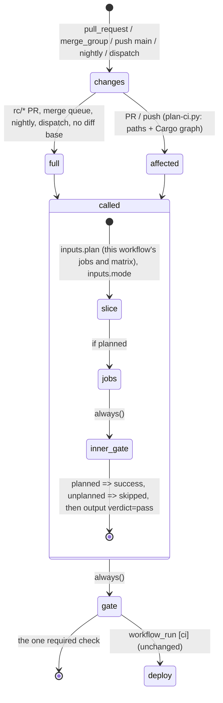

# ci-workflows: plan

Facts below are from `main` at `16eaa55` (2026-11-16); recount them when a phase starts. A phase's stages (one per job)
are planned in detail when the phase starts, and a stage's steps when the stage starts.

## Decisions (owner, 2026-11-16)

| Question | Decision |
|---|---|
| Where the one required `gate` lives | A **thin `ci.yml` orchestrator** keeps the name `ci`, the planner `changes` and `gate`, and calls each concern's workflow through `workflow_call`. Each concern file also has `workflow_dispatch` (and `schedule` where it has one), so it can run alone. The ruleset, the deploy trigger and the gate's name do not change |
| Planner | **`plan-ci.py`** through the migration and the phases. Moving to the `triggerd` action is its own stage of the Actions track, after the Medium group: add a matrix output, run it in shadow beside `plan-ci.py`, compare the outputs, then cut over |
| Migration | Right after Phase 0, a **refactor only**: no eight passes, no behaviour change. It covers `ci.yml`'s jobs and `e2e-schedule.yml` → `e2e.yml`, with the job ids unchanged, the simplest callee first, and lowercase workflow names (owner, 2026-11-17, after #251). `flake-hunt.yml` is **not** folded into `test.yml` here: it stays as it is and becomes a stage of the Test phase (folding it breaks R8 and edges R9). `release-plz.yml` waits for the Release phase: folding it needs routing by event and a real release to prove it |
| Passes | After the migration, **every job goes through all eight passes**, the migrated ones and the new ones alike |
| Order | The priority groups below. Within a phase, jobs that exist come before new ones |
| Actions | Created when two or more jobs repeat the same steps, or steps similar enough that one action (often a **composite** action) can serve the group. **The exact same steps in two or more places: create the action and say so in the pull request. Anything less than exact: ask the owner first**, showing the candidate steps side by side and the proposed inputs |
| The final job of a called workflow | Named **`verdict`**, so the only job called `gate` in a check list is the required one |
| The mutant driver | Committed in stage 0.3 and run as a step of **`ci-scripts`**, so it runs whenever that job does and a surviving mutant fails the gate |
| `actionlint` | **Added** as a pinned check (stage 0.4), to validate the `with:` contracts the split creates; how it is installed is chosen there, by survey |

**Priority groups.** High: Build, Test, Release. Medium: PR, Lint, E2E, Deploy. Low: Docs, Perf, Bench, Security,
Chores, Prof (confirmed by the owner, 2026-11-16). Backlog: Web, UI/UX, Issue. Within a group, the order is mine: Test before Build (Test holds most of the gate, so it carries the most risk,
and Build's cross-target actions serve Release), and the groups' existing jobs (`deny`, `docs`) before their new ones.

**Related plan.** [test-suites](../test-suites/PLAN.md) (#234) plans the contract suite on nextest, a load suite and
profiling as scripts and crates, and leaves their workflows to phases 2, 12, 13 and 14 here. Its pull requests edit commands
inside jobs that Phase 1 moves (`contract.sh`'s passes, the `pg-adapter` job's `cargo test` lines): whichever lands second
takes the other's change by merging `main`.

## What the split must keep working

- The ruleset on `main` requires exactly one check, `gate`, and ADR-0100 asks for one aggregate required context.
- `deploy.yml` starts from `workflow_run: workflows: [ci]`, and `assert-sha-checks.sh` asks for `gate` by name on the
  commit.
- `plan-ci.py`'s job list must equal `assert-gate.sh`'s list of known jobs. `test_plan_ci.py` and the planner and gate
  mutants enforce it.
- `lint-all-workflows.sh` gives secrets, environments and `id-token` only to the jobs it names per file, and bans
  `pull_request_target`.
- `verify-bundle.sh` identifies a signer by workflow **file path** (`release.yml`, `deploy.yml`), so both filenames stay.
- GitHub allows 10 nesting levels and 50 unique called workflows per top-level file (changelog of November 2025), and a
  called workflow must sit directly in `.github/workflows/`. A contract cell is then three levels deep (`ci` → `test` →
  `contract-cell`).
- A calling job's `needs.<id>.result` is `success` when at least one job inside it succeeded, even if a planned sibling
  was **skipped**, and the top `gate` cannot see that skip; only when nothing inside ran is the result `skipped`
  ([research 0018](research/0018-gate-spike.md), F5). Stage 0.2 chose design A+: every callee ends with a `verdict` job that
  judges its own jobs, and `gate` requires the callee's result to be `success` **and** its `verdict` output to be `pass`.
- In a called workflow `github.event_name` is the **caller's** event. When `ci`'s nightly run calls `test.yml`, `test.yml`
  sees `schedule`, so a callee routes by an explicit input and never by the event name.
- A callee must not set a workflow-level `concurrency` group: `github.workflow` resolves to the caller's name, so a group
  written the usual way equals the caller's, GitHub reports a deadlock, and the run starts no job (F3).
- A callee must not ask for a permission its calling job does not grant: the run does not start (`startup_failure`), so no
  `gate` would report (F8).
- An `if` that cannot be evaluated skips its job without failing it (F9), so a planned job is judged by a result that must
  be exactly `success`.

## Target architecture

The diagram is design A+, which stage 0.2 chose ([research 0018](research/0018-gate-spike.md)): `inner_gate` is the callee's
`verdict` job, and `gate` reads both the calling job's result and the `verdict` output.

- **Called by `ci.yml` (inside the gate):** `test`, `lint`, `documentation`, `security`, `web`, and later `build`.
- **Own triggers (outside the gate):** `e2e` (schedule and dispatch), `release`, `release-plz` (until the Release
  phase), `deploy`, `flagship` (#229: the edge's Flagship flags, with its own environment and secrets; the Deploy phase), and later `maintenance`, `benchmarking`, `profiling`, `performance`, `pr` and `issues`.
- **Files after the migration:** `ci.yml` (`ci`), `contract-cell.yml` (called), `test.yml` (Test), `lint.yml` (Lint),
  `documentation.yml` (Docs; the owner's tree spells it `documentaion.yml`, taken as a typo), `security.yml` (Security),
  `web.yml` (Web), `e2e.yml` (E2E), and `deploy.yml`, `flagship.yml`, `release.yml`, `release-plz.yml` unchanged. The phases add
  `build.yml`, `pr.yml`, `maintenance.yml` (Chores), `benchmarking.yml`, `profiling.yml`, `performance.yml`, `uiux.yml`
  and `issues.yml`.

## Phase 0: Foundation

| Stage | What it does |
|---|---|
| 0.1 | **ADR-0102** (done: [adrs/ci/0102](../contrail/adrs/ci/0102-one-workflow-per-concern-and-the-verdict-job.md)): one orchestrator, called workflows, the `verdict` job (design A+, chosen by the spike). Conventions: a callee routes by input, has no workflow-level `concurrency`, gets only the permissions its caller grants, and follows the repo's job-id, `name:` and comment style |
| 0.2 | **Gate spike** on a draft pull request (closed unmerged), because `workflow_dispatch` needs the file on `main`. It compares a verdict per callee with a callee that reports and one gate that judges (and `re-actors/alls-green`), on seven must-fail scenarios and eight measured facts. **Done:** design A+, [research/0018](research/0018-gate-spike.md) |
| 0.3 | **Planner and gate** (done: [phase 0001](phases/0001-foundation.md), this pull request): `plan-ci.py` gets a `WORKFLOWS` map and the outputs `top`, `workflows` and `plans`, its rules run everything for every workflow file that runs checks, and `assert-gate.sh` takes its job list as an input; `gate` requires each expected callee's result to be `success` and its `verdict` output to be `pass`. A behaviour-preserving change; the mutant driver is committed and runs in `ci-scripts`. Unblocked: #221 (the crates move) merged |
| 0.4 | **Lint conventions and indexes** (done: [phase 0001](phases/0001-foundation.md), this pull request): new rules R8 (no workflow-level `concurrency` in a callee) and R9 (a callee does not read `github.event_name`). `lint-all-workflows.sh` needs no change for credentials: it gives a workflow it does not name the strictest policy. `actionlint` is added as a pinned check. The two READMEs index the files and link `cicd.md` instead of restating it |
| 0.5 | **Baseline**: wall-clock and runner-minutes (the sum of job durations) per job from recent `ci` runs; GitHub reports 0 billable minutes on this public repository. It is measured again after the migration, and passes 5 to 7 are measured against it |

The order is 0.5, 0.2, 0.1, 0.3, 0.4; the stages are planned in [phases/0001-foundation.md](phases/0001-foundation.md).
Phase 0 is done when ADR-0102 is merged, the spike's controls have been shown, and the planner, gate and lint changes are
merged.

## Phase 1: Migration (refactor only, one pull request per target file)

**Rules.** The same commands, the same job boundaries, the same gate result, **and the same job ids** (owner, 2026-11-17: a job
is renamed in the phase that owns its workflow, not in the migration). Each pull request carries a **parity table**: every old
step, then the new workflow, job and step, then the command, identical; a script checks it. The order is the simplest callee
first (owner, 2026-11-17); [phases/0002-migration.md](phases/0002-migration.md) says why, and plans each stage.

| Stage | Target | Moves |
|---|---|---|
| M1 | `documentation.yml` (`name: documentation`) | `docs` |
| M2 | `security.yml` | `deny` |
| M3 | `web.yml` | `web` |
| M4 | `lint.yml` | `lint`, `deps` |
| M5a | `test.yml` | `ci-scripts`, `hermetic`, `pg-adapter`, `mutants`: plain moves; `contract` and the cell-marker rule stay in `ci.yml` and `gate` (owner, 2026-11-17: M5 is split in two) |
| M5b | `test.yml` | `contract` (calls `contract-cell.yml`) and the judging of its cells: the `verdict` action gains `cell-job` and `cells` (owner, 2026-11-17). **Not** `flake-hunt.yml`: it stays as it is and becomes a stage of the Test phase (owner, 2026-11-17) |
| M6 | `e2e.yml` | `e2e-schedule.yml` renamed (schedule and dispatch, calls `contract-cell.yml` for `worker-cf e2e`). The contract matrix's own `e2e` pass stays in Test until the E2E phase |

The `verdict` job's steps become a composite action in **M2**, where they stand in two files, and the pull request says so. The
`verdict` job of `test.yml` also downloads the cell markers, so it is not an exact copy and is asked about in M5. A
near-duplicate found while moving is asked about, not built. The workflows' `name:` is lowercase, the repository's convention
(owner, 2026-11-17).

**The migration is done when:**
- `ci.yml` holds only `changes`, the calls and `gate`;
- the invariants below hold;
- a full dispatch run and an affected-only pull-request run are both green, running the same set of commands as the
  baseline;
- an `rc/*` pull request still plans a staging dispatch;
- the nightly run and the E2E schedule (by dispatch) are green, and `flake-hunt.yml` is unchanged;
- the file table in `cicd.md` is true.

## Phases 2 to 14: every workflow through the eight passes

| Group | Phase: file (`name:`) | Stages (jobs; existing first) | To resolve in the phase |
|---|---|---|---|
| High | **2 Test**: `test.yml` ([phase 0003](phases/0003-test.md); `mdbook` deferred to Phase 9 by the owner, 2026-11-18) | bash · hermetic → crates + doctest · pg-adapter · contract · mutants · flake-hunt · workers | The owner's sample runs `-E 'package(p) and test(smoke\|mutant\|regression)'`: the `smoke` and `mutant` categories do not exist ([AGENTS.md](../../../AGENTS.md) rule 4 lists the prefixes). A crate with no hermetic tests exits 4. Consider `cargo nextest archive` (build once, fan out). The sample's job has `with:` and `steps:` together, which GitHub does not accept: a matrix job either calls a workflow or runs steps. **From #279 (the preview control plane, merged after M5a):** `preview-control-tests.yml` runs on every pull request outside `gate`, repeats five `ci-scripts` commands and the provisioner's step of `pg-adapter` (and its tests, which `hermetic` runs), and is the only place the provisioner's `wasm32` build is checked, so `gate` waits for no such check; fold what is new of it into `test.yml` (or `lint`'s `wasm32` clippy) and drop the rest. `plan-ci.py` plans `infra/preview/`, `infra/cloudflare/` and `thrust-preview-provisioner` in a branch before `RULES`, not as rules, so `test_plan_ci.py`'s one-sample-per-rule check and the rule-effect mutants do not reach them |
| High | **3 Build**: `build.yml` ([phase 0004](phases/0004-build.md)) | docker · windows · linux · macos · bsd · wasm | CI builds no image today; the only Dockerfiles are the stock web app's (`web/apps/web/Dockerfile.*`), which no job builds. BSD needs a VM or a cross toolchain. wasm overlaps the contract cells' Worker build |
| High | **4 Release**: `release.yml` | the existing plan, build and publish · **fold in `release-plz.yml`** (version, changelog) · sbom · attest · slsa · build and test (release, static, cross) · msrv · sign · package · latest | Routing by event. The lint allowlist names the release jobs. Immutable releases. A full proof needs a real release, which the owner triggers |
| Med | **5 Lint**: `lint.yml` ([phase 0005](phases/0005-lint.md); the first stage, `bash`, was taken out of order because nothing in it waits for Build) | rust · deps (its 12 guard steps placed where they belong) · bash · docker · dotenv · yaml · json · codeowners · editorconfig · git | The boundary with Security's bash and docker |
| Med | **6 E2E**: `e2e.yml` | schedule · the `e2e` pass carved out of Test · one `flow-<journey>` job per spec in `e2e/journeys/` | |
| Med | **7 Deploy**: `deploy.yml` | cloudflare (today's jobs) · neon · tofu | `workflow_run: [ci]`, the reviewers, `assert-gated-environments.sh`. A staging drill from `rc/*` is needed. Infrastructure for neon and tofu lives in another repository |
| Med | **8 PR**: `pr.yml` | stats · fmt · lint (title) · reports · issues · labels · assign · notify · body | A fork's pull request gets a read-only token and `pull_request_target` is banned, so the jobs that write need a design (a two-stage `workflow_run`, or same-repository pull requests only). The Conventional Commits title feeds release-plz |
| Low | **9 Docs**: `documentation.yml` | mdbook (including `mdbook test`, deferred from Phase 2: the book has no Rust samples yet) · markdown · spelling · rustdoc · inclusiveness-analyzer · seo · readability · links · slop · i18n · a11y · generate | |
| Low | **10 Security**: `security.yml` | supply-chain · secrets · sast · dast · rust · bash · docker · api · web | DAST needs a running target |
| Low | **11 Chores**: `maintenance.yml` | licenses · ossf | GitHub disables a schedule in a public repository after 60 days without activity |
| Low | **12 Bench**: `benchmarking.yml` | micro · macro | Noise on hosted runners |
| Low | **13 Prof**: `profiling.yml` | cpu · memory · network · storage | |
| Low | **14 Perf**: `performance.yml` | load · soak · spike · disaster-recovery · chaos | Needs a target; never gates a pull request |
| Backlog | Web (`web.yml`), UI/UX (`uiux.yml`), Issue (`issues.yml`) | planned when promoted | `web` already has its file after M5 |
| Track | **Actions** | the `triggerd` cut-over (after phase 8) · candidates named in the owner's tree (xbom, attest, provenance, mdbook, actions, licensing, harden-runner), each **proposed and asked about** in its phase unless it is an exact duplicate | A composite action where the steps are YAML; TypeScript on Node 24 like `triggerd` (`dist/` checked in, `check:dist`, tests run in CI) where there is logic |

## Process

A phase starts with a phase document, `phases/NNNN-<workflow>.md`. A stage starts with its section in that document.

**A phase document holds:**
- the workflow's purpose and use cases;
- its triggers and a state machine;
- its interface: inputs (`mode`, `plan`, dispatch inputs), outputs, permissions, secrets;
- acceptance criteria for the workflow;
- the jobs, one stage each, with their status;
- **action candidates**: the exact duplicates listed, the near-duplicates as questions for the owner;
- open questions.

**A stage section holds:**
- the job's purpose and use cases;
- acceptance criteria;
- the job's state machine;
- its steps, broadly;
- a **survey of public solutions** (candidate, pinned version, fit, chosen or rejected and why), done before any step is
  written (a public solution is preferred to custom code);
- for custom code: shell or Python first, refactored to a TypeScript action (JavaScript only where TypeScript is not
  possible) once it is proven, each hand-written piece named with the probe that showed no built-in covers it;
- a pass log: the pass, the pull request, the date, the evidence.

**The passes.** For a job that already exists, a pass whose evidence already holds is recorded with that evidence, not
skipped.

| Pass | Exit evidence | Lands as |
|---|---|---|
| 1 Proof of concept | Runs by dispatch on one real input, with a **must-fail control** (AGENTS.md rule 8) | branch |
| 2 Working prototype | Runs on its real triggers and inputs. A new job is **advisory**: outside the gate's expected set. Its failure modes are listed | branch or draft pull request |
| 3 Documented | Header comment (why, not what), a row in the READMEs, an entry in `cicd.md` or `running.md`, permissions stated | the stage's pull request |
| 4 MVP | A pull-request-time job is **in the gate** (planner, known-jobs list, `needs`) and in the lint registry, with helper tests and controls. Green on a full run and an affected-only run | the same pull request, promoted in its last commit |
| 5 Caching | Baseline, change, measured again. A cache-key control (change an input, see a miss). "No benefit" is a valid result if measured | per job, or per workflow |
| 6 Parallelization | The critical path measured before and after (split, matrix, shard, `needs` graph) | pull request |
| 7 CPU time | Runner-minutes (the sum of job durations; GitHub reports 0 billable minutes on this public repository) measured before and after: affected-only rules, prebuilt tools, no duplicate build, runner size | pull request |
| 8 Production documentation | Final docs, a runbook for each failure, the stage marked done | per workflow |

The preview control-plane CI gap noted above is addressed by the required gate: `lint` checks the provisioner's wasm32 build, while `ci-scripts`, `hermetic` and `pg-adapter` run its existing tests. The redundant standalone workflow is removed and the infrastructure path selection is a tested planner rule. The provisioner crate's special `pg-adapter` selection remains a branch in the planner.

## Invariants (checked in every pull request of the migration and the phases)

1. `gate` stays the only required context, shown by `assert-required-contexts.sh`.
2. No coverage is lost: the parity table covers every moved step.
3. A planned job that is skipped or fails turns `gate` red at every nesting level, shown by a control.
4. An `rc/*` pull request still plans a staging dispatch.
5. `lint-all-workflows.sh` passes, every job has least privilege, and nothing uses `pull_request_target`.
6. The planner's jobs equal the gate's known jobs; `test_plan_ci.py`, `test-ci-scripts.sh` and the hand mutants of the
   planner and the gate pass. The mutant driver was a session scratchpad file and is not in the repository, so this is
   checkable by anyone only from stage 0.3, which commits it and runs it in `ci-scripts`.
7. Every script of the `deps` job (wherever its guards end up) is run locally before each push.

## Status (2026-11-17)

| Item | State |
|---|---|
| This plan | merged (#223) |
| Phase 0, the foundation | **done.** Planned in [phases/0001-foundation.md](phases/0001-foundation.md) (#225); its owner questions are answered and recorded in the decisions table above. Stage 0.5, the baseline: [research/0017](research/0017-ci-baseline.md) (#230). Stage 0.2, the gate spike (draft #232, closed): [research/0018](research/0018-gate-spike.md) (#236). Stage 0.1: [ADR-0102](../contrail/adrs/ci/0102-one-workflow-per-concern-and-the-verdict-job.md) (#239). Stage 0.3, the planner, the gate and the mutant driver (#245). Stage 0.4, the lint rules, `actionlint` and the two indexes (#249) |
| Phase 1, the migration | planned in [phases/0002-migration.md](phases/0002-migration.md) (#251); its four questions are answered (all as recommended) and recorded above. **M1, `documentation.yml`, is done** (#254, merged 2026-11-17; probes #255 and #256, closed unmerged). **M2, `security.yml` and the `verdict` action, is done** (#258, merged 2026-11-17; probes #259 and #260, closed unmerged). **M3, `web.yml`, is done** (#264, merged 2026-11-17; probes #265 and #266, closed unmerged). **M4, `lint.yml`, is done** (#269, merged 2026-11-17; probes #270 and #271, closed unmerged). **M5a, `test.yml` without `contract`, is done** (#275, merged 2026-11-17; probes #276 and #277, closed unmerged). **M5b, `contract` and the judging of its cells, is done** (#281, merged 2026-11-17; probes #282 and #283, closed unmerged). **M6, `e2e.yml`, is done** (#289, merged 2026-11-18; probes #291 and #292, closed unmerged). **The migration's acceptance is done**: every criterion above is shown by a run or a file, and recorded in [phases/0002-migration.md](phases/0002-migration.md); the cost after the migration is [research/0019](research/0019-ci-baseline-after-migration.md) |
| Phase 2, Test | planned in [phases/0003-test.md](phases/0003-test.md); its four questions are answered (all as recommended) and recorded in it: `mdbook` deferred to Phase 9, `workers` the last stage, `ci-scripts` keeps its id, `flake-hunt` stays its own workflow. **All eight stages are done and recorded** in the phase document (stage 4, the doctest, is a decision and not a job; stage 8, `workers`, is #345, merged 2026-11-22: G-6, the Worker's wasm32 unit tests, on Node and not on workerd). **Pass 8 is recorded** in the phase document's acceptance section and in [research 0020](research/0020-ci-baseline-after-the-test-phase.md): a full run's median wall clock went from 1024 s to 585 s, and **all seven criteria hold**: the seventh (what is left of G-5: stage 2, `blast`, `bench` and `scale`, the probes) is closed by the owner's decision of 2026-11-22 to leave it by hand. **Phase 2 is done** |
| Phase 3, Build | planned in [phases/0004-build.md](phases/0004-build.md) (2026-11-22): what builds today (one thing ships, the deploy bundle, and its 297 s are measured step by step: 106 s of them compile `worker-build`, on a cache that has never existed), why the bundle's build stays in `deploy.yml` and `release.yml` (their file paths are the signers `verify-bundle.sh` requires), the six stages in a proposed order, and four questions for the owner, **answered 2026-11-23, all as recommended** (all six stages as compile proofs that publish nothing; one target per stage; a Dockerfile at stage 5; the bundle stays). **Stage 1, `linux`, the template, is done and recorded** (#352, merged 2026-11-23: `build.yml`, the sixth called workflow; 134 s cold, 101 to 102 s with the cache; a break only the release profile sees turns it and `gate` red and nothing else, shown live); **stage 2, `wasm`, passes 1 to 4 are in #356** (the bundle's two Workers in release at pull-request time, under the bundle's cache key: 238 s cold, 47% of it compiling `worker-build`; the warm time and whether the bundle restores the cache follow the merge) |
| Phase 5, Lint | planned in [phases/0005-lint.md](phases/0005-lint.md) (2026-11-23), taken up before Build is done because its first stage waits for nothing in it. **Stage 1, `bash`, is in #360** (shellcheck 0.11.0 over the 114 maintained scripts and the 23 `run:` blocks of the six composite actions, with a control, in the gate; the owner's three answers on scope, severity and the actions, all as recommended). The other stages are planned when they start |
| Phases 4 and 6 to 14 | not started |
| Open for the owner | nothing to decide for the plan. Two things the acceptance turned up, neither built: an offer of a guard that holds `cicd.md`'s file table to the tree (it had drifted by six files, five after #298), and an observation outside the plan: the staging deploy of the release candidate is queued behind an older run's approval at `staging-do-lifecycle` (`43816740997`, waiting since 2026-11-16) |
