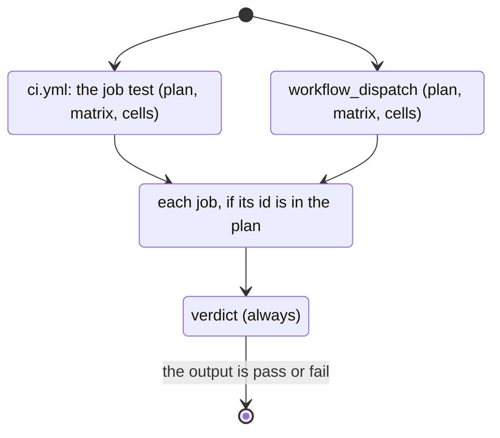
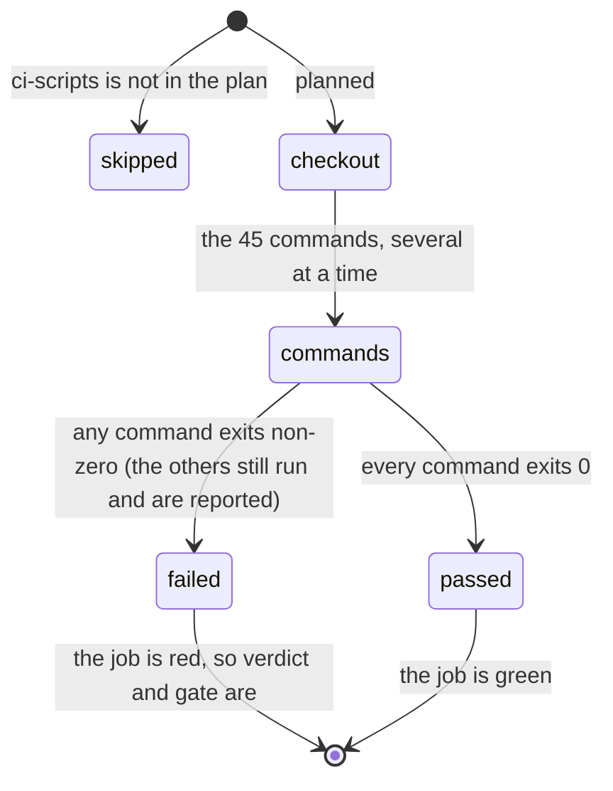

# Phase 0003: Test

Part of [ci-workflows](../PLAN.md). Planned 2026-11-18, the day [Phase 1](0002-migration.md) was accepted. Facts are from `main` at `b0bcdbd`, read on that day: recount them
when a stage starts. This is **Phase 2 of the plan** (the numbering of phase documents is repository-wide, so it is `0003`): the first workflow that goes through the eight
passes, on the layout the migration left. Its workflow is `test.yml` (`name: test`) and, as a stage, `flake-hunt.yml`.

The plan's decisions, the passes and the invariants are in [PLAN.md](../PLAN.md); how a called workflow is judged is [ADR-0102](../../contrail/adrs/ci/0102-one-workflow-per-concern-and-the-verdict-job.md).
The cost of what exists is [research 0019](../research/0019-ci-baseline-after-migration.md). This document does not restate them.

## Purpose and use cases

`test.yml` runs the repository's tests. Its jobs are called by `ci.yml` (its job `test`), so the workflow serves four uses:

| Use | What runs | Who decides |
|---|---|---|
| A pull request or a push to `main` | the jobs and cells the change needs | `plan-ci.py`, over the changed paths and the crate graph |
| A full run (an `rc/*` pull request, a merge-queue entry, the nightly, a dispatch of `ci`) | every job and every cell | `ci.yml`'s `changes` job |
| A run of `test.yml` by hand | the plan it is given (by default the four jobs that need no cells) | the person who dispatches it |
| Characterising a flaky cell | one cell, 1 to 50 times, weekly or by hand | `flake-hunt.yml`, which is not a callee |

The workflow exists to answer one question for each change, cheaply: *what does this change break?* The testing strategy ([docs/src/testing/strategy.md](../../../../docs/src/testing/strategy.md))
says which layer catches which defect; this workflow is where those layers run.

## What exists today (read 2026-11-18)

| Job | What it runs | When the planner plans it | Median (research 0019, 11 full runs) |
|---|---|---|---|
| `ci-scripts` | 45 commands (this document said 44 when it was planned; recounted for stage 1): the tests of the CI's own scripts (the planner, the gate, the lint, the guards, the deploy, preview and edge helpers), the wiring test and the mutant driver | **any crate change**, and any change under `.github/`, `scripts/` and the preview and edge infrastructure | 305 s (timeout 10 min) |
| `hermetic` | nextest under the `ci` profile over the **whole workspace**, the contract counts, the doctests, the OpenAPI tests (`thrust-api-v1 --features openapi`), and the JUnit upload | **any crate change** | 176 s |
| `pg-adapter` | the Postgres and SMTP adapter tests on testcontainers, and the preview provisioner's Postgres test | `thrust-adapters-selfhosted` (or the provisioner) is affected, or infrastructure | 133 s |
| `contract` | one job per cell of the contract matrix, each a call of `contract-cell.yml` on its own runner (26 cells) | per cell: the cell's target binary is affected, or its pass's inputs changed | 3568 s in all; the longest cell is `worker-cf e2e`, 624 s |
| `mutants` | `scripts/mutants.sh`: planted mutants of the server, each of which the contract suite must fail on | `thrust-server` is affected, or the suite changed | 744 s (p90 1019 s); the longest job that is not a cell |
| `verdict` | judges the five jobs and the cells' markers against the plan (ADR-0102) | always | 10 s |
| `flake-hunt.yml` (not a callee) | one cell repeated 1 to 50 times (5 by default), Monday 03:17 UTC and by hand; `hunt` job, 120 min timeout | never: nothing in `ci` waits for it | not measured |

Facts that shape the phase, each read from the file named:
- **`hermetic` is not affected-only.** `plan-ci.py` plans `ci-scripts`, `deps`, `lint` and `hermetic` for *any* crate change, and `hermetic` runs the whole workspace. The crate graph is
  computed (`affected()`), but only `pg-adapter`, `mutants` and the cells use it.
- **Four nextest profiles run in no job**: `deep` (more generated cases, `PROPTEST_CASES=4096`), `oracle` (the TypeScript differential; needs Node), `load` and `prof` (Phases 12 and 13).
  Gap G-5 (`status.md`) records that CI does not run the `oracle_` tests, stage 2, the `blast` and `bench` passes or the probes; `deep` is not in it. A regression only `deep` or `oracle` finds is found by hand.
- **G-6: there are no wasm32 unit tests.** The Worker is tested only over HTTP, by the `worker-memory` and `worker-cf` cells. Since #298 the provisioner's wasm32 build is *checked* (`lint`), not tested.
- **G-3: `cargo-mutants` runs in no job.** `mutants` is the contract suite's planted mutants, not Rust mutation testing; the crates other than `thrust-core` have no tests of their own to mutate.
- **The book has no Rust code samples** (no ` ```rust ` fence in `docs/src`), so `mdbook test` would pass with nothing to test.
- **The categories of AGENTS.md rule 4** are `prop_`, `model_`, `parity_`, `oracle_`, `fuzz_replay_`, `regression_`, `load_` and `prof_`. The `smoke` and `mutant` of the owner's sample are not among them.
- **No step is an exact duplicate of another** in `test.yml`, `contract-cell.yml`, `flake-hunt.yml` and `e2e.yml` except `actions/checkout` (seven places, one pinned line each), which is not worth an action.
  The near-duplicates are in *Action candidates*.

## Interface

| | |
|---|---|
| Inputs, called | `plan` (JSON array of the workflow's planned jobs), `matrix` (the contract matrix), `cells` (the `<target> <pass>` list), all required strings |
| Inputs, by hand | the same three, with defaults: the four jobs that need no cells, an empty matrix, no cells |
| Output | `verdict`: `pass` only when every planned job succeeded and every other was skipped; `ci.yml`'s `gate` requires it |
| Permissions | `{}` at the top; `contents: read` on each job; no secrets, no environments, no `id-token` |
| Routing | by input, never by event name (a callee sees the caller's event, R9); no workflow-level `concurrency` (R8) |
| `flake-hunt.yml` | its own triggers and inputs (`target`, `pass`, `iterations`), `concurrency: flake-hunt`, `contents: read`; it is not read by `gate` |



## Acceptance criteria for the workflow

The phase is done when:
1. **Every stage has its section and its pass log**, and each of the eight passes for each job has either a pull request and its evidence or a recorded reason.
2. **The invariants of the plan hold in every pull request**, each with the control that shows it can fail.
3. **Nothing the jobs ran is lost.** Each stage's pull request carries the parity of `ci-commands.py` and, where a job is split or a command moves, a must-fail control.
4. **Passes 5 to 7 are measured, not asserted.** Runner-seconds and the critical path of the Test workflow are measured against research 0019 with `ci-baseline.py` (same window rule), before and after, and a pass that did not help says so.
5. **The two gaps that are CI's** (G-5, what runs only by hand; G-6, no wasm32 unit tests) are each closed by a stage or recorded as a decision not to, by the owner.
6. **The documents are true**: `running.md`'s rows, `cicd.md`'s table, the READMEs; checked by the same searches as the migration's acceptance (`cicd-table-vs-tree.py`).
7. **`flake-hunt.yml` has been through the passes** as a stage of this phase.

## The stages

Existing jobs first, then new ones (the plan's rule). The order inside the existing jobs is mine, and the owner may change it: **cheapest and most settled first, so the first stage is the template the others follow, and the biggest costs once the template works.** **The owner changed it once, on 2026-11-19: `mutants` moved ahead of `crates`**, because measuring `hermetic` showed it is never what a crate pull request waits for.

| # | Stage | Job (id kept) | What the passes have to settle | Status |
|---|---|---|---|---|
| 1 | bash | `ci-scripts` | 45 commands run one after another. Where the time goes is now measured (stage section below). It is planned on any crate change: whether every crate change needs it is a pass 7 question, to be answered from what its tests read | **passes 1 to 7 done** (#311, #318); the runbook is written, and the final documentation pass waits for the phase: [the section below](#stage-1-in-detail-ci-scripts) |
| 2 | mutants | `mutants` | **Moved up from stage 5 by the owner (2026-11-19)**, after the measurements: it is the longest job that is not a cell (903 s median over five runs, 744 s over the 11 full runs of research 0019), and the last job to finish in two of the four crate-change pull-request runs I read, and it is planned in about 70% of pull requests. 54 rows, each of which rebuilds `thrust-server` with a mutant's cargo feature into the shared `target/` and runs one contract pass: a flat 13 to 15 s each, so the work divides evenly, but rows cannot share a checkout. G-2, G-3 | **in progress**: [planned below](#stage-2-in-detail-mutants) |
| 3 | crates | `hermetic` (the nextest part, the contract counts and the OpenAPI tests) | The whole workspace on any crate change. Affected-only with nextest's own `rdeps()` filter, or `cargo nextest archive` and `--partition` to build once and fan out; the profiles `deep` and `oracle` (G-5) | not started. **Measured 2026-11-19**: hermetic is 173 s (setup 29, compile 58, running 4,770 tests 38, contract counts 15, OpenAPI tests 12) and was never the last job in the four crate-change runs I read, so this stage saves runner-seconds, not a pull request's wall clock |
| 4 | doctest | `hermetic` (the doctest step) | **Decided by measurement: it stays a step.** `cargo test --doc` takes 2 s (median of 11 full runs, min 1, max 2): a job of its own would pay about 35 s of checkout and setup to save nothing. Nextest cannot run doctests, which is why it is a separate command | **closed** (not a job) |
| 5 | pg-adapter | `pg-adapter` | Docker and Mailpit on the runner; the provisioner's Postgres test; caching of the build | not started |
| 6 | contract | `contract` | 26 cells, about 65% of a full run's runner-seconds (3568 of 5483 s at the medians). One build per runner (native or wasm): what the `rust-cache` keys share. The `e2e` and `e2e-mail` passes move to Phase 6 (E2E). | not started |
| 7 | flake-hunt | `flake-hunt.yml` | Its placement (a question); a `hunt` job of up to 120 minutes; never gated | not started |
| 8 | workers | new | G-6: wasm32 unit tests of the Worker. A survey of public solutions comes first; the job is new, so it is advisory until pass 4 | not started |
| — | mdbook | — | **Not in this phase** (owner, 2026-11-18): the book has no Rust samples, so `mdbook test` would have nothing to test. Revisited in Phase 9 (Docs), when it has | deferred |

Each stage's section (purpose, acceptance, state machine, steps, a survey of public solutions, custom code and its probe, the pass log) is written **when the stage starts**, not before.

### Stage 1 in detail: `ci-scripts`

**Purpose and use cases.** The logic behind the required check is itself tested here: the planner, the gate, the `verdict` action, the lint, the guards of `deps`, the deploy, release, preview, edge and Flagship helpers,
the wiring test and the mutant driver: 45 commands. A failing command fails the job and `gate` through `needs`. It runs in every full run, and in **every affected-only run measured since M5b (7 of 7, research 0019)**, because the planner plans it
for any crate change and for any change under `.github/`, `scripts/` and the preview and edge infrastructure.

**What it costs, and where** (measured 2026-11-18: `test.yml` dispatched twice on a throwaway branch with the plan `["ci-scripts"]` and the step run under `set -x` with a timestamp in the prompt, so that bash prints the time before each
command; the two runs are the same commands on two runners):

| Command | Median (s) | Both runs (s) | Share |
|---|---|---|---|
| `test_preview_result.py` | 77.8 | 93.6, 61.9 | 23% |
| `mutate_gate.py` (the mutant driver, 229 mutants) | 50.7 | 63.9, 37.6 | 15% |
| `test-plan-deploy.sh` | 44.7 | 54.9, 34.5 | 13% |
| `test_preview_config.py` | 28.2 | 33.3, 23.2 | 8% |
| `test-ports.sh` | 20.3 | 25.0, 15.6 | 6% |
| `test_flagship.py` | 18.9 | 22.1, 15.7 | 6% |
| `test-deploy-worker.sh` | 16.9 | 20.4, 13.4 | 5% |
| `test-deploy-target.sh` | 13.1 | 15.7, 10.5 | 4% |
| the other 37 commands | 64.3 | | 19% |
| **all 45** | **334.9** | **403.8, 265.9** | |

What it shows:
- **Four commands are 60% of the step and the eight longest 81%.** None is a build or a download; they are test logic and process spawns (`test_preview_result.py` starts one Python process per generated case).
- **For a typical pull request this job is the critical path.** In the two affected-only runs I read (`44187850687`, `44246581933`) `ci-scripts` was the last job to finish: 315 s of a 350 s run and 271 s of a 308 s run, about 90% of the wall clock.
  Research 0019's medians say the same (affected-only wall clock 314 s, `ci-scripts` 258 s).
- **The runners differ by about 1.5×** across nearly every command (403.8 s against 265.9 s), so a single run proves little about a change of 10%.
- **Failure modes of the job as it is** (pass 2): it stops at the first failing command, so a pull request that breaks three tests is told about one at a time; its timeout is 10 minutes and the slower of the two runs was 404 s of command time (411 s
  of job), so another 1.5× would time it out with no change of ours; and one `bash -e` step gives GitHub no per-command timing (the table above needed the trace).
- **Independence is a scan, not yet a proof.** The tests use no fixed temporary path and open no fixed port (the port numbers in them are strings in test inputs); they read `crates/` and the manifests read-only; five use `git` and one `cargo metadata`.
  Pass 6 proves it by running them together.

**Acceptance criteria for the stage.**
1. **The same 45 commands with the same results.** `ci-commands.py` parity, and, if the list moves into a script, a check that the script runs each of the 45 lines, with a control that reports one removed.
2. **A failing command still turns the job and `gate` red, and the log says which command failed.** Control: a dispatch in which one test is made to fail.
3. **Passes 6 and 7 are measured with one instrument, by dispatch, before and after**: the job's wall clock and its runner-seconds, three runs or more each, then the next affected-only pull requests. The runner spread (1.5×) is reported with the numbers.
4. **No interference and a safe margin**: the commands pass alone and together in ten consecutive dispatches, and the timeout leaves at least 1.5× of the slowest run seen.
5. **The documents are true** (`running.md`'s row, the READMEs, `cicd.md`).

**State machine** (the failure branch is the proposal; today the first failure stops the step):



**Steps, broadly.** Today: a checkout, then one step (`RUSTUP_TOOLCHAIN: stable`) that runs the 45 commands in order under `bash -e`. Proposed: the same checkout and the same commands, held in one list, run several at a time by a public tool that
reports a result and a time for each; the job fails if any command fails.

**Survey of public solutions** (to be settled in pass 1 on the runner, not from memory):

| Candidate | Fit | Verdict |
|---|---|---|
| GNU parallel (`-j`, `--joblog`, `--halt never`, `--group`) | runs a list of commands k at a time, keeps each command's output together, writes a table of exit code and time per command, and can run them all and fail at the end | **first choice, if the runner image has it** (checked in pass 1: `parallel --version` on `ubuntu-24.04`) |
| `xargs -P` | always present; no per-command time, output interleaved | the fallback; weaker |
| A matrix of shards (`strategy.matrix`) over runners | keeps the job id, so the planner, the gate and the verdict do not change (they read `needs.ci-scripts.result`); costs a checkout and a runner per shard, so more runner-seconds | only if one runner's cores cap the gain |
| bats-core, pytest-xdist | would mean rewriting 45 hand-written tests | rejected: no gain, and rule 3 forbids weakening tests |

**Custom code.** None yet. A per-command table in the job summary would come from `--joblog`; if it needs a script, it is named here with the probe that shows nothing built-in gives it.

**The passes**

| Pass | Status | Evidence, or what it will do |
|---|---|---|
| 1 Proof of concept | **holds** | `workflow_dispatch` of `test.yml` with `plan` `["ci-scripts"]` runs it alone (runs `44365600321` and `44365605105`, on a branch). Must-fail controls: each test's own, and the mutant driver's 229 rows |
| 2 Working prototype | **holds** | runs on every real trigger. Failure modes: the four above |
| 3 Documented | **done** (this stage's pull request) | header comment in `test.yml`, rows in both READMEs, `running.md` and `cicd.md` updated for the parallel run, permissions stated; the gap is closed: a comment on the timeout says what the job takes and why ten minutes |
| 4 MVP | **holds** | in the planner's `JOBS` and the gate's known jobs, judged by `verdict`, covered by the wiring test and the mutant driver |
| 5 Caching | **no benefit** (recorded) | nothing is built, installed or downloaded: there is no `setup-rust`, and `cargo metadata` only reads manifests (2 to 3 s in the table). The slow commands are test logic and process spawns, and a cache key has nothing to key |
| 6 Parallelization | **done** (this stage's pull request), results below | the commands run a core at a time under GNU parallel; the runner has 4 cores (the job's own log says so) |
| 7 CPU time | **done** (#318): (a) yes, (b) not chosen | (a) `test_preview_result.py` in-process: 69 s to 1 s, as sensitive as before (below). (b) planning `ci-scripts` only for the crate changes its tests read: not chosen by the owner (8 of the last 60 merged pull requests, no wall-clock gain) |
| 8 Production documentation | runbook written (#318); the workflow-level pass is the end of the phase | `running.md` says what to read when `ci-scripts` is red, and how to rerun a flaky command; the plan's pass 8 is per workflow, so the final pass waits for the other stages |

**Decisions (owner, 2026-11-18), both as recommended:**
- **Pass 6 runs the commands several at a time inside the job**, not in a matrix of shards: the job id, the planner, the gate and the `verdict` do not change, and runner-seconds stay flat.
- **Pass 7's two candidates wait for pass 6's numbers.** (a) `test_preview_result.py` without a process per case, and (b) planning `ci-scripts` only for the crate changes its tests read, are decided after the parallel run is measured: the longest single
  command sets the floor of the parallel job, and (b) changes what a Rust pull request is checked by, so it comes back to the owner with the list of what each test reads.

**What the parallel run must get right** (my reading, to be proved in pass 1 and 6, not assumed): the order of the list is the order in which commands start, so the longest go first or the job ends with one slow command alone; the exit status must be the
number of failed commands, with `--halt never` so that all of them run; and the job's output must stay readable (a command's lines together), because 45 commands' lines interleaved would be worse than today's log.

**Pass 6, measured** (`test.yml` dispatched alone with the plan `["ci-scripts"]` on the stage branch; the job's own start and end, on the runner):

| | one after another | a core at a time |
|---|---|---|
| Job wall clock | 277 s and 411 s (the two traced runs); 305 s is the median of 11 full runs (research 0019) | **132 to 204 s, median 144 s** over ten runs of the final step (the first version of it: 134 s) |
| Result | | 11 of 11 green (a green job means every command exited 0, which the control below shows; the first run's table was read in full: 45 rows, none non-zero) |
| Commands' own time | 335 s (the traced runs' medians) | 472 s in the one table I read: the commands overlap and slow each other, they do not shrink |
| The floor | | the longest command alone, `test_preview_result.py` (62 to 108 s in the tables) |

- **The control** (a throwaway branch with one extra command that exits 3, run `44369690408`): the job and its `verdict` went red, the table had 46 rows and exactly one non-zero exit, the end of the log named the failed command,
  and the other 45 had run. The real step's failure path works.
- **No interference**: 11 consecutive dispatched runs green on the runner, and all 45 commands passed together locally at 8 and at 4 at a time.
- **Guards added, each shown able to fail**: the wiring test gains six checks (136 to 142: the status kept, the step ending in `exit "$status"`, `--halt never` and `--group`, no command listed twice, every test script of
  `.github/scripts/tests/` listed); the mutant driver gains five mutants (229 to 234), each killed by the check written for it (the first failing check of each was read), so a step that ran the commands and then exited 0 cannot pass.
- **Parity**: `ci-commands.py` against `main`: 56 jobs, 55 unchanged, one changed (`test.yml:ci-scripts`, expected); the 45 command lines are the same multiset before and after.
- **Runner-seconds**: the job is one runner busy for less time (305 s to 144 s at the medians, about 53% less), so the minutes GitHub counts fall; the commands' CPU time does not.
- **The pull request's own first full run** (`44371889122`, on `865eec2`, with 41 other jobs starting at once): `ci-scripts` took **202 s**, on a slower runner: 781 s of command time against 472 s in the first dispatch (each command about 1.65× slower), the longest,
  `test_preview_result.py`, 173 s alone; 45 rows and none non-zero. The mechanism held; **the floor moves with the runner**, which is the case for pass 7's first candidate. (That run was red for an unrelated reason, six advisories against `lettre`, fixed by #312.)
- **The effect on a real pull request, read from the first affected-only one after the merge** (#318, run `44396581438`: `ci-scripts` and `deps` planned, nothing else; this also carries pass 7's first candidate, below): **151 s from `changes` to the end of `gate`, `ci-scripts` 107 s**, against the two affected-only runs read before
  the stage, 350 s (`ci-scripts` 315 s) and 308 s (`ci-scripts` 271 s). `ci-scripts` was still the last job to finish, now 71% of the run and not 90%. One run, a different change, and runners that differ by 1.5×: it is the first real data point, not a distribution.

**Pass 7, candidate (a) (owner's choice, 2026-11-18): `test_preview_result.py` in-process** (#318). The test started one Python process per generated case, about 60 s of its 69, and was the longest command of the step (62 to 108 s alone, 173 s on a slow runner). It now calls the script's `main()` in this process with its output captured, and takes about **1 s**.
- **Faithful**: a scratch copy that runs every one of the ~3,980 cases both ways and compares exit status, stdout and stderr: 7,965 checks, 0 failed. The committed test keeps a **sample of every kind of case** (accepted, each way of refused, no JSON, not an object, called with no arguments) through a real process and requires the two to agree: 28 new checks (3,957 to 3,985), so the command line, the arguments and the
  `-I` flag stay covered.
- **As sensitive as before**: four bugs planted one at a time in copies of the script fail the old and the new test with the same number of red checks (716, 2, 585, 6) and the same first one. **The new check can fail**: a planted difference in the in-process runner fails exactly the 27 agreement checks and nothing else, and an emptied sample fails its coverage check.
- **Candidate (b)** (plan `ci-scripts` only for the crate changes its tests read) was **not chosen**. Replaying the last 60 merged pull requests through today's planner ([`ci-scripts-planning.py`](../scripts/ci-scripts-planning.py)): 33 were full runs anyway; of the other 27, `ci-scripts` was planned in 22, and in 8 only because a crate changed. It would have saved about 144 s of runner time in 8 of 60 and shortened none of them (`hermetic` and the cells take longer).
- **Left as it is**: the command list in `test.yml` still starts with `test_preview_result.py`, "the slowest first"; it is now one of the fastest, which costs nothing (the order is a hint). `test.yml` was left alone so that #318's run stayed an affected-only one; the next pull request that edits it fixes the order.

### Stage 2 in detail: `mutants`

**Purpose and use cases.** The contract suite is only evidence if it can fail (AGENTS.md rule 8), so `scripts/mutants.sh` builds the server **broken on purpose**, one rule at a time, and the suite must fail on each (the gap G-2: no skill owns it). It also holds guard rows (a pass started against the wrong
server must be refused before a test runs) and the adapters' own mutants. A mutant that survives, or a row that did not run, fails the job. It is planned whenever `thrust-server` or the suite is affected, and in every full run: **in about 70% of the last 60 merged pull requests** (33 were full runs, and of the other 27, 9 planned it).

**What it costs, and where** (measured 2026-11-19: `test.yml` dispatched twice on a throwaway branch with the plan `["mutants"]` and `scripts/mutants.sh` run under `bash -x` with a timestamp in the prompt; plus the job times of five recent runs):
- **The job**: 719 to 1,007 s over five runs (median 903 s; research 0019's median over its 11 full runs is 744 s); the two traced runs took 832 s and 716 s. By step: checkout 3 s, `setup-rust` 31 s, the script 865 s (median).
- **54 rows in a flat distribution**: per row, median 13 to 15 s, p90 17 to 23 s, longest 29 to 33 s, shortest 2 s; the first row takes 24 to 29 s (the cold build). By kind, in the two runs: 29 `contract.sh native-memory main` rows 418 to 476 s, 12 adapter rows (`cargo nextest`, 10 to 11 s each) 112 to 136 s, 7 `mail` rows 65 to 79 s,
  2 `engine` rows 49 to 56 s, 2 `native-pg budget` rows 28 to 38 s, 2 `csrfoff` rows 12 s. **No row dominates, so the work divides evenly.**
- **It decides the wall clock of a crate change.** In the four crate-change pull-request runs I read, the last job to finish was `mutants` twice (903 s and 916 s of a 952 s and a 956 s run), a contract cell once and an e2e cell once; `hermetic` never.

**Why the rows cannot simply run at once.** Each of the 42 server rows runs `scripts/contract.sh native-memory <pass>` (or `native-pg budget`) with `THRUST_SERVER_FEATURES=<mutant>`, which does `cargo build -p thrust-server --features <mutant>` into the **shared `target/`**, starts `target/debug/thrust-server`, runs one pass on nextest,
and moves a JUnit report from a **shared path** (`target/nextest/contract/junit.xml`). Two rows in one checkout would run each other's binary and report. The script runs them one after another for that reason, and `contract-all.sh` is serial for the same one.

**Acceptance criteria for the stage.**
1. **The same 54 rows, each run exactly once.** A test over the real row list shows that the shards together run every row once and none twice, with a control (a shard count that drops or doubles a row fails it).
2. **A mutant that survives still fails the job, and so does a shard that runs no row.** Controls: a row whose mutant is removed (`SURVIVED`), and a shard given no rows.
3. **A failed shard fails `mutants`, so `verdict` and `gate` do not change** (a matrix job's result is the aggregate of its jobs): shown by a control.
4. **Passes 6 and 7 are measured with one instrument, by dispatch, before and after**: the job's wall clock and its runner-seconds (the sum over shards), three runs or more each, then the next pull requests that plan it. The runner spread (about 1.5×) is reported with the numbers.
5. **The documents are true** (`running.md`, `cicd.md`, the READMEs).

**Design (owner, 2026-11-19: four shards).** A matrix of four legs under the **same job id `mutants`**, `fail-fast: false`. Every leg walks the whole script and runs the rows whose position `k` has `(k - 1) mod 4` equal to its index: round robin by position, so the rows of each kind
land on different legs (the kinds cost 10 to 30 s each) and a row added anywhere is picked up. The script is told the count and the index as `strategy.job-total` and `strategy.job-index`, so the matrix is the one place that says how many legs there are, and no row is left without a runner.
Each leg is its own runner with its own `target/`, so nothing in `contract.sh` changes. One leg saves the cache. Built in `scripts/lib/mutants-shard.sh` (sourced by `scripts/mutants.sh`, where every row starts with `want <label>`), and held by:
- `test-mutants-shards.sh` (in `ci-scripts`, about 9 s): for 1 to 8 shards and every index, the rows selected are exactly the positions `k` with `(k - 1) mod n` equal to the index; the real script, run against stub `contract.sh` and `rs`, gives 2, 4 and 7 shards that together run what one run does, once each, with a list that names every row that runs; a shard with no row fails; a count or index that is not a shard of a split is refused with exit 2; and
  the log names each row a leg starts. Eleven controls (a wrong modulus, a `want` that always selects, a row with no `want`, each guard removed) must each be rejected, and each is rejected for the reason it was built for (`VERBOSE=1` prints the reason).
- a runtime guard in the script itself: a leg compares the rows it selected with the verdicts it recorded, so a row outside `want` (which would run on every leg) fails the leg (`VACUITY GUARD`); a leg that selected no row fails.
- the wiring test and eight hand mutants of `test.yml` (the matrix, `fail-fast`, the two numbers the script is told, the single cache saver), all killed.

**What a shard costs** (from the two traced runs, whose 54 row times are in script order; round robin by position puts 14, 14, 13 and 13 rows on the four legs and the work in each is within about 12% of the others; each leg adds setup of about 37 s and the cold first row's extra ~10 s):

| shards | wall clock (runs 44429826293 and 44429822956) | runner-seconds, all legs | against the same two runs (832 s, 716 s) |
|---|---|---|---|
| 3 | 315 s, 275 s | 938 s, 824 s | +13%, +15% |
| **4 (chosen)** | **256 s, 228 s** | **985 s, 871 s** | **+18%, +22%** |
| 6 | 196 s, 175 s | 1,079 s, 965 s | +30%, +35% |
| 8 | 175 s, 156 s | 1,173 s, 1,059 s | +41%, +48% |

The first draft of this table said 4 shards cost "+6%": that compared the estimate with the **median of five runs** (903 s), which the two traced runs were below. Like for like it is **+18% to +22% in runner-seconds for a wall clock about a quarter as long**; against the median it is between -4% and +9%. The runners differ by about 1.5× from run to run (719 s to 1,007 s for the same job), so pass 7 measures several runs on each side and reports the spread.

**Survey of public solutions:**

| Candidate | Fit | Verdict |
|---|---|---|
| A matrix of shards under one job id (GitHub's own `strategy.matrix`) | each shard has its own runner and `target/`; the job's result is the aggregate; no change to `contract.sh`, the planner, the gate or the verdict | **the proposal** |
| The rows a core at a time inside the job, as `ci-scripts` now does | same runner cost, but needs a `CARGO_TARGET_DIR` per worker and `contract.sh` hard-codes `target/debug/thrust-server`, so the harness every cell uses would change, and each worker pays a cold compile on four shared cores | rejected: it touches the shared harness to save nothing a matrix does not |
| `nextest --partition` | a row is a build and a pass, not a nextest test | does not apply |
| `cargo-mutants` | Rust mutation testing, a different technique (G-3), not these hand-planted builds | does not apply |
| Fewer rows for a pull request (each row tied to the crates it breaks) | a Rust pull request would be checked by fewer controls | not proposed |

**Custom code.** A small change to `scripts/mutants.sh` (shell, the shard selector and the listing mode), and the checks above. Nothing built-in selects the rows of a hand-written script.

**The passes**

| Pass | Status | Evidence, or what it will do |
|---|---|---|
| 1 Proof of concept | **holds** | `workflow_dispatch` of `test.yml` with the plan `["mutants"]` runs it alone (runs `44429822956` and `44429826293`, on a branch). Controls: each row is a control, and the verdict logic has its own tests (`test-mutants-verdict.sh`) |
| 2 Working prototype | **holds** | runs on every real trigger. Failure modes: a row that did not run or survived fails the job; a hung row is stopped by the 45-minute timeout; no per-row time is printed (the verdicts come at the end) |
| 3 Documented | holds, one gap | header comments in the script and the workflow, the READMEs. Gap: the per-row cost is written nowhere, and the log gives none |
| 4 MVP | **holds** | in the planner's `JOBS` and the gate's known jobs, judged by `verdict`, covered by the wiring test and the mutant driver |
| 5 Caching | to be measured | the cache key `native-mutants`; each shard restores it. Whether the first row's cold build (24 to 29 s) can be cut is measured, not assumed |
| 6 Parallelization | **the lever** | the matrix above |
| 7 CPU time | the price of 6 | runner-seconds against the shard count, from the table; the number of shards is the choice |
| 8 Production documentation | per workflow | the runbook: a row survived; a shard ran nothing; a hung row |

The owner's rule: an exact duplicate in two or more places becomes an action without asking; anything less than exact is asked first.

- **Exact duplicates: none worth an action.** `actions/checkout` is the same step in seven places; an action that wraps one pinned line would add a layer and remove nothing.
- **Near-duplicates, to be asked when the stage reaches them (not now):**
  - the preamble of `hermetic`, `pg-adapter` and `mutants`: a checkout, `setup-rust` with `nextest: 'true'` and a different `cache-key`, and `save-cache` on `main`. One composite could take the cache key as an input; I will show the three side by side at stage 2 or 4;
  - the JUnit upload: `hermetic` uploads its report, `pg-adapter` and `mutants` do not, though both write one; whether they should is a stage 4 and 5 question before it is a duplicate;
  - the install of `mdbook` and `mdbook-mermaid` (`documentation.yml`) if an `mdbook` stage is added: a candidate of the plan's Actions track.
- `contract-pass-tools` is already shared by `contract-cell.yml` and `flake-hunt.yml`.

## Questions for the owner

Asked and answered on 2026-11-18, before the first stage; **all four were answered as recommended** (the decisions are recorded at the end of this section). Each had my recommendation.

1. **`mdbook`.** The owner's sample has an `mdbook` stage in Test. The book has no Rust code samples, so `mdbook test` would pass vacuously, and a check that cannot fail is not evidence (AGENTS.md rule 8).
   *Recommended: leave it out of this phase and revisit it in Phase 9 (Docs), when the book has something to test.*
2. **`workers`.** I read it as G-6, wasm32 unit tests of the Worker. *Recommended: yes, as the last stage, and it begins with a survey of public solutions (`wasm-bindgen-test`, `workerd`) before any design.*
3. **The shape of `hermetic` and the name of `ci-scripts`.** The sample's `bash · hermetic → crates + doctest`: split `hermetic` into two jobs, and call `ci-scripts` `bash`. The migration kept job ids, and a rename touches about 20 to 40 lines of the
   planner, the gate, the tests, the mutants and the docs. `ci-scripts` runs Python and shell tests, so `bash` would not describe it.
   *Recommended: split the job where the measurements say it pays (stages 2 and 3 decide it, not this document) and keep the id `ci-scripts`.*
4. **Where `flake-hunt` lives.** "A stage of the Test phase" can mean it goes through the passes where it is, or that it moves into `test.yml`. Folding it in breaks R8 (it has a workflow-level `concurrency`) and R9 (it reads an empty `inputs` as a scheduled run).
   *Recommended: it stays its own workflow, which is never gated, and goes through the passes there.*

Two questions belong to a stage, and I will ask them then:
- **`smoke` and `mutant`** (stage 2): the repository's categories are the ones AGENTS.md rule 4 lists; defining a new category changes that rule.
- **`deep` and `oracle` in CI** (stage 2, G-5): a nightly run is the natural home; `oracle` needs Node and the TypeScript oracle's generated output.

## Decisions (owner, 2026-11-18)

| Question | Decision |
|---|---|
| `mdbook` | **Left out of this phase.** It is revisited in Phase 9 (Docs), when the book has Rust samples to test |
| `workers` | **A stage of this phase, the last.** It starts with a survey of public solutions before any design |
| The shape of `hermetic`, the name of `ci-scripts` | **Split where the measurements say it pays; the id `ci-scripts` stays.** Stages 2 and 3 decide the split |
| `flake-hunt` | **Stays its own workflow**, never gated, and goes through the passes there |

What follows from them: the stage list above is now eight stages (the `mdbook` row is a deferral, not a stage); `flake-hunt.yml` is not a callee and `gate` does not read it, so pass 4 (MVP), which the plan
defines as "in the gate", cannot mean that for it; its stage will say what it does mean (the lint registry, the helper tests and controls it already has in `test-check-flake-hunt-cell.sh`), as
the migration did for `e2e.yml`; and a rename of a job id, if a stage ever wants one, is a question
of its own, with its cost.
