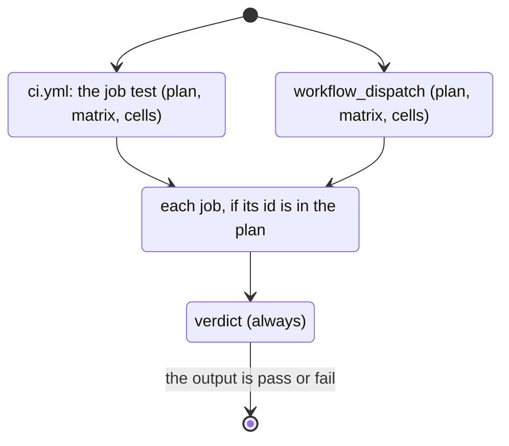
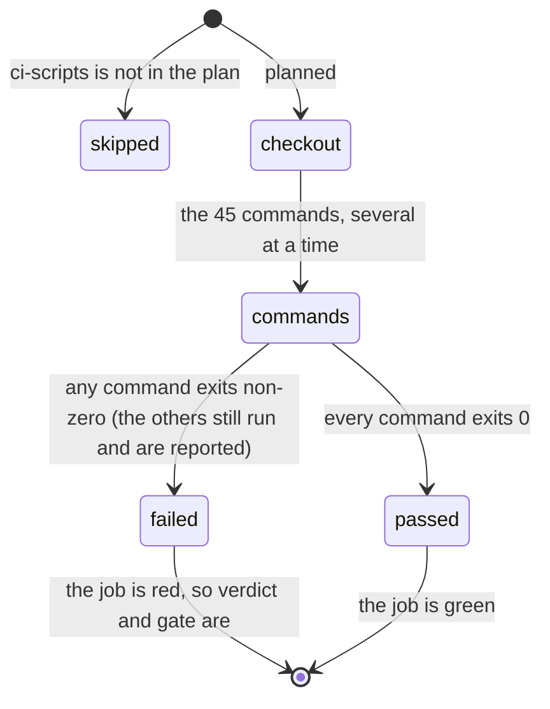
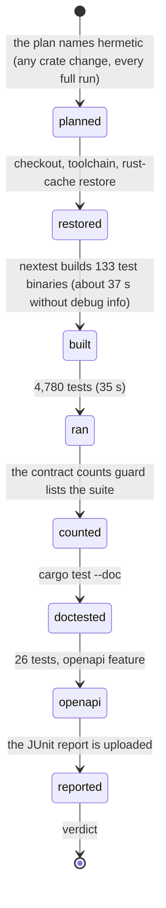
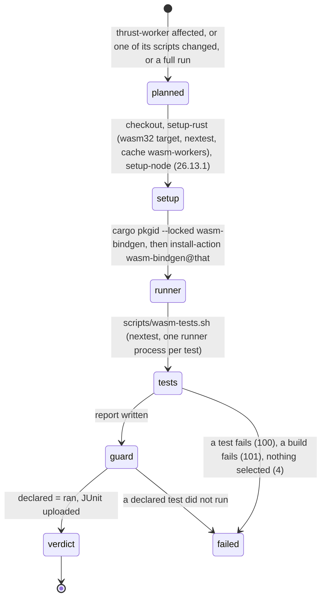

# Phase 0003: Test

Part of [ci-workflows](../PLAN.md). Planned 2026-11-18, the day [Phase 1](0002-migration.md) was accepted. Facts are from `main` at `b0bcdbd`, read on that day: recount them
when a stage starts. This is **Phase 2 of the plan** (the numbering of phase documents is repository-wide, so it is `0003`): the first workflow that goes through the eight
passes, on the layout the migration left. Its workflow is `test.yml` (`name: test`) and, as a stage, `flake-hunt.yml`.

The plan's decisions, the passes and the invariants are in [PLAN.md](../PLAN.md); how a called workflow is judged is [ADR-0102](../../contrail/adrs/ci/0102-one-workflow-per-concern-and-the-verdict-job.md).
The cost of what exists is [research 0019](../research/0019-ci-baseline-after-migration.md). This document does not restate them.

## Purpose and use cases

`test.yml` runs the repository's tests. Its jobs are called by `ci.yml` (its job `test`), so the workflow serves four uses:

| Use | What runs | Who decides |
|---|---|---|
| A pull request or a push to `main` | the jobs and cells the change needs | `plan-ci.py`, over the changed paths and the crate graph |
| A full run (an `rc/*` pull request, a merge-queue entry, the nightly, a dispatch of `ci`) | every job and every cell | `ci.yml`'s `changes` job |
| A run of `test.yml` by hand | the plan it is given (by default the four jobs that need no cells) | the person who dispatches it |
| Characterising a flaky cell | one cell, 1 to 50 times, weekly or by hand | `flake-hunt.yml`, which is not a callee |

The workflow exists to answer one question for each change, cheaply: *what does this change break?* The testing strategy ([docs/src/testing/strategy.md](../../../../docs/src/testing/strategy.md))
says which layer catches which defect; this workflow is where those layers run.

## What exists today (read 2026-11-18)

| Job | What it runs | When the planner plans it | Median (research 0019, 11 full runs) |
|---|---|---|---|
| `ci-scripts` | 45 commands (this document said 44 when it was planned; recounted for stage 1): the tests of the CI's own scripts (the planner, the gate, the lint, the guards, the deploy, preview and edge helpers), the wiring test and the mutant driver | **any crate change**, and any change under `.github/`, `scripts/` and the preview and edge infrastructure | 305 s (timeout 10 min) |
| `hermetic` | nextest under the `ci` profile over the **whole workspace**, the contract counts, the doctests, the OpenAPI tests (`thrust-api-v1 --features openapi`), and the JUnit upload | **any crate change** | 176 s |
| `pg-adapter` | the Postgres and SMTP adapter tests on testcontainers, and the preview provisioner's Postgres test | `thrust-adapters-selfhosted` (or the provisioner) is affected, or infrastructure | 133 s |
| `contract` | one job per cell of the contract matrix, each a call of `contract-cell.yml` on its own runner (26 cells) | per cell: the cell's target binary is affected, or its pass's inputs changed | 3568 s in all; the longest cell is `worker-cf e2e`, 624 s |
| `mutants` | `scripts/mutants.sh`: planted mutants of the server, each of which the contract suite must fail on | `thrust-server` is affected, or the suite changed | 744 s (p90 1019 s); the longest job that is not a cell |
| `verdict` | judges the five jobs and the cells' markers against the plan (ADR-0102) | always | 10 s |
| `flake-hunt.yml` (not a callee) | one cell repeated 1 to 50 times (5 by default), Monday 03:17 UTC and by hand; `hunt` job, 120 min timeout | never: nothing in `ci` waits for it | not measured |

Facts that shape the phase, each read from the file named:
- **`hermetic` is not affected-only.** `plan-ci.py` plans `ci-scripts`, `deps`, `lint` and `hermetic` for *any* crate change, and `hermetic` runs the whole workspace. The crate graph is
  computed (`affected()`), but only `pg-adapter`, `mutants` and the cells use it.
- **Four nextest profiles run in no job**: `deep` (more generated cases, `PROPTEST_CASES=4096`), `oracle` (the TypeScript differential; needs Node), `load` and `prof` (Phases 12 and 13).
  Gap G-5 (`status.md`) records that CI does not run the `oracle_` tests, stage 2, the `blast` and `bench` passes or the probes; `deep` is not in it. A regression only `deep` or `oracle` finds is found by hand.
- **G-6: there are no wasm32 unit tests.** The Worker is tested only over HTTP, by the `worker-memory` and `worker-cf` cells. Since #298 the provisioner's wasm32 build is *checked* (`lint`), not tested.
- **G-3: `cargo-mutants` runs in no job.** `mutants` is the contract suite's planted mutants, not Rust mutation testing; the crates other than `thrust-core` have no tests of their own to mutate.
- **The book has no Rust code samples** (no ` ```rust ` fence in `docs/src`), so `mdbook test` would pass with nothing to test.
- **The categories of AGENTS.md rule 4** are `prop_`, `model_`, `parity_`, `oracle_`, `fuzz_replay_`, `regression_`, `load_` and `prof_`. The `smoke` and `mutant` of the owner's sample are not among them.
- **No step is an exact duplicate of another** in `test.yml`, `contract-cell.yml`, `flake-hunt.yml` and `e2e.yml` except `actions/checkout` (seven places, one pinned line each), which is not worth an action.
  The near-duplicates are in *Action candidates*.

## Interface

| | |
|---|---|
| Inputs, called | `plan` (JSON array of the workflow's planned jobs), `matrix` (the contract matrix), `cells` (the `<target> <pass>` list), all required strings |
| Inputs, by hand | the same three, with defaults: the four jobs that need no cells, an empty matrix, no cells |
| Output | `verdict`: `pass` only when every planned job succeeded and every other was skipped; `ci.yml`'s `gate` requires it |
| Permissions | `{}` at the top; `contents: read` on each job; no secrets, no environments, no `id-token` |
| Routing | by input, never by event name (a callee sees the caller's event, R9); no workflow-level `concurrency` (R8) |
| `flake-hunt.yml` | its own triggers and inputs (`target`, `pass`, `iterations`), `concurrency: flake-hunt`, `contents: read`; it is not read by `gate` |



## Acceptance criteria for the workflow

The phase is done when:
1. **Every stage has its section and its pass log**, and each of the eight passes for each job has either a pull request and its evidence or a recorded reason.
2. **The invariants of the plan hold in every pull request**, each with the control that shows it can fail.
3. **Nothing the jobs ran is lost.** Each stage's pull request carries the parity of `ci-commands.py` and, where a job is split or a command moves, a must-fail control.
4. **Passes 5 to 7 are measured, not asserted.** Runner-seconds and the critical path of the Test workflow are measured against research 0019 with `ci-baseline.py` (same window rule), before and after, and a pass that did not help says so.
5. **The two gaps that are CI's** (G-5, what runs only by hand; G-6, no wasm32 unit tests) are each closed by a stage or recorded as a decision not to, by the owner.
6. **The documents are true**: `running.md`'s rows, `cicd.md`'s table, the READMEs; checked by the same searches as the migration's acceptance (`cicd-table-vs-tree.py`).
7. **`flake-hunt.yml` has been through the passes** as a stage of this phase.

## The stages

Existing jobs first, then new ones (the plan's rule). The order inside the existing jobs is mine, and the owner may change it: **cheapest and most settled first, so the first stage is the template the others follow, and the biggest costs once the template works.** **The owner changed it once, on 2026-11-19: `mutants` moved ahead of `crates`**, because measuring `hermetic` showed it is never what a crate pull request waits for.

| # | Stage | Job (id kept) | What the passes have to settle | Status |
|---|---|---|---|---|
| 1 | bash | `ci-scripts` | 45 commands run one after another. Where the time goes is now measured (stage section below). It is planned on any crate change: whether every crate change needs it is a pass 7 question, to be answered from what its tests read | **passes 1 to 7 done** (#311, #318); the runbook is written, and the final documentation pass waits for the phase: [the section below](#stage-1-in-detail-ci-scripts) |
| 2 | mutants | `mutants` | **Moved up from stage 5 by the owner (2026-11-19)**, after the measurements: it is the longest job that is not a cell (903 s median over five runs, 744 s over the 11 full runs of research 0019), and the last job to finish in two of the four crate-change pull-request runs I read, and it is planned in about 70% of pull requests. 54 rows, each of which rebuilds `thrust-server` with a mutant's cargo feature into the shared `target/` and runs one contract pass: a flat 13 to 15 s each, so the work divides evenly, but rows cannot share a checkout. G-2, G-3 | **passes 1 to 7 done** (#321, #325, [below](#stage-2-in-detail-mutants)); pass 8 is the end of the phase. The model test in the `discard-noop` row stays, behind `--max-fail=1:immediate`; dropping it is a one-line change if the owner prefers it |
| 3 | crates | `hermetic` (the nextest part, the contract counts and the OpenAPI tests) | The whole workspace on any crate change. Affected-only with nextest's own `rdeps()` filter, or `cargo nextest archive` and `--partition` to build once and fan out; the profiles `deep` and `oracle` (G-5) | **passes 1 to 7 done** (#329, #330, #331, [below](#stage-3-in-detail-crates-the-nextest-part-of-hermetic)): `hermetic` is on no critical path, so the stage saves runner-seconds and no wall clock; `CARGO_PROFILE_DEV_DEBUG=none` took the job from 162 s to 134 s. The two reject-heavy tests (#330) and the nightly `deep` job (#331, G-48) are done, each in its own pull request; the numbers after the merge are below |
| 4 | doctest | `hermetic` (the doctest step) | **Decided by measurement: it stays a step.** `cargo test --doc` takes 2 s (median of 11 full runs, min 1, max 2): a job of its own would pay about 35 s of checkout and setup to save nothing. Nextest cannot run doctests, which is why it is a separate command | **closed** (not a job) |
| 5 | pg-adapter | `pg-adapter` | Docker and Mailpit on the runner; the provisioner's Postgres test; caching of the build | **passes 1 to 7 done, no change** ([below](#stage-5-in-detail-pg-adapter)): more test threads and one invocation bought nothing, and the job is bound by a container per test on 4 cores |
| 6 | contract | `contract` | 26 cells, about 65% of a full run's runner-seconds (3568 of 5483 s at the medians). One build per runner (native or wasm): what the `rust-cache` keys share. The `e2e` and `e2e-mail` passes move to Phase 6 (E2E). | **passes 1 to 7 done** ([below](#stage-6-in-detail-contract)): the e2e cell is the longest job of every full run and its tools step swung 61 to 577 s because of a 32 MB apt download of fonts; the browser alone, without `--with-deps`, takes it from 138 s to 57 s and the cell from 616 s to 542 s (paired, 4 rounds). The e2e journeys stay for Phase 6 |
| 7 | flake-hunt | `flake-hunt.yml` | Its placement (a question); a `hunt` job of up to 120 minutes; never gated | **passes 1 to 7 done, no change** ([below](#stage-7-in-detail-flake-hunt)): about 100 s a week; one e2e iteration after #341 passed, so the shared action still works there |
| 8 | workers | new | G-6: wasm32 unit tests of the Worker. A survey of public solutions comes first; the job is new, so it is advisory until pass 4 | **passes 1 to 7 done** (#345, merged 2026-11-22). The first CI run failed all 15 tests (Node 22.22.0, below); the second, on Node 26.13.1, was green: the job takes 92 s cold and 68 s with the cache ([below](#stage-8-in-detail-workers)): 15 `#[wasm_bindgen_test]` tests of the Worker's glue run on Node under nextest in 4 to 7 s; cargo-mutants on `lib.rs` went from 33 caught and 11 missed to 43 caught and 1 missed (`scheduled`, covered by the `cron` pass). **The host is Node, not workerd** (ADR-0123): no public runner hosts Rust tests inside workerd. The job is in the gate from its first commit (ADR-0102 allows no advisory job in `test.yml`) |
| — | mdbook | — | **Not in this phase** (owner, 2026-11-18): the book has no Rust samples, so `mdbook test` would have nothing to test. Revisited in Phase 9 (Docs), when it has | deferred |

Each stage's section (purpose, acceptance, state machine, steps, a survey of public solutions, custom code and its probe, the pass log) is written **when the stage starts**, not before.

### Stage 1 in detail: `ci-scripts`

**Purpose and use cases.** The logic behind the required check is itself tested here: the planner, the gate, the `verdict` action, the lint, the guards of `deps`, the deploy, release, preview, edge and Flagship helpers,
the wiring test and the mutant driver: 45 commands. A failing command fails the job and `gate` through `needs`. It runs in every full run, and in **every affected-only run measured since M5b (7 of 7, research 0019)**, because the planner plans it
for any crate change and for any change under `.github/`, `scripts/` and the preview and edge infrastructure.

**What it costs, and where** (measured 2026-11-18: `test.yml` dispatched twice on a throwaway branch with the plan `["ci-scripts"]` and the step run under `set -x` with a timestamp in the prompt, so that bash prints the time before each
command; the two runs are the same commands on two runners):

| Command | Median (s) | Both runs (s) | Share |
|---|---|---|---|
| `test_preview_result.py` | 77.8 | 93.6, 61.9 | 23% |
| `mutate_gate.py` (the mutant driver, 229 mutants) | 50.7 | 63.9, 37.6 | 15% |
| `test-plan-deploy.sh` | 44.7 | 54.9, 34.5 | 13% |
| `test_preview_config.py` | 28.2 | 33.3, 23.2 | 8% |
| `test-ports.sh` | 20.3 | 25.0, 15.6 | 6% |
| `test_flagship.py` | 18.9 | 22.1, 15.7 | 6% |
| `test-deploy-worker.sh` | 16.9 | 20.4, 13.4 | 5% |
| `test-deploy-target.sh` | 13.1 | 15.7, 10.5 | 4% |
| the other 37 commands | 64.3 | | 19% |
| **all 45** | **334.9** | **403.8, 265.9** | |

What it shows:
- **Four commands are 60% of the step and the eight longest 81%.** None is a build or a download; they are test logic and process spawns (`test_preview_result.py` starts one Python process per generated case).
- **For a typical pull request this job is the critical path.** In the two affected-only runs I read (`44187850687`, `44246581933`) `ci-scripts` was the last job to finish: 315 s of a 350 s run and 271 s of a 308 s run, about 90% of the wall clock.
  Research 0019's medians say the same (affected-only wall clock 314 s, `ci-scripts` 258 s).
- **The runners differ by about 1.5×** across nearly every command (403.8 s against 265.9 s), so a single run proves little about a change of 10%.
- **Failure modes of the job as it is** (pass 2): it stops at the first failing command, so a pull request that breaks three tests is told about one at a time; its timeout is 10 minutes and the slower of the two runs was 404 s of command time (411 s
  of job), so another 1.5× would time it out with no change of ours; and one `bash -e` step gives GitHub no per-command timing (the table above needed the trace).
- **Independence is a scan, not yet a proof.** The tests use no fixed temporary path and open no fixed port (the port numbers in them are strings in test inputs); they read `crates/` and the manifests read-only; five use `git` and one `cargo metadata`.
  Pass 6 proves it by running them together.

**Acceptance criteria for the stage.**
1. **The same 45 commands with the same results.** `ci-commands.py` parity, and, if the list moves into a script, a check that the script runs each of the 45 lines, with a control that reports one removed.
2. **A failing command still turns the job and `gate` red, and the log says which command failed.** Control: a dispatch in which one test is made to fail.
3. **Passes 6 and 7 are measured with one instrument, by dispatch, before and after**: the job's wall clock and its runner-seconds, three runs or more each, then the next affected-only pull requests. The runner spread (1.5×) is reported with the numbers.
4. **No interference and a safe margin**: the commands pass alone and together in ten consecutive dispatches, and the timeout leaves at least 1.5× of the slowest run seen.
5. **The documents are true** (`running.md`'s row, the READMEs, `cicd.md`).

**State machine** (the failure branch is the proposal; today the first failure stops the step):



**Steps, broadly.** Today: a checkout, then one step (`RUSTUP_TOOLCHAIN: stable`) that runs the 45 commands in order under `bash -e`. Proposed: the same checkout and the same commands, held in one list, run several at a time by a public tool that
reports a result and a time for each; the job fails if any command fails.

**Survey of public solutions** (to be settled in pass 1 on the runner, not from memory):

| Candidate | Fit | Verdict |
|---|---|---|
| GNU parallel (`-j`, `--joblog`, `--halt never`, `--group`) | runs a list of commands k at a time, keeps each command's output together, writes a table of exit code and time per command, and can run them all and fail at the end | **first choice, if the runner image has it** (checked in pass 1: `parallel --version` on `ubuntu-24.04`) |
| `xargs -P` | always present; no per-command time, output interleaved | the fallback; weaker |
| A matrix of shards (`strategy.matrix`) over runners | keeps the job id, so the planner, the gate and the verdict do not change (they read `needs.ci-scripts.result`); costs a checkout and a runner per shard, so more runner-seconds | only if one runner's cores cap the gain |
| bats-core, pytest-xdist | would mean rewriting 45 hand-written tests | rejected: no gain, and rule 3 forbids weakening tests |

**Custom code.** None yet. A per-command table in the job summary would come from `--joblog`; if it needs a script, it is named here with the probe that shows nothing built-in gives it.

**The passes**

| Pass | Status | Evidence, or what it will do |
|---|---|---|
| 1 Proof of concept | **holds** | `workflow_dispatch` of `test.yml` with `plan` `["ci-scripts"]` runs it alone (runs `44365600321` and `44365605105`, on a branch). Must-fail controls: each test's own, and the mutant driver's 229 rows |
| 2 Working prototype | **holds** | runs on every real trigger. Failure modes: the four above |
| 3 Documented | **done** (this stage's pull request) | header comment in `test.yml`, rows in both READMEs, `running.md` and `cicd.md` updated for the parallel run, permissions stated; the gap is closed: a comment on the timeout says what the job takes and why ten minutes |
| 4 MVP | **holds** | in the planner's `JOBS` and the gate's known jobs, judged by `verdict`, covered by the wiring test and the mutant driver |
| 5 Caching | **no benefit** (recorded) | nothing is built, installed or downloaded: there is no `setup-rust`, and `cargo metadata` only reads manifests (2 to 3 s in the table). The slow commands are test logic and process spawns, and a cache key has nothing to key |
| 6 Parallelization | **done** (this stage's pull request), results below | the commands run a core at a time under GNU parallel; the runner has 4 cores (the job's own log says so) |
| 7 CPU time | **done** (#318): (a) yes, (b) not chosen | (a) `test_preview_result.py` in-process: 69 s to 1 s, as sensitive as before (below). (b) planning `ci-scripts` only for the crate changes its tests read: not chosen by the owner (8 of the last 60 merged pull requests, no wall-clock gain) |
| 8 Production documentation | runbook written (#318); the workflow-level pass is the end of the phase | `running.md` says what to read when `ci-scripts` is red, and how to rerun a flaky command; the plan's pass 8 is per workflow, so the final pass waits for the other stages |

**Decisions (owner, 2026-11-18), both as recommended:**
- **Pass 6 runs the commands several at a time inside the job**, not in a matrix of shards: the job id, the planner, the gate and the `verdict` do not change, and runner-seconds stay flat.
- **Pass 7's two candidates wait for pass 6's numbers.** (a) `test_preview_result.py` without a process per case, and (b) planning `ci-scripts` only for the crate changes its tests read, are decided after the parallel run is measured: the longest single
  command sets the floor of the parallel job, and (b) changes what a Rust pull request is checked by, so it comes back to the owner with the list of what each test reads.

**What the parallel run must get right** (my reading, to be proved in pass 1 and 6, not assumed): the order of the list is the order in which commands start, so the longest go first or the job ends with one slow command alone; the exit status must be the
number of failed commands, with `--halt never` so that all of them run; and the job's output must stay readable (a command's lines together), because 45 commands' lines interleaved would be worse than today's log.

**Pass 6, measured** (`test.yml` dispatched alone with the plan `["ci-scripts"]` on the stage branch; the job's own start and end, on the runner):

| | one after another | a core at a time |
|---|---|---|
| Job wall clock | 277 s and 411 s (the two traced runs); 305 s is the median of 11 full runs (research 0019) | **132 to 204 s, median 144 s** over ten runs of the final step (the first version of it: 134 s) |
| Result | | 11 of 11 green (a green job means every command exited 0, which the control below shows; the first run's table was read in full: 45 rows, none non-zero) |
| Commands' own time | 335 s (the traced runs' medians) | 472 s in the one table I read: the commands overlap and slow each other, they do not shrink |
| The floor | | the longest command alone, `test_preview_result.py` (62 to 108 s in the tables) |

- **The control** (a throwaway branch with one extra command that exits 3, run `44369690408`): the job and its `verdict` went red, the table had 46 rows and exactly one non-zero exit, the end of the log named the failed command,
  and the other 45 had run. The real step's failure path works.
- **No interference**: 11 consecutive dispatched runs green on the runner, and all 45 commands passed together locally at 8 and at 4 at a time.
- **Guards added, each shown able to fail**: the wiring test gains six checks (136 to 142: the status kept, the step ending in `exit "$status"`, `--halt never` and `--group`, no command listed twice, every test script of
  `.github/scripts/tests/` listed); the mutant driver gains five mutants (229 to 234), each killed by the check written for it (the first failing check of each was read), so a step that ran the commands and then exited 0 cannot pass.
- **Parity**: `ci-commands.py` against `main`: 56 jobs, 55 unchanged, one changed (`test.yml:ci-scripts`, expected); the 45 command lines are the same multiset before and after.
- **Runner-seconds**: the job is one runner busy for less time (305 s to 144 s at the medians, about 53% less), so the minutes GitHub counts fall; the commands' CPU time does not.
- **The pull request's own first full run** (`44371889122`, on `865eec2`, with 41 other jobs starting at once): `ci-scripts` took **202 s**, on a slower runner: 781 s of command time against 472 s in the first dispatch (each command about 1.65× slower), the longest,
  `test_preview_result.py`, 173 s alone; 45 rows and none non-zero. The mechanism held; **the floor moves with the runner**, which is the case for pass 7's first candidate. (That run was red for an unrelated reason, six advisories against `lettre`, fixed by #312.)
- **The effect on a real pull request, read from the first affected-only one after the merge** (#318, run `44396581438`: `ci-scripts` and `deps` planned, nothing else; this also carries pass 7's first candidate, below): **151 s from `changes` to the end of `gate`, `ci-scripts` 107 s**, against the two affected-only runs read before
  the stage, 350 s (`ci-scripts` 315 s) and 308 s (`ci-scripts` 271 s). `ci-scripts` was still the last job to finish, now 71% of the run and not 90%. One run, a different change, and runners that differ by 1.5×: it is the first real data point, not a distribution.

**Pass 7, candidate (a) (owner's choice, 2026-11-18): `test_preview_result.py` in-process** (#318). The test started one Python process per generated case, about 60 s of its 69, and was the longest command of the step (62 to 108 s alone, 173 s on a slow runner). It now calls the script's `main()` in this process with its output captured, and takes about **1 s**.
- **Faithful**: a scratch copy that runs every one of the ~3,980 cases both ways and compares exit status, stdout and stderr: 7,965 checks, 0 failed. The committed test keeps a **sample of every kind of case** (accepted, each way of refused, no JSON, not an object, called with no arguments) through a real process and requires the two to agree: 28 new checks (3,957 to 3,985), so the command line, the arguments and the
  `-I` flag stay covered.
- **As sensitive as before**: four bugs planted one at a time in copies of the script fail the old and the new test with the same number of red checks (716, 2, 585, 6) and the same first one. **The new check can fail**: a planted difference in the in-process runner fails exactly the 27 agreement checks and nothing else, and an emptied sample fails its coverage check.
- **Candidate (b)** (plan `ci-scripts` only for the crate changes its tests read) was **not chosen**. Replaying the last 60 merged pull requests through today's planner ([`ci-scripts-planning.py`](../scripts/ci-scripts-planning.py)): 33 were full runs anyway; of the other 27, `ci-scripts` was planned in 22, and in 8 only because a crate changed. It would have saved about 144 s of runner time in 8 of 60 and shortened none of them (`hermetic` and the cells take longer).
- **Left as it is**: the command list in `test.yml` still starts with `test_preview_result.py`, "the slowest first"; it is now one of the fastest, which costs nothing (the order is a hint). `test.yml` was left alone so that #318's run stayed an affected-only one; the next pull request that edits it fixes the order.

### Stage 2 in detail: `mutants`

**Purpose and use cases.** The contract suite is only evidence if it can fail (AGENTS.md rule 8), so `scripts/mutants.sh` builds the server **broken on purpose**, one rule at a time, and the suite must fail on each (the gap G-2: no skill owns it). It also holds guard rows (a pass started against the wrong
server must be refused before a test runs) and the adapters' own mutants. A mutant that survives, or a row that did not run, fails the job. It is planned whenever `thrust-server` or the suite is affected, and in every full run: **in about 70% of the last 60 merged pull requests** (33 were full runs, and of the other 27, 9 planned it).

**What it costs, and where** (measured 2026-11-19: `test.yml` dispatched twice on a throwaway branch with the plan `["mutants"]` and `scripts/mutants.sh` run under `bash -x` with a timestamp in the prompt; plus the job times of five recent runs):
- **The job**: 719 to 1,007 s over five runs (median 903 s; research 0019's median over its 11 full runs is 744 s); the two traced runs took 832 s and 716 s. By step: checkout 3 s, `setup-rust` 31 s, the script 865 s (median).
- **54 rows in a flat distribution**: per row, median 13 to 15 s, p90 17 to 23 s, longest 29 to 33 s, shortest 2 s; the first row takes 24 to 29 s (the cold build). By kind, in the two runs: 29 `contract.sh native-memory main` rows 418 to 476 s, 12 adapter rows (`cargo nextest`, 10 to 11 s each) 112 to 136 s, 7 `mail` rows 65 to 79 s,
  2 `engine` rows 49 to 56 s, 2 `native-pg budget` rows 28 to 38 s, 2 `csrfoff` rows 12 s. **No row dominates, so the work divides evenly.**
- **It decides the wall clock of a crate change.** In the four crate-change pull-request runs I read, the last job to finish was `mutants` twice (903 s and 916 s of a 952 s and a 956 s run), a contract cell once and an e2e cell once; `hermetic` never.

**Why the rows cannot simply run at once.** Each of the 42 server rows runs `scripts/contract.sh native-memory <pass>` (or `native-pg budget`) with `THRUST_SERVER_FEATURES=<mutant>`, which does `cargo build -p thrust-server --features <mutant>` into the **shared `target/`**, starts `target/debug/thrust-server`, runs one pass on nextest,
and moves a JUnit report from a **shared path** (`target/nextest/contract/junit.xml`). Two rows in one checkout would run each other's binary and report. The script runs them one after another for that reason, and `contract-all.sh` is serial for the same one.

**Acceptance criteria for the stage.**
1. **The same 54 rows, each run exactly once.** A test over the real row list shows that the shards together run every row once and none twice, with a control (a shard count that drops or doubles a row fails it).
2. **A mutant that survives still fails the job, and so does a shard that runs no row.** Controls: a row whose mutant is removed (`SURVIVED`), and a shard given no rows.
3. **A failed shard fails `mutants`, so `verdict` and `gate` do not change** (a matrix job's result is the aggregate of its jobs): shown by a control.
4. **Passes 6 and 7 are measured with one instrument, by dispatch, before and after**: the job's wall clock and its runner-seconds (the sum over shards), three runs or more each, then the next pull requests that plan it. The runner spread (about 1.5×) is reported with the numbers.
5. **The documents are true** (`running.md`, `cicd.md`, the READMEs).

**Design (owner, 2026-11-19: four shards).** A matrix of four legs under the **same job id `mutants`**, `fail-fast: false`. Every leg walks the whole script and runs the rows whose position `k` has `(k - 1) mod 4` equal to its index: round robin by position, so the rows of each kind
land on different legs (the kinds cost 10 to 30 s each) and a row added anywhere is picked up. The script is told the count and the index as `strategy.job-total` and `strategy.job-index`, so the matrix is the one place that says how many legs there are, and no row is left without a runner.
Each leg is its own runner with its own `target/`, so nothing in `contract.sh` changes. One leg saves the cache. Built in `scripts/lib/mutants-shard.sh` (sourced by `scripts/mutants.sh`, where every row starts with `want <label>`), and held by:
- `test-mutants-shards.sh` (in `ci-scripts`, about 9 s): for 1 to 8 shards and every index, the rows selected are exactly the positions `k` with `(k - 1) mod n` equal to the index; the real script, run against stub `contract.sh` and `rs`, gives 2, 4 and 7 shards that together run what one run does, once each, with a list that names every row that runs; a shard with no row fails; a count or index that is not a shard of a split is refused with exit 2; and
  the log names each row a leg starts. Eleven controls (a wrong modulus, a `want` that always selects, a row with no `want`, each guard removed) must each be rejected, and each is rejected for the reason it was built for (`VERBOSE=1` prints the reason).
- a runtime guard in the script itself: a leg compares the rows it selected with the verdicts it recorded, so a row outside `want` (which would run on every leg) fails the leg (`VACUITY GUARD`); a leg that selected no row fails.
- the wiring test and eight hand mutants of `test.yml` (the matrix, `fail-fast`, the two numbers the script is told, the single cache saver), all killed.

**What a shard costs** (from the two traced runs, whose 54 row times are in script order; round robin by position puts 14, 14, 13 and 13 rows on the four legs and the work in each is within about 12% of the others; each leg adds setup of about 37 s and the cold first row's extra ~10 s):

| shards | wall clock (runs 44429826293 and 44429822956) | runner-seconds, all legs | against the same two runs (832 s, 716 s) |
|---|---|---|---|
| 3 | 315 s, 275 s | 938 s, 824 s | +13%, +15% |
| **4 (chosen)** | **256 s, 228 s** | **985 s, 871 s** | **+18%, +22%** |
| 6 | 196 s, 175 s | 1,079 s, 965 s | +30%, +35% |
| 8 | 175 s, 156 s | 1,173 s, 1,059 s | +41%, +48% |

The first draft of this table said 4 shards cost "+6%": that compared the estimate with the **median of five runs** (903 s), which the two traced runs were below. Like for like it is **+18% to +22% in runner-seconds for a wall clock about a quarter as long**; against the median it is between -4% and +9%. The runners differ by about 1.5× from run to run (719 s to 1,007 s for the same job), so pass 7 measures several runs on each side and reports the spread.

**Survey of public solutions:**

| Candidate | Fit | Verdict |
|---|---|---|
| A matrix of shards under one job id (GitHub's own `strategy.matrix`) | each shard has its own runner and `target/`; the job's result is the aggregate; no change to `contract.sh`, the planner, the gate or the verdict | **the proposal** |
| The rows a core at a time inside the job, as `ci-scripts` now does | same runner cost, but needs a `CARGO_TARGET_DIR` per worker and `contract.sh` hard-codes `target/debug/thrust-server`, so the harness every cell uses would change, and each worker pays a cold compile on four shared cores | rejected: it touches the shared harness to save nothing a matrix does not |
| `nextest --partition` | a row is a build and a pass, not a nextest test | does not apply |
| `cargo-mutants` | Rust mutation testing, a different technique (G-3), not these hand-planted builds | does not apply |
| Fewer rows for a pull request (each row tied to the crates it breaks) | a Rust pull request would be checked by fewer controls | not proposed |

**Custom code.** A small change to `scripts/mutants.sh` (shell, the shard selector and the listing mode), and the checks above. Nothing built-in selects the rows of a hand-written script.

**The passes**

| Pass | Status | Evidence, or what it will do |
|---|---|---|
| 1 Proof of concept | **holds** | `workflow_dispatch` of `test.yml` with the plan `["mutants"]` runs it alone (runs `44429822956` and `44429826293`, on a branch). Controls: each row is a control, and the verdict logic has its own tests (`test-mutants-verdict.sh`) |
| 2 Working prototype | **holds** | runs on every real trigger: the pull request's own `ci` run (`44435959424`) ran the four legs and `gate` was green. Failure modes: a row that did not run or survived fails its leg; a leg with no row, or with a row outside `want`, fails (`VACUITY GUARD`); a hung row is stopped by the 20-minute timeout and the log names the row it was in |
| 3 Documented | **done** (#321) | header comments in the script, the library and the workflow; `running.md` (the script row, the job row, a runbook for a red leg), `cicd.md` and the READMEs. The gap is closed: the log names each row as it starts, and GitHub's own timestamps give its time |
| 4 MVP | **holds** | in the planner's `JOBS` and the gate's known jobs, judged by `verdict`, covered by the wiring test and the mutant driver |
| 5 Caching | to be measured | the cache key `native-mutants`; each shard restores it. Whether the first row's cold build (24 to 29 s) can be cut is measured, not assumed |
| 6 Parallelization | **done** (#321), results below | four legs under the id `mutants`; wall clock 854 s to 389 s at the medians of three runs each |
| 7 CPU time | **done** (#325), results below; keep or drop is the owner's | the price of 6 was +28% in runner time, most of the spread one row's model test hanging for 84 to 163 s in 16 of 27 runs; `--max-fail=1:immediate` on that row ends it in 4 to 24 s: wall clock 389 s to 246 s, runner time 1,091 s to 935 s at the medians |
| 8 Production documentation | runbook written (#321); the workflow-level pass is the end of the phase | `running.md`: what to read when a leg is red, a leg that ran no row, a row outside `want`, a hung row |

**Pass 6, measured** (`test.yml` dispatched alone with the plan `["mutants"]`, the one-runner job on `main` and the four legs on the stage branch, started within a minute of each other, 2026-11-19):

| | one runner (`main`) | four shards (this branch) |
|---|---|---|
| Runs | `44436075396`, `44436077868`, `44436080786` | `44435967407`, `44435970438`, `44435974268` |
| Wall clock | 824, 854, 951 s (median **854 s**) | 281, 389, 400 s (median **389 s**) |
| Runner-seconds | the same | 1,018, 1,091, 1,139 s (median **1,091 s**) |
| At the medians | | **wall clock -54%, runner time +28%** |

The pull request's own run (`44435959424`, 41 other jobs starting with it): 353 s and 1,114 s. A leg is 226 to 400 s: setup 26 to 52 s (median 34 s) and the script 189 to 361 s. All 16 legs of the four sharded runs were green.

- **The estimate was right about the count and wrong about the tail**: 228 to 256 s of wall clock and +18% to +22% were predicted from two unsharded runs in which a certain row happened to be fast; the measured runs include the case where it is not. Of the +28%, +18% to +22% is what the estimate had (four setups of about 35 s and four cold first rows against one),
  and the rest is within what that row's tail and the runners' spread (about 1.5x) can do.
- **The finding.** `postgres adapter + discard-noop` (row 41, which falls on leg 0) takes **either about 5 s or about 125 s** (143 s in three runs). In CI it took 160, 163 and 105 s on leg 0 in three of the four sharded runs and about 25 s in the fourth, and 22 and 26 s in the two unsharded traces. Locally, with Docker, 15 runs of that row alone:
  its model test (`model_postgres_adapter_matches_the_reference_model`) took under 6 s six times, 24.5 s once and **124 to 144 s eight times**, whereas the row's two other tests failed in about 3 s every time. **It is not proptest's shrinking**: capping it (`PROPTEST_MAX_SHRINK_ITERS=0`) left three of six runs at 125 to 144 s.
  `[profile.adapters]` marks a test slow at 120 s but kills nothing, so the test itself ends at about 125 s; I did not look inside it for the wait. The row still ends KILLED (3 tests failed) either way, so the verdict is unaffected: it is time, not correctness. The one-runner job has the same tail (presumably part of its 719 to 1,007 s spread; I did not separate it); sharding puts it on one leg's critical path, so
  the sharded job is about **281 s when the row is fast and 350 to 400 s when it is not**.
- **What would remove it, and why it is not in this pull request.** The row's filterset is `binary(pg_adapter) & test(/an_abandoned_transaction|model_postgres_adapter_matches/)`: the two `an_abandoned_transaction` tests kill the mutant in 3 s, and the model test is in the filterset, presumably as a second witness (I did not look for the reason). Dropping it from the row would cost about 120 s of runner time in half of the runs, and
  the loss of a control; that is a decision about what the control must show, so it is the owner's (question below). Balancing the legs cannot help: the row is slow at random, and four legs with one slow row are as long as the slow leg.

**Pass 7, measured** (the owner asked for `--fail-fast` first, then keep against drop; #325, 2026-11-19). Locally with Docker, and then in CI:

| | row time | verdict |
|---|---|---|
| Today, 27 runs (21 local, 6 in CI) | 4 to 26 s in 11, **84 to 163 s in 16** | KILLED, every run |
| `--fail-fast` (waits for running tests), 6 runs | 144, 145, 128, 84, 4, 126 s | KILLED; **no help**: the first failure came at 3.3 s and nextest waited 140 s for the model test |
| `--max-fail=1:immediate`, 16 runs (10 by the command line, 6 through `scripts/mutants.sh`) | **4 to 14 s in all 16** | KILLED; one test FAIL, the other two terminated, the model test never the one that failed |
| the same command **without the mutant's feature** (the control) | 13 s with the build; the three tests pass in 3.6 s | exit 0, which the verdict reads as SURVIVED |

| In CI, the four-leg job | wall clock | runner-seconds | row 41 on leg 0 |
|---|---|---|---|
| #321, three dispatches (before) | 281, 389, 400 s (median 389) | 1,018, 1,091, 1,139 s (median 1,091) | 160, 163, 105 s, and about 25 s in the fourth |
| #325, three dispatches (after) | **246, 244, 270 s (median 246)** | **905, 935, 990 s (median 935)** | **20.4, 19.5, 24.4 s** |
| #325's own `ci` run (all 42 jobs) | 269 s | 1,001 s | 19.7 s |
| the one-runner job, three dispatches (the baseline, #321) | 824, 854, 951 s (median 854) | the same | |

Against the one-runner job: **wall clock -71%, runner time +9%** at the medians (against #321's -54% and +28%). The legs are now 198 to 270 s; leg 0 is the longest in one of the three runs and no longer by a margin. The rows after row 41 on leg 0 (45, 49, 53) took their usual 4 to 14 s: the containers the terminated tests left running did not disturb them.
Row 41 still takes 20 s in CI against 4 s locally: probably the build of the adapter crate with the feature and the Postgres image pulled on a fresh runner; I did not separate them.

- **Two consequences, measured and documented in `running.md`**: nextest's report counts a terminated test as failed, so the verdict reads `KILLED (3 test(s) failed)` for one real failure and two terminated; and each terminated test leaves its Postgres container running (ten runs left ten, and six more six; nothing on a runner, which is discarded with the job).
- **Only this row gets the flag**: the other adapter rows look for a needle one aimed test prints, and terminating that test because another failed first would turn their kill into UNCLEAR. `test-mutants-shards.sh` holds it (22 checks, 13 of them must-fail controls).
- **Keep or drop, what each costs** (the comparison the owner asked for, in the pull request and not repeated here): the immediate form is, in what a green run shows, close to dropping (the model test was terminated in all 16 runs), and keeps the model test as a fallback that ends the row itself if the two fast tests ever stop failing; dropping saves no more time (both about 4 s locally), avoids the leaked container and the misleading count, and makes a
  regression of the two fast tests a loud SURVIVED; today's row is the only one that shows the model test, the only generative witness, can kill the mutant on every run, at about 80 runner-seconds a run.

The owner's rule: an exact duplicate in two or more places becomes an action without asking; anything less than exact is asked first.

- **Exact duplicates: none worth an action.** `actions/checkout` is the same step in seven places; an action that wraps one pinned line would add a layer and remove nothing.
- **Near-duplicates, to be asked when the stage reaches them (not now):**
  - the preamble of `hermetic`, `pg-adapter` and `mutants`: a checkout, `setup-rust` with `nextest: 'true'` and a different `cache-key`, and `save-cache` on `main`. One composite could take the cache key as an input; I will show the three side by side at stage 2 or 4;
  - the JUnit upload: `hermetic` uploads its report, `pg-adapter` and `mutants` do not, though both write one; whether they should is a stage 4 and 5 question before it is a duplicate;
  - the install of `mdbook` and `mdbook-mermaid` (`documentation.yml`) if an `mdbook` stage is added: a candidate of the plan's Actions track.
- `contract-pass-tools` is already shared by `contract-cell.yml` and `flake-hunt.yml`.

### Stage 3 in detail: `crates` (the nextest part of `hermetic`)

**Purpose and use cases.** The hermetic suite is every test that needs no network, no Docker and no running target: `cargo nextest run --profile ci --workspace --locked` (4,780 tests in 133 binaries, 35 to 39 s of running), the contract counts guard (`scripts/check-contract-counts.sh`, which lists the contract suite once per pass so
that a stale expected count is found without a server), the doctests (`cargo test --doc`) and the OpenAPI tests (26 tests with the `openapi` feature). The planner runs it on any crate change, over the whole workspace ("they build it all anyway"), and in every full run: **43 of the last 60 merged pull requests** (33 full runs, and 10 of the other 27).

**What it costs, and what it is not on the way of** (measured: 11 green full runs before this stage, and the probes below):

| step | seconds | |
|---|---|---|
| checkout | 5 | |
| `setup-rust` (toolchain, cache restore, nextest) | 24 to 29 | |
| nextest, `ci` profile | 97 to 99 | about 60 s building 133 test binaries, 35 to 39 s running them |
| contract counts | 14 to 15 | `cargo nextest list` once per pass arm, by design |
| doctests | 1 to 2 | |
| OpenAPI tests | 12 | |
| JUnit upload | 1 | |
| **the job** | **162 to 173** | |

**It is on no critical path, so this stage can save runner minutes and no pull request's wall clock.** Full runs now end at the `worker-cf e2e` cell (558 s and 736 s in the two I read, against `hermetic`'s 162 to 173 s); the one run that planned only `mutants` and `ci-scripts` ended with `mutants` (306 s). The saving is
about 30 s of runner time on 72% of pull requests, which is why I stopped at the cheap, measured changes and asked the owner only the two questions that were his.

**Acceptance criteria for the stage.**
1. **The same tests with the same results**: 4,780 passed and 10 skipped, the 26 OpenAPI tests, the doctests and the contract counts, before and after.
2. **Runner time and wall clock measured by dispatch before and after**, three warm runs or more each, with the spread; the cold run is reported but not what is compared.
3. **What a pull request is checked by does not change** (no affected-only selection, no fewer tests) unless the owner decides it.
4. **A candidate that does not pay is recorded as such with its numbers**, and not adopted.
5. **The documents are true** (`running.md`, `status.md`).



**What was measured** (`test.yml` dispatched alone with the plan `["hermetic"]` on a throwaway branch; each variant had a cache key and a save of its own, was run once cold and then three times warm, and `main`'s unchanged job was run beside them; 2026-11-19):

| variant (3 warm runs each) | nextest step | job | cache |
|---|---|---|---|
| `main` as it is | 95 to 98 s | 153 to 172 s (median 162) | 605 to 651 MiB |
| the probe, default debug info | 98 to 150 s | 160 to 219 s (171) | 605 MiB |
| **`CARGO_PROFILE_DEV_DEBUG=none`** | **72 to 73 s** | **112 to 134 s (134)** | **401 MiB** |
| `CARGO_PROFILE_DEV_DEBUG=line-tables-only` | 79 and 143 s (two green runs; the third was the #114 flake) | 151 to 229 s | 530 MiB |
| `none` and rust-cache's `cache-workspace-crates` | 71 to 193 s (median **165**) | 131 to 282 s (**247**) | 770 MiB |
| `none` again, the baseline of that last row, run beside it | 72 to 74 s | 133 to 138 s (137) | 401 MiB |

Both the default and the `none` run ran **4,780 tests, all passed (10 skipped), and 26 OpenAPI tests**; the running time of the tests was 39.0 s in the one default run I read and 34.8 s in the one `none` run. Cold runs, one each, for scale only: nextest step 163 s (default), 138 s (`line-tables-only`) and 131 s (`none`).

**Survey of public solutions:**

| Candidate | What I found | Verdict |
|---|---|---|
| `CARGO_PROFILE_DEV_DEBUG=none` (cargo's own profile setting; the `mutants` profile already uses `debug = "none"`) | nextest step 99 s to 72 s, job 162 s to 134 s at the medians, cache 35% smaller, same tests | **adopted**, at the job level of `hermetic` only |
| `line-tables-only` | two green runs, 79 s and 143 s: too noisy to call, and the only thing it would keep over `none` is file:line in a backtrace (a panic names its own file and line without debug info) | not adopted |
| `rust-cache`'s `cache-workspace-crates` (an input of the pinned v2.9.2) | **worse**: the step took a median of 165 s against 72 s, and the cache was 1.9 times larger. The slow runs are probably cargo rebuilding the workspace because a fresh checkout's files look newer than the cached artifacts; I did not confirm it | **no benefit**, not adopted |
| sccache (`mozilla-actions/sccache-action` v0.0.11, sccache 0.19.0) | not tried: the most it could save is the build that remains (about 37 s of a 134 s job, and only for crates a pull request did not touch), at the price of a third-party action and a `RUSTC_WRAPPER` in the job; the result above is no encouragement | not tried |
| `cargo nextest archive` and `--partition` across runners | the tests run 35 s; n runners each pay a checkout, a setup and an archive restore (about 30 s of runner time each) to save at most 35 s of wall clock, in a job that is on no critical path | rejected on the numbers |
| selecting the affected crates (nextest's `rdeps()`, or `-p`) | the most it could save is the whole nextest step (97 s) on the 10 of 60 pull requests that plan `hermetic` without being a full run: at most about 16 s a pull request on average, and far less in fact, since the changed crate's dependents are most of the workspace. It would change what a crate pull request is checked by | not proposed |
| a job of its own for the doctests | 1 to 2 s | closed (the doctest stage): a job costs about 35 s of setup to save nothing |

**Custom code.** One `env` line, one wiring check and two mutants. Nothing hand-written replaces a built-in.

**Findings made on the way** (not part of this change):
- **`deep` failed and no job ran it** (G-48; **both follow-ups are done**: #330 fixed the two tests, and #331 runs the profile nightly): 251 tests, 313 s and 383 s on a runner; four `oracle_` tests need the oracle's generated output; two `thrust-core` tests abort with proptest's "Too many rejects" at 4096 cases; and `prop_decode_never_panics_on_mutated_updates` fails at random (#114).
- **#114 also fails the normal `hermetic` job at random**: 1 of the 22 probe runs. It is open. `running.md` now says so.
- **The cache key now changes**: rust-cache hashes every variable that starts with `CARGO`, `CC`, `CFLAGS`, `CXX`, `CMAKE` or `RUST` (read in the pinned source), so `hermetic` builds a new cache on its first run on `main`, and a run before that, on a branch, is cold (a branch never saves).

**Decisions (owner, 2026-11-19), both as recommended:**
- **`deep`**: fix the two reject-heavy tests first (their own pull request), then a nightly advisory `deep` job that excludes the `oracle_` tests. **Done:** #330 fixed the two tests, and #331 added `deep.yml` (a job of 6.5 to 11 minutes in the four runs read; the only red test in the two runs of the job itself was #114's).
- **No new test categories**: `smoke` and `mutant` are not defined; AGENTS.md rule 4 is unchanged, and the stage keeps running the whole workspace.

**The passes**

| Pass | Status | Evidence, or what it will do |
|---|---|---|
| 1 Proof of concept | **holds** | `workflow_dispatch` with the plan `["hermetic"]` runs it alone (the probe runs above). Controls: a failing test fails the job (the #114 run) |
| 2 Working prototype | **holds** | runs on every real trigger. Failure modes: a red test; #114 at random |
| 3 Documented | **done** (this stage's pull request) | `running.md` (the row and a runbook for a red job), `status.md` G-48 |
| 4 MVP | **holds** | in the planner's `JOBS` and the gate's known jobs, judged by `verdict`, covered by the wiring test and the mutant driver |
| 5 Caching | **done**: one change adopted, one measured and refused | the cache is 35% smaller with `none`; `cache-workspace-crates` is worse |
| 6 Parallelization | **closed: no benefit** | the tests run 35 s; `nextest archive` and partitions cost more runner time than they save, on no critical path |
| 7 CPU time | **done** (this stage's pull request) | `CARGO_PROFILE_DEV_DEBUG=none`: the job 162 s to 134 s at the medians; affected-only selection not proposed (at most about 16 s a pull request, and it changes what a crate change is checked by) |
| 8 Production documentation | runbook written; the workflow-level pass is the end of the phase | |

**After the merge** (three dispatches of `["hermetic"]` on `main` on 2026-11-19, once its first run had built the new cache: 402 MiB against 651 MiB): the two runs that restored the cache took **126 s and 130 s**, the nextest step 74 s and 72 s and `setup-rust` 17 s and 22 s, against 153 to 172 s (median 162), 95 to 98 s and 24 to 26 s before, which is the probe's result within a few seconds. The third restored no cache (its log has no "Cache hit" line; the cause I do not know, probably the cache service under three restores at once) and built from scratch: the step 129 s, the job 200 s.

### Stage 5 in detail: `pg-adapter`

**Purpose and use cases.** The adapters' own tests that need Docker: `pg_adapter` (88 tests, each of which starts its own Postgres container through testcontainers), `smtp_sink` (7 tests against Mailpit, a mail server nobody here wrote) and `infra/preview/scripts/test-provisioner-bootstrap.sh` (the preview
provisioner's security and lifecycle against Postgres). The planner runs it when `thrust-adapters-selfhosted` is affected and in every full run: **44 of the last 60 merged pull requests** (33 full runs, and 11 of the other 27).

**What it costs** (22 green runs of `ci`, 2026-11-19):

| step | seconds | |
|---|---|---|
| checkout | 4 | |
| `setup-rust` | 18 | restores a cache of about 343 MiB |
| Postgres adapter tests | 78 (72 to 175) | about 12 s building and 61 s running 88 tests |
| SMTP adapter tests | 18 | 7 tests, 17 s |
| preview provisioner script | 3 | |
| **the job** | **132** (114 to 222) | |

**It is on no critical path**, like `hermetic`: full runs end at the `worker-cf e2e` cell, so this stage can save runner minutes and no pull request's wall clock.

**Where the 61 s go.** The 88 tests add up to **194 s of test time** (mean 2.2 s, most of it the container's start; one test, `model_postgres_strategy_reaches_every_step_class`, takes 34.9 s), so at 4 threads the floor is about 48 s and the step takes 61 s.

**What was measured** (`test.yml` dispatched alone with the plan `["pg-adapter"]` on a throwaway branch with dispatch inputs for the settings; warm runs):

| setting | Postgres step | job | runs |
|---|---|---|---|
| **the default (4 threads, the job as it is)** | **76 s** (74 to 77) | **134 s** (130 to 134) | 4 paired |
| `--test-threads 8` | 78 s (75 to 88) | 127 s (121 to 134) | 4 paired |
| `--test-threads 16` | 80 s (78 to 115) | 134 s (131 to 160) | 4 paired |
| one nextest invocation for `pg_adapter` and `smtp_sink`, 8 threads | 99 s (76 to 132), and no separate SMTP step | 130 s (107 to 160) | 4 paired |

"Paired" means that the four settings ran in the same round, side by side, four rounds in all, so they saw the same load. **All 16 runs were green: no flake at 8 or at 16 threads.** An earlier round of 19 runs, with up to eleven jobs at once, found the same (nothing stood out) but ran the default itself at 116 s against its usual 78 s, so it could
not separate anything; I repeated it paired. Its `debug=none` variant is not a result: its warm runs restored no cache (their log shows `Compiling proc-macro2`), so they rebuilt everything and took 165 s; the build is 12 s in the job as it is, so the most debug info could save is a few seconds of it, and I did not measure it again.

**Why more threads buy nothing** (my reading, not measured): the runner has 4 vCPUs, and the Postgres containers and the tests share them; the tests wait on containers that are themselves busy initialising a database on the same cores, so more threads queue more work for the same cores.

**Survey, and what is left:**

| Candidate | Evidence | Verdict |
|---|---|---|
| more `--test-threads` | measured: 76, 78 and 80 s | **no benefit**, not adopted |
| one invocation for both Docker suites | measured: the job 130 s against 134 s, inside the spread | **no benefit**, not adopted |
| `CARGO_PROFILE_DEV_DEBUG=none` (the lever of `hermetic`) | the build is 12 s; not measured, for the reason above | not adopted: at most a few seconds |
| partitioning across runners | each runner pays about 22 s of setup and its own image pulls to save at most 61 s x (1 - 1/n), in a job on no critical path | rejected on the numbers |
| a Postgres container shared by tests | not tried: the container per test is what isolates the tests from one another, so sharing one changes what they prove | the owner's decision, not proposed |
| a larger runner | costs more per minute; not tried | not proposed |

**Decision: no change to the `pg-adapter` job.** It is bound by a container per test on 4 cores, and no setting I tried moves it. Nothing in `test.yml` changes in this stage.

**The passes**

| Pass | Status | Evidence |
|---|---|---|
| 1 Proof of concept | **holds** | `workflow_dispatch` with the plan `["pg-adapter"]` runs it alone (the probe runs above) |
| 2 Working prototype | **holds** | runs on every real trigger; 22 green runs read |
| 3 Documented | **holds** | the job's comments, `running.md`'s row |
| 4 MVP | **holds** | in the planner's `JOBS` and the gate's known jobs, judged by `verdict`, covered by the wiring test and the mutant driver |
| 5 Caching | **no benefit** | the build is 12 s and the cache restore 18 s; no input to change |
| 6 Parallelization | **no benefit** (measured) | 4, 8 and 16 threads and one invocation: 76 to 99 s for the step |
| 7 CPU time | **no change** | the cost is the container per test (194 s of test time in 88 tests) |
| 8 Production documentation | the workflow-level pass is the end of the phase | |

### Stage 6 in detail: `contract`

**Purpose and use cases.** The contract suite is run against a target, one cell to a runner (`contract-cell.yml`): four targets (`native-memory`, `native-pg`, `worker-memory`, `worker-cf`) and the passes each offers (`main`, `sweeper`, `panic`, `csrfoff`, `mail`, `oracle`, `cron`, `worker`, `bindings`, `e2e`, `e2e-mail`), 26 cells in all. The planner runs the cells a change needs, and a
full run runs all of them.

**What it costs** (24 full runs of `ci`, 2026-11-18 and 19; the job's duration, in seconds):

| cells | median | range | share of the 3,717 s |
|---|---|---|---|
| `worker-cf e2e` | **768** | 491 to 1,068 | 20.7% |
| `worker-cf e2e-mail` | 362 | 261 to 725 | 9.7% |
| `worker-cf oracle` | 202 | 183 to 257 | 5.4% |
| the other 7 `worker-cf` cells | 125 to 170 | | 26.0% |
| the 6 `worker-memory` cells | 98 to 116 | | 17.1% |
| the 4 `native-pg` cells | 76 to 138 | | 10.5% |
| the 6 `native-memory` cells | 50 to 108 | | 10.5% |

**The cell that sets the wall clock of every full run is `worker-cf e2e`.** The cells run at once on runners of their own, so the longest sets the time, and no other is within 400 s of it. It is `setup` 31 s, then the tools step, then the pass: **the pass is steady (about 430 s), and the tools step is not: 61 to 577 s.** So while
that cell is the longest, nothing done to any other cell can shorten a full run, and the e2e cell's own spread is most of the spread of a full run's wall clock.

**Why the tools step swings.** `playwright install --with-deps chromium` apt-installs **only fonts** here (`fonts-freefont-ttf`, `fonts-ipafont-gothic`, `fonts-tlwg-loma-otf`, `fonts-unifont`, `fonts-wqy-zenhei` and the `xfonts-*` set, 32 MB) and four Mesa upgrades, because the runner image has the libraries Chromium needs.
In the 576 s run that download took **8 min 6 s at 65.9 kB/s** (a slow mirror); in a fast one the same step takes seconds. Everything else in the step is steady: `pnpm install` 7 s, the app build 29 to 33 s, the browser 17 s. Nothing in that step was cached.

**What was measured** (the owner said "yes, now, measured first" on 2026-11-19, pulling this forward from Phase 6, whose journeys are untouched): a throwaway branch with a `variant` input, `test.yml` dispatched with the plan `["contract"]` and the two e2e cells, one cold run and then **four paired rounds** (the three variants in the same minute,
so on the same mirror), 13 dispatches and 26 cell-runs, **all green**:

| variant | `e2e` tools step | `e2e` job | `e2e-mail` tools step | `e2e-mail` job |
|---|---|---|---|---|
| as it is (`--with-deps`) | 138 s (99 to 296) | **616 s** (551 to 793) | 114 s (94 to 225) | **358 s** (316 to 460) |
| **no `--with-deps`** | **57 s** (53 to 86) | **542 s** (524 to 713) | **56 s** (54 to 82) | **274 s** (264 to 331) |
| no `--with-deps`, the browser cached (`actions/cache`) | 57 s (55 to 63) | 554 s (539 to 588) | 57 s (54 to 66) | 289 s (266 to 302) |

- **The change: install the browser and not its system packages** (`contract-pass-tools`, which `flake-hunt.yml` shares). No journey asserts on rendering (a screenshot is taken only on a failure), and all 18 cell-runs of the two e2e cells without the fonts passed (the 16 of the paired rounds, and the 2 of the cold run). The tools step goes from a median of 138 s to 57 s and the **tail goes with it**: the control hit 296 s in one round, the variants did not
  (86 s at worst, in the same round, so something else in the network was slow too). The job: **616 s to 542 s (e2e) and 358 s to 274 s (e2e-mail)** at the medians of that sample. The mirror was fast in most of those rounds, so against the 24-run median of 768 s the saving of a full run's wall clock is larger than the 74 s measured here: I estimate about 770 s to about 540 s, and I will check it after the merge.
- **The browser cache is no benefit**, so it is not adopted: the browser's download is quick, and a cache would be a dependency for nothing (57 s against 57 s).
- **The one thing lost**: the CJK and Unicode fonts, so the screenshots of a failed journey will show boxes for those glyphs. If a runner image ever lacks a library Chromium needs, Playwright says so in its own error, and `--with-deps` goes back (the comment on the install says so).

**What I looked at and did not change:**

| Candidate | Evidence | Verdict |
|---|---|---|
| the 16 Worker cells (10 `worker-cf`, 6 `worker-memory`) each build the same wasm | `wrangler dev` runs `worker-build --release`: the script's start to "target healthy" is 44 to 62 s a cell. A build job whose output the cells download would save about 430 s of runner time (about 12%; my estimate from the 44 to 62 s a cell spends before its target is healthy), but a cell would wait for it (+70 to 90 s on a run with no e2e cell; also an estimate) and `scripts/worker-dev.sh`, which every Worker cell and `flake-hunt.yml` use, would grow a prebuilt mode | not proposed; the owner's call if runner minutes matter |
| `debug=none` (the lever of `hermetic`) | the Worker is a release build with `strip = "debuginfo"` already, so it does not apply to the 16 Worker cells; the 10 native cells rebuild `thrust-server` and the suite (about 7 s a cell at most, my estimate from `hermetic`) | not measured, not adopted |
| `npm install --global wrangler` (10 s in each of the 16 Worker cells) | at most 160 s of runner time | not measured, not adopted |
| the `oracle` cells (202, 138 and 108 s) | the time is real work: 62 s of build and boot, 14 s of the Schemathesis gate, 64 s of the harness's own controls and self-test; `uv`'s download is 1 s | nothing to cache |
| the e2e pass itself (about 430 s) | the journeys, one spec each in `e2e/journeys/` | Phase 6 (E2E) |

**Custom code.** One line of the action and its comment, a wiring check and two mutants (`contract-pass-tools` becomes a target of the mutant driver); 251 of 251 killed. No custom code replaces a built-in: the change removes a flag.

**The passes**

| Pass | Status | Evidence |
|---|---|---|
| 1 Proof of concept | **holds** | `workflow_dispatch` with the plan `["contract"]` and a matrix runs cells alone (the probe) |
| 2 Working prototype | **holds** | runs on every real trigger; 24 full runs read |
| 3 Documented | **done** | the action's comment, `cicd.md`'s row |
| 4 MVP | **holds** | in the planner and the gate: the cells are judged by `verdict` through their markers |
| 5 Caching | **done: no benefit** | the browser cache measured and refused; the Rust caches are shared per target family already |
| 6 Parallelization | **no change** | the cells already run at once, one runner each |
| 7 CPU time | **done** | the e2e tools step: 138 s to 57 s (e2e) and 114 s to 56 s (e2e-mail); the repeated Worker build is the owner's call |
| 8 Production documentation | the workflow-level pass is the end of the phase | |

**After the merge** (#341; three dispatches of the two e2e cells on `main`, 2026-11-19, all green): `worker-cf e2e` took **679, 549 and 550 s (median 550 s)**, its tools step 80, 54 and 58 s, against the 24-run median of **768 s** and its tools step of 291 s; `worker-cf e2e-mail` took **329, 285 and 284 s (median 285 s)** against 362 s. That is **about 220 s off the cell that sets the wall clock of a full run** (-28%), and the probe's estimate (770 s to 540 s) held. The first of the three, the one that ran its pass in 561 s against 436 s and 444 s, shows how much the pass itself moves with the load: the tools step is steady now, the pass is not. Pull request 341's own full run (45 jobs) read 683 s for the e2e cell.

### Stage 7 in detail: `flake-hunt`

**Purpose and use cases.** `.github/workflows/flake-hunt.yml` repeats **one contract cell N times** (1 to 50, 5 by default) to characterise a flake, by hand and every Monday at 03:17 UTC (`native-memory main`, 5 iterations). It is its own workflow and is never gated (your decision of 2026-11-18): `ci.yml` does not call it and `gate` does not read it. Its first step,
`.github/scripts/check-flake-hunt-cell.sh`, refuses a target and pass that are not a cell of `scripts/contract-all.sh`, before anything is built, and `test-check-flake-hunt-cell.sh` holds the workflow's two lists equal to the matrix. A pass is prepared by the same action a cell uses (`contract-pass-tools`), and the `hunt` job passes only if `scripts/flake-hunt.sh`
prints `failures: 0 / N` (the script ends with an `echo`, so its exit status says nothing).

**What it costs** (the 8 runs on record, 2026-10-19 to 2026-11-16, and the one of 2026-11-19 below):

| runs | what | seconds |
|---|---|---|
| 4 weekly runs | `native-memory main`, 5 iterations | 68, 90, 94, 113 (all green) |
| 4 manual runs | a cell, some iterations | 312 to 2,372 (all green) |

The weekly run is **about 100 s a week**; the manual ones cost what the cell and the iterations cost, which is the point of running them.

**What was checked after #341**, which changed the action this workflow shares (it is not gated and no pull request runs it, so a regression there would show only when someone ran a hunt): one iteration of `worker-cf e2e` by dispatch on `main` (run `44611747724`) **passed**, so the shared path works with the browser installed without `--with-deps`.

**What I looked at and did not change:**

| Candidate | Evidence | Verdict |
|---|---|---|
| iterations in parallel | the point of a hunt is repeated runs of one cell, one after another on one runner, with its own `target/`; at once they would measure a different load, and they would share a build directory (the hazard that makes `contract-all.sh` serial) | not done: it would change what is measured |
| caching | restore-only on the keys the cells save on `main` (`contract-native`, `contract-wasm`); the e2e tools step is the shared action | nothing to add |
| the weekly hunt | 4 green runs of about 100 s | nothing to speed up |

**Decision: no change to `flake-hunt.yml`.**

**The passes**

| Pass | Status | Evidence |
|---|---|---|
| 1 Proof of concept | **holds** | `workflow_dispatch` runs it alone (a hunt of `worker-cf e2e` on `main` after #341) |
| 2 Working prototype | **holds** | 4 weekly runs and 4 manual ones, all green |
| 3 Documented | **holds** | the header comment, the README row, `cicd.md`'s row, `running.md` |
| 4 MVP | **holds**, not gated by design | the input check and `test-check-flake-hunt-cell.sh` hold its lists to the matrix, and the workflow lint covers the file |
| 5 Caching | **no change** | restore-only, on the cells' keys |
| 6 Parallelization | **no change**, by design | iterations are sequential on purpose |
| 7 CPU time | **no change** | about 100 s a week |
| 8 Production documentation | the workflow-level pass is the end of the phase | |

### Stage 8 in detail: `workers`

**Purpose and use cases.** G-6: the Worker (`crates/worker`) has glue that exists only on wasm32, and nothing native reaches it. It reads its whole configuration out of `worker::Env` (a plain JavaScript object: `flag`, `num`, `core_config`, `check_rate_windows`, `oidc_provider`, `email_sender`, `api_config`, `v1_config`), builds the composition root, routes `fetch` (with its 8 MiB body ceiling), consumes `queue` batches (acknowledge, deliver again, set aside as a dead letter) and runs `scheduled`. Until this stage only the `worker-memory` and `worker-cf` cells reached it, over HTTP, a whole cell per question. A flag read wrongly, a rate window the binding cannot count, a dead letter lost or a moved body limit were found late and expensively. The new job runs unit tests of that glue on any change that affects `thrust-worker`.

**Acceptance criteria.**
1. `scripts/wasm-tests.sh` runs every `#[wasm_bindgen_test]` the source declares (a count guard), under nextest, with a runner of exactly the version `Cargo.lock` pins for `wasm-bindgen`.
2. A defect planted in the glue is killed: cargo-mutants on `crates/worker/src/lib.rs` through the same runner, every survivor named with its reason.
3. The job is in the gate (ADR-0102): planner `JOBS`, `WORKFLOWS["test"]`, `verdict`'s `needs` and `jobs`, the wiring test; a change to the Worker plans it, one to the native server does not.
4. Each hand-written piece has a check and a control that can fail (AGENTS.md rule 8).
5. The docs say what is live: `running.md`, `cicd.md`, `status.md` G-6, the defect matrix, AGENTS.md's Commands table.

**State machine of the job.**



**Survey of public solutions** (2026-11-20; searches and the repositories' own pages, **not an exhaustive survey**):

| Candidate | Pinned / state | Fit | Verdict |
|---|---|---|---|
| `wasm-bindgen-test` with its Node runner | 0.3.80 (a wasm32-only dev-dependency); the runner is the lock's `wasm-bindgen`, 0.2.130; Node 26.13.1 in CI (not the web jobs' 22.22.0: see the first CI run, below) | Runs `#[wasm_bindgen_test]` functions of the real wasm build. `--list --format terse` is supported for nextest since wasm-bindgen PR #4356 `[derived]`, and nextest lists and runs all 15 tests `[re-run]`. workers-rs itself uses it for its own `worker` crate (`cf.rs`, `context.rs`, `socket.rs`: `gh search code`) | **chosen** |
| `wasm-pack test --node` | active: not archived, last push 2026-11-11 `[re-run: gh api]` | A wrapper that drives the same runner through `cargo test`, so not nextest (AGENTS.md rule 1), and it installs its own `wasm-bindgen-cli` | rejected: nothing over the runner set as cargo's `runner` `[derived: not run]` |
| Rust unit tests hosted **inside workerd** (wrangler, Miniflare or `workerd` itself) | none found | It would be the host ADR-0123 names. No public runner hosts Rust test binaries there | not available: **a departure from ADR-0123**, recorded in status G-6 and the defect matrix |
| `vitest-pool-workers` / Miniflare | | Runs JavaScript tests in workerd, which would call the Worker over HTTP | rejected: it repeats what the `worker-*` cells do |

**Custom code, each piece named with the probe that showed no built-in covers it:**

| Piece | What it does | Probe |
|---|---|---|
| `scripts/lib/workerd-stubs.cjs` | Answers, for Node, the four `cloudflare:` modules the Worker's wasm imports (`workers`, `sockets`, `node`, `email`) with `module.registerHooks`, and defines the one workerd global it uses, `FixedLengthStream`. `tracing` answers as workerd does outside an invocation (`getActiveSpan()` is `undefined`) | Plain Node: `Cannot find module 'cloudflare:workers'` `[re-run]`. A CommonJS-only `Module._load` patch: `ERR_UNSUPPORTED_ESM_URL_SCHEME` (the snippets are ES modules) `[re-run]`; `registerHooks` covers both `[re-run]`, on 26.9.0 (see the first CI run: it is not enough on Node 22). No public package answers workerd's modules for Node (the survey above). Two entries were found only by the entry-point tests: `tracing` as `undefined` (`Cannot read properties of undefined (reading 'getActiveSpan')`) and the missing `FixedLengthStream` global (`ReferenceError`); each now has a check and a control in `test-wasm-tests.sh` |
| `scripts/wasm-test-runner.sh` | Cargo's runner for wasm32: sets `NODE_OPTIONS` to load the stand-ins, and refuses a `wasm-bindgen-test-runner` that is not the lock's `wasm-bindgen` exactly (it asks Cargo: `cargo pkgid --locked wasm-bindgen`) | The runner in `~/.cargo/bin` here was 0.2.129 and the lock pins 0.2.130 `[re-run]`. The hook, `[target.wasm32-unknown-unknown] runner`, is Cargo's own. Not tried, `[unverified]`: `[env]` in `.cargo/config.toml` might set `NODE_OPTIONS` without a wrapper, but the exact-version refusal needs one anyway |
| `scripts/wasm-tests.sh` | nextest's `workers` profile, then a count guard: every `#[wasm_bindgen_test]` the source declares must be in the JUnit report | nextest exits 4 when a profile selects nothing, but not when it selects fewer than were written (what a `cfg` or a rename that drops a test looks like). Same pattern as the contract scripts' count guards |

**One piece was replaced by a built-in the same day.** I first wrote `scripts/lib/locked-version.sh`, an awk reader of `Cargo.lock`, without checking for one. `cargo pkgid --locked wasm-bindgen` prints `registry+<index>#wasm-bindgen@0.2.130`, fails when the crate is absent (`did not match any packages`) and when it is at two versions (`specification is ambiguous`), and costs about 65 ms a call `[re-run: probe-pkgid.sh]`. The script, its seven checks and its planner rule are gone; the job step and the runner wrapper use the built-in, and `test-wasm-tests.sh` tests the wrapper's use of it with a stand-in Cargo and once with the real one against the real lock.

**No action was created.** The job's steps (checkout, `setup-rust`, `setup-node`, `install-action`) are existing actions used as they are; no step is an exact duplicate of another job's, and nothing near a duplicate was found.

**The tests** (`crates/worker/src/wasm_tests.rs`, 15 `#[wasm_bindgen_test]` functions). An `Env` is a plain object, so each test builds one and calls the Worker's own function; `fetch` and `queue` are the real wasm exports (`crate::_worker_fetch::fetch`, `crate::_worker_queue::queue`, the modules `worker-macros` 0.9 generates for `#[event]`), driven with a real `Request` and a fake queue. Generated ([Rule 9](../../../../AGENTS.md)): every word over an alphabet for the six spellings of a flag and the near-misses of each; the decimal digits and their bit boundaries against a reference the test owns; the variable-to-field map of the core configuration; every word over an alphabet and the `u32` boundaries for the two retention windows (issue #59: a window that is not a whole number of days refuses and names its variable); every subset of the three OIDC settings; every sign-in rate window from 0 to 200 s and the largest; and, as boundary values, bodies of 0, 1, one under, exactly at, one over and 4 KiB over the 8 MiB ceiling. Hand-written, and said to be in the test and in status G-6: a table of 14 examples of `THRUST_V1_RATE_LIMIT`'s spelling (Rule 9 (b), the format `V1Config::parse` states), and the queue consumer's cases, a handful of fixed batches, which is **a gap under Rule 9** (no generated sequence of batches against a model).

**What was measured** (locally, 2026-11-20, Apple silicon, a warm build; the CI numbers are not in yet):

| What | Number |
|---|---|
| debug info on: the test binary / one test | 158 MB / 20 s |
| `[profile.wasm-test]` (no debug info): the binary / one test | 26 MB / 1.85 s (three tests at once) |
| the tests, `scripts/wasm-tests.sh` | 14 tests: 4.5 s wall (3.7 s in nextest), 32 CPU-s. The same script on the 15 tests after merging `main`: 7.6 s wall (6.6 s in nextest), 34 CPU-s and 22 s of system time. One runner process per test, 2 to 3 CPU-s each; all of them start at once, so the wall time follows the load of the machine more than the count |
| cargo-mutants on `crates/worker/src/lib.rs` (3 jobs) | 52 mutants in 6 m 25 s on the 14-test tree (baseline 21 s build + 4 s test; a mutant about 4 s + 4 s); 11 m 32 s on the merged one (baseline 26 s + 5 s; a mutant about 7 s + 4 s). I did not find out whether the difference is the machine's load or the merged code |
| the `workers` job in CI (run `44825424412`, cold: `No cache found`) | **92 s**: set up 3 s, checkout 5 s, `setup-rust` 16 s, Node 26.13.1 3 s, the version step under 1 s (`wasm-bindgen@0.2.130`), the runner install 2 s, **the tests step 57 s** (the `wasm-test` build 34.9 s, nextest 19.0 s for the 15 tests on the runner's 4 cores), the JUnit upload 2 s. The whole run took 8 m 41 s, set by the cells, so this job is on no critical path |
| `Cargo.lock` | +10 packages (`cast`, `minicov`, `nu-ansi-term`, `oorandom`, `same-file`, `walkdir`, `wasm-bindgen-test`, `wasm-bindgen-test-macro`, `wasm-bindgen-test-shared`, `winapi-util`); the stage itself changed no existing package. One bump was folded into its pull request at the owner's word (2026-11-22), unrelated to it: `url` 2.5.8 → 2.5.9 and `form_urlencoded` 1.2.2 → 1.2.3, because a new advisory, RUSTSEC-2026-0592 (a stack overflow in `Url::origin()` on nested `blob:` URLs), turned `cargo deny` red for every change to `Cargo.lock` (`cargo update -p url --precise 2.5.9`: a plain `cargo update -p url` locked nothing) |

**What the controls found.**
- **cargo-mutants (`.cargo/mutants-wasm.toml`, by hand):** with the twelve config and queue tests, 33 caught, 8 unviable, **11 missed** (the router, four `MAX_REQUEST_BODY` arithmetic mutants, the queue consumer, `events_queue_message`, `dead_letter_queue_message`, `scheduled`). The two entry-point tests (`fetch`, `queue`) brought it to **43 caught, 8 unviable, 1 missed**. The same totals hold on the tree after `main`'s retention change (#340, which made `core_config` return a `Result`) with a new test for its two windows added: **43 caught, 8 unviable, 1 missed**, 0 timeouts. The one missed is `scheduled → ()` (`lib.rs:432` now, after #343): it hands the trigger's own cron string to `thrust_core::run_cron` and logs the report, so over an empty memory store its only visible effect is a log line. What a trigger runs is tested natively (`crates/core/usecases/tests/schedules.rs`: a trigger does its job and no other, a string that is not a cron of the table runs none; `outbox.rs`: the sweep), and by the contract suite's `cron` pass on the Worker (`worker_cron_scheduled_handler_runs_the_sweeper`, `worker_cron_scheduled_handler_runs_the_hard_delete`, `stage2_cron_real_trigger_runs_the_sweeper`). The mutants were not run again after #343, which changed this one function: `cargo mutants --list` on the merged tree gives the same 52, with only its line moved. A wasm unit test of it could assert only a log string, so none was written.
- **No defect was found in the Worker.** Every red during the build-up was in a test or in the harness: the number reference accepted `-0` for an unsigned field (the test), the fake queue's class had to be named `WorkerQueue` (the test), and the Node host lacked `tracing` and `FixedLengthStream` (the stand-ins). The controls, not the Worker, are the evidence that these tests can fail.
- **The controls of my own scripts found three more of my errors:** a `FixedLengthStream` stand-in whose "too long" branch was invisible to a check that only looked at the final error (a body longer than its length must not reach the consumer: now checked by reading what the consumer is handed); the `scripts/wasm-tests.sh` header advertised a filtered run that its own count guard would have failed (a run with arguments now skips only the count); and `locked-version.sh` itself (above).
- **The first CI run failed all 15 tests, on a Node that was not the one I had used.** Everything passed locally on Node 26.9.0, and the job took its Node from `web/.node-version`, 22.22.0. On 22.22.0 every test process died with `ERR_INTERNAL_ASSERTION: This is caused by either a bug in Node.js` at `ModuleLoader.getModuleJobForRequire`, from `loadESMFromCJS` (run `44822700250`, job `136587500584`). The cause, read in Node's own source and not guessed at: the runner's glue is CommonJS and `require()`s the Worker's inline JavaScript snippets, which are ES modules that import `cloudflare:workers` and its like; Node's `require(esm)` path asserts that an import specifier's protocol is `file:`, `node:` or `data:`, and does so *before* any resolve hook is asked, so the stand-ins cannot help. I read `lib/internal/modules/esm/loader.js` of every release from 22.15 to 25.9: **every 22 and 23 asserts (22.23.5 is the last 22), 24 asserts before 24.12.0, 25 before 25.2.0, and 26 has no such code**. The job now pins Node 26.13.1 (26.9.0 is what ran by hand; 24.12 and later were read, not run), `scripts/wasm-test-runner.sh` refuses an older Node in words, and the script test holds each boundary with stand-in nodes and controls. What I had wrongly written before the run was "`registerHooks` covers `require` and `import` alike", true on the one Node I had run. Nothing in the Worker or the tests was wrong.

**Owner decisions (2026-11-20).** Run the Worker's wasm32 tests **under nextest, with a few fat tests** (each test function is one runner process of 2 to 4 CPU-s, so each covers a lot; AGENTS.md rule 1 holds). Scope: **`thrust-worker` only**; the edge's `runtime.rs` (G-41) and the two preview Workers stay recorded gaps.

**Open items, none a blocker.** (1) The host is Node, not workerd (ADR-0123): a difference between them in anything the stand-ins do not model is found only by the cells. (2) `workerd-stubs.cjs` is hand-written and grows when `worker` imports something new; it fails by naming the file. (3) The tests depend on the module names `worker-macros` 0.9 generates. (4) They need the default `memory` feature; a `--no-default-features` run is not supported, and the count guard would say so. (5) A binding that is JavaScript `null` (not `undefined`) is not tested: `[unverified]`. (6) **CI's lint does not read `wasm_tests.rs`**: `lint.yml`'s Worker clippy step has no `--all-targets`, and the native `--all-targets` run never compiles wasm32-only code. I ran `clippy -p thrust-worker --target wasm32-unknown-unknown --all-targets --locked -- -D warnings` by hand: one error, `type_complexity` on the table of rate-limit specs, fixed with a type alias; then clean. Nothing keeps it clean. A step in `lint.yml` would, but that is the Lint phase's file (the planner plans a full run on any change to it, and its mutants and docs follow): a question for the owner, recommended for Phase 5. (7) `cargo deny` for the ten new packages: see the pass log.

**ADR-0102 and "advisory".** The plan says a new job is advisory until pass 4. In a called workflow that cannot stand: `test.yml` may hold only the jobs the planner moved there, and the wiring test fails on any other. So the job is in the plan, `verdict` and `gate` from its first commit on the stage's branch, and the early evidence is a dispatch of `test.yml` on the branch with the plan `["workers"]`.

**The passes**

| Pass | Status | Evidence |
|---|---|---|
| 1 Proof of concept | **holds** | a probe of two passing tests and one planted failure ran in Node through nextest: two passed, the planted one failed (2026-11-20, run by the owner's `!` commands, because the sandbox refuses to run the downloaded runner) |
| 2 Working prototype | **holds** | 15 of 15 on the Mac (14 of 14 before `main`'s retention change). On a runner: the first `ci` run of the pull request (`44822700250`) failed `workers` alone, all 15 tests on Node 22.22.0 (finding above), every other job green and `gate` red as designed; the second (`44825424412`), on Node 26.13.1, is **green in all of its jobs, `gate` included**, with `wasm32 tests: 15 of 15 declared, all passed`. The job needs no branch dispatch of its own: a pull request that touches the Worker plans it |
| 3 Documented | **holds** | the header comments, `running.md` (profile, script, job, runbook), `cicd.md`, `.github/workflows/README.md`, status G-6, the defect matrix X8, AGENTS.md |
| 4 MVP | **holds** | in the gate: planner `JOBS`, `WORKFLOWS["test"]`, `verdict`; `test_plan_ci.py` (7,038 checks), `test_workflow_wiring.py` (168), `test-ci-scripts.sh` (209 cases, 8 of them `workers`), `mutate_gate.py` (272 of 272 mutants killed, none survived, none broken, the equivalent ones still equivalent) and `test-wasm-tests.sh` (66 checks with controls, under `sh` and `dash`; all of them also pass in CI's `ci-scripts`, on the runner's own Node) |
| 5 Caching | **done: adopted, measured both ways** | key `wasm-workers`, saved on `main` only. Before the merge every run was cold (`No cache found`): 92 to 97 s, 34.9 s of it the wasm build. **After it (2026-11-22):** the first run on `main` (`45083708804`) was cold too, 93 s with a 36.8 s build, and saved the cache: **230,814,917 bytes, in 4.4 s**. A dispatch of `test.yml` on `main` with the plan `["workers"]` (`45084134281`) restored it (3.5 s) and took **68 s, the build 6.9 s**: **about 25 s of 93 (27%), all of it the build**. A pull request should restore from `main`'s scope (GitHub's rule for branch caches); I have not yet seen one do it. **The cost:** the repository's cache is 25 entries and 10,167 MiB of the 10,240 MiB GitHub allows, so a new entry evicts the least recently used one. I did not measure what it evicts; the entries that are there are bigger (the largest, 711 MiB) |
| 6 Parallelization | **no change** | one job of a few seconds of tests: nextest already runs the 15 processes at once (6.6 s for 34 CPU-s on the second run, 3.7 s for 32 CPU-s on the first) |
| 7 CPU time | **done** | `[profile.wasm-test]` took a test from 20 s to 1.85 s; affected-only planning (the Worker and the crates it depends on) |
| 8 Production documentation | the workflow-level pass is the end of the phase | |

## Questions for the owner

Asked and answered on 2026-11-18, before the first stage; **all four were answered as recommended** (the decisions are recorded at the end of this section). Each had my recommendation.

1. **`mdbook`.** The owner's sample has an `mdbook` stage in Test. The book has no Rust code samples, so `mdbook test` would pass vacuously, and a check that cannot fail is not evidence (AGENTS.md rule 8).
   *Recommended: leave it out of this phase and revisit it in Phase 9 (Docs), when the book has something to test.*
2. **`workers`.** I read it as G-6, wasm32 unit tests of the Worker. *Recommended: yes, as the last stage, and it begins with a survey of public solutions (`wasm-bindgen-test`, `workerd`) before any design.*
3. **The shape of `hermetic` and the name of `ci-scripts`.** The sample's `bash · hermetic → crates + doctest`: split `hermetic` into two jobs, and call `ci-scripts` `bash`. The migration kept job ids, and a rename touches about 20 to 40 lines of the
   planner, the gate, the tests, the mutants and the docs. `ci-scripts` runs Python and shell tests, so `bash` would not describe it.
   *Recommended: split the job where the measurements say it pays (stages 2 and 3 decide it, not this document) and keep the id `ci-scripts`.*
4. **Where `flake-hunt` lives.** "A stage of the Test phase" can mean it goes through the passes where it is, or that it moves into `test.yml`. Folding it in breaks R8 (it has a workflow-level `concurrency`) and R9 (it reads an empty `inputs` as a scheduled run).
   *Recommended: it stays its own workflow, which is never gated, and goes through the passes there.*

One question came out of stage 2's measurements (asked in #321, 2026-11-19): **should the model test stay in the `postgres adapter + discard-noop` row?** It hung for 84 to 163 s in 16 of 27 runs (finding above) and the row is killed either way. The owner said to try `--fail-fast` on the row first, and then, if it failed, to compare keeping and dropping.
**Tried (#325):** the plain `--fail-fast` does not help (it waits for the running test); `--max-fail=1:immediate` does (4 to 24 s in 20 of 20 runs, locally and in CI). The comparison is in #325.
*Recommended: `--max-fail=1:immediate` as in #325 (the time of dropping, and the model test stays a fallback). Dropping is the stricter and simpler row, at no more time, if the owner would rather the row say when the two fast tests regress; only the row as it was shows the model test kill the mutant on every run. The owner's call: #325 was merged with the flag on 2026-11-19, and I read that as accepting the recommendation, not as an answer (nothing was said); dropping the model test instead is a one-line change.*

Two questions belonged to stage 3 and were asked and answered on 2026-11-19, both as recommended (the answers are in the stage section above):
- **`smoke` and `mutant`**: the repository's categories are the ones AGENTS.md rule 4 lists; defining a new category changes that rule. **Answer: no new categories.**
- **`deep` and `oracle` in CI** (G-5, G-48): a nightly run is the natural home; `oracle` needs Node and the TypeScript oracle's generated output. **Answer: fix the two reject-heavy tests first, then a nightly advisory `deep` job that excludes the `oracle_` tests.** `oracle` stays by hand.

## Decisions (owner, 2026-11-18)

| Question | Decision |
|---|---|
| `mdbook` | **Left out of this phase.** It is revisited in Phase 9 (Docs), when the book has Rust samples to test |
| `workers` | **A stage of this phase, the last.** It starts with a survey of public solutions before any design |
| The shape of `hermetic`, the name of `ci-scripts` | **Split where the measurements say it pays; the id `ci-scripts` stays.** Stages 2 and 3 decide the split |
| `flake-hunt` | **Stays its own workflow**, never gated, and goes through the passes there |
| How the Worker's wasm32 tests run (stage 8, 2026-11-20) | **Under nextest, with a few fat tests**: each test function is one runner process of 2 to 4 CPU-s, so each covers a lot, and AGENTS.md rule 1 holds |
| Which Worker code (stage 8, 2026-11-20) | **`thrust-worker` only.** The edge's `runtime.rs` (G-41) and the two preview Workers stay recorded gaps |

What follows from them: the stage list above is now eight stages (the `mdbook` row is a deferral, not a stage); `flake-hunt.yml` is not a callee and `gate` does not read it, so pass 4 (MVP), which the plan
defines as "in the gate", cannot mean that for it; its stage will say what it does mean (the lint registry, the helper tests and controls it already has in `test-check-flake-hunt-cell.sh`), as
the migration did for `e2e.yml`; and a rename of a job id, if a stage ever wants one, is a question
of its own, with its cost.

## Acceptance of the phase (pass 8, 2026-11-22)

The seven criteria of [the acceptance criteria above](#acceptance-criteria-for-the-workflow), each with what shows it. The measurement is [research 0020](../research/0020-ci-baseline-after-the-test-phase.md).

| # | Criterion | Evidence | Holds |
|---|---|---|---|
| 1 | Every stage has its section and pass log, and each pass a pull request and evidence or a recorded reason | Sections for stages 1, 2, 3, 5, 6, 7 and 8 above; stage 4 is a decision by measurement (a step stays a step), with its row. Pull requests: stage 1 #311 and #318; stage 2 #321 and #325; stage 3 #329, #330 and #331; stage 5 the record #337; stages 6 and 7 #341 and the record #342; stage 8 #345 | **yes** |
| 2 | The plan's invariants hold in every pull request, each with the control that shows it can fail | The helper tests that hold them (`test_plan_ci.py`, `test_workflow_wiring.py`, `test-ci-scripts.sh`, `mutate_gate.py`, the workflow lint and the index guard) run in `ci-scripts` and `deps` on every pull request; the last one, #345, ends at 272 of 272 mutants killed. **The gate's control was shown live twice**: run `44822700250` (`workers` failed on Node 22, so `verdict` and `gate` went red and every other job stayed green) and run `45081430725` (`deny` failed on RUSTSEC-2026-0592, the same) | **yes** |
| 3 | Nothing the jobs ran is lost | Each stage section carries its parity with `ci-commands.py` and, where a job was split or a command moved, its control; stage 8 adds a job and removes nothing. The `ci-scripts` list is 47 commands, counted from `test.yml` | **yes** |
| 4 | Passes 5 to 7 are measured, not asserted | [Research 0020](../research/0020-ci-baseline-after-the-test-phase.md), by `ci-baseline.py` over 19 full runs against 0019's 11. **A full run's median wall clock fell from 1024 s to 585 s (−43%); runner-seconds fell 1 to 4% (the two medians disagree); the e2e cell is now the only job on the critical path, 260 s ahead of the next.** One job got slower, `pg-adapter` (133 s to 170 s), which is not attributed (eight pull requests added to its tests or code since), and the record says so | **yes** |
| 5 | The two gaps that are CI's, G-5 and G-6, are each closed by a stage or recorded as a decision not to, by the owner | **G-6: closed by stage 8** for `thrust-worker` (15 tests; the edge's `runtime.rs` and the two preview Workers stay recorded gaps, the owner's decision of 2026-11-20). **G-5: closed in part.** `deep` runs nightly (stage 3, not gated; G-48), and `oracle_` stays by hand by the owner's decision of 2026-11-19. **The rest of G-5's list has no decision of the owner's that I can find**: stage 2 (needs a Cloudflare sandbox only the owner provides), the `blast` pass (observational by design, not in `contract-all.sh`), the `bench` and `scale` passes (release-build latency load tests) and the probes. My reading is that the plan already places them in later phases (7 Deploy, 12 Bench, 14 Perf); that is a reading, not a decision | **G-6 yes; G-5 waits for the owner** (question 1 below) |
| 6 | The documents are true | `cicd-table-vs-tree.py`: **2 workflows were on disk without a row** (`preview-migration-source.yml`, `preview-migration-verify.yml`, added by other pull requests) and now have them: 27 on disk, 27 in the table, nothing either way. `running.md`'s mutant row count was 54 and is 66 (shards of 17, 17, 16, 16, from `MUTANTS_LIST=1`); `ci-scripts`'s command count is 47, as `test.yml` has it, in `running.md` (twice) and `cicd.md`; the plan's own status lines said no stage had started and now say where the phase stands. `check-ci-index.sh`, the workflow lint, actionlint and the book build pass | **yes** |
| 7 | `flake-hunt.yml` has been through the passes as a stage of this phase | Stage 7 | **yes** |

**The phase is done when the owner has answered question 1**; the other criteria hold.

**What the phase leaves** (for the phases that follow): the e2e cell sets the wall clock of every full run and is about 260 s ahead of the next job, so a faster full run is Phase 6's (E2E) to find; the 26 cells are 64% of a full run's runner-seconds, so a cheaper one is the planner's or the cells'; and the repository's cache is at its 10 GB limit (25 entries, 10,167 MiB), which no single stage can fix and any new cache key makes worse.

### Questions for the owner (pass 8)

1. **The rest of G-5** (stage 2, `blast`, `bench` and `scale`, the probes): *recommended: they stay by hand for now, and the plan's later phases take them (7 Deploy for stage 2, 12 Bench and 14 Perf for the load tests); `blast` stays observational.* This is the one criterion that is not mine to close.
2. **`lint.yml` and the wasm tests**: CI's lint never compiles `crates/worker/src/wasm_tests.rs` (the Worker's wasm32 clippy step has no `--all-targets`). *Recommended: add the step in Phase 5 (Lint), whose file it is.*
3. **`pg-adapter`'s 37 s**: *recommended: leave it, and measure it again in the first stage that touches the job; the cause is not known and eight pull requests are the only lead.*
4. **Still open from stage 2**: whether the model test stays in the `postgres adapter + discard-noop` row (read as accepted with #325, not answered).
