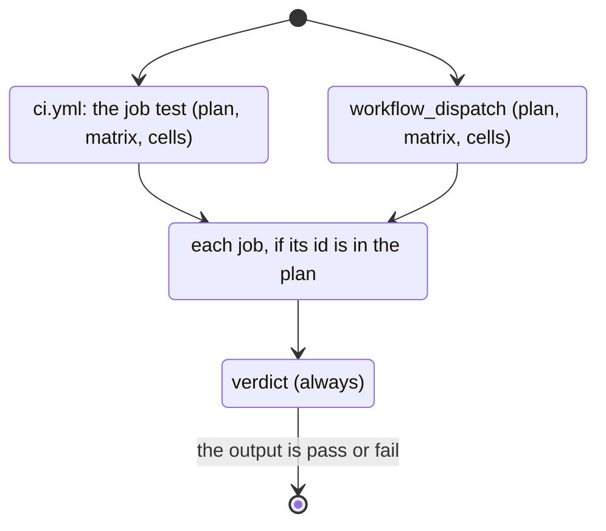

# Phase 0003: Test

Part of [ci-workflows](../PLAN.md). Planned 2026-11-18, the day [Phase 1](0002-migration.md) was accepted. Facts are from `main` at `b0bcdbd`, read on that day: recount them
when a stage starts. This is **Phase 2 of the plan** (the numbering of phase documents is repository-wide, so it is `0003`): the first workflow that goes through the eight
passes, on the layout the migration left. Its workflow is `test.yml` (`name: test`) and, as a stage, `flake-hunt.yml`.

The plan's decisions, the passes and the invariants are in [PLAN.md](../PLAN.md); how a called workflow is judged is [ADR-0102](../../contrail/adrs/ci/0102-one-workflow-per-concern-and-the-verdict-job.md).
The cost of what exists is [research 0019](../research/0019-ci-baseline-after-migration.md). This document does not restate them.

## Purpose and use cases

`test.yml` runs the repository's tests. Its jobs are called by `ci.yml` (its job `test`), so the workflow serves four uses:

| Use | What runs | Who decides |
|---|---|---|
| A pull request or a push to `main` | the jobs and cells the change needs | `plan-ci.py`, over the changed paths and the crate graph |
| A full run (an `rc/*` pull request, a merge-queue entry, the nightly, a dispatch of `ci`) | every job and every cell | `ci.yml`'s `changes` job |
| A run of `test.yml` by hand | the plan it is given (by default the four jobs that need no cells) | the person who dispatches it |
| Characterising a flaky cell | one cell, 1 to 50 times, weekly or by hand | `flake-hunt.yml`, which is not a callee |

The workflow exists to answer one question for each change, cheaply: *what does this change break?* The testing strategy ([docs/src/testing/strategy.md](../../../../docs/src/testing/strategy.md))
says which layer catches which defect; this workflow is where those layers run.

## What exists today (read 2026-11-18)

| Job | What it runs | When the planner plans it | Median (research 0019, 11 full runs) |
|---|---|---|---|
| `ci-scripts` | 44 commands: the tests of the CI's own scripts (the planner, the gate, the lint, the guards, the deploy, preview and edge helpers), the wiring test and the mutant driver | **any crate change**, and any change under `.github/`, `scripts/` and the preview and edge infrastructure | 305 s (timeout 10 min) |
| `hermetic` | nextest under the `ci` profile over the **whole workspace**, the contract counts, the doctests, the OpenAPI tests (`thrust-api-v1 --features openapi`), and the JUnit upload | **any crate change** | 176 s |
| `pg-adapter` | the Postgres and SMTP adapter tests on testcontainers, and the preview provisioner's Postgres test | `thrust-adapters-selfhosted` (or the provisioner) is affected, or infrastructure | 133 s |
| `contract` | one job per cell of the contract matrix, each a call of `contract-cell.yml` on its own runner (26 cells) | per cell: the cell's target binary is affected, or its pass's inputs changed | 3568 s in all; the longest cell is `worker-cf e2e`, 624 s |
| `mutants` | `scripts/mutants.sh`: planted mutants of the server, each of which the contract suite must fail on | `thrust-server` is affected, or the suite changed | 744 s (p90 1019 s); the longest job that is not a cell |
| `verdict` | judges the five jobs and the cells' markers against the plan (ADR-0102) | always | 10 s |
| `flake-hunt.yml` (not a callee) | one cell repeated 1 to 50 times (5 by default), Monday 03:17 UTC and by hand; `hunt` job, 120 min timeout | never: nothing in `ci` waits for it | not measured |

Facts that shape the phase, each read from the file named:
- **`hermetic` is not affected-only.** `plan-ci.py` plans `ci-scripts`, `deps`, `lint` and `hermetic` for *any* crate change, and `hermetic` runs the whole workspace. The crate graph is
  computed (`affected()`), but only `pg-adapter`, `mutants` and the cells use it.
- **Four nextest profiles run in no job**: `deep` (more generated cases, `PROPTEST_CASES=4096`), `oracle` (the TypeScript differential; needs Node), `load` and `prof` (Phases 12 and 13).
  Gap G-5 (`status.md`) records that CI does not run the `oracle_` tests, stage 2, the `blast` and `bench` passes or the probes; `deep` is not in it. A regression only `deep` or `oracle` finds is found by hand.
- **G-6: there are no wasm32 unit tests.** The Worker is tested only over HTTP, by the `worker-memory` and `worker-cf` cells. Since #298 the provisioner's wasm32 build is *checked* (`lint`), not tested.
- **G-3: `cargo-mutants` runs in no job.** `mutants` is the contract suite's planted mutants, not Rust mutation testing; the crates other than `thrust-core` have no tests of their own to mutate.
- **The book has no Rust code samples** (no ` ```rust ` fence in `docs/src`), so `mdbook test` would pass with nothing to test.
- **The categories of AGENTS.md rule 4** are `prop_`, `model_`, `parity_`, `oracle_`, `fuzz_replay_`, `regression_`, `load_` and `prof_`. The `smoke` and `mutant` of the owner's sample are not among them.
- **No step is an exact duplicate of another** in `test.yml`, `contract-cell.yml`, `flake-hunt.yml` and `e2e.yml` except `actions/checkout` (seven places, one pinned line each), which is not worth an action.
  The near-duplicates are in *Action candidates*.

## Interface

| | |
|---|---|
| Inputs, called | `plan` (JSON array of the workflow's planned jobs), `matrix` (the contract matrix), `cells` (the `<target> <pass>` list), all required strings |
| Inputs, by hand | the same three, with defaults: the four jobs that need no cells, an empty matrix, no cells |
| Output | `verdict`: `pass` only when every planned job succeeded and every other was skipped; `ci.yml`'s `gate` requires it |
| Permissions | `{}` at the top; `contents: read` on each job; no secrets, no environments, no `id-token` |
| Routing | by input, never by event name (a callee sees the caller's event, R9); no workflow-level `concurrency` (R8) |
| `flake-hunt.yml` | its own triggers and inputs (`target`, `pass`, `iterations`), `concurrency: flake-hunt`, `contents: read`; it is not read by `gate` |



## Acceptance criteria for the workflow

The phase is done when:
1. **Every stage has its section and its pass log**, and each of the eight passes for each job has either a pull request and its evidence or a recorded reason.
2. **The invariants of the plan hold in every pull request**, each with the control that shows it can fail.
3. **Nothing the jobs ran is lost.** Each stage's pull request carries the parity of `ci-commands.py` and, where a job is split or a command moves, a must-fail control.
4. **Passes 5 to 7 are measured, not asserted.** Runner-seconds and the critical path of the Test workflow are measured against research 0019 with `ci-baseline.py` (same window rule), before and after, and a pass that did not help says so.
5. **The two gaps that are CI's** (G-5, what runs only by hand; G-6, no wasm32 unit tests) are each closed by a stage or recorded as a decision not to, by the owner.
6. **The documents are true**: `running.md`'s rows, `cicd.md`'s table, the READMEs; checked by the same searches as the migration's acceptance (`cicd-table-vs-tree.py`).
7. **`flake-hunt.yml` has been through the passes** as a stage of this phase.

## The stages

Existing jobs first, then new ones (the plan's rule). The order inside the existing jobs is mine, and the owner may change it: **cheapest and most settled first, so the first stage is the template the others follow, and the biggest costs once the template works.**

| # | Stage | Job (id kept) | What the passes have to settle | Status |
|---|---|---|---|---|
| 1 | bash | `ci-scripts` | Where the 305 s go (not known: 44 commands run in sequence; the mutant driver is one of them). It is planned on any crate change: whether every crate change needs it is a pass 7 question, to be answered from what its tests read. The id: see the questions | not started |
| 2 | crates | `hermetic` (the nextest part, the contract counts and the OpenAPI tests) | The whole workspace on any crate change. Affected-only with nextest's own `rdeps()` filter, or `cargo nextest archive` and `--partition` to build once and fan out; the profiles `deep` and `oracle` (G-5) | not started |
| 3 | doctest | `hermetic` (the doctest step) | Nextest cannot run doctests; whether a job of its own pays (measured, pass 6), or whether it stays a step | not started |
| 4 | pg-adapter | `pg-adapter` | Docker and Mailpit on the runner; the provisioner's Postgres test; caching of the build | not started |
| 5 | mutants | `mutants` | The longest non-cell job (744 s, p90 1019 s), and the last job to finish in the one run before the migration whose critical path I read. Whether its rows can run apart (they run one after another and share a build directory today) is a pass 6 question. G-2, G-3 | not started |
| 6 | contract | `contract` | 26 cells, about 65% of a full run's runner-seconds (3568 of 5483 s at the medians). One build per runner (native or wasm): what the `rust-cache` keys share. The `e2e` and `e2e-mail` passes move to Phase 6 (E2E). | not started |
| 7 | flake-hunt | `flake-hunt.yml` | Its placement (a question); a `hunt` job of up to 120 minutes; never gated | not started |
| 8 | workers | new | G-6: wasm32 unit tests of the Worker. A survey of public solutions comes first; the job is new, so it is advisory until pass 4 | not started |
| — | mdbook | — | **Not in this phase** (owner, 2026-11-18): the book has no Rust samples, so `mdbook test` would have nothing to test. Revisited in Phase 9 (Docs), when it has | deferred |

Each stage's section (purpose, acceptance, state machine, steps, a survey of public solutions, custom code and its probe, the pass log) is written **when the stage starts**, not before.

## Action candidates

The owner's rule: an exact duplicate in two or more places becomes an action without asking; anything less than exact is asked first.

- **Exact duplicates: none worth an action.** `actions/checkout` is the same step in seven places; an action that wraps one pinned line would add a layer and remove nothing.
- **Near-duplicates, to be asked when the stage reaches them (not now):**
  - the preamble of `hermetic`, `pg-adapter` and `mutants`: a checkout, `setup-rust` with `nextest: 'true'` and a different `cache-key`, and `save-cache` on `main`. One composite could take the cache key as an input; I will show the three side by side at stage 2 or 4;
  - the JUnit upload: `hermetic` uploads its report, `pg-adapter` and `mutants` do not, though both write one; whether they should is a stage 4 and 5 question before it is a duplicate;
  - the install of `mdbook` and `mdbook-mermaid` (`documentation.yml`) if an `mdbook` stage is added: a candidate of the plan's Actions track.
- `contract-pass-tools` is already shared by `contract-cell.yml` and `flake-hunt.yml`.

## Questions for the owner

Asked and answered on 2026-11-18, before the first stage; **all four were answered as recommended** (the decisions are recorded at the end of this section). Each had my recommendation.

1. **`mdbook`.** The owner's sample has an `mdbook` stage in Test. The book has no Rust code samples, so `mdbook test` would pass vacuously, and a check that cannot fail is not evidence (AGENTS.md rule 8).
   *Recommended: leave it out of this phase and revisit it in Phase 9 (Docs), when the book has something to test.*
2. **`workers`.** I read it as G-6, wasm32 unit tests of the Worker. *Recommended: yes, as the last stage, and it begins with a survey of public solutions (`wasm-bindgen-test`, `workerd`) before any design.*
3. **The shape of `hermetic` and the name of `ci-scripts`.** The sample's `bash · hermetic → crates + doctest`: split `hermetic` into two jobs, and call `ci-scripts` `bash`. The migration kept job ids, and a rename touches about 20 to 40 lines of the
   planner, the gate, the tests, the mutants and the docs. `ci-scripts` runs Python and shell tests, so `bash` would not describe it.
   *Recommended: split the job where the measurements say it pays (stages 2 and 3 decide it, not this document) and keep the id `ci-scripts`.*
4. **Where `flake-hunt` lives.** "A stage of the Test phase" can mean it goes through the passes where it is, or that it moves into `test.yml`. Folding it in breaks R8 (it has a workflow-level `concurrency`) and R9 (it reads an empty `inputs` as a scheduled run).
   *Recommended: it stays its own workflow, which is never gated, and goes through the passes there.*

Two questions belong to a stage, and I will ask them then:
- **`smoke` and `mutant`** (stage 2): the repository's categories are the ones AGENTS.md rule 4 lists; defining a new category changes that rule.
- **`deep` and `oracle` in CI** (stage 2, G-5): a nightly run is the natural home; `oracle` needs Node and the TypeScript oracle's generated output.

## Decisions (owner, 2026-11-18)

| Question | Decision |
|---|---|
| `mdbook` | **Left out of this phase.** It is revisited in Phase 9 (Docs), when the book has Rust samples to test |
| `workers` | **A stage of this phase, the last.** It starts with a survey of public solutions before any design |
| The shape of `hermetic`, the name of `ci-scripts` | **Split where the measurements say it pays; the id `ci-scripts` stays.** Stages 2 and 3 decide the split |
| `flake-hunt` | **Stays its own workflow**, never gated, and goes through the passes there |

What follows from them: the stage list above is now eight stages (the `mdbook` row is a deferral, not a stage); `flake-hunt.yml` is not a callee and `gate` does not read it, so pass 4 (MVP), which the plan
defines as "in the gate", cannot mean that for it; its stage will say what it does mean (the lint registry, the helper tests and controls it already has in `test-check-flake-hunt-cell.sh`), as
the migration did for `e2e.yml`; and a rename of a job id, if a stage ever wants one, is a question
of its own, with its cost.
