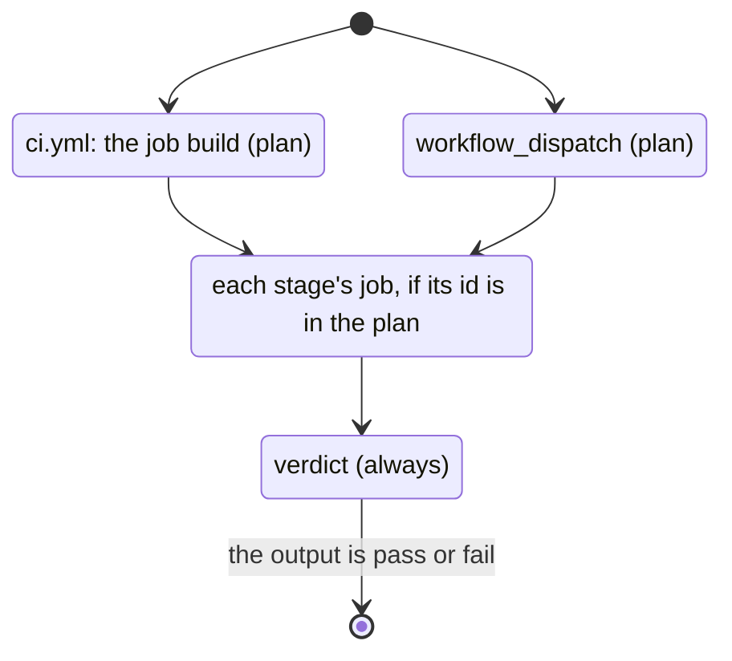

# Phase 0004: Build

Part of [ci-workflows](../PLAN.md). Planned 2026-11-22, the day [Phase 2 (Test)](0003-test.md) was closed. Facts are from `main` at `5320a89f`, read on that day: recount them
when a stage starts. This is **Phase 3 of the plan** (the numbering of phase documents is repository-wide, so it is `0004`): the second workflow that goes through the eight
passes. Its workflow is `build.yml` (`name: build`), which does not exist yet.

The plan's decisions, the passes and the invariants are in [PLAN.md](../PLAN.md); how a called workflow is judged is [ADR-0102](../../contrail/adrs/ci/0102-one-workflow-per-concern-and-the-verdict-job.md).
The cost of what exists is [research 0020](../research/0020-ci-baseline-after-the-test-phase.md). This document does not restate them.

Tags on claims: **[re-run]** I ran it for this document; **[read]** I read it in the file or log named; **[derived]** from documentation or inference; **[unverified]** not checked.

## Purpose and use cases

`build.yml` compiles what the repository ships, or may ship, for each target it is asked about, and proves each build by a check that can fail. It is the plan's answer to one question: *does this commit
still build, here?* Where Test asks what a change breaks, Build asks whether the artifacts can still be made. Its stages are **new**: no job of today's `ci` is a Build job, and the one build that
ships (the deploy bundle) belongs to the Release flow, for a reason in the next section.

| Use | What runs | Who decides |
|---|---|---|
| A pull request or a push to `main` | the stages the change needs | `plan-ci.py`, over the changed paths and the crate graph |
| A full run (an `rc/*` pull request, a merge-queue entry, the nightly, a dispatch of `ci`) | every stage | `ci.yml`'s `changes` job |
| A run of `build.yml` by hand | the plan it is given | the person who dispatches it |
| Phase 4 (Release) | the same stages, called for a release (**not decided here**: [PLAN.md](../PLAN.md) says Build's cross-target actions serve Release) | Phase 4 |

## What exists today (read 2026-11-22)

| Build | Where | What it builds | When | Cost |
|---|---|---|---|---|
| **The deploy bundle** | the composite action `.github/actions/build-bundle`, called by `deploy.yml` (`build`: a release candidate for staging) and `release.yml` (`build`: a tag, for production and the release's assets), and by both on a pull request that changes the action | the Worker and the edge Worker (`worker-build --release`), the `migrate` binary (native, release), the web app (`turbo`), in one reproducible `deploy-bundle.tar.gz`; **attested by the caller** | an `rc/*` dispatch, a tag, and a dry run on a pull request that touches `build-bundle`, the two workflows or `plan-release.sh` | 310 s (rc, run `45084816796`), 328 and 341 s (tags `v0.4.0`, `v0.3.0`), 265 and 396 s (two dry runs) [re-run: the jobs API] |
| The contract cells' builds | `scripts/contract.sh`: `cargo build -p thrust-server` (debug; **release only for the `bench` and `scale` passes**), `cargo run … --bin migrate`; the Worker cells build through wrangler's `[build]` (`worker-build --release`) | `thrust-server`, `migrate`, the Worker | inside each of the 26 cells, in a step with the pass itself | not timed apart from the pass |
| `web` | `web.yml` | the web app, the same five commands as the bundle | a web change | Test/Web's, not this phase's |
| The preview provisioner | `deploy-preview-provisioner.yml` (closed: by hand on `main`) | `worker-build --release` of `crates/preview-provisioner` | dispatch | not measured |
| `lint` | `lint.yml` | wasm32 *checks* (`clippy`, `cargo check`), not builds | a Rust change | Phase 5's |

**Not built by anything in CI:** an image of any kind, a release build of `thrust-server` outside the two cells' passes, anything for macOS, Windows or a BSD, anything for an Arm target. The repository has **no Dockerfile
of its own** (the two under `web/apps/web/` are the stock app's, and no job builds them) and `docs/src/architecture/infra.md` says that **nothing publishes the self-hosted server** [read].

### What the bundle's 297 seconds are (the first measurement)

The rc build of run `45084816796` (2026-11-22), from its job log, step by step [re-run]:

| Step | Seconds | Note |
|---|---|---|
| checkout, the commit check | 7.6 | |
| `setup-rust`: toolchain, the cache step | 12.9 | **"No cache found."** The key is `deploy-release`, and nothing has ever saved it |
| `cargo install worker-build --locked` | **106.3** | 36% of the job; compiled from source on every run |
| `npm install --global wrangler` | 7.5 | `worker-tools: "true"` installs it; no command of `build-bundle` names it [read] |
| `migrate` (native, release) | 26.7 | |
| the Worker (`worker-build --release . --no-default-features`) | 73.0 | |
| the edge Worker (`worker-build --release .`) | 17.2 | |
| `setup-node`, then the web app (pnpm install, turbo build) | 3.8 + 40.6 | |
| the bundle itself (`tar`, `gzip -n`) | 1.3 | |
| **checkout to bundle** | **296.9** | |

Why nothing saves the cache: `build-bundle`'s `save-cache` defaults to `false`, no caller passes it, and a cache saved from an `rc/*` branch or a tag is read by nothing else. **A cache saved on `main` is read
by every other ref** [derived: GitHub's rule that a run restores from its own ref, its base and the default branch; every job of `test.yml` and `lint.yml` is built on it, saves only on `main`, and all 25 entries
in the repository's cache are `refs/heads/main` (re-run: the caches API); a restore from a pull request's ref was not measured here]. Nothing runs `build-bundle` on `main`. That is a hypothesis for the `wasm` stage to measure, not a result: a `build.yml` job on `main` that builds the Workers with the key `deploy-release` could fill the cache that the
release candidate's and the tag's builds restore. The repository's cache is at its limit (10,167 of 10,240 MiB, research 0020), so any new key evicts another.

### What the native dependencies are

`cargo tree -p thrust-server -e normal --locked` [re-run]: no `openssl`, `native-tls`, `aws-lc`, zlib or zstd crate in the server's dependency tree; **`ring`** (C and assembly) is the one crate that
compiles foreign code, through `rustls` and `tokio-rustls`. `clippy --workspace --all-targets --locked` passes on `aarch64-apple-darwin` today [re-run: the deps-guards run before #350], so the
workspace type-checks on macOS; that is a check, not a release build. Whether `ring` builds on `x86_64-pc-windows-msvc` and on FreeBSD under the toolchain's pinned `1.100.0` is **[unverified]**: the
`windows` and `bsd` stages' first pass is that probe.

## Facts that shape the phase

- **The bundle's build cannot simply move into `build.yml`.** `verify-bundle.sh` requires the attestation of a release candidate to be signed by `deploy.yml` and the attestation of a tag by `release.yml`
  (`--signer-workflow`, by file path) [read: `.github/scripts/verify-bundle.sh` lines 31 to 44]. The build is a composite action, so it runs inside the caller's job and the caller attests it. A reusable
  workflow that attested its own output would be the signer instead [derived: not tested]. So the build of the bundle, and its attestation, stay in those two files in this phase, and moving them is Phase 4's
  (sbom, attest, slsa), with its verifier.
- **Nothing here is published.** No image, no binary and no installer is released, and the plan's Release phase decides what is. Build's artifacts are workflow artifacts with a short retention.
- **The web app is built by the same five commands in three places**: `web.yml`, `build-bundle` and `contract-pass-tools` (`setup-node` from `web/.node-version`, pnpm at the version `web/package.json` pins, `pnpm install
  --frozen-lockfile --ignore-scripts`, `turbo run build --filter=web`, and a check that `index.html` exists) [read]. The e2e script builds it a fourth way, only when it is not built.
- **`worker-build` runs in three places with different flags and directories**: `build-bundle` (`--release .` for the edge, `--release . --no-default-features` for the Worker), the cells' wrangler `[build]`
  (`worker-build --release`), and `deploy-preview-provisioner.yml` (`--release .` in `crates/preview-provisioner`). The `workers` job compiles the Worker for wasm32 tests, which is not the same artifact. The overlap
  with the contract cells that [PLAN.md](../PLAN.md) names is real, and what to share is measured in the `wasm` stage.
- **The repository is public** [re-run: `gh repo view`], so a standard hosted macOS, Windows or Arm runner costs no minutes [derived from GitHub's pricing rules: the first probe shows it]. The cost of a stage here is
  **wall clock and cache**, not money.
- **ADR-0102 allows no advisory job inside a callee** (Phase 2, stage 8): a job in `build.yml` is in the plan, `verdict` and `gate` from its first commit, and the early evidence is a dispatch of `build.yml` on the stage's
  branch. Whether a job that runs on every pull request gates every pull request is a pass 4 to 7 question, answered by the stage's measured time.
- **The toolchain is an exact version** (`rust-toolchain.toml`: `1.100.0`), so a target a stage adds is added to that toolchain, not to `stable`.

## Interface

| | |
|---|---|
| Inputs, called | `plan` (JSON array of the workflow's planned jobs), a required string |
| Inputs, by hand | the same, with a default (every stage) |
| Output | `verdict`: `pass` only when every planned job succeeded and every other was skipped; `ci.yml`'s `gate` requires it |
| Artifacts | one per stage and target, named `build-<stage>-<target>`, with `retention-days` of 1 to 7; none attached to a release |
| Permissions | `{}` at the top; `contents: read` on each job; **no secrets, no environments, no `id-token`** (attestation and publishing are Phase 4's) |
| Routing | by input, never by event name (a callee sees the caller's event, R9); no workflow-level `concurrency` (R8) |

## Acceptance criteria for the workflow

The phase is done when:
1. **Every stage has its section and its pass log**, and each of the eight passes for each job has either a pull request and its evidence or a recorded reason.
2. **The invariants of the plan hold in every pull request**, each with the control that shows it can fail.
3. **Nothing the jobs ran is lost.** The deploy bundle is built, attested and verified as before: `verify-bundle.sh` still accepts a release candidate's and a tag's bundle and **still refuses one signed by another
   workflow** (the control).
4. **Passes 5 to 7 are measured, not asserted.** Runner-seconds and the critical path of a full run are measured against research 0020 with `ci-baseline.py` (same window rule), and a pass that did not help says so.
5. **Every target the owner chose is built by a stage that fails when the build breaks**, shown by a control (a planted break the stage must catch), or is recorded with numbers as a target that does not compile or
   costs more than it shows, and dropped by the owner.
6. **The documents are true**: `running.md`, `cicd.md`'s table, the workflows README, checked by `cicd-table-vs-tree.py` and the index guard.

## The stages

The owner's tree names six: docker, windows, linux, macos, bsd, wasm. **All are new jobs**, so the rule "existing jobs first" has nothing to order. My order is **the most settled first, so the first stage is the template the
others follow; the one with a measured saving second; the probes, which cost nothing but time, next; and the ones that need a decision last.** The owner may change it.

| # | Stage | Job (proposed) | Exists today as | What the passes have to settle | Status |
|---|---|---|---|---|---|
| 1 | linux | `linux` | `migrate` (release) in the bundle; `thrust-server` (debug) in the cells; `thrust-server` (release) only in the `bench` and `scale` passes | **The template**: `build.yml`, its `verdict`, `ci.yml`'s `build` call, `gate`'s `needs`, the planner's `JOBS`, `WORKFLOWS` and path rules, the wiring test and the mutants; what an artifact is; which triples (question 2) | **passes 1 to 7 done** (#352, merged 2026-11-23, and this record; [below](#stage-1-in-detail-linux-the-template)): the job is 134 s cold and 101 to 102 s with the cache (−24%), off every critical path; a break that only the release profile sees turned it, its `verdict` and `gate` red and nothing else (probe B), where every debug-built job stayed green |
| 2 | wasm | `wasm` | the bundle's two `worker-build` runs (73 s and 17 s, after 106 s to install the tool), the cells' wrangler build, the provisioner's | whether the Workers are built once and shared or twice; **the `deploy-release` cache saved from `main`** (hypothesis above); installing `worker-build` as a prebuilt binary instead of compiling it; whether `wrangler` is needed in a build at all; the exact-duplicate web action below | not started |
| 3 | macos | `macos` | nothing | the probe: does the server build on `aarch64-apple-darwin`, how long, what artifact; whether a cache fits the budget | not started |
| 4 | windows | `windows` | nothing | the probe: does `ring` build on `x86_64-pc-windows-msvc`; the shell the steps run in (bash is on the runner) | not started |
| 5 | docker | `docker` | nothing: no Dockerfile | question 3; an image built from a Dockerfile of the repository's, **not pushed** | not started |
| 6 | bsd | `bsd` | nothing | question 2; a VM on a hosted runner or a cross toolchain: a survey of public solutions comes first; the stage is dropped if neither is worth its time | not started |

Each stage's section (purpose, acceptance, state machine, steps, a survey of public solutions, custom code and its probe, the pass log) is written **when the stage starts**, not before.

### Stage 1 in detail: `linux`, the template

**Purpose and use cases.** `linux` proves that the native server and the migration binary still build in **release** for the runner's own target, `x86_64-unknown-linux-gnu`, and keeps what it built for three days. It is also the stage that makes `build.yml` exist: the workflow, its `verdict`, `ci.yml`'s call, the gate's `needs`, the planner's job and workflow, and the wiring checks and mutants that every later stage inherits. It runs for a pull request or a push that affects `thrust-server` or `thrust-adapters-postgres` (the crate of `migrate`), for a change of `build.yml` itself and for a full run, and alone by dispatching `build.yml` with the plan `["linux"]`.

**Acceptance.**
1. It fails when the release build of either binary fails, and when either binary is missing, shown by a control.
2. A planned `linux` that fails turns `build / verdict` and `gate` red: structurally (the wiring checks and the 41 new mutants, below) and live (probe B, below).
3. It is planned for exactly the changes above, tested against an independent model.
4. It publishes, signs and attests nothing, and holds no secret, environment or `id-token`.
5. It is documented: `cicd.md`, `running.md` (a row and a runbook), the workflows index.

**Steps** (`.github/workflows/build.yml`): checkout; `setup-rust` (toolchain from `rust-toolchain.toml`, a `rust-cache` keyed `build-linux`, saved on `main` only); `cargo build --release --locked -p thrust-server`; `cargo build --release --locked -p thrust-adapters-postgres --features native --bin migrate` (the line `build-bundle` builds it with, held equal by the wiring test); a check that both binaries exist; an upload of both as `build-linux-x86_64-unknown-linux-gnu` for three days.

**What it costs** (run `45094823898` of #352, a full run, `build / linux`; **cold**, as the run of every pull request is, because the cache is saved on `main` only) [re-run: the job's log]:

| Step | Seconds | Note |
|---|---|---|
| checkout | 6.1 | |
| `setup-rust`: toolchain, cache restore | 11.5 | "No cache found." |
| `cargo build --release --locked -p thrust-server` | **86.5** | cargo: "Finished `release` profile in 1m 26s" |
| `cargo build --release … --bin migrate` | 21.7 | `thrust-adapters-postgres` is compiled a second time, with the feature `native` |
| the check, the upload | 2.7 | two files, 5,207,243 bytes zipped |
| **the job** | **134** | |

What it shows:
- **It is cheap, and on no critical path.** The run took 594 s and had 48 jobs (the 46 of research 0020, and `linux` and `verdict`); the e2e cell, 552 s, set the wall clock; `build / linux` is the 12th longest job, between `hermetic` (143 s) and `ci-scripts` (131 s). So it runs wherever the planner plans it, with no reason to make it a full-run-only job.
- **The repository's `[profile.release]` is the Worker's** (`opt-level = "s"`, fat LTO, one codegen unit), and the native server it makes is 10.2 MB (`thrust-server`: 10,186,032 bytes; `migrate`: 2,568,016), a dynamically linked, not stripped, x86-64 ELF for GNU/Linux [re-run: `file` on the downloaded artifact, inspected and not run]. A server for distribution may want a profile of its own (`opt-level = 3`, a stripped binary, a static one): that is a Phase 4 and `docker` question (stage 5), and nothing here decides it.
- **`migrate` costs 21.7 s on top** because the server's build and `migrate`'s build need `thrust-adapters-postgres` with different features. The two commands stay two, because the second is the command the deploy bundle uses, and the proof is of that command.
- **The artifact is 5.2 MB for three days** (it expires 2026-11-26 for this run). Six targets will multiply it, so the retention stays short; the limit of GitHub's artifact storage was not looked up here **[unverified]**.

**Survey of public solutions** (what a native Linux release build needs, and the candidates):

| Candidate | Read from | Fit | Decision |
|---|---|---|---|
| `cargo build` | the toolchain | the build of the runner's own target; the commands the repository already runs | **chosen** |
| `actions/upload-artifact` | already pinned in the repository (`v7.0.2`) | the upload of a short-lived workflow artifact | **chosen** |
| `taiki-e/upload-rust-binary-action` | its README and `action.yml` | builds a Rust binary and **uploads it to a GitHub Release** (`contents: write`; `tar.gz` named `$bin-$target`; `build-tool` cargo, cross or cargo-zigbuild) | rejected here: writing to a release is Phase 4's; **a candidate for Release** |
| `houseabsolute/actions-rust-cross` | its README | cross-compiles with `cross`; "for Linux and BSD targets, an x86-64 Linux runner"; its example matrix includes FreeBSD, Windows and macOS | rejected for a native build (the README says a native Arm build does not need it); **a candidate for `bsd`** (stage 6), to be read again and pinned there |
| `Swatinem/rust-cache` | already used by `setup-rust` | the cache of the dependencies | **chosen**, as every Rust job: whether it pays for this job is pass 5 |

**Custom code, and why it has no built-in.** One piece: the check that both binaries exist (a `for` over two names and `test -x`). `cargo build --bin <name>` would fail on a renamed binary, but not on one written elsewhere (a `build.target-dir` or `--target` in `.cargo/config.toml` moves it), and `upload-artifact`'s `if-no-files-found: error` is documented to fail when **no** file is found, which is not the same as one of two missing **[unverified: how it treats one missing of two]**. The check says which binary is missing before the upload does. Its control is the step's own text, taken from `build.yml`: it fails in a directory with no binary, with only `thrust-server` and with only `migrate`, and passes with both (`scratchpad/linux-check-control.py`, 4 of 4).

**The probes** (#354, a draft opened on `main`'s new head, **closed unmerged**, its branch deleted; it changed one file, `crates/server/src/main.rs`):

| Probe | Run | What it showed |
|---|---|---|
| A: a comment line | `45095952963`, an affected-only run | The planner planned `build / linux` with `deps`, `lint`, `hermetic`, `ci-scripts`, the four `mutants` legs and the ten native cells, and skipped `pg-adapter`, `workers`, `web`, `docs` and `deny`. `gate` passed. `linux` took 101 s, with a cache hit from `main`. The longest job was `mutants` leg 0, 309 s |
| B: `#[cfg(not(debug_assertions))] compile_error!(…)` | `45096904701` | **`build / linux` failed in 40 s with the planted error** (`error: PROBE B: a break that only the release profile sees`, exit 101), `build / verdict` failed, and `gate` failed: `GATE FAIL: build was expected to run and its result is 'failure'`. Of the run's 29 jobs, 21 succeeded, 5 were skipped and 3 failed: those three. The verdicts of `lint` and `test` said `pass`: **nothing else saw the break**, because the contract cells, the mutants, the tests and clippy build in debug |

Probe B is the stage's reason to exist, and the live control of the invariant that a planned job that fails turns the gate red, for a job in a workflow that did not exist before this stage.

**Failure modes (pass 2).** A compile error that only the release profile has (an item behind `cfg(debug_assertions)`, a link error under LTO): the cells build in debug and would not see it, which is the stage's reason to exist (probe B shows it). A lockfile that `--locked` refuses. Cargo exiting 0 and building nothing (the check). A run of 30 minutes (the timeout; the job takes 134 s). A runner without the toolchain's download (the same as every Rust job). Its cache entry evicting another's, in a repository at its 10 GB limit (pass 5).

**Pass log.**

| Pass | Where | Evidence |
|---|---|---|
| 1 PoC | #352's run `45094823898` | `build / linux` green on a real input (the commit itself); the check's control (4 of 4); the artifact downloaded and inspected |
| 2 Prototype | #352's run, `main`'s push run `45095756737`, the dispatch `45096751902`, probe A | it runs on its real triggers: `workflow_call` from `ci.yml` in a full run (#352's, and `main`'s own push run for the merge, green, 167 s because it saved the cache), in an affected-only run (probe A), and alone by `workflow_dispatch` with the plan `["linux"]` (on `main`: a new workflow cannot be dispatched from a branch, because GitHub reads its file from the default branch, so the pull request's own run was the proof of concept); its failure modes are listed above |
| 3 Documented | #352 | `cicd.md` (row, planner rule, examples re-run through the planner, the counts), `running.md` (rows and a runbook), the workflows index; header comment of `build.yml` |
| 4 MVP | #352 | in the gate: the planner's `JOBS` and `WORKFLOWS`, `ci.yml`'s call, `gate`'s `needs` and `VERDICT_JOBS`, `assert-gate.sh`'s list; `test_plan_ci.py` 7048, `test_workflow_wiring.py` 196, `test-ci-scripts.sh` 221, `mutate_gate.py` **313 of 313 killed** (272 before; 41 new: 18 made for the new call and file, 23 by hand), 12 that change nothing survive; `ci-commands.py` against `main`: 3 jobs appear, none is gone, the one changed job is the gate's `VERDICT_JOBS`; the 28 commands of `deps`, `deny`, `fmt` and clippy pass; green on a full run (#352's `45094823898` and `main`'s `45095756737`, `gate` by name) and on an affected-only run (probe A), and **red where it must be** (probe B) |
| 5 Caching | the dispatch `45096751902` on `main`, probe A's run `45095952963` | **Measured, and it pays: 134 s cold to 101 and 102 s warm (−24%).** The cold figure is #352's run (`build / linux`, "No cache found"); `main`'s own run of the merge took 167 s because it saved the cache (222.8 MB: `v0-rust-build-linux-Linux-x64-2fd77104-272d588c`). Warm, on `main` (dispatch of `build.yml` with the plan `["linux"]`, "Cache hit … full match") and on a pull request (probe A: **a pull request's run restores the cache `main` saved**, which the plan had listed as not yet measured): restore 4.3 s (the step total 17.7 s against 11.5 s, which had no download), the server build 86.5 s to 54.9 s, `migrate` 21.7 s to 13.6 s. The first real change after the merge, #353 (a fix in `thrust-adapters-postgres`, so `linux` was planned), took **89 s** on `main`'s push run `45097099843`. What the cache holds is the dependencies: the workspace's own crates are recompiled (`cache-workspace-crates` is off), and the fat LTO runs each time. The key is `rust-cache`'s own (prefix, `shared-key: build-linux`, the job, a hash of the Rust environment, a hash of the lockfile), and it changes with the lockfile: the repository's other caches show four generations of the same job's key (`209984db`, `e40323b1`, `7bbf394d`, `272d588c`). The repository's caches are 10,370 MiB of 10,240 with this entry in (26 entries), so it costs the oldest entry its place (the `mutants` cache of 2026-11-19, 708 MB, last used 11-20): kept, because 32 s of 134 is a saving no other job of the workflow gives |
| 6 Parallelization | measured on the same runs | **No change.** The job is on no critical path (a full run: the e2e cell, 552 s; an affected-only run of a server change: `mutants` leg 0, 309 s), so making it shorter would shorten nothing. Its two commands share one `target/`, and a second job for `migrate` would pay the checkout and the setup (about 18 s) to save 13.6 s |
| 7 CPU minimization | runner-seconds | **No change.** A planned `linux` costs 101 to 134 runner-seconds, about 2% of a full run's median (5,240 s, research 0020), and it is planned by crate, as the other jobs are. A rule that spared it for a change to a crate's tests would need the planner to tell a test file from a source file, which it does not (a crate's files are the crate), for a saving of the same 2%. Not done |

## Action candidates

**Exact duplicate (created without asking, said in the pull request that creates it):**

| Steps | Where | Proposed |
|---|---|---|
| The web app's build: `setup-node` (`web/.node-version`), pnpm at the pinned version, `pnpm install --frozen-lockfile --ignore-scripts`, `turbo run build --filter=web`, the `index.html` check | `web.yml`, `build-bundle`, `contract-pass-tools` | a composite action, `build-web`, created in the first stage that edits one of the three (the `wasm` stage edits `build-bundle`), with the other two moved onto it in the same pull request |

**Near-duplicates (to ask about, side by side, at the stage):** the Worker builds above (`--release .`, `--no-default-features`, wrangler's `[build]`) differ in flags and directory; whether one action serves them is
asked at stage 2. The native steps of `linux`, `macos` and `windows` are the same steps on three runners: a matrix of one job and not an action, unless stage 1 shows a reason against.

## Questions for the owner (planning)

**All four answered on 2026-11-23, as recommended** (the owner chose the recommended option of each; the decisions are in the table below).

| Question | Decision (owner, 2026-11-23) |
|---|---|
| 1. What does Build build? | **All six stages, as compile proofs**: each builds its target and uploads a short-lived workflow artifact; nothing is published (Phase 4's). A target that does not compile, or costs more than it shows, is recorded with its numbers and dropped by the owner |
| 2. Which targets? | **One per stage first**: `x86_64-unknown-linux-gnu` (and `-musl` for the image), `aarch64-apple-darwin`, `x86_64-pc-windows-msvc`, `x86_64-unknown-freebsd`. Other arches and other BSDs only if the owner names them |
| 3. A Dockerfile? | **Yes, at stage 5**, for `thrust-server` and `migrate`; the design (base image, user, where it lives) is put to the owner then; the image is built and not pushed |
| 4. The deploy bundle | **Stays** built and attested by `deploy.yml` and `release.yml` through `build-bundle`. Moving it is Phase 4's, with its verifier |

The questions as asked:

1. **What does Build build?** Only what the repository ships (the Workers, `migrate`, the web app, which the bundle already builds), or every target in your tree as a **compile proof**, uploading a short-lived
   workflow artifact and publishing nothing? *Recommended: all six stages as proofs.* `thrust-server` has no release build in CI today and nothing publishes it, so the stages for macOS, Windows, the image and a BSD
   build things that nobody ships yet; the cost is wall clock and cache, not money (the repository is public). A target that does not compile, or costs more than it shows, is recorded with its numbers and dropped
   by you. Publishing is Phase 4's.
2. **Which targets?** *Recommended, one per stage first:* `x86_64-unknown-linux-gnu` (and `x86_64-unknown-linux-musl`, the static build the image wants), `aarch64-apple-darwin`, `x86_64-pc-windows-msvc`,
   `x86_64-unknown-freebsd`. Arm Linux and Arm Windows, Intel macOS, and NetBSD or OpenBSD are added only if you name them. The rustc book's platform-support pages say FreeBSD (`x86_64` and `aarch64`) and NetBSD (`x86_64`) are **Tier 2 with host tools**, installable with `rustup`, and
   OpenBSD is **Tier 3**, with no prebuilt standard library (so it would need a nightly and `-Zbuild-std`, which the pinned stable `1.100.0` does not give) [read: the search results of 2026-11-22, one snapshot of which
   was old; the `bsd` stage re-reads the live pages before building anything].
3. **May the `docker` stage add a Dockerfile to the repository?** `infra.md` says the project has none of its own and does not say why. *Recommended: yes, at stage 5, for `thrust-server` and `migrate`*, and I put
   the design (base image, user, where the file lives) to you then, with the image built and **not** pushed.
4. **The bundle stays where it is.** `build-bundle` is called by `deploy.yml` and `release.yml`, which are the signers `verify-bundle.sh` requires. *Recommended: it stays; Build's `wasm` stage proves the Workers on
   the same commands at pull-request time, and may fill a cache the bundle restores; moving the bundle's build is a Phase 4 question, with its verifier.* Say if you want it moved now.

## To resolve in the phase (mine, by measurement)

- Whether each stage runs on every pull request that touches Rust (the planner's affected-only rule over `thrust-server`'s dependency closure) or on a full run only. The critical path is the e2e cell at 508 to 663 s
  (research 0020); a stage that is slower than that **becomes** the critical path, so the stage's time decides.
- Matrix of one job or one job per target (the verdict reads job ids; a matrix is judged as one).
- Artifact names and retention; whether a pull request needs them at all.
- The cache budget: the repository's Rust caches today are 0.07 to 0.78 GB each, so a native target adds that to a repository at its 10 GB limit. A stage that cannot show a benefit does not get a key.
