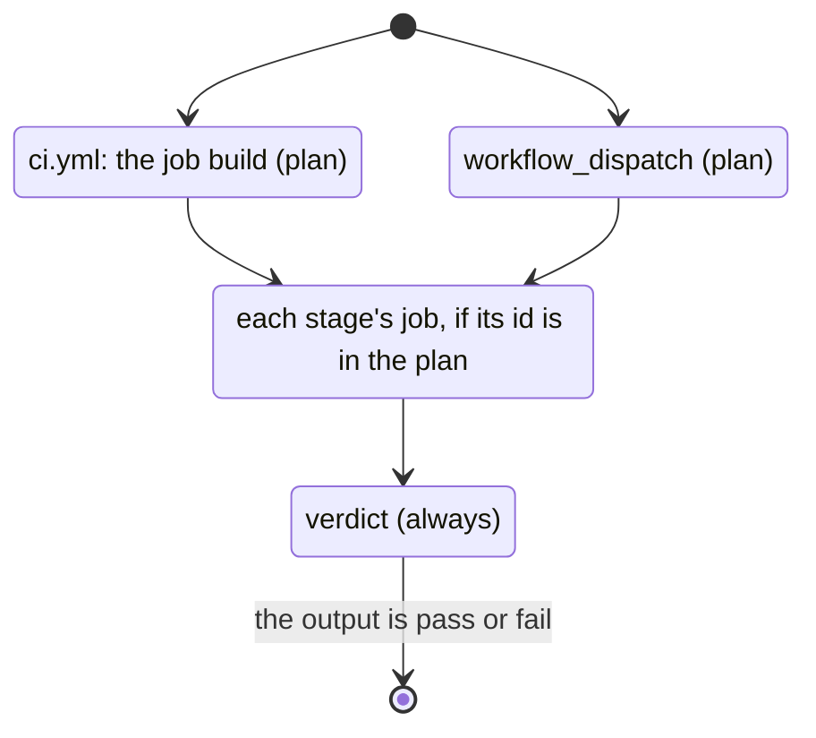

# Phase 0004: Build

Part of [ci-workflows](../PLAN.md). Planned 2026-11-22, the day [Phase 2 (Test)](0003-test.md) was closed. Facts are from `main` at `5320a89f`, read on that day: recount them
when a stage starts. This is **Phase 3 of the plan** (the numbering of phase documents is repository-wide, so it is `0004`): the second workflow that goes through the eight
passes. Its workflow is `build.yml` (`name: build`), which does not exist yet.

The plan's decisions, the passes and the invariants are in [PLAN.md](../PLAN.md); how a called workflow is judged is [ADR-0102](../../contrail/adrs/ci/0102-one-workflow-per-concern-and-the-verdict-job.md).
The cost of what exists is [research 0020](../research/0020-ci-baseline-after-the-test-phase.md). This document does not restate them.

Tags on claims: **[re-run]** I ran it for this document; **[read]** I read it in the file or log named; **[derived]** from documentation or inference; **[unverified]** not checked.

## Purpose and use cases

`build.yml` compiles what the repository ships, or may ship, for each target it is asked about, and proves each build by a check that can fail. It is the plan's answer to one question: *does this commit
still build, here?* Where Test asks what a change breaks, Build asks whether the artifacts can still be made. Its stages are **new**: no job of today's `ci` is a Build job, and the one build that
ships (the deploy bundle) belongs to the Release flow, for a reason in the next section.

| Use | What runs | Who decides |
|---|---|---|
| A pull request or a push to `main` | the stages the change needs | `plan-ci.py`, over the changed paths and the crate graph |
| A full run (an `rc/*` pull request, a merge-queue entry, the nightly, a dispatch of `ci`) | every stage | `ci.yml`'s `changes` job |
| A run of `build.yml` by hand | the plan it is given | the person who dispatches it |
| Phase 4 (Release) | the same stages, called for a release (**not decided here**: [PLAN.md](../PLAN.md) says Build's cross-target actions serve Release) | Phase 4 |

## What exists today (read 2026-11-22)

| Build | Where | What it builds | When | Cost |
|---|---|---|---|---|
| **The deploy bundle** | the composite action `.github/actions/build-bundle`, called by `deploy.yml` (`build`: a release candidate for staging) and `release.yml` (`build`: a tag, for production and the release's assets), and by both on a pull request that changes the action | the Worker and the edge Worker (`worker-build --release`), the `migrate` binary (native, release), the web app (`turbo`), in one reproducible `deploy-bundle.tar.gz`; **attested by the caller** | an `rc/*` dispatch, a tag, and a dry run on a pull request that touches `build-bundle`, the two workflows or `plan-release.sh` | 310 s (rc, run `45084816796`), 328 and 341 s (tags `v0.4.0`, `v0.3.0`), 265 and 396 s (two dry runs) [re-run: the jobs API] |
| The contract cells' builds | `scripts/contract.sh`: `cargo build -p thrust-server` (debug; **release only for the `bench` and `scale` passes**), `cargo run … --bin migrate`; the Worker cells build through wrangler's `[build]` (`worker-build --release`) | `thrust-server`, `migrate`, the Worker | inside each of the 26 cells, in a step with the pass itself | not timed apart from the pass |
| `web` | `web.yml` | the web app, the same five commands as the bundle | a web change | Test/Web's, not this phase's |
| The preview provisioner | `deploy-preview-provisioner.yml` (closed: by hand on `main`) | `worker-build --release` of `crates/preview-provisioner` | dispatch | not measured |
| `lint` | `lint.yml` | wasm32 *checks* (`clippy`, `cargo check`), not builds | a Rust change | Phase 5's |

**Not built by anything in CI:** an image of any kind, a release build of `thrust-server` outside the two cells' passes, anything for macOS, Windows or a BSD, anything for an Arm target. The repository has **no Dockerfile
of its own** (the two under `web/apps/web/` are the stock app's, and no job builds them) and `docs/src/architecture/infra.md` says that **nothing publishes the self-hosted server** [read].

### What the bundle's 297 seconds are (the first measurement)

The rc build of run `45084816796` (2026-11-22), from its job log, step by step [re-run]:

| Step | Seconds | Note |
|---|---|---|
| checkout, the commit check | 7.6 | |
| `setup-rust`: toolchain, the cache step | 12.9 | **"No cache found."** The key is `deploy-release`, and nothing has ever saved it |
| `cargo install worker-build --locked` | **106.3** | 36% of the job; compiled from source on every run |
| `npm install --global wrangler` | 7.5 | `worker-tools: "true"` installs it; no command of `build-bundle` names it [read] |
| `migrate` (native, release) | 26.7 | |
| the Worker (`worker-build --release . --no-default-features`) | 73.0 | |
| the edge Worker (`worker-build --release .`) | 17.2 | |
| `setup-node`, then the web app (pnpm install, turbo build) | 3.8 + 40.6 | |
| the bundle itself (`tar`, `gzip -n`) | 1.3 | |
| **checkout to bundle** | **296.9** | |

Why nothing saves the cache: `build-bundle`'s `save-cache` defaults to `false`, no caller passes it, and a cache saved from an `rc/*` branch or a tag is read by nothing else. **A cache saved on `main` is read
by every other ref** [derived: GitHub's rule that a run restores from its own ref, its base and the default branch; every job of `test.yml` and `lint.yml` is built on it, saves only on `main`, and all 25 entries
in the repository's cache are `refs/heads/main` (re-run: the caches API); a restore from a pull request's ref was not measured here]. Nothing runs `build-bundle` on `main`. That is a hypothesis for the `wasm` stage to measure, not a result: a `build.yml` job on `main` that builds the Workers with the key `deploy-release` could fill the cache that the
release candidate's and the tag's builds restore. The repository's cache is at its limit (10,167 of 10,240 MiB, research 0020), so any new key evicts another.

### What the native dependencies are

`cargo tree -p thrust-server -e normal --locked` [re-run]: no `openssl`, `native-tls`, `aws-lc`, zlib or zstd crate in the server's dependency tree; **`ring`** (C and assembly) is the one crate that
compiles foreign code, through `rustls` and `tokio-rustls`. `clippy --workspace --all-targets --locked` passes on `aarch64-apple-darwin` today [re-run: the deps-guards run before #350], so the
workspace type-checks on macOS; that is a check, not a release build. Whether `ring` builds on `x86_64-pc-windows-msvc` and on FreeBSD under the toolchain's pinned `1.100.0` is **[unverified]**: the
`windows` and `bsd` stages' first pass is that probe.

## Facts that shape the phase

- **The bundle's build cannot simply move into `build.yml`.** `verify-bundle.sh` requires the attestation of a release candidate to be signed by `deploy.yml` and the attestation of a tag by `release.yml`
  (`--signer-workflow`, by file path) [read: `.github/scripts/verify-bundle.sh` lines 31 to 44]. The build is a composite action, so it runs inside the caller's job and the caller attests it. A reusable
  workflow that attested its own output would be the signer instead [derived: not tested]. So the build of the bundle, and its attestation, stay in those two files in this phase, and moving them is Phase 4's
  (sbom, attest, slsa), with its verifier.
- **Nothing here is published.** No image, no binary and no installer is released, and the plan's Release phase decides what is. Build's artifacts are workflow artifacts with a short retention.
- **The web app is built by the same five commands in three places**: `web.yml`, `build-bundle` and `contract-pass-tools` (`setup-node` from `web/.node-version`, pnpm at the version `web/package.json` pins, `pnpm install
  --frozen-lockfile --ignore-scripts`, `turbo run build --filter=web`, and a check that `index.html` exists) [read]. The e2e script builds it a fourth way, only when it is not built.
- **`worker-build` runs in three places with different flags and directories**: `build-bundle` (`--release .` for the edge, `--release . --no-default-features` for the Worker), the cells' wrangler `[build]`
  (`worker-build --release`), and `deploy-preview-provisioner.yml` (`--release .` in `crates/preview-provisioner`). The `workers` job compiles the Worker for wasm32 tests, which is not the same artifact. The overlap
  with the contract cells that [PLAN.md](../PLAN.md) names is real, and what to share is measured in the `wasm` stage.
- **The repository is public** [re-run: `gh repo view`], so a standard hosted macOS, Windows or Arm runner costs no minutes [derived from GitHub's pricing rules: the first probe shows it]. The cost of a stage here is
  **wall clock and cache**, not money.
- **ADR-0102 allows no advisory job inside a callee** (Phase 2, stage 8): a job in `build.yml` is in the plan, `verdict` and `gate` from its first commit, and the early evidence is a dispatch of `build.yml` on the stage's
  branch. Whether a job that runs on every pull request gates every pull request is a pass 4 to 7 question, answered by the stage's measured time.
- **The toolchain is an exact version** (`rust-toolchain.toml`: `1.100.0`), so a target a stage adds is added to that toolchain, not to `stable`.

## Interface

| | |
|---|---|
| Inputs, called | `plan` (JSON array of the workflow's planned jobs), a required string |
| Inputs, by hand | the same, with a default (every stage) |
| Output | `verdict`: `pass` only when every planned job succeeded and every other was skipped; `ci.yml`'s `gate` requires it |
| Artifacts | one per stage and target, named `build-<stage>-<target>`, with `retention-days` of 1 to 7; none attached to a release |
| Permissions | `{}` at the top; `contents: read` on each job; **no secrets, no environments, no `id-token`** (attestation and publishing are Phase 4's) |
| Routing | by input, never by event name (a callee sees the caller's event, R9); no workflow-level `concurrency` (R8) |

## Acceptance criteria for the workflow

The phase is done when:
1. **Every stage has its section and its pass log**, and each of the eight passes for each job has either a pull request and its evidence or a recorded reason.
2. **The invariants of the plan hold in every pull request**, each with the control that shows it can fail.
3. **Nothing the jobs ran is lost.** The deploy bundle is built, attested and verified as before: `verify-bundle.sh` still accepts a release candidate's and a tag's bundle and **still refuses one signed by another
   workflow** (the control).
4. **Passes 5 to 7 are measured, not asserted.** Runner-seconds and the critical path of a full run are measured against research 0020 with `ci-baseline.py` (same window rule), and a pass that did not help says so.
5. **Every target the owner chose is built by a stage that fails when the build breaks**, shown by a control (a planted break the stage must catch), or is recorded with numbers as a target that does not compile or
   costs more than it shows, and dropped by the owner.
6. **The documents are true**: `running.md`, `cicd.md`'s table, the workflows README, checked by `cicd-table-vs-tree.py` and the index guard.

## The stages

The owner's tree names six: docker, windows, linux, macos, bsd, wasm. **All are new jobs**, so the rule "existing jobs first" has nothing to order. My order is **the most settled first, so the first stage is the template the
others follow; the one with a measured saving second; the probes, which cost nothing but time, next; and the ones that need a decision last.** The owner may change it.

| # | Stage | Job (proposed) | Exists today as | What the passes have to settle | Status |
|---|---|---|---|---|---|
| 1 | linux | `linux` | `migrate` (release) in the bundle; `thrust-server` (debug) in the cells; `thrust-server` (release) only in the `bench` and `scale` passes | **The template**: `build.yml`, its `verdict`, `ci.yml`'s `build` call, `gate`'s `needs`, the planner's `JOBS`, `WORKFLOWS` and path rules, the wiring test and the mutants; what an artifact is; which triples (question 2) | **passes 1 to 7 done** (#352, merged 2026-11-23, and this record; [below](#stage-1-in-detail-linux-the-template)): the job is 134 s cold and 101 to 102 s with the cache (−24%), off every critical path; a break that only the release profile sees turned it, its `verdict` and `gate` red and nothing else (probe B), where every debug-built job stayed green |
| 2 | wasm | `wasm` | the bundle's two `worker-build` runs (73 s and 17 s, after 106 s to install the tool), the cells' wrangler build, the provisioner's | whether the Workers are built once and shared or twice; **the `deploy-release` cache saved from `main`** (hypothesis above); installing `worker-build` as a prebuilt binary instead of compiling it; whether `wrangler` is needed in a build at all (the web action is not made here: the owner deferred it, see *Action candidates*) | **passes 1 to 7 done** (#356, merged 2026-11-23, and this record; [below](#stage-2-in-detail-wasm)): 238 s cold, 79 s warm (−67%); **the bundle restores the cache**: a release candidate's build 310 s to 165 s, a tag's 328 and 341 s to 176 s |
| 3 | macos | `macos` (in `build-extended.yml`: **not a required check**, by the owner's decision of 2026-11-23) | nothing | the probe: does the server build on `aarch64-apple-darwin`, how long, what artifact; whether a cache fits the budget | **passes 1 to 7 done** (#365 and #367, merged 2026-11-23, and this record; [below](#stage-3-in-detail-macos)): it builds, first try, in 234 s cold (the server 173 s) and **134 s with the cache** (-46% against the dispatch that saved it); its cache was never saved until #367 fixed the layout (the action called `setup-rust`, two composites deep) |
| 4 | windows | `windows` (in `build-extended.yml`, **not a required check**: my assumption, on the owner's reasoning for macOS, asked in #367) | nothing | the probe: does `ring` build on `x86_64-pc-windows-msvc`; the shell the steps run in (bash is on the runner) | **passes 1 to 7 done** (#367, merged 2026-11-23, and this record; [below](#stage-4-in-detail-windows)): it builds, first try, in 219 to 290 s cold (the server 136 to 203 s) and **133 s with the cache** (-39%); the stage also found why no native cache was saved |
| 5 | docker | `docker` | nothing: no Dockerfile | question 3; an image built from a Dockerfile of the repository's, **not pushed** | not started |
| 6 | bsd | `bsd` | nothing | question 2; a VM on a hosted runner or a cross toolchain: a survey of public solutions comes first; the stage is dropped if neither is worth its time | not started |

Each stage's section (purpose, acceptance, state machine, steps, a survey of public solutions, custom code and its probe, the pass log) is written **when the stage starts**, not before.

### Stage 1 in detail: `linux`, the template

**Purpose and use cases.** `linux` proves that the native server and the migration binary still build in **release** for the runner's own target, `x86_64-unknown-linux-gnu`, and keeps what it built for three days. It is also the stage that makes `build.yml` exist: the workflow, its `verdict`, `ci.yml`'s call, the gate's `needs`, the planner's job and workflow, and the wiring checks and mutants that every later stage inherits. It runs for a pull request or a push that affects `thrust-server` or `thrust-adapters-postgres` (the crate of `migrate`), for a change of `build.yml` itself and for a full run, and alone by dispatching `build.yml` with the plan `["linux"]`.

**Acceptance.**
1. It fails when the release build of either binary fails, and when either binary is missing, shown by a control.
2. A planned `linux` that fails turns `build / verdict` and `gate` red: structurally (the wiring checks and the 41 new mutants, below) and live (probe B, below).
3. It is planned for exactly the changes above, tested against an independent model.
4. It publishes, signs and attests nothing, and holds no secret, environment or `id-token`.
5. It is documented: `cicd.md`, `running.md` (a row and a runbook), the workflows index.

**Steps** (`.github/workflows/build.yml`): checkout; `setup-rust` (toolchain from `rust-toolchain.toml`, a `rust-cache` keyed `build-linux`, saved on `main` only); `cargo build --release --locked -p thrust-server`; `cargo build --release --locked -p thrust-adapters-postgres --features native --bin migrate` (the line `build-bundle` builds it with, held equal by the wiring test); a check that both binaries exist; an upload of both as `build-linux-x86_64-unknown-linux-gnu` for three days.

**What it costs** (run `45094823898` of #352, a full run, `build / linux`; **cold**, as the run of every pull request is, because the cache is saved on `main` only) [re-run: the job's log]:

| Step | Seconds | Note |
|---|---|---|
| checkout | 6.1 | |
| `setup-rust`: toolchain, cache restore | 11.5 | "No cache found." |
| `cargo build --release --locked -p thrust-server` | **86.5** | cargo: "Finished `release` profile in 1m 26s" |
| `cargo build --release … --bin migrate` | 21.7 | `thrust-adapters-postgres` is compiled a second time, with the feature `native` |
| the check, the upload | 2.7 | two files, 5,207,243 bytes zipped |
| **the job** | **134** | |

What it shows:
- **It is cheap, and on no critical path.** The run took 594 s and had 48 jobs (the 46 of research 0020, and `linux` and `verdict`); the e2e cell, 552 s, set the wall clock; `build / linux` is the 12th longest job, between `hermetic` (143 s) and `ci-scripts` (131 s). So it runs wherever the planner plans it, with no reason to make it a full-run-only job.
- **The repository's `[profile.release]` is the Worker's** (`opt-level = "s"`, fat LTO, one codegen unit), and the native server it makes is 10.2 MB (`thrust-server`: 10,186,032 bytes; `migrate`: 2,568,016), a dynamically linked, not stripped, x86-64 ELF for GNU/Linux [re-run: `file` on the downloaded artifact, inspected and not run]. A server for distribution may want a profile of its own (`opt-level = 3`, a stripped binary, a static one): that is a Phase 4 and `docker` question (stage 5), and nothing here decides it.
- **`migrate` costs 21.7 s on top** because the server's build and `migrate`'s build need `thrust-adapters-postgres` with different features. The two commands stay two, because the second is the command the deploy bundle uses, and the proof is of that command.
- **The artifact is 5.2 MB for three days** (it expires 2026-11-26 for this run). Six targets will multiply it, so the retention stays short; the limit of GitHub's artifact storage was not looked up here **[unverified]**.

**Survey of public solutions** (what a native Linux release build needs, and the candidates):

| Candidate | Read from | Fit | Decision |
|---|---|---|---|
| `cargo build` | the toolchain | the build of the runner's own target; the commands the repository already runs | **chosen** |
| `actions/upload-artifact` | already pinned in the repository (`v7.0.2`) | the upload of a short-lived workflow artifact | **chosen** |
| `taiki-e/upload-rust-binary-action` | its README and `action.yml` | builds a Rust binary and **uploads it to a GitHub Release** (`contents: write`; `tar.gz` named `$bin-$target`; `build-tool` cargo, cross or cargo-zigbuild) | rejected here: writing to a release is Phase 4's; **a candidate for Release** |
| `houseabsolute/actions-rust-cross` | its README | cross-compiles with `cross`; "for Linux and BSD targets, an x86-64 Linux runner"; its example matrix includes FreeBSD, Windows and macOS | rejected for a native build (the README says a native Arm build does not need it); **a candidate for `bsd`** (stage 6), to be read again and pinned there |
| `Swatinem/rust-cache` | already used by `setup-rust` | the cache of the dependencies | **chosen**, as every Rust job: whether it pays for this job is pass 5 |

**Custom code, and why it has no built-in.** One piece: the check that both binaries exist (a `for` over two names and `test -x`). `cargo build --bin <name>` would fail on a renamed binary, but not on one written elsewhere (a `build.target-dir` or `--target` in `.cargo/config.toml` moves it), and `upload-artifact`'s `if-no-files-found: error` is documented to fail when **no** file is found, which is not the same as one of two missing **[unverified: how it treats one missing of two]**. The check says which binary is missing before the upload does. Its control is the step's own text, taken from `build.yml`: it fails in a directory with no binary, with only `thrust-server` and with only `migrate`, and passes with both (`scratchpad/linux-check-control.py`, 4 of 4).

**The probes** (#354, a draft opened on `main`'s new head, **closed unmerged**, its branch deleted; it changed one file, `crates/server/src/main.rs`):

| Probe | Run | What it showed |
|---|---|---|
| A: a comment line | `45095952963`, an affected-only run | The planner planned `build / linux` with `deps`, `lint`, `hermetic`, `ci-scripts`, the four `mutants` legs and the ten native cells, and skipped `pg-adapter`, `workers`, `web`, `docs` and `deny`. `gate` passed. `linux` took 101 s, with a cache hit from `main`. The longest job was `mutants` leg 0, 309 s |
| B: `#[cfg(not(debug_assertions))] compile_error!(…)` | `45096904701` | **`build / linux` failed in 40 s with the planted error** (`error: PROBE B: a break that only the release profile sees`, exit 101), `build / verdict` failed, and `gate` failed: `GATE FAIL: build was expected to run and its result is 'failure'`. Of the run's 29 jobs, 21 succeeded, 5 were skipped and 3 failed: those three. The verdicts of `lint` and `test` said `pass`: **nothing else saw the break**, because the contract cells, the mutants, the tests and clippy build in debug |

Probe B is the stage's reason to exist, and the live control of the invariant that a planned job that fails turns the gate red, for a job in a workflow that did not exist before this stage.

**Failure modes (pass 2).** A compile error that only the release profile has (an item behind `cfg(debug_assertions)`, a link error under LTO): the cells build in debug and would not see it, which is the stage's reason to exist (probe B shows it). A lockfile that `--locked` refuses. Cargo exiting 0 and building nothing (the check). A run of 30 minutes (the timeout; the job takes 134 s). A runner without the toolchain's download (the same as every Rust job). Its cache entry evicting another's, in a repository at its 10 GB limit (pass 5).

**Pass log.**

| Pass | Where | Evidence |
|---|---|---|
| 1 PoC | #352's run `45094823898` | `build / linux` green on a real input (the commit itself); the check's control (4 of 4); the artifact downloaded and inspected |
| 2 Prototype | #352's run, `main`'s push run `45095756737`, the dispatch `45096751902`, probe A | it runs on its real triggers: `workflow_call` from `ci.yml` in a full run (#352's, and `main`'s own push run for the merge, green, 167 s because it saved the cache), in an affected-only run (probe A), and alone by `workflow_dispatch` with the plan `["linux"]` (on `main`: a new workflow cannot be dispatched from a branch, because GitHub reads its file from the default branch, so the pull request's own run was the proof of concept); its failure modes are listed above |
| 3 Documented | #352 | `cicd.md` (row, planner rule, examples re-run through the planner, the counts), `running.md` (rows and a runbook), the workflows index; header comment of `build.yml` |
| 4 MVP | #352 | in the gate: the planner's `JOBS` and `WORKFLOWS`, `ci.yml`'s call, `gate`'s `needs` and `VERDICT_JOBS`, `assert-gate.sh`'s list; `test_plan_ci.py` 7048, `test_workflow_wiring.py` 196, `test-ci-scripts.sh` 221, `mutate_gate.py` **313 of 313 killed** (272 before; 41 new: 18 made for the new call and file, 23 by hand), 12 that change nothing survive; `ci-commands.py` against `main`: 3 jobs appear, none is gone, the one changed job is the gate's `VERDICT_JOBS`; the 28 commands of `deps`, `deny`, `fmt` and clippy pass; green on a full run (#352's `45094823898` and `main`'s `45095756737`, `gate` by name) and on an affected-only run (probe A), and **red where it must be** (probe B) |
| 5 Caching | the dispatch `45096751902` on `main`, probe A's run `45095952963` | **Measured, and it pays: 134 s cold to 101 and 102 s warm (−24%).** The cold figure is #352's run (`build / linux`, "No cache found"); `main`'s own run of the merge took 167 s because it saved the cache (222.8 MB: `v0-rust-build-linux-Linux-x64-2fd77104-272d588c`). Warm, on `main` (dispatch of `build.yml` with the plan `["linux"]`, "Cache hit … full match") and on a pull request (probe A: **a pull request's run restores the cache `main` saved**, which the plan had listed as not yet measured): restore 4.3 s (the step total 17.7 s against 11.5 s, which had no download), the server build 86.5 s to 54.9 s, `migrate` 21.7 s to 13.6 s. The first real change after the merge, #353 (a fix in `thrust-adapters-postgres`, so `linux` was planned), took **89 s** on `main`'s push run `45097099843`. What the cache holds is the dependencies: the workspace's own crates are recompiled (`cache-workspace-crates` is off), and the fat LTO runs each time. The key is `rust-cache`'s own (prefix, `shared-key: build-linux`, the job, a hash of the Rust environment, a hash of the lockfile), and it changes with the lockfile: the repository's other caches show four generations of the same job's key (`209984db`, `e40323b1`, `7bbf394d`, `272d588c`). The repository's caches are 10,370 MiB of 10,240 with this entry in (26 entries), so it costs the oldest entry its place (the `mutants` cache of 2026-11-19, 708 MB, last used 11-20): kept, because 32 s of 134 is a saving no other job of the workflow gives |
| 6 Parallelization | measured on the same runs | **No change.** The job is on no critical path (a full run: the e2e cell, 552 s; an affected-only run of a server change: `mutants` leg 0, 309 s), so making it shorter would shorten nothing. Its two commands share one `target/`, and a second job for `migrate` would pay the checkout and the setup (about 18 s) to save 13.6 s |
| 7 CPU minimization | runner-seconds | **No change.** A planned `linux` costs 101 to 134 runner-seconds, about 2% of a full run's median (5,240 s, research 0020), and it is planned by crate, as the other jobs are. A rule that spared it for a change to a crate's tests would need the planner to tell a test file from a source file, which it does not (a crate's files are the crate), for a saving of the same 2%. Not done |

### Stage 2 in detail: `wasm`

**Purpose and use cases.** `wasm` proves that the two Workers the deploy bundle ships still build in **release** for `wasm32-unknown-unknown`, with the bundle's own commands, and keeps what it built for three days. It also holds the cache that the bundle's own build lacks. It runs for a pull request or a push that affects `thrust-worker` or `thrust-edge`, for a change of `build.yml` and for a full run, and alone by dispatching `build.yml` with the plan `["wasm"]`.

**Acceptance.**
1. It fails when the release build of either Worker fails, and when `worker-build` leaves a file out or writes it empty, shown by a control.
2. A planned `wasm` that fails turns `build / verdict` and `gate` red: structurally (the wiring checks and the 28 new mutants); the live chain is stage 1's probe B, which runs through the same `verdict` job.
3. It is planned exactly when `thrust-worker` or `thrust-edge` is affected, against an independent model.
4. Its Worker and edge commands, and the files it checks, are the bundle's, held equal by the wiring test.
5. Its cache key is the bundle's, saved on `main` only, and the bundle then restores it: **shown** by probe C (pass 5, below).

**Steps** (`build.yml`): checkout; `setup-rust` (the toolchain, the target `wasm32-unknown-unknown`, `worker-build` and `wrangler` at the pinned versions, a `rust-cache` keyed `deploy-release`, saved on `main` only); `worker-build --release . --no-default-features` in `crates/worker`; `worker-build --release .` in `crates/edge`; a check that each wrote `worker/shim.mjs`, `index.js` and a non-empty `index_bg.wasm`; an upload of both `build/` directories as `build-wasm-wasm32-unknown-unknown` for three days.

**What it costs** (run `45105438353` of #356, a full run, `build / wasm`; **cold**, as the run of every pull request is until `main` has saved the cache) [re-run: the job's log]:

| Step | Seconds | Note |
|---|---|---|
| checkout | 5.8 | |
| `setup-rust`: toolchain, `wasm32` target, cache restore | 13.8 | "No cache found." |
| `cargo install worker-build --locked` | **110.7** | **47% of the job**; cargo: "Finished `release` profile in 1m 50s" |
| `npm install --global wrangler` | 7.4 | no command of this job calls it (see pass 7) |
| the Worker (`worker-build --release . --no-default-features`) | 74.1 | the Worker's cargo build 63 s, then `wasm-opt` and `esbuild` |
| the edge Worker (`worker-build --release .`) | 16.9 | cargo 15.5 s |
| the check, the upload | 2.6 | 1,917,864 bytes zipped |
| **the job** | **238** | |

What it shows:
- **The numbers are the bundle's.** The bundle's own log (run `45084816796`, read above) has `worker-build` at 106 s, the Worker at 73 s, the edge at 17 s and `wrangler` at 7.5 s; this job has 111, 74, 17 and 7. The job is the bundle's build with a different caller, which is the point of holding the commands equal.
- **Almost half of it is compiling a tool.** `worker-build` has no prebuilt binary to fetch instead: `workers-rs`'s releases (v0.9.0 down to v0.8.4) have **no assets** and the crate's manifest has no `binstall` metadata [re-run: `gh api` on the releases and the manifest]. In a warm Worker cell the same line takes 0.4 s and says "Ignored package `worker-build v0.9.0` is already installed", because `rust-cache` restored `~/.cargo/bin` [re-run: run `45094823898`'s `worker-memory main` cell]. So the cache is the only lever, and it works once something saves it.
- **The Workers are small.** The Worker's `index_bg.wasm` is 5,212,316 bytes and the edge's 675,116; the artifact is 1.9 MB zipped.
- **`worker-build` downloads three tools on every run, warm ones too** (`wasm-bindgen` 0.2.130, `wasm-opt` 133, `esbuild` 0.28.2: the warm job's log has the same three "Downloading" lines; about 2 s in all by the timestamps), so they are outside the cache. It is small, and nothing here changes it.

**Survey of public solutions.**

| Candidate | Read from | Fit | Decision |
|---|---|---|---|
| `worker-build` | `workers-rs` v0.9.0 (pinned by `setup-rust`) | what the bundle, the wrangler configs and the preview provisioner's workflow already run | **chosen**; no prebuilt binary exists, so it is compiled and cached |
| `taiki-e/install-action` | its README (search result) | installs tools from GitHub Releases, and falls back to `cargo-binstall` for a tool it does not list | rejected for `worker-build`: with no release asset to fetch, the fallback would compile it too **[derived: from the README; not run]** |
| `cargo binstall` | the manifest and the releases above | fetches a prebuilt binary where a crate publishes one | rejected: `worker-build` publishes none |
| `Swatinem/rust-cache` (`cache-bin`) | already used by `setup-rust` | restores `~/.cargo/bin` and `target/` | **chosen**: it is the lever, and the bundle's key was never saved |

**Custom code, and why it has no built-in.** One piece: the check that `worker-build` wrote its files (two nested `for` loops and `test -s`). The bundle has the same six `test -s` lines. Whether `worker-build` can exit 0 and leave a file out I did not find documented either way **[unverified]**; the shim imports `../index.js`, which imports `index_bg.wasm`, so a missing file would fail at deploy and not at build, which is why both the bundle and this job check. Its control is the step's own text, taken from `build.yml` (`scratchpad/wasm-check-control.py`): it fails for each of the six files missing and each of the six empty, for one Worker only and for none, and passes for all six: **16 of 16 cases**.

**Failure modes (pass 2).** A compile error in either Worker's release build (the cells do not build the edge at all, and build the Worker with the same command in the `worker-cf` cells); `worker-build` exiting 0 and writing a partial `build/` (the check); a version of `worker-build` that does not compile (pinned, and installed with `--locked`); a download of `wasm-bindgen`, `wasm-opt` or `esbuild` that fails (a network failure of the runner, as for every job); the cache entry evicted in a repository over its 10 GB limit (the install then compiles again, 238 s as above); a timeout of 30 minutes.

**What this stage does not do.** It does not build the preview provisioner or the preview migration executor Workers: they are not in the bundle, and the provisioner's build is by its own manual workflow. It does not make the `worker-cf` cells take the Worker from this job (a build once and shared: about 10 builds of the same wasm, the owner's call, noted in the Test phase), and it does not change `build-bundle`.

**Pass log.**

| Pass | Where | Evidence |
|---|---|---|
| 1 PoC | #356's run `45105438353` | `build / wasm` green on a real input (the commit itself), 238 s cold; the check's control (16 of 16) |
| 2 Prototype | #356's run | on its real trigger (`workflow_call` from `ci.yml`, in a full run); the failure modes are above |
| 3 Documented | #356 | `cicd.md`, `running.md` (a row and a runbook), the workflows index, the header comment of `build.yml` |
| 4 MVP | #356 | in the gate: the planner's `JOBS` and `WORKFLOWS`, the verdict's `needs` and `jobs`; `test_plan_ci.py` 7058, `test_workflow_wiring.py` 208, `mutate_gate.py` **341 of 341 killed** (313 before), 12 that change nothing survive; `ci-commands.py` against `main`: `PARITY` (one job appears, the verdict's `jobs` line changes, none is gone); the 28 commands of `deps`, `deny`, `fmt` and clippy pass |
| 5 Caching | `main`'s push run `45108060701`, the dispatch `45108571272`, probe C (#358, closed unmerged) | **Measured, and it pays twice.** *The job:* 238 s cold (#356's run); `main`'s own run of the merge took 300 s because it saved the cache (249.3 MB, `v0-rust-deploy-release-Linux-x64-2fd77104-272d588c`); **79 s warm** (the dispatch of `build.yml` on `main` with the plan `["wasm"]`, "Cache hit"): −159 s, −67%. The install of `worker-build` is **0.85 s** (110.7 s), the Worker 43.8 s (74.1 s; cargo 32.7 s of it, 63 s cold), the edge Worker 2.9 s (16.9 s; cargo 1.4 s), the setup 13.4 s (13.8 s; the restore takes 3.5 s). *The bundle:* **it restores the cache.** Probe C touched `build-bundle`, so `release.yml` and `deploy.yml` ran the bundle build in their dry runs, and both log "Cache hit for: v0-rust-deploy-release-…", "Cache restored successfully" and "Ignored package `worker-build v0.9.0` is already installed" (0.25 s, 106 s before). `deploy.yml`'s build took **165 s** (an rc build: 310 s, run `45084816796`; a dry run: 313 s, run `44826225244`), `release.yml`'s **176 s** (the tags `v0.4.0` and `v0.3.0`: 328 and 341 s): **about 145 to 165 s less on a path that a release candidate and a tag wait for**. Step by step in the deploy run: install 106 s to 0.25 s, the Worker 73 s to 41 s, the edge 17 s to 3.2 s; **the native `migrate` build is not helped** (30.4 s, 26.7 s cold: the cache holds the Workers' wasm32 dependencies, not the native release ones) and the web build is unchanged (about 45 s). *What this does not show:* a pull request's dry run, and not a real release candidate or tag, restored the cache; they are the same job and the same action, and GitHub lets a run restore the default branch's caches from any ref **[derived: GitHub's documented rule]**, so the first real release candidate is where it is proved. *What keeps it there:* GitHub evicts a cache that has not been read for seven days **[derived]** and the oldest entries when a repository is over its limit; the nightly full run of `main` plans `wasm` and restores the key every day, and the repository's caches are now 9,932 MiB of 10,240 (26 entries), with this entry in |
| 6 Parallelization | measured on the same runs | **No change.** `wasm` is on no critical path (a full run took 711 s, set by the e2e cell at 664 s; the job is 238 s cold, 79 s warm), and the two Workers' builds share one `target/` and cost 43.8 s and 2.9 s warm: a second job for the edge Worker would pay the checkout and the setup (about 18 s) to save 2.9 s |
| 7 CPU minimization | runner-seconds | **No change.** A planned `wasm` costs 79 runner-seconds warm, about 1.5% of a full run's median (5,240 s, research 0020), and it is planned by crate, as the other jobs are (the Worker depends on `thrust-core`, so most Rust changes plan it). The one waste in it is `wrangler`: `setup-rust`'s input `worker-tools` installs it with `worker-build`, it takes 7.8 s warm (10% of the job; 8.6 s in the bundle's build, 5%), and no command of the job or of the bundle's build calls it. Splitting the input would save about 8 s a planned run and 8 s of a release's wait, and touches the action every Rust job shares (so every pull request runs everything) and the attested bundle build: not worth it at 0.15% of a full run, and recorded here. The same build is made three times at pull-request time when a change reaches the Worker (the ten `worker-cf` cells, this job and, at a release, the bundle); building it once and giving the cells its artifact would remove about ten builds of 74 s cold, which was the owner's call in the Test phase and is still not proposed |

### Stage 3 in detail: `macos`

**Purpose and use cases.** `macos` proves that the native server and the migration binary still build in **release** for `aarch64-apple-darwin`, on a hosted macOS runner, and keeps what it built for three days. It is the only thing in CI that runs on macOS: the tests and the contract suite are run on a Mac by hand, so a break that only that target sees (a crate that needs an API Linux has and macOS has not, a C dependency that Apple's compiler refuses) would otherwise be found at a desk. It runs every night, when a release candidate is pushed, by hand, and on a pull request that edits its workflow or its action. **It is not a required check.**

**What the owner asked, and how I read it.** On 2026-11-23, with the job already green in the gate: "I'd prefer if macos build jobs weren't required checks. These are useful, but I see them as lower priority checks that should run during either a pre-release check or nightly." In this repository the only required check is `gate`, and a job is "required" when `gate` waits for it. So I read it as **outside `gate` altogether**: a red macOS run blocks no pull request and no release candidate (the staging deploy waits for `ci`'s `gate` and for nothing else). A called workflow cannot hold such a job (every job of a callee is in the plan, the `verdict` and so the gate: the Test phase's stage 8 found that, and ADR-0102 says it), so `macos` is in a workflow of its own, `build-extended.yml`, **as `deep.yml` and `flake-hunt.yml` are**, with no plan and no `verdict`. Its triggers are the two the owner named: **every night** (06:11 UTC, on `main`; that run also saves the cache and keeps it from the seven days an unread cache lives) and **when a release candidate is pushed** (`rc/*`, the branch release-plz makes: the pre-release check), and by hand.
The other reading was to keep `macos` in `build.yml` and plan it only in full runs (a release candidate's pull request, a merge-queue entry, the nightly `ci`). That is one planner rule, but `gate` would then require it of a release candidate, which is a required check at the moment that matters most. I did not build it; if it is the one the owner meant, it is a small change. **Not yet said by the owner: whether the Windows and BSD stages are treated the same.** They would be the next jobs of `build-extended.yml`. **Windows was put there at stage 4 (#367), as an assumption on the same reasoning, and the question is asked there; BSD is not placed yet.**

**Acceptance.**
1. It fails when either release build fails, when either binary is missing, and **when the runner is not the target the job claims**, each shown by a control.
2. It is not in the gate: not called by `ci.yml`, no job of the planner, no plan, no `verdict`; shown by the wiring test and the mutants.
3. It runs on its triggers: the pull-request path trigger on the pull request that adds it; the night, the release-candidate push and the dispatch after the merge.
4. A pull request that does not edit its workflow or its action does not start it.
5. It is documented: `cicd.md` (a row), `running.md` (rows, a runbook that says a red night blocks nothing and so must be read), the workflows and actions indexes.

**Steps.** The steps are the action `build-native`'s, which `linux` uses too: they would have been an exact copy of `linux`'s but for the runner, the cache key and the artifact's name, so they became an action when the second job needed them (and `linux`'s own steps moved onto it, with its cache key and artifact name unchanged: **which is how its cache stopped being saved**, see stage 4). A job gives the action a `name` (it names the artifact, `build-<name>-<target>`, and the job's own `setup-rust` call keys the cache with the same name: since #367 the action does not set Rust up) and a `target`: the action checks that the compiler's host is that target; builds `thrust-server` and `migrate` in release (`migrate` with the command `build-bundle` uses); checks that both exist; and uploads them for three days.

**What it costs** (run `45114294824` of #365, when the job was still in `build.yml`; `macos-15-arm64`, **cold**) [re-run: the job's log]:

| Step | Seconds | Note |
|---|---|---|
| queue | 3 | no wait for a runner |
| checkout | 4.4 | |
| `setup-rust`: the toolchain, the cache restore | 8.6 | "No cache found." |
| the host check | 0.1 | "building for aarch64-apple-darwin" |
| `cargo build --release --locked -p thrust-server` | **173.0** | cargo: "Finished `release` profile in 2m 52s"; `linux` took 86.5 s |
| `cargo build --release … --bin migrate` | 37.4 | `linux`: 21.7 s |
| the check, the upload | 2.7 | 4,910,254 bytes zipped |
| **the job** | **234** | |

What it shows:
- **It builds, first try.** The server's whole tree, `ring` (the one crate with C and assembly in it) included, compiles and links for `aarch64-apple-darwin` on a hosted runner. The two binaries are `Mach-O 64-bit executable arm64`, 8,962,816 and 2,298,896 bytes [re-run: `file` on the downloaded artifact, inspected and not run]. `setup-rust` and the scripts it runs (written and tested on Ubuntu) worked on macOS with BSD tools unchanged.
- **It is twice as slow as `linux`**: three M1 cores against four vCPUs. In the full run of #365 (51 jobs, 626 s, the e2e cell 590 s) it was not among the seven longest jobs, so the owner's decision is about priority and not about time.
- **`linux` did not change by moving onto the action**: 113 s cold in the same run, against 134 s in #352's, which is runner variance (about 1.5 times, research 0017) and not a result; the one new step costs 0.1 s.

**Survey of public solutions.**

| Candidate | Read from | Fit | Decision |
|---|---|---|---|
| `macos-15` (arm64) | GitHub's runner reference and the runner-images repository (search results) | standard hosted runner, 3 M1 cores, 7 GB; **free and unlimited in a public repository**; macOS 14 images were retired on 2026-11-02 | **chosen**, pinned as `ubuntu-24.04` is |
| `macos-latest` | the same | a label that moves with the image | rejected: a proof of a target must not change what it runs on by itself (the host check would catch an architecture change, not a compiler's) |
| `macos-26` (arm64), `macos-15-intel` and `macos-26-intel` | the same | the next macOS, and Intel (4 CPUs, 14 GB) for `x86_64-apple-darwin` | not used: the owner named `aarch64-apple-darwin` only (question 2); added if the owner names them |
| Cross-compiling for macOS from Linux (`cargo-zigbuild`, `osxcross`) | not read | would prove a build with a cross linker, not on the target's own compiler | rejected: the point is the real target's toolchain, and the runner is free |
| `houseabsolute/actions-rust-cross` | its README (stage 1) | for Windows and macOS targets it does not use `cross` ("those hosts can build all supported targets natively") | not needed: `cargo build` on the target's own host |

**Custom code, and why it has no built-in.** The host check: `host="$(rustc -vV | sed -n 's/^host: //p')"` against the job's `target`. Nothing asks "is this runner the target the job says": `runs-on` is a label, and `cargo build` on the wrong runner succeeds and produces binaries of that runner's own host. Its control is the step's own text, taken from the action: it passes for this Mac's own host and fails, naming both, for another target, an empty one and the host with a character more or less (6 of 6, `scratchpad/native-action-control.py`); the binary check has its 4 cases in the same script.

**Failure modes.** A compile or link error on macOS only (the stage's reason to exist); a runner on another host (the check); a build that exits 0 and makes no binary (the check); a macOS image that is retired (the label stops resolving: a red night); a cache entry that evicts another in a repository at its limit (pass 5); **a red night that nobody reads**, which is what "not required" costs.

**Pass log (so far).**

| Pass | Where | Evidence |
|---|---|---|
| 1 PoC | #365's run `45114294824` | `macos` green on a real input: 234 s cold, both binaries `Mach-O arm64`; the host check and the binary check's controls (10 of 10) |
| 2 Prototype | #365 | **after the owner's decision**, the job is in `build-extended.yml`: its pull-request path trigger runs it on the pull request that adds it; the night, the release-candidate push and the dispatch cannot run before the merge (GitHub reads a schedule and dispatches only from the default branch) |
| 3 Documented | #365 | `cicd.md`, `running.md` (rows and a runbook), the workflows and actions indexes, the header comment of `build-extended.yml` |
| 4 "MVP" | #365 | "in the gate" does not apply: **by the owner's decision it is not**, and the wiring test and the mutants hold that. What does apply: the wiring checks (the workflow is not called, has no plan and no verdict, has the four triggers and no more, and its job is pinned to a runner and a target), the mutants, the workflow lint and `actionlint`, the shell guard over the action, and `ci-commands.py` against `main` (`PARITY`: `macos` and the action appear, `linux`'s five steps are the action's, the verdict is unchanged) |
| 5 Caching | #365 after the merge, found and fixed in #367, measured on `main` after it | **The cache was never saved until #367.** The first dispatch on `main` (run `45117073286`, 238 s) and the second (`45117548426`, 198 s) both logged "No cache found.", the post step of `rust-cache` took 0.46 s and printed nothing, and the caches API had no entry; the scheduled night of 2026-11-23 (run `45124978674`, on the nested layout again) did the same (200 s). The cause is in stage 4 below (a controlled probe). **After #367, on `main`** (dispatches `45125998420` and `45127235317`): the first saved it ("... Saving cache ...", 18.7 s: `v0-rust-build-macos-Darwin-arm64-60948658-272d588c`, 222,599,214 bytes), the second restored it (an exact hit, 8.3 s) and **ran in 134 s against 249 s** for the dispatch that saved it: -46%, or -42% if that run's 19 s save is left out. The server's release build went 168 s to 81 s, `migrate` 35.7 s to 21.8 s, and the post step said "Cache up-to-date." (0.13 s). **It pays in time and costs 222.6 MB** of a repository cache that is over its 10,240 MiB limit (10,385 MiB, 28 entries, at the time): GitHub evicts the least recently used first, which are the two older generations of the large caches (the last part of their key differs from the current one; last used 2026-11-22 23:00 to 23:33 UTC), and every build cache, `deploy-release` and `wasm-workers` were present and had been used within the last few minutes. The night run is also what keeps the entry from the seven days an unread cache lives. A key can be dropped if the owner wants the room back; the saving is 86 to 115 s a run (`windows` and `macos`, by the pairs above), of a job that is on no critical path |
| 6, 7 | | nothing to parallelise (one job, on no critical path and not in the gate); the cache is the only saving, which is pass 5. **The `schedule` trigger is proved**: the night of 2026-11-23 fired at 06:34 UTC (GitHub delays a schedule; the cron says 06:11) on `main`'s head `5dce2e8a`, run `45124978674`, green, 200 s; it ran the nested layout, so it saved nothing. **The first night with the fixed layout is 2026-11-24**: about 134 s with the cache is what it should take, and it is read in the Actions tab, not in a gate. The `rc/*` trigger **was seen run** on a release candidate on 2026-11-23: runs `45117635837` and `45117634409` green, and `45117631639` replaced by the next push to the same ref (the concurrency group). The branch release-plz pushes and its `-tmp-` twin both match `rc/*`, so one update starts two runs (three, here): an observation, not changed in this stage, **and changed afterwards** (the follow-up below: the twin is left out) |

### Stage 4 in detail: `windows`

**Purpose and use cases.** `windows` proves that the native server and the migration binary still build in **release** for `x86_64-pc-windows-msvc`, on a hosted Windows runner, and keeps what it built for three days. It is the only thing in CI that runs on Windows, and nothing here is developed on it, so a break that only that target sees (an API only Unix has, a C dependency MSVC refuses, a script of the build that cannot run under Git Bash) would be found by the first person to try. It runs on the triggers of `macos`, in the workflow of `macos`. **It is not a required check: that is my assumption, not the owner's word** (see *Placement*).

**Placement (assumption, asked).** The owner's decision of 2026-11-23 was about the macOS build jobs, and it said why: "useful, but ... lower priority checks that should run during either a pre-release check or nightly". Nothing about Windows differs: it is as useful and as low in priority, so the job is the second of `build-extended.yml`. The other placement (in `build.yml`, planned with `linux` when `thrust-server` or its closure changes) would make it a required check, which is the cost the owner wanted to avoid for macOS. It is a one-line move either way, and the pull request asks.

**Acceptance.**
1. It fails when either release build fails, when either binary is missing (the check names the file it looked for, with its suffix), when the runner is not the target the job claims, and when the job and the action disagree about the suffix (a Windows job that forgets `exe: .exe`, any other that says it): each shown by a control.
2. It is not in the gate: not called by `ci.yml`, no job of the planner, no plan, no `verdict`; the wiring test and the mutants hold that.
3. It runs on its triggers: the pull-request path trigger on the pull request that adds it (shown by #367); the night, the release-candidate push and the dispatch after the merge.
4. Each native job saves its cache on `main`, which a pull request cannot show: read from the caches API after the merge. **Shown on 2026-11-23, on `main`**: `macos` and `windows` logged "... Saving cache ..." and have entries (222,599,214 and 252,089,035 bytes); `linux`'s post step logged "Cache up-to-date." in `main`'s `ci` run `45125725107` (its entry, `v0-rust-build-linux-Linux-x64-2fd77104-272d588c`, 222,811,876 bytes, was saved before #365 and its key has not changed), where through the nested action the same state printed nothing (run `45117020873`).
5. It is documented: `cicd.md`, `running.md` (the rows and the runbook), the workflows and actions indexes, the header of `build-extended.yml`.

**Steps.** `windows` calls `setup-rust` (key `build-windows`, saved on `main` only), then `build-native` with `name: windows`, `target: x86_64-pc-windows-msvc` and `exe: .exe`. The action's steps are written for Git Bash (`shell: bash`, which a Windows runner has): the host check, the two cargo builds through `scripts/rs`, the check that both binaries exist and the upload. The only change the action needed for Windows is `exe`, the suffix of an executable on the target: empty by default, used by the existence check and the upload.

**What it costs** (run `45117864517` of #367, job `137504718817`; `windows-2025`, **cold**, and on the layout that did not save a cache, which does not matter to a cold run) [re-run: the job's log, `gh api .../jobs/<id>/logs`]:

| Step | Seconds | Note |
|---|---|---|
| queue and set up | 2 | |
| checkout | 10 | |
| `setup-rust`: the toolchain, the cache restore | 17 | "info: syncing channel updates", rustc 1.100.0 installed in 8 s; "No cache found." |
| the host check | 0.1 | "building for x86_64-pc-windows-msvc" |
| `cargo build --release --locked -p thrust-server` | **165** | cargo: "Finished `release` profile in 2m 45s"; `macos` 173 s, `linux` 86.5 s |
| `cargo build --release … --bin migrate` | 37 | cargo: 36.80 s; `macos` 37.4 s, `linux` 21.7 s |
| the check, the upload | 2.5 | 4,918,629 bytes zipped |
| the post steps, the end of the job | 4 | |
| **the job** | **238** | `macos` in the same run: 199 s |

What it shows:
- **It builds, first try, and nothing in the build had to change for Windows but the suffix.** The whole tree compiles and links, `ring` 0.17.14 (the one crate with C and assembly in it) in about 6 s, and `windows-sys` 0.61.2 compiled too. The server's signal handling is `tokio::signal::ctrl_c()`, which is portable, and no code of the three native crates uses `unix`, `libc` or `std::os` (read before the run, which agrees). The two binaries are `PE32+ executable (console) x86-64, for MS Windows`, 9,638,400 and 2,208,256 bytes [re-run: `file` on the downloaded artifact, inspected and not run].
- **The shell was not a problem, as far as this run shows.** `setup-rust`, `scripts/toolchain-channel.sh` and `scripts/rs` (written and tested on Ubuntu and a Mac) ran under Git Bash on the first try. **Whether the checkout had CRLF line endings was not measured**: no step prints it, and the repository has no `.gitattributes`. No script failed, so I did not add one; if one ever fails on Windows with a `\r` in its error message, `* text=auto` or `*.sh text eol=lf` is the first thing to try, and a `.gitattributes` that does not exist yet is the finding.
- **It costs what `macos` costs, not what `linux` costs**: 165 s for the server on four vCPUs against 173 s on three M1 cores and 86.5 s for `linux`'s same four. That is about twice `linux`'s; why was not measured. **One run is not the number**: the next run of the job (run `45119239892`, the flat layout, also cold because a pull request saves nothing) took **290 s** (the server 203 s, `migrate` 46 s) on the same runner label, while `macos` took 234 s again. A third cold run, on `main` at the merge (run `45125998420`, which also saved the cache), took 219 s. So the job is **219 to 290 s cold**, a spread of 1.3 times that is runner variance (research 0017 measured about 1.5 times), and the figure to plan with is the upper one. It is not on a critical path (the gated full run is set by the e2e cell at 552 to 664 s) and not in the gate.

**Finding of this stage: `setup-rust` called from inside another composite action never saves the cache.** `build-native` (stage 3) called `setup-rust`, which calls `rust-cache`. `rust-cache` saves in its post step, and the post step of an action two composite actions deep gets the wrong inputs from the runner: `setup-rust`'s `save-if: ${{ inputs.save-cache == 'true' }}` is read with the nearest composite's inputs, where `save-cache` does not exist, so it is false and the step returns without a word. The runner issues are actions/runner#2009, #2030 and #3514 and devcontainers/ci#442 (search results; I did not read the issues). It was seen first as three silent facts: the macOS cache was not created in two dispatches on `main`; `linux`'s post step, through the action, printed nothing on `main` (run `45117020873`), where `wasm`'s, which calls `setup-rust` itself, printed "Cache up-to-date." (run `45108571272`).

**A controlled probe** (run `45118462130`, a branch that was never merged and is deleted, with its cache): the same `setup-rust` call with `save-cache: "true"` forced on, a key with no entry, the same small build (`thrust-core`), in two jobs that differ only in the nesting.

| Job | `save-if` in the main step | restore | the post step | entry in the caches API |
|---|---|---|---|---|
| `flat` (`setup-rust` called by the job) | true | "No cache found." | "... Saving cache ..." (6.4 s) | `v0-rust-probe-flat-Linux-x64-…`, 129,997,289 bytes |
| `nested` (called from a composite, as `build-native` did) | true | "No cache found." | 116 ms, nothing printed | **none** |

It is a regression of #365, which moved `linux`'s steps into the action "with its cache key unchanged": `linux` could save on `main` before, and after it could not, so the cache of the one gated native job would have gone stale at the next lockfile change and the nightly and the bundle would have built cold. The fix is the flat layout `wasm` already has: each job calls `setup-rust` first, with its own key, and the action keeps the build steps only. The wiring test says it both ways (the action does not call `setup-rust`; no composite does but `build-bundle`, which only restores; each job calls it before the action; the `build-` keys are exactly the three jobs') and the mutants plant the original mistake. **What a pull request cannot show is the save itself**: `save-cache` is true on `main` only, so the proof is the caches API after the merge, and a dispatch of `build-extended.yml` on `main` that restores it.

**Survey of public solutions.**

| Candidate | Read from | Fit | Decision |
|---|---|---|---|
| `windows-2025` | GitHub's runner reference (search results) | standard hosted runner, 4 vCPUs, 16 GB; **free and unlimited in a public repository**; an MSVC toolchain and Git Bash, which the first run used | **chosen**, pinned as `ubuntu-24.04` and `macos-15` are |
| `windows-latest` | the same | a label that moves with the image | rejected, as `macos-latest` is: a proof must not change what it runs on by itself |
| `windows-11-arm`, `windows-2022` | not read | Arm Windows (`aarch64-pc-windows-msvc`); the older image | not used: the owner named `x86_64-pc-windows-msvc` only (question 2) |
| Cross-compiling for Windows from Linux (`cargo-xwin`, `cross`) | not read | would prove a build with a cross linker, not on the target's own compiler | rejected, as for macOS: the point is the real toolchain, and the runner is free |
| `houseabsolute/actions-rust-cross` | its README (stage 1) | for Windows and macOS targets it does not use `cross` ("those hosts can build all supported targets natively") | not needed: `cargo build` on the target's own host |
| `ilammy/msvc-dev-cmd` | not read | puts `cl` and `link` on the `PATH` for builds that call them directly | not needed: the first run built without it (`rustc` finds the MSVC tools itself) |

**Custom code, and why it has no built-in.** The suffix: an input `exe` of the action, `.exe` on Windows and empty elsewhere, held by the existence check and the upload. `cargo build --message-format=json` would name the paths of the artifacts it made, but that would take the expectation from the build under test: the check exists so that a build that exits 0 and makes no binary cannot pass, and it has to name the files it expects. Deriving the suffix from the host triple inside the action would work as well; an input makes a job that forgets it fail loudly (a job that said nothing on Windows is refused at the check, which names the file). Its control is the step's own text, taken from the action: 10 cases (no binary, each one alone, both, with `EXE` empty and `.exe`, and the two ways the job and the suffix can disagree), each as it should be (`scratchpad/native-action-control.py`).

**Failure modes.** A compile or link error on Windows only (the stage's reason to exist); a runner image that moves (a new MSVC toolset or a new Git for Windows: a red night, not a red pull request); a checkout with CRLF line endings that a script cannot read (not seen); a runner on another host (the check); a job that forgets or overstates `exe` (the check); a cache that is not saved, in silence (the runbook says how to see it); **a red night that nobody reads**.

**Pass log (so far).**

| Pass | Where | Evidence |
|---|---|---|
| 1 PoC | #367's runs `45117864517` and `45119239892` | `windows` green on a real input, twice: 238 s and 290 s cold, both binaries `PE32+ x86-64`; the `exe` control (10 cases) |
| 2 Prototype | #367 | the pull-request path trigger started it, on both heads of the pull request (the flat layout's run shows `save-cache: false` and `save-if: false` on a pull request, as it must); the night, the release-candidate push and the dispatch cannot run before the merge |
| 3 Documented | #367 | `cicd.md`, `running.md` (rows and a runbook with the cache's silent failure), the workflows and actions indexes, the header comments |
| 4 "MVP" | #367 | not in the gate, held by the wiring test (249 checks, 254 with #366 merged in) and the mutants (399 of 399 killed, 403 of 403 with #366 merged in, 14 that change nothing survive; the first run of the flat layout found one mutant whose text anchor my edit had moved, and it was fixed, not dropped); the workflow lint, `actionlint` and the shell guard over the action; `ci-commands.py` against `main` |
| 5 Caching | #367, measured on `main` after the merge | the finding above, the probe and the fix, and **the save read on `main`**: `windows` saved 252,089,035 bytes (19.5 s), restores it in 12.9 s and **ran in 133 s against 219 s** for the dispatch that saved it (-39%, or -33% without that run's 19 s save), the server 136 s to 77 s and `migrate` 29.4 s to 15.8 s; `macos` is in stage 3's row. `linux`, in `main`'s `ci` run `45125725107` with its cache: 104 s (the server 57 s, `migrate` 14.7 s), as stage 1 measured (101 to 102 s). The two new caches add 0.47 GB to a repository that is over its cache limit (`linux`'s was already there); see stage 3 for what that evicts |
| 6, 7 | #367 | as for `macos`: one job on no critical path and not in the gate, so nothing to parallelise, and nothing to minimise beyond the cache (pass 5) |

### Follow-up (2026-11-23): release-plz's twin branch, and what the cache costs

Two questions the owner asked after #367, with the owner's answers and what was read to give them.

**1. The twin of the release-candidate branch.** To make a commit GitHub marks "Verified" on a branch that already exists, release-plz cannot force-push (the API has no force-push), so it ([`github_force_push`](https://github.com/release-plz/release-plz/blob/main/crates/release_plz_core/src/command/release_pr/mod.rs)): creates `rc/<time>-tmp-<random>` at `main`'s tip, commits the release changes onto it through the API, moves the real `rc/<time>` ref to that commit, and deletes the twin. `release-plz.yml` runs `release-pr` after every push to `main`, so it happens after **every merge**: PR #338's branch had been force-pushed 24 times in four days. `build-extended` matched `rc/*`, so one update started three runs (the twin at `main`'s tip, which the next push cancelled; the twin at the release commit, a full macOS and Windows build on a branch deleted a moment later; and the real branch at the same commit): on 2026-11-23, 12 runs for 4 updates. The twin's last commit is the real branch's head, so excluding it loses nothing, and nothing else reacts to it (`deploy.yml`'s `rc/**` filters a `ci` run, and the twin has no pull request).

**Decision (the owner, 2026-11-23, "yes exclude the twin"): `branches: [rc/*, '!rc/*-tmp-*']`.** The pattern was tried before it was written into the workflow, on a throwaway workflow with the same filter shape (`probe/*`, `'!probe/*-tmp-*'`; a ruleset refuses new `rc/*` branches to anyone but the App and the admin, so the probe used another prefix): one commit pushed as `probe/2026-11-23T12-00-00Z` started one run (`45248239480`, green), and the same commit pushed as `probe/2026-11-23T12-00-00Z-tmp-Ab12Cd` started none, several minutes later. The real name running is the control; the twin matching a bare `rc/*` was seen in production (the three runs above). Both branches were deleted. The wiring test applies GitHub's rule (the last pattern a name matches decides; `*` is any run of characters but `/`) to the filter as written, for four names (a release candidate, the owner's hand-made `rc/manual-<version>`, a twin, `main`), and four mutants change the pattern (dropped, too wide, not matching, in the wrong order). **To read after the next merge to `main`:** one `push` run of `build-extended` for the updated `rc/<time>` and none for a `-tmp-` branch.

**Still the owner's:** the trigger is "after every merge to `main`", not "before a release" (the release candidate is `main` plus a version bump, rebuilt each time). That is more often than "a pre-release check or nightly" says. The choices: the filter as it is (one run per merge), a `push` to `main` (the honest name for the same thing), or no push trigger (the nightly already builds `main`). Not changed; asked.

**2. The repository's cache: limits, and where the 10 GB comes from** (read 2026-11-23; the limits from [the changelog of 2025-11-20](https://github.blog/changelog/2025-11-20-github-actions-cache-size-can-now-exceed-10-gb-per-repository/) and [the limits page](https://docs.github.com/en/actions/reference/limits)).

| Limit | Value |
|---|---|
| Size, retention | 10 GB per repository and 7 days since last access, at no cost by default; above 10 GB needs a Pro, Team or Enterprise account, billed pay-as-you-go with budgets (GitHub Support cannot raise it); over the limit, the least recently used entries are evicted |
| Rates, per repository | 200 uploads, 1,500 downloads and 400 deletes a minute |
| Settings | Admins can set a "cache size eviction limit" and a "cache retention limit" (the range, an API and whether a public repository may are not stated; **the Actions settings page was not read**) |

`rust-cache` keys each job family on a hash of the parsed workspace `Cargo.toml` manifests, `Cargo.lock`, the toolchain pin and `.cargo/config.toml`, so every merge that changes one of them starts a **new generation of all 11 families** (about 3.9 GB: `mutants` 747 MiB, `lint` 490, `pg-adapter` 455, `hermetic` 444, `contract-native` 424, `contract-wasm` 413, and the rest). There were five such merges in four days (#339, #340, #343, #345, #368), and the entries' creation times match the merge times to within a minute. Right after #368 the cache read 37 entries and 13.7 GB against the 10.24 GB limit (eviction is asynchronous, so the limit is soft): about 4.35 GB live (four generations on disk, the newest one current: 42% of the limit) and about 9.4 GB of generations that nothing reads again. Least-recently-used eviction took a stale `hermetic` entry first, while all 11 current entries stayed.

**Does it matter? Not today.** The repository is at the default limit, so nothing is billed, and the rates are far away. The costs are the uploads (about 3.9 GB per manifest-changing merge, 6 to 20 s a job) and a cache that always sits at its limit. **Not measured:** whether an eviction ever made a live job run cold, and how often eviction runs.

**What to do about it, in order of how much:** (1) nothing now; (2) if the settings page offers it, set the retention limit to 2 or 3 days (no code; the night keeps `macos` and `windows` alive at that); (3) a job in the Chores phase (`maintenance.yml`) that keeps the newest generation of each family and deletes the rest: about 40 lines and tests, **only if the live set passes about 60% of the limit or a live entry is seen evicted**; (4) a smaller live set, by merging the families that build the same profile: Test and Lint pass 5, not Build's.

## Action candidates

**Exact duplicates:** none that Build makes an action of. The web app's build (`setup-node` from `web/.node-version`, pnpm at the pinned version, `pnpm install --frozen-lockfile --ignore-scripts`, `turbo run build --filter=web`, the `index.html` check) is in `web.yml`, `build-bundle` and `contract-pass-tools`, and **the owner has already decided it is not an exact duplicate and deferred the action**: the record of #258 (2026-11-17, [phase 0002](0002-migration.md)) says the copies are "the same commands, but not an exact copy" (four steps with job-level `env` against one step with step-level `env`, and `contract-pass-tools` runs two more commands after), and that "the action is proposed again in the Web and E2E phases, where pass 5 (caching the pnpm store) touches exactly these steps". This document said, when it was written, that Build would create it without asking; **that was wrong, and is corrected here (2026-11-23): Build does not touch it.** `build-bundle` is the third place, and it is unchanged.

**Near-duplicates (to ask about, side by side, at the stage):** the Worker builds above (`--release .`, `--no-default-features`, wrangler's `[build]`) differ in flags and directory; whether one action serves them is
asked at stage 2. The native steps of `linux`, `macos` and `windows` are the same steps on three runners: **they became the action `build-native` at stage 3** (the second job needed them, and the steps were an exact copy), not a matrix, because the three jobs live in two workflows and only one of them is gated.

## Questions for the owner (planning)

**All four answered on 2026-11-23, as recommended** (the owner chose the recommended option of each; the decisions are in the table below).

| Question | Decision (owner, 2026-11-23) |
|---|---|
| 1. What does Build build? | **All six stages, as compile proofs**: each builds its target and uploads a short-lived workflow artifact; nothing is published (Phase 4's). A target that does not compile, or costs more than it shows, is recorded with its numbers and dropped by the owner |
| 2. Which targets? | **One per stage first**: `x86_64-unknown-linux-gnu` (and `-musl` for the image), `aarch64-apple-darwin`, `x86_64-pc-windows-msvc`, `x86_64-unknown-freebsd`. Other arches and other BSDs only if the owner names them |
| 3. A Dockerfile? | **Yes, at stage 5**, for `thrust-server` and `migrate`; the design (base image, user, where it lives) is put to the owner then; the image is built and not pushed |
| 4. The deploy bundle | **Stays** built and attested by `deploy.yml` and `release.yml` through `build-bundle`. Moving it is Phase 4's, with its verifier |
| Added at stage 3 (2026-11-23): are the macOS build jobs required checks? | **No.** The owner: "I'd prefer if macos build jobs weren't required checks. These are useful, but I see them as lower priority checks that should run during either a pre-release check or nightly." Read as: **outside `gate` altogether** (a red run blocks no pull request and no release candidate), in a workflow of their own, `build-extended.yml`, **nightly and when a release candidate is pushed**. The other reading (planned only in full runs, so required of a release candidate's `gate` and of nothing else) is one planner rule away, and the owner had not yet said whether the Windows and BSD stages are to be treated the same (answered below) |
| Added at stage 4 (2026-11-23): where do the Windows, BSD and docker builds belong? | **In `build-extended.yml`, outside the gate: agreed** (the owner, 2026-11-23, to the recommendation put in #367: "Where do Windows, BSD and docker belong: agreed"). `windows` is there; `bsd` and `docker` go there when their stages run. If the owner ever wants one required, it moves to `build.yml` and the planner (a rule for the paths of the server's closure, as `linux` has) |

The questions as asked:

1. **What does Build build?** Only what the repository ships (the Workers, `migrate`, the web app, which the bundle already builds), or every target in your tree as a **compile proof**, uploading a short-lived
   workflow artifact and publishing nothing? *Recommended: all six stages as proofs.* `thrust-server` has no release build in CI today and nothing publishes it, so the stages for macOS, Windows, the image and a BSD
   build things that nobody ships yet; the cost is wall clock and cache, not money (the repository is public). A target that does not compile, or costs more than it shows, is recorded with its numbers and dropped
   by you. Publishing is Phase 4's.
2. **Which targets?** *Recommended, one per stage first:* `x86_64-unknown-linux-gnu` (and `x86_64-unknown-linux-musl`, the static build the image wants), `aarch64-apple-darwin`, `x86_64-pc-windows-msvc`,
   `x86_64-unknown-freebsd`. Arm Linux and Arm Windows, Intel macOS, and NetBSD or OpenBSD are added only if you name them. The rustc book's platform-support pages say FreeBSD (`x86_64` and `aarch64`) and NetBSD (`x86_64`) are **Tier 2 with host tools**, installable with `rustup`, and
   OpenBSD is **Tier 3**, with no prebuilt standard library (so it would need a nightly and `-Zbuild-std`, which the pinned stable `1.100.0` does not give) [read: the search results of 2026-11-22, one snapshot of which
   was old; the `bsd` stage re-reads the live pages before building anything].
3. **May the `docker` stage add a Dockerfile to the repository?** `infra.md` says the project has none of its own and does not say why. *Recommended: yes, at stage 5, for `thrust-server` and `migrate`*, and I put
   the design (base image, user, where the file lives) to you then, with the image built and **not** pushed.
4. **The bundle stays where it is.** `build-bundle` is called by `deploy.yml` and `release.yml`, which are the signers `verify-bundle.sh` requires. *Recommended: it stays; Build's `wasm` stage proves the Workers on
   the same commands at pull-request time, and may fill a cache the bundle restores; moving the bundle's build is a Phase 4 question, with its verifier.* Say if you want it moved now.

## To resolve in the phase (mine, by measurement)

- Whether each stage runs on every pull request that touches Rust (the planner's affected-only rule over `thrust-server`'s dependency closure) or on a full run only. The critical path is the e2e cell at 508 to 663 s
  (research 0020); a stage that is slower than that **becomes** the critical path, so the stage's time decides.
- Matrix of one job or one job per target (the verdict reads job ids; a matrix is judged as one).
- Artifact names and retention; whether a pull request needs them at all.
- The cache budget: the repository's Rust caches today are 0.07 to 0.78 GB each, so a native target adds that to a repository at its 10 GB limit. A stage that cannot show a benefit does not get a key.
