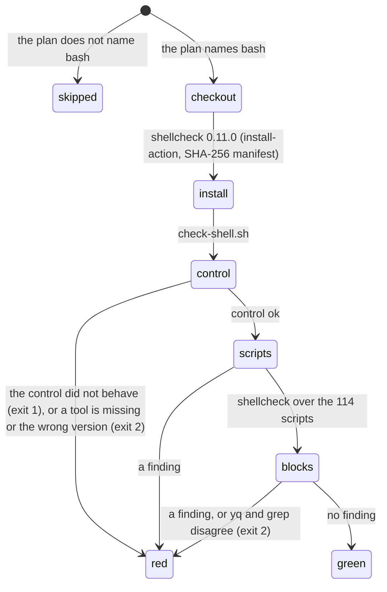

# Phase 0005: Lint

Phase 5 of the [CI workflows plan](../PLAN.md): `lint.yml`, the workflow for what a change must satisfy before any test runs and
without compiling or running the product. It starts with its first stage, `bash` (shellcheck), which the owner asked for first because
nothing in it waits for the Build phase. The other stages are planned when they start; this document holds the phase, and the one stage
that exists. How CI works today is in [CI/CD](../../../../docs/src/architecture/cicd.md); this repeats none of it.

## Purpose and use cases

`lint.yml` answers one question for a pull request: is what was written well formed, by the repository's own rules and by a public tool's,
before a test is asked to say whether it works. It is called by `ci.yml` (inside the gate) and can be run alone. Its jobs, today:

| Job | What it reads | Stage |
|---|---|---|
| `deps` | the guards: the dependency graph, the crate layout, the topology, the edge configuration, the Plane 500s, the acceptance list, the placement, the migrations, the lockfile's form, the contract counts, the deploy configuration, the release configuration, the Flagship policy, every workflow and action (the workflow lint, the index, actionlint) and the OpenAPI diff | not started (the plan: "its 12 guard steps placed where they belong") |
| `lint` | rustfmt and clippy, native and wasm32 | not started (it exists; its eight passes are to be shown) |
| `bash` | every shell script the repository maintains, and the shell in its composite actions | **stage 1, this document** |

The plan's list for the phase is "rust · deps · bash · docker · dotenv · yaml · json · codeowners · editorconfig · git". The stages after
`bash` are written when they start, each with its survey and its questions. Two things are known now and are not decided:

- `.editorconfig` and `CODEOWNERS` do not exist in the repository. Those two stages need the owner to say what the file should hold before
  there is anything to lint, and `editorconfig` is where a formatter for shell (shfmt reads `.editorconfig`) is to be asked about: running
  `shfmt` over 114 scripts that have no recorded style would be a rewrite of all of them, and is not part of stage 1.
- The `docker` stage lists Dockerfiles, and the only ones are the stock web app's; Build's stage 5 decides whether the repository gets one.
  The boundary with Security's `bash` and `docker` (Phase 10) is open: this stage is the *lint* of the shell (style, quoting, portability); a
  *security* reading of it (untrusted input, `eval`) is Security's and is not started.

## What exists today (read 2026-11-23, `main` at `6014d8a7`)

- **`lint.yml`** has `deps`, `lint` and a `verdict` job; `ci.yml` calls it, and the gate waits for its verdict. This stage adds `bash`.
- **Shell.** 163 tracked scripts: 162 `*.sh` and `scripts/rs`, which has no extension. 117 have `#!/bin/sh` (the runner runs them under
  dash), 42 have `bash` (`/bin/bash` or `env bash`), 4 have no shebang (three sourced libraries, and `infra/preview/pr-role-limits.sh`, which
  says `shell=bash`). By area: `.github/scripts` 50, `scripts` 46, `.agents/plans` 30, `infra` 11, `tools/*` 23, `probes` 3.
- **What read them.** Nothing ran shellcheck over a `*.sh`. About a dozen of them carried `# shellcheck disable=` or `source=` lines, so
  someone had run it by hand. [re-run: `grep -rn shellcheck` over the tree, outside `web/`]
- **The shell in a workflow's `run:`** is read by actionlint, in the `deps` job, *when shellcheck is on `PATH`*: measured locally, with a
  control (a workflow with an unquoted variable is refused, SC2086, an `info` finding, and the same workflow passes with `-shellcheck=`, which
  turns it off). Whether it does on the runner is probe C, below.
- **The shell in a composite action** (`.github/actions/*/action.yml`: six actions, 23 `run:` blocks, 792 lines of YAML) is read by nothing:
  actionlint takes an `action.yml` for a workflow and answers `"jobs" section is missing in workflow`, three more errors, and exits 1
  [re-run: the same scratch repository].
- **The runner image** (`ubuntu-24.04`, version `20261116.376.1`, read from its README) has shellcheck **0.9.0**, `yq` 4.54.3 and `jq` 1.7.
  The repository's authors run 0.11.0 (a `# shellcheck disable=SC2329` is in `check-cargo-lock.sh`, and 0.9.0 does not know that code).

## Facts that shape the phase (each measured)

| Fact | How it was found |
|---|---|
| A first run of shellcheck 0.11.0 over a clean export of `main` (163 scripts, 4 to 5 s on a laptop) gives **212 findings in 55 scripts**: 3 error, 34 warning, 165 info, 10 style | `git archive`, then `shellcheck --format=json1` |
| Two codes are 112 of the 212: SC2016 (an expression in single quotes, 65) and SC2015 (`A && B \|\| C`, 47). Both are idioms the repository writes on purpose | the same run, by code |
| The 34 warnings are about 8 distinct issues and **none is a bug in a script that runs**: 14 are one function named `complete` (a bash builtin, SC3044), 12 are variables read through `eval`, and the rest are intentional (a glob in a `case`, a one-row loop, quotes Node reads) | read in context, one by one; `dash -n` and `bash -n` on the one that looked real (`measure-cpu.sh`, an apostrophe in a `${x:?}` message) both pass |
| 49 of the 163 scripts are the records of finished experiments (30 in `.agents/plans/`, the spikes, the probes, the zxcvbn measurement) | by directory |
| `RULES` in the planner stops at a path's **first** match, so "every shell script plans a job" cannot be one of its rules without shadowing the rule that knows the script (`scripts/wasm-tests.sh` is `workers`', `ci-scripts`', and also a shell script) | `plan-ci.py`, read; `test_plan_ci.py`'s "one sample per rule" |
| shellcheck's own `-S` and `.shellcheckrc` can set what fails, and `--rcfile` makes one file the configuration for every caller | `shellcheck --help` |

## Interface

`lint.yml` is unchanged in shape: `workflow_call` with the input `plan` (the JSON list of this workflow's jobs the planner chose),
`workflow_dispatch` with the same input (default: all three), `permissions: {}` at the top and `contents: read` in each job, no secret, no
environment, no `id-token`. The outputs: `verdict`. A `bash` job needs no cache and no Rust toolchain.

## Acceptance criteria for the workflow

Written for the phase; each stage adds its own. The workflow is done when:

1. every stage is a job in the gate (the planner, the verdict, the wiring) with a control that makes it fail, and every one of its findings
   on today's tree is fixed or annotated with a reason, never silenced wholesale;
2. each job is planned for exactly the files it reads (tested against an independent model) and for nothing else;
3. no job needs a token, so a pull request from a fork runs the same checks;
4. the repository's own scripts and workflows have no finding at the level the stage fails at;
5. each job has its row in `cicd.md`, `running.md` and the workflows' index, and a runbook for each way it fails;
6. every job has been through the eight passes, in the owner's order.

## The stages

| # | Stage | Status |
|---|---|---|
| 1 | `bash`: shellcheck over the maintained scripts and the composite actions' `run:` blocks | **this pull request** (passes 1 to 4; 5 to 7 measured below) |
| 2 to 10 | `docker`, `dotenv`, `yaml`, `json`, `editorconfig`, `codeowners`, `git`, and the passes of `deps` and `lint` | not started; planned when started. Their order is not decided here |

### Stage 1 in detail: `bash`

**Purpose and use cases.** Fail a pull request that adds or changes shell that shellcheck reads as wrong, at every level it reports (a
finding that is meant is annotated where it is, with its reason), for the scripts the repository maintains and for the shell inside its
composite actions. It runs when a shell file, `.shellcheckrc` or an `action.yml` changes, in every full run, and alone by dispatch.

**Owner's decisions (2026-11-23), all as recommended.**

| Question | Answer |
|---|---|
| Which scripts? | the maintained ones: 114 of 163. The 49 records of finished experiments are named in the helper and left alone |
| What fails the job? | every level, with SC2016 and SC2015 off in a committed `.shellcheckrc` (the same bar as the workflows' `run:`, which actionlint holds at every level) |
| The composite actions? | yes, their `run:` blocks, as a separate commit of the stage |

**Acceptance.**

1. It fails when a maintained script, or a composite action's `run:` block, has a finding at any level, shown by controls on a script, on a
   block, and live (the probes).
2. A shellcheck that is not looking fails it: the helper's control (an `info` finding must be refused, the repository's configuration must be
   the one in effect, two composite actions must be read) runs before any script is read, and the helper refuses a version other than the
   pinned one, a missing `yq` or `jq`, no script found, and an extraction that dropped blocks.
3. A planned `bash` that fails turns `lint / verdict` and `gate` red and nothing else (probes A and B).
4. It is planned for a `*.sh` outside `web/`, `.shellcheckrc` and an `action.yml`, and for nothing else, and `RULES` is not changed.
5. The repository passes it today: 117 scripts and 23 run blocks of 6 actions, no finding, with every resolution a fix or an annotation with
   its reason.
6. It is documented: `cicd.md`, `running.md`, the workflows' index, `AGENTS.md`'s Commands table.

**State machine.**

**Steps** (`.github/workflows/lint.yml`, job `bash`): checkout; `taiki-e/install-action` with `tool: shellcheck@0.11.0`;
`sh .github/scripts/check-shell.sh`. The helper, in order: refuses a missing or wrong-version shellcheck, a missing `yq`, `jq` or
`.shellcheckrc`; runs the control; lists the scripts from `git ls-files` (a `*.sh`, or an executable whose first line is a shell shebang,
less `web/`, `node_modules/` and the 49 frozen records); runs shellcheck over them with `--rcfile`; cuts each `run:` block out of every
`.github/actions/*/action.yml` with `yq` and `jq`, holds `yq`'s count of blocks to `grep`'s count of `run:` keys, and reads each block in the
dialect of its `shell:`.

**Survey of public solutions** (what a shellcheck stage needs, and the candidates; versions and dates read from the GitHub API, 2026-11-23):

| Candidate | Read from | Fit | Decision |
|---|---|---|---|
| shellcheck on the image | the runner-images README | 0.9.0, free, no install | rejected as the gate: the version moves with the image, and 0.9.0 does not know SC2329 (the repository's own `disable=` for it is 0.11 code) |
| `taiki-e/install-action` with `shellcheck@0.11.0` | already pinned in the repository (`v2.87.29`); its `shellcheck.json` manifest has the release's SHA-256 for linux x86-64 | an exact, checked binary, installed as the repository installs `cargo-deny` and `mdbook` | **chosen** |
| `ludeeus/action-shellcheck` | its releases (latest `2.0.0`, 2023-01-29); its README not read | a wrapper that finds scripts, by its description | rejected: its last release is 3.8 years old, and the repository's shellcheck version is a decision the helper holds, not an input of someone else's wrapper |
| `reviewdog/action-shellcheck` | its releases (latest `v1.35.1`, 2026-11-13); its README not read | pull request annotations | rejected for the gate: its reporters post checks or review comments, which need a write token **[from its documented reporters, not re-read here]**, and a fork's pull request has a read-only one (`pull_request_target` is banned); a candidate for annotations later, if the owner wants them |
| the `koalaman/shellcheck` image | the project's repository (it ships a Dockerfile and a `scratch`-style build) **[not read]** | the same binary, by digest | rejected: a Docker pull in place of a checked tarball, and a second way to pin one tool |
| super-linter / MegaLinter | not read beyond their names | one container for many linters, including the other stages of this phase | not evaluated for this stage (a multi-linter image is not a stage-sized thing); to be surveyed when the `yaml`, `json` and `editorconfig` stages are planned, and the comparison made then |
| pre-commit with `shellcheck-py` | not read | a hook framework | rejected: the repository has none, and it would be the first |
| actionlint | measured in a scratch repository | reads a workflow's `run:`, at every level, when shellcheck is on `PATH`; does not read an `action.yml` | already in `deps`; **cannot do the composite actions** |

**Custom code, and why it has no built-in.** One file, `.github/scripts/check-shell.sh`, with four pieces, each with the probe that showed no
built-in covers it:

1. *Finding the scripts.* `git ls-files '*.sh'` is the built-in, and it misses `scripts/rs`. shellcheck itself takes files and does not look
   for them, and the one wrapper that might (above) is stale. The helper reads the first line of each executable that is not a `*.sh`.
2. *What is not ours.* shellcheck has no ignore list (its `.shellcheckrc` has no path key). The 49 frozen records are named once, in the
   helper's `frozen()`, and the planner does not repeat the list.
3. *The control and the version.* Nothing in shellcheck proves that it is looking; `--version` is the one thing it offers, and the control is
   the proof (AGENTS.md rule 8).
4. *The composite actions' blocks.* `yq` (mikefarah's, on the image) writes each step that has a `run:` as one JSON line, with its `shell:`,
   the line the block starts at and the name, and `jq` writes the block out. This is two built-ins and a loop, and not a YAML parser written
   by hand (`lint-workflow.sh` has one for text layout; it is not reused, because it cannot hand a block to another tool). actionlint was the
   candidate and fails on an `action.yml` [measured].

**The first run, and what became of it.** 71 findings in the maintained scope, at every level with the two idioms off:

| Resolution | Findings | What |
|---|---|---|
| fixed | 27 | `complete`, a bash builtin, renamed `full_root` (14); `tr 'A-Z' 'a-z'` is `tr '[:upper:]' '[:lower:]'` (4); `cmd; if [ "$?" -eq 0 ]` is `if cmd` in `e2e.sh`, which has no `set -e` for it to change (3); a `shell=sh` header on the three sourced libraries (3); an unquoted `$orphans` is a quoted pipe (1); a dead assignment (1); a quoted value that read as arithmetic (1) |
| annotated, with the reason | 44 | word-split lists (`$extra`, `$pids`, `$EXTRA`, `$OPT_ENV`, the gate test's job lists: 8); commit ids read through `eval` (12); a function run by a trap or through `$LISTER` (5); subshells whose changes must not leak (6); optional arguments (4); `ps \| grep -F` for a fixed string (2); a read-and-`rm` of a list the script then ends on (2); a one-row loop (1); a glob in a `case` pattern (1); the quotes Node reads in `NODE_OPTIONS` (2); a list of names without a blank (1) |

Every test that covers an edited script was run under dash after the change (the list is in the first commit's message): all pass. The
shell lint fails on the tree as it was (68 groups of findings, exit 1) and passes on the tree as it is.

**What it costs** (run `45109906721`, #360's own run, `lint / bash`, 38 s; probe A's run, `45110043281`, 19 s) [re-run: the jobs' step logs]:

| Step | #360's run | Probe A | Note |
|---|---|---|---|
| set up, checkout | 7 s | 4 s | |
| `taiki-e/install-action`, `shellcheck@0.11.0` | **20 s** | 5 s | in #360's run, 18 s of it is `apt` removing the image's own `shellcheck 0.9.0-1`; the download of the tarball and its SHA-256 check are 0.27 s (`info: downloading …` 04:07:57.206, `shellcheck installed` 04:07:57.461) |
| `check-shell.sh` | 8 s | 8 s | the control 0.1 s; shellcheck over 117 scripts 8 s (4 to 5 s on a laptop); the 23 blocks 0.3 s |
| post checkout | 1 s | 1 s | |

What it shows:
- **It is off every critical path.** `lint / deps` and `lint / lint` took 73 s each in the same run, so `lint.yml` is no shorter for `bash`
  being faster, and no longer for it. The run (a full one, `gate` green, no job failed) took 540 s; its longest job is the e2e cell, as in
  research 0020.
- **The install is the cost, and not the check**: 5 to 20 s for a tool that downloads in a quarter of a second, because install-action
  removes the image's package first. A cache of the binary would save the download and not the removal.
- **The new test is 2.9 s** in `ci-scripts` (`test-check-shell.sh`: 40 checks on the runner, where the three that need the real 0.11.0
  skip, as they print: the image's shellcheck is 0.9.0), against a longest command of 102 s: it adds nothing to that job's critical path.

**The probes** (#361, #362 and #363, drafts whose base is #360's branch, so that each run plans only its own change; **closed unmerged**,
their branches deleted):

| Probe | Run | What it showed |
|---|---|---|
| A: `ls $probe_x` in `scripts/verify-all.sh` | `45110043281` | The planner planned only `bash` (the rest of the plan was skipped: `lint / deps`, `lint / lint`, `test`, `build`, `web`, `documentation` and `security`). **`lint / bash` failed in 19 s**: `In scripts/verify-all.sh line 43: SC2086 (info)`, then `check-shell: 117 scripts (shellcheck exited 1) and 23 run blocks of 6 composite actions (status 0); the findings are above`. `lint / verdict` failed (`GATE FAIL: bash was expected to run and its result is 'failure'`) and `gate` failed (`GATE FAIL: lint was expected to run and its result is 'failure'`). The control had passed on the runner first (`control ok (shellcheck 0.11.0 …)`) |
| B: an unquoted `wrangler@${WRANGLER_VERSION}` in `.github/actions/deploy-worker/action.yml` | `45110073532` | `lint / bash` failed: `check-shell: .github/actions/deploy-worker/action.yml, the run block at line 301 (Install wrangler (exact version))` and `SC2086 (info)`; `verdict` and `gate` failed as in A. **`lint / deps` passed**, with its workflow lint and actionlint: nothing but the extraction reads an `action.yml`'s shell. `ci-scripts` ran and passed (the planner's rule for an action) |
| C: an unquoted `$ITER` in `.github/workflows/flake-hunt.yml` | `45110104084` | **`lint / deps` failed**: `.github/workflows/flake-hunt.yml:67:9: shellcheck reported issue in this script: SC2086:info`, so actionlint, on the runner, with the image's 0.9.0, does read a workflow's `run:` at `info` level, as it did on the laptop. `lint / bash` was skipped: a workflow is not a file this job reads. `gate` failed |

Probe A is the stage's reason to exist, and the live control of the invariant that a planned job that fails turns the gate red, for a job
in a workflow that was already called. Probe B shows the gap the composite actions' extension closes, and probe C shows that the workflows'
own shell was already covered (so this stage does not repeat it), and by which shellcheck: the image's 0.9.0, not the pinned one (below).

**Failure modes (pass 2), and what each does.**

| What goes wrong | What the job does | What to do |
|---|---|---|
| a script or a block has a finding | exit 1, `In <script> line N` (or `<action>, the run block at line N (<step>)`, whose line 1 is the next line), the code and its wiki link | fix it, or annotate it where it is: `# shellcheck disable=SCnnnn # why`, on its own line, immediately before the command (before a compound command it covers the whole command; before the first command it covers the file) |
| the control does not behave | exit 1, `control: …` says which of the five | shellcheck is not looking, or `.shellcheckrc` was edited so that SC2086 is off or SC2016 is on: restore it, or change the control with the policy |
| another shellcheck version | exit 2, both versions named | install 0.11.0 (`brew`, or the release tarball), or `CHECK_SHELL_ANY_VERSION=1` to look anyway on a laptop |
| `yq` or `jq` missing, or a `yq` that is not mikefarah's | exit 2 | install them (the runner has both) |
| yq and grep disagree on the number of blocks of an action | exit 2, the action named | a line that starts with `run:` inside a block's own text (a heredoc): rewrite it, or the extraction needs to learn it |
| a step in a shell other than `sh` or `bash` | exit 2, the action named | shellcheck reads no other; the block is not checked until it does |
| a new shellcheck release | the pinned job does not change | bump `SHELLCHECK_VERSION` in the helper and `tool:` in `lint.yml` together (the wiring test holds them equal), and resolve what the new version finds |
| a new record of a finished experiment | `bash` reads it | add its directory to `frozen()` in `check-shell.sh` |

**Known gaps (not closed here).**
- **actionlint's shellcheck is the image's 0.9.0**, not the pinned 0.11.0: probe C shows it reads workflow `run:` blocks, and a finding that
  only 0.11.0 reports (SC2329 and the newer codes) is not reported in a workflow. `actionlint -shellcheck <path>` takes the binary to use;
  giving it the pinned one is a change to the `deps` job's step, which is the `deps` stage's.
- The 49 frozen records are not read. A new record under `.agents/plans/` is not linted, by the owner's answer.
- A formatter (`shfmt`) is not part of this stage: the repository has no recorded style; it belongs with the `editorconfig` stage.

**Pass log.**

| Pass | Where | Evidence |
|---|---|---|
| 1 PoC | #360's run `45109906721`; locally | `bash` green on a real input (the tree); the control on a script (a planted finding is refused: probe A), and the helper fails on the unfixed baseline (68 groups, exit 1) and passes on the fixed one |
| 2 Prototype | #360's run, probes A, B, C | it runs on its real triggers: `workflow_call` from `ci.yml` (#360's run, a full run, and the three probes, each an affected-only run of one change), and by `workflow_dispatch` once merged (a new job of an existing workflow can be dispatched only from the default branch's file). Its failure modes are in the table above |
| 3 Documented | #360 | `cicd.md` (the file table, the helper list, the planner's rules and examples, the counts), `running.md` (the job's row), the workflows' index, `AGENTS.md`'s Commands row, the header comments of `check-shell.sh`, `.shellcheckrc` and the job |
| 4 MVP | #360 | in the gate: the planner's `JOBS` and `WORKFLOWS["lint"]`, `ALSO`, the verdict's `needs` and `jobs`; `test_plan_ci.py` 7086, `test_workflow_wiring.py` 216, `test-ci-scripts.sh` 221, `test-check-shell.sh` 43 (40 where shellcheck is not 0.11.0), `mutate_gate.py` **356 of 356 killed** (341 before; 15 new: 13 written for the stage, 7 of the planner and 6 of `lint.yml`, and 2 that the lint row's third job generates; the 12 equivalent ones survive, as they must) |
| 5 Caching | #360's run and probe A | **No change, measured.** The job is 19 to 38 s, and the install, 5 to 20 s of it, is `apt` removing the image's package: the download and the SHA-256 check are 0.27 s, so a cache of the binary saves nothing the job spends. A restore would add an entry to a repository cache that was at its 10 GB limit when last read |
| 6 Parallelization | the same runs | **No change.** `bash` runs beside `deps` and `lint` (73 s each) and ends first (38 s at the most): `lint.yml`'s wall clock is theirs. The scripts and the blocks are 8.3 s together; two jobs would pay the checkout and the install twice |
| 7 CPU minimization | the same runs; the last 60 changes on `main` | **No change.** A planned `bash` is 19 to 38 runner-seconds (0.4 to 0.7% of a full run's median, 5,240 s, research 0020). 24 of the last 60 changes on `main` touch a path that plans it (shell scripts are edited often in this repository), and 16 of those also touch a path that plans every job (`Cargo.lock`, a workflow that runs the checks, `scripts/rs`, …, read as the planner's `FULL` rules); so it adds a job to a run that would not have had it in 8 of 60. It is not planned for a crate, a doc or a workflow file other than `lint.yml` |
| 8 Production documentation | not before the phase's other stages are done | the runbook above is this stage's part |

## Action candidates

None for stage 1. The helper (`check-shell.sh`) is one file called from one place, and the extraction of a composite action's blocks is a function of it, so there is no repeated step to factor and nothing to ask the owner about. The later stages may repeat the installation of a linter by `install-action` (one line each); that is not an action either.

## Questions for the owner

None open for stage 1: its three (scope, severity, the composite actions) were answered on 2026-11-23, all as recommended, and are in the table above. For the stages after it, to be asked when they start:

1. **`editorconfig`**: what `.editorconfig` should hold (indent, line endings, final newline) before a stage can check it, and whether `shfmt` then formats the 114 scripts (it reads `.editorconfig`, and would change most of them).
2. **`codeowners`**: what `CODEOWNERS` should say; there is none.
3. **`deps`**: whether actionlint, in `deps`, is given the pinned shellcheck (`-shellcheck <path>`) so that a workflow's shell is read by 0.11.0 and not by the image's 0.9.0.
4. **`docker`**: which Dockerfiles exist, which waits for Build's stage 5.

## To resolve in the phase (mine, by measurement)

- The cost of each later stage's tool install against a `curl` and a checked tarball, now that `install-action`'s `apt` removal is known to be most of an install's time (5 to 20 s, for a tool that downloads in a quarter of a second). It matters only if a stage lands on a critical path, and none of this phase's does.
- Whether a single job reading several kinds of file (shell, YAML, JSON, `.env`) is cheaper than one job each, which is the plan's shape and this document's: each stage pays a checkout and an install (about 7 s and 5 to 20 s here).
