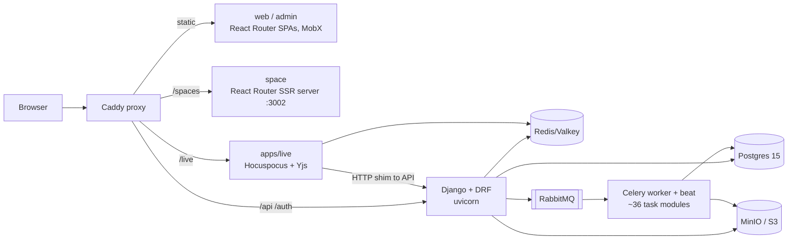
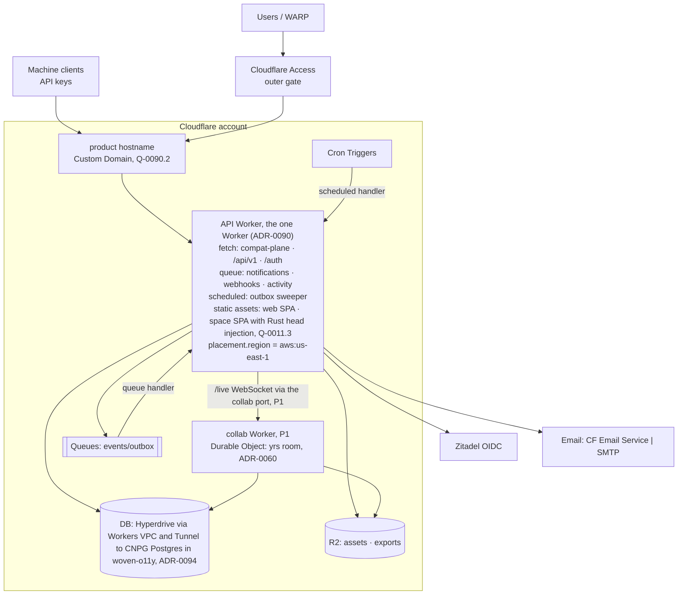
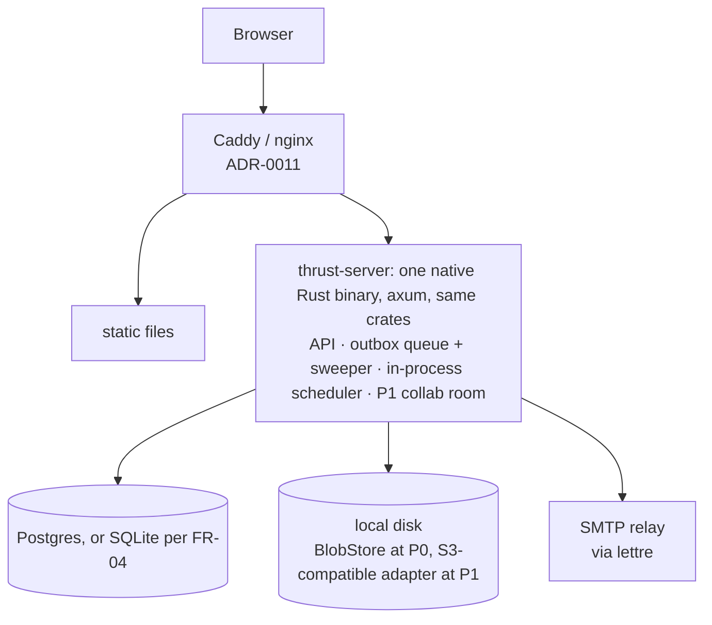
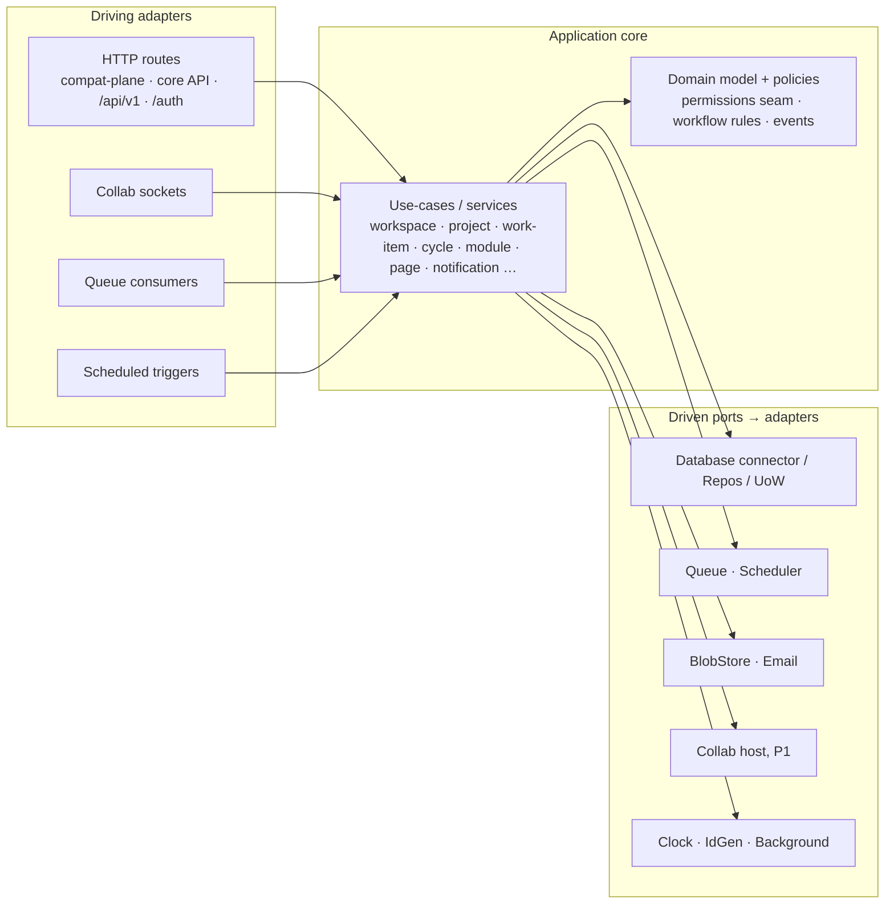
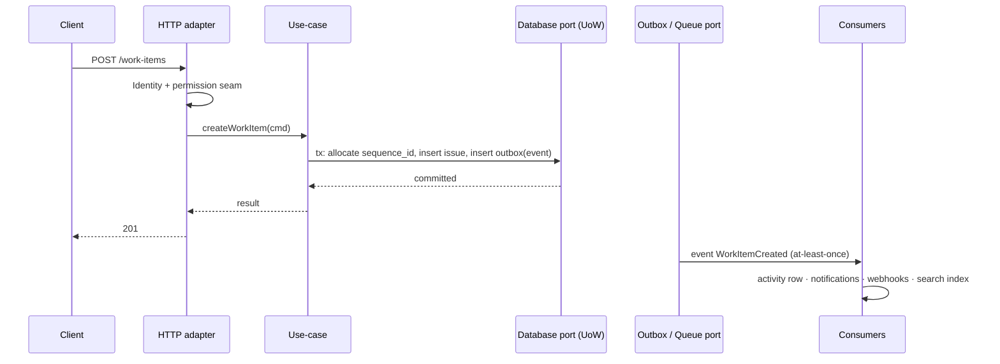
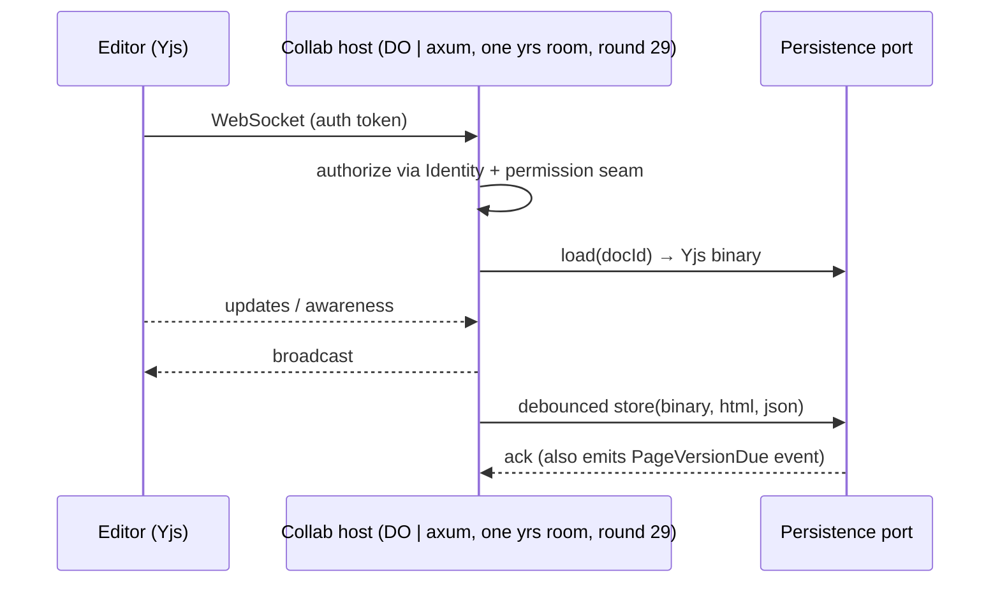

# ARCHITECTURE — Contrail

Status: **draft v0** (interview 2026-10-17). Boxes marked ⚠ are open (see QUESTIONS.md). Two views:
1. **Deployed architecture** — what runs where (Cloudflare set and self-hosted twin).
2. **Application architecture** — how the code is organised (hexagonal, ports & adapters).

## 0. Starting point (today's Plane, from repo survey)



Notable facts that constrain the design **[S]**: `Issue.save()` uses an advisory lock for `sequence_id`;
soft delete (`deleted_at`) is universal with partial unique constraints; collab persistence goes through the API
(binary + html + json written together); beat runs ~10 daily jobs and a 5-minute email digest; auth has
session cookies + `X-Api-Key`, no OIDC/SAML/SCIM in CE.

## 1. Deployed architecture

### 1a. Cloudflare adapter set (target)

> **Phasing (rounds 4–6):** the diagram is the end state. At P0 the **collab Worker** and its Durable Object are
> absent (editing is a plain API save; the room is P1), and adapter sets are compile-time bundles (ADR-0007). Auth
> starts as user+password, with Access then OIDC added.

> **Round 29 (2026-10-19, FR-11, FR-05, FR-03, FR-08):** one API Worker replaces the edge, API and consumer Workers
> (ADR-0090, accepted). The Workflows box is removed: long jobs are queue messages with a `jobs` table (ADR-0071). The
> KV box is removed: sessions are rows behind `Database` (FR-03), and a `Cache` port is added only when a measured hot
> path needs it (ADR-0082). `placement.region` puts the Worker beside the database in us-east-1 (FR-08, ADR-0094).
> The self-hosted set is §1b and SPEC R-P3.



Worker topology (ADR-0090, accepted round 29, FR-11): one **API Worker** (Rust, workers-rs; router per ADR-0030)
holds `fetch`, the queue consumer, the `scheduled` handler, the static assets and `placement.region = "aws:us-east-1"`
for P0 and the daily-use release (M2). A **collab Worker** hosting the DO class is added when the P1 room lands
(ADR-0060), joined by a service binding; the API Worker never talks to the DO except via the collab port. Reopen if the
bundle exceeds 20 MiB or a DO lifecycle change must ship with an API change. Whether `space` is a route group of this
Worker or its own thin Worker is still open (ADR-0090, round 27).

### 1b. Self-hosted twin (same application code, different adapters)

> **Round 29 (2026-10-19, FR-05, FR-19):** the twin is one binary, one database and local disk. The queue is the
> outbox (in-process fast path plus the sweeper), the scheduler is an in-process timer, blobs live on local disk at P0
> (an S3-compatible adapter for MinIO at P1), email goes over SMTP through `lettre`, and the P1 collab room runs inside
> the same binary. RabbitMQ, Valkey, Hocuspocus and the separate worker process are cut. The database is Postgres, or
> SQLite on `rusqlite` if spike 0002's `worker-do` cell wins (FR-04). Parity is the `native-pg` contract cell in CI.



### 1c. Adapter matrix (switch = config / compile-time + at most a redeploy)

> **Round 29 (2026-10-19, FR-05):** reduced from 16 ports to those whose adapters really differ between the two
> sets. `WorkflowEngine` is withdrawn: long jobs are queue messages with a `jobs` table (ADR-0071). RabbitMQ, Valkey
> and Hocuspocus are cut (ADR-0070, ADR-0082, ADR-0060). Sessions are rows behind `Database` (FR-03), and a `Cache`
> port is added only when a measured hot path needs it (ADR-0082). Rate limiting is the Workers Rate Limiting binding
> on Cloudflare (D-007) and an in-process counter natively (ADR-0033). `StaticHost` has no trait in code; ADR-0011
> serves the static apps from Workers static assets or Caddy/nginx.

| Port | Cloudflare adapter | Self-hosted adapter | ADR |
|---|---|---|---|
| `Database` connector | Hyperdrive→Workers VPC→Tunnel→CNPG Postgres (ADR-0094; engine still ⚠ pending spike 0002, which adds the FR-04 `worker-do` cell) | Postgres through a native pool; `rusqlite` if the `worker-do` cell wins (FR-04) | 0040 |
| `Queue` | Cloudflare Queues | the outbox: in-process fast path + sweeper, one process | 0070 |
| `BlobStore` | R2 | local disk at P0; S3-compatible (MinIO) at P1 (FR-19) | 0080 |
| `Scheduler` | Cron Triggers | in-process timer | 0072 |
| `Email` | CF Email Service / SMTP | SMTP through `lettre` | 0073 |
| `Collab` host | the `yrs` room in a Durable Object (P1) | the same `yrs` room inside the axum server (P1) | 0060 |
| `Clock` / `IdGen` / `Background` | `JsClock`, `JsIdGen`, `WaitUntilBackground` (`crates/thrust-adapters-cloudflare/src/lib.rs:22-49`) | `SystemClock`, `NativeIdGen`, `TokioBackground` (`crates/thrust-adapters-selfhosted/src/lib.rs:8-33`) | 0002 |

Search, flags, AI, identity, secrets and telemetry are core code on one dialect.

## 2. Application architecture (hexagonal)

Rule: **domain and application code depend only on ports; no `worker::*` / workers-rs, `tokio-postgres`/`sqlx`, `lapin` or other platform
crate import outside an adapter crate.** An adapter set is chosen at composition time (ADR-0007).



**Round 29 (2026-10-19, FR-05):** the driven ports are the §1c list; search, flags, AI, identity, secrets and
telemetry are core code on one dialect.

### 2a. Package layout (Rust workspace in `aRustyDev/thrust`, ADR-0005/0006; redrawn round 25)

```
thrust/
  crates/
    thrust-ports/               # traits (round 29, the §1c list): Database connector/Repos/UoW, Queue, Scheduler,
                                #   BlobStore, Email, Collab host, Clock/IdGen/Background;
                                #   shared contract-test suites (ADR-0121)
    thrust-core/                # domain + use-cases; depends on ports only; Authorizer + `Scope` proof types (ADR-0051)
    thrust-contracts/           # event/outbox schemas, file-asset contract, API types (OpenAPI source, ADR-0032)
    thrust-api-core/            # NOT AT P0 (round 29, FR-06): the core REST + OpenAPI surface for Dioxus, scripts
                                #   and MCP, generated from the use-cases at M4, when the Dioxus client exists
    thrust-api-v1/              # /api/v1 Plane wire-compat, a thin shim over core use-cases (ADR-0031)
    thrust-compat-plane/        # TRANSITIONAL: Plane-shaped internal endpoints for the React app (ADR-0034);
                                #   deleted when the Dioxus UI lands (ADR-0013 Phase 2)
    thrust-adapters-cloudflare/ # workers-rs: hyperdrive|d1, queues, r2, cron, email, ai-gateway, rate limiting …
    thrust-adapters-selfhosted/ # native pool, in-process queue (the outbox), local disk (S3-compatible at P1),
                                #   smtp (`lettre`), in-process scheduler … (round 29, FR-05, FR-19)
    thrust-worker/              # composition root: wasm32 Cloudflare Worker (cargo feature set `cloudflare`)
    thrust-server/              # composition root: native axum/tokio (cargo feature set `selfhosted`)
    thrust-collab-do/           # NOT BEFORE M5 (round 29, FR-05, FR-11): the collab Worker's own root crate, added
                                #   when the P1 room lands; a DO must be exported from the same Wasm module as `fetch`
                                #   (spike 0001, ADR-0090), so until then the one Worker exports the DO classes
  web/                          # pnpm workspace: adopted React apps (web, space) + @plane/* packages,
                                #   minimal changes only (ADR-0034); retired by ADR-0013 Phase 2
  docs/plan/                    # this planning package, once the repo is populated
```

Three HTTP surfaces sit on the same use-cases: **compat-plane** (React), **`/api/v1`** (wire-compatible with Plane) and the
**core API**. `apps/admin` is retired (ADR-0021), so two apps are served: `web` (a static SPA) and `space` (server-rendered in Plane, `ssr: true`; here an SPA plus Rust-injected metadata, Q-0011.3).

**Spike 0001 notes (round 26; crate names are those of the spike branch).** (1) Every port returns a `Send` future (ADR-0002); `Background`, `Clock` and `IdGen` are ports, so core never spawns or reads the clock. (2) One router crate (`thrust-api`) is compiled into both roots; `thrust-api-core`, `thrust-api-v1` and `thrust-compat-plane` are route groups composed into it. (3) The SQL lives once, in `thrust-adapters-postgres`, written at `tokio_postgres::Client` level behind a `Connector` (a native pool on the server, a Hyperdrive socket on the Worker); the cloudflare and selfhosted adapter crates supply the connector and the non-SQL adapters. (4) The one HTTP contract suite lives in `thrust-contract-tests` and runs against every target.

**Round 29 (2026-10-19, FR-05, FR-06, FR-11).** `thrust-api-core` is not built at P0: two HTTP surfaces sit on the
use-cases (compat-plane and `/api/v1`), and the core OpenAPI surface is generated from them at M4 (review §3).
`thrust-collab-do` is not a separate root until M5: the one Worker exports the DO classes, as the slice already does
(`RateLimiterDo` and `RoomDo`, `crates/thrust-worker/src/durable.rs:26-86`). The `thrust-ports` and
`thrust-adapters-selfhosted` lines follow the §1c list, and `kv` leaves the Cloudflare adapter line (FR-03; ADR-0082).

### 2b. Request flow (write path, any adapter set)



Design commitments: transactional outbox (events written in the same transaction, relayed to `Queue`); consumers are
idempotent; the permission seam is called in the use-case layer (not the router) so every driving adapter is covered.

### 2c. Collab flow



## 3. Cross-cutting
- **Tenancy**: every aggregate carries a tenant key (`workspace_id`; instance-level for single-org); isolation
  mechanism per ADR-0041. No query without the tenant predicate (enforced in repository layer).
- **Contracts**: events (`contracts/events`), API schemas, and the file-asset lifecycle are versioned artifacts.
- **Config-driven adapters**: one typed `AppConfig` selects an adapter per port (ADR-0007); invalid combos fail at startup.
- **Observability**: trace-id propagated through Queue/DO hops (ADR-0130; no Workflow hop after round 29, FR-05).
- **Security**: SSRF guard on outbound URL fetches (link crawl, webhooks); API-key hashing; public-space data
  minimisation (ADR-0141).

## 4. Out of scope for this document
Implementation sequencing (next session), concrete schema, UI redesign.
