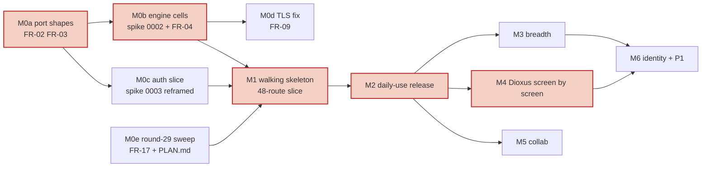

# PLAN — Contrail: milestones M0 to M6

The roadmap for the Contrail release of Thrust. It applies FR-01 of the
[Fable architecture review](reviews/2026-10-19-fable-architecture-review.md) (§3, "Proposed roadmap"), triaged with
the owner on 2026-10-19 (review §5). SPEC §8 points here. FEATURES.md keeps the tier of every feature (P0, P1, P2);
this file orders the work.

Sized for one owner working with agents: "pd" is person-days of the owner's attention; agents do the typing.

## Status (2026-10-19)

| Milestone | State | Issues | Open items |
|---|---|---|---|
| M0 Foundations fixed | **in progress** | #35 #36 #37 #38 #39 #40 #41 #43 #47 #55 | The round-29 plan PRs are open, and this file arrives with the last of them; 25 issues filed (#35 to #59). The first code issue is #35 (FR-02). Target end 2026-11-09 (2 to 3 weeks). |
| M1 Walking skeleton | not started | #44 #45 #49 #51 #52 #57 #58 | Waits for the M0 exit criterion. |
| M2 Daily-use release, "Contrail" | not started | #42 #46 #48 #53 #59 | Waits for M1. |
| M3 Breadth | not started | #56 | Waits for M2. |
| M4 Dioxus, screen by screen | not started | none yet | Starts when M2's exit criterion holds. Carries the flip of CSRF enforcement (Q-0050.8). |
| M5 Collab (P1) | not started | #54 | Waits for M2; spike 0005 runs first. |
| M6 Identity and P1 features | not started | #50 | Waits for M3 or M4, whichever comes first. Carries the Workers VPC service to the issuer (Q-0050.9). |

ADRs after round 29: 53 accepted, 5 proposed (0040, 0041, 0061, 0122, 0141), 2 superseded (`adrs/README.md`).

Open decisions (text and owner in `QUESTIONS.md`; all owned by asmith):

| Question | Decide by | Trigger |
|---|---|---|
| Q-0040, Q-0040.6, Q-0041 | 2026-11-09 | the spike 0002 report (M0) |
| Q-0094.6 | 2026-11-09 | recreating the `worker-pg` cell's Hyperdrive resources (spike 0002) |
| Q-0122 | review by 2026-11-09 | M0 exit; decided with issue #58's oracle gate |
| Q-R7 | review by 2026-11-09 | M0 exit |
| Q-0061 | review by 2026-11-09 | M0 exit; decided with spike 0005 (M5) |
| Q-0053.1 | review by 2026-11-09 | M0 exit; the question is P2 |

## Milestones

| Milestone | Contents | Exit criterion |
|---|---|---|
| **M0 Foundations fixed** (2 to 3 weeks) | FR-02 and FR-03 port shapes (#35, #36); single Worker with `placement.region` (#43, #39); clippy deny list in CI, since ADR-0006's panic policy says "not yet enforced" (#40); spike 0002 with the Postgres cell and the FR-04 Durable Object cell (#37); spike 0003 as the two-day auth slice (#38); the FR-09 TLS move if Postgres stays (#41); the round-29 ADR and question sweep (FR-17); `PLAN.md`. Also filed for M0: the slice's routes leave the `/api/v1` prefix (#47, FR-06) and the compat-inventory and spike-0004 scripts move into `tools/` (#55, FR-15). | Engine decided in ADR-0040; auth slice green on both targets; `gate` green with clippy; the 4 contract targets still green. |
| **M1 Walking skeleton** (about 39 pd of compat plus the auth and workspace/project use-cases) | The 48-route minimum slice with the auth-client JSON change applied (#44); `/api/v1` for projects, states, labels and work items, with the oracle gate on those operations (#58); Playwright journey "sign in, create a workspace, project and work item, see it" (#45). Also filed for M1: the deploy pipeline per ADR-0110 round 29 (#49), one `plane_500()` helper and compat parity scoped to the acceptance list (#51), compat DTOs kept out of `thrust-contracts` (#52), the per-PR schema sweep (#57). | The owner does that journey on the production hostname through the stock React app. |
| **M2 Daily-use release, "Contrail"** | The screens in [M2 screen list](#m2-screen-list) (#46); plain-save descriptions (FR-14, #48); outbox consumers for activity and notifications; retention cleanup F-D10 (#59); the `status.woven` deep probe (#42); Playwright journeys for every screen in scope. Also filed for M2: the queue failure policy (#53, FR-21). | The team uses it daily for four weeks inside the SLO; compat rows outside the list are stubs, listed in `DEVIATIONS.md`. |
| **M3 Breadth** | Cycles, modules, views, estimates, intake, webhooks (with the SSRF guard), email digest, public spaces, API keys and the full P0 `/api/v1` resource list, exports as queue jobs (#56), workspace invites (Q-F7). | Oracle gate green for all P0 v1 operations; each new screen adds its Playwright journey. |
| **M4 Dioxus, screen by screen** (starts when M2's exit criterion holds; runs beside M3) | Spike 0007 go/no-go; the editor island decision (registered in ADR-0006 as a planned permanent exception, FR-15); the core OpenAPI surface generated from the use-cases (FR-06); the first screen ported with `clone-frontend`; the compat rows behind each ported screen deleted. **Flip CSRF enforcement** when the custom frontend replaces the stock one, that is, when no cookie-authenticated mutation is left to a client that does not send `X-CSRFToken`: set `THRUST_CSRF_ENFORCE=on` in the Worker's vars and the server's environment, no code change (Q-0050.8, ADR-0052's 2026-10-24 note; until then the production default is off and only `SameSite=Lax`, `HttpOnly`, `Secure` and the `__Host-` prefix protect the cookie, as in Plane). | First Dioxus screen in production behind a flag; compat row count falling. CSRF enforcement on in production when the last stock screen is retired. |
| **M5 Collab (P1)** | Spike 0005; the `yrs` room on a Durable Object and on axum (#54); pages open collaboratively from the P0 HTML (the converter from spike 0006). The `collab` Worker is added here (FR-11). | 50-editor load test passes; P0 pages open unchanged. |
| **M6 Identity and P1 features** | OIDC through Zitadel with JIT; Cloudflare Access on the UI paths (FR-13, #50); custom roles, guests, audit rows (FR-18); GitHub and Beads sync. **A Workers VPC service for the issuer:** a service over a tunnel that can reach `id.auth.woven` (Zitadel), the same pattern as CNPG (a tunnel plus a VPC service, ADR-0094), so that the Worker's `Fetch` port can reach a WARP-only issuer for discovery, the token exchange and the key set (Q-0050.9; the owner's lean on the pattern, not yet built), and the first login against Zitadel through it (K2, `research/0012` §9). | ADR-0050 end state reached. |

The Dioxus start gate moved in round 29 (FR-01): from "P0 and P1 shipped" to "the M2 release has held the SLO for
4 weeks and its Playwright journey suite is green". The journey suite is the UI oracle; the `/api/v1` oracle diff
gate applies to M3's operations (ADR-0013).

## Critical path

M0 → M1 → M2 → M4. M3 and M5 hang off M2 and can interleave with M4; M6 waits for M4's auth client or M3's
invites, whichever comes first.

Issues on the M0 nodes: M0a #35, #36 · M0b #37 · M0c #38 · M0d #41 · M0e the round-29 plan PRs.

## M2 screen list

Confirmed by the owner in round 29 (FR-01; Q-R8):

1. Work-item list: group-by, filters, pagination.
2. Work-item detail: description, comments, activity, attachments, labels, assignees, state, priority, dates.
3. Project create and settings.
4. Workspace members (no invites; invites are M3).
5. In-app notifications.
6. Global search.

Cycles, modules, views, pages, intake, webhooks, public spaces and exports are M3. The F-X13 acceptance list is the
48-route minimum slice plus the compat rows behind these screens. Every other route the React shell calls gets the
cheapest shape-correct response (empty list, `404`, or the fixture), recorded in `DEVIATIONS.md` (FR-01, ADR-0034).

## Smallest usable release

M1 plus M2: a work tracker with workspaces, projects, states, labels, work items with descriptions, comments, activity,
attachments, assignees, notifications and search, served to the stock React app on one hostname, with `/api/v1` for
those resources. No cycles, modules, pages, intake, webhooks, exports or public spaces until M3.

## Capacity and cut line

| Item | Size | Source |
|---|---|---|
| P0 as tiered, for one owner | about 400 to 500 pd on top of compat `[inferred]` | FR-01 |
| compat-plane, all 290 P0 rows React uses | 207.6 pd (139.1 to 364.2) | `research/0003` §8.2, §15.6 |
| compat-plane, 48-route minimum slice | 39.3 pd (26.7 to 66.7) | `research/0003` §8.2 |
| compat-plane, this plan (slice plus the M2 screens) | 60 to 90 pd, deleted screen by screen; saves about 100 to 150 pd | FR-01 |

The cut line is the smallest usable release: anything outside M1 and M2 waits for M3 or later. The ADR-0034 tripwires
(66 pd for the slice, 364 pd for P0 compat; Q-0009.1) apply to the acceptance list, not to the 290 rows (round 29,
FR-01).

## Issues

All 25 are in `aRustyDev/thrust` with the label `review:fable-2026-10-19`. GitHub is authoritative for their text and
state.

### Finding to issues

| Finding | Issues | Finding | Issues |
|---|---|---|---|
| FR-01 | #44 #45 #46 #58 #59 | FR-13 | #50 |
| FR-02 | #35 | FR-14 | #48 |
| FR-03 | #36 | FR-15 | #54 #55 |
| FR-04 | #37 | FR-16 | #37 #38 |
| FR-05 | #43 #54 #56 | FR-17 | plan only |
| FR-06 | #47 | FR-18 | #51 |
| FR-07 | #40 | FR-19 | plan only |
| FR-08 | #39 | FR-20 | #52 |
| FR-09 | #41 | FR-21 | #53 |
| FR-10 | #42 #57 | FR-22 | #37 (allocation check) |
| FR-11 | #43 | FR-23 | #48 |
| FR-12 | #49 | ADR-0006 panic policy | #40 |

### Index

Subjects are shortened from the handoff's Track B table (`reviews/2026-10-19-fable-handoff-PROMPT.md`), and the
"Blocked by" column translates its dependencies into issue numbers; #58 and #59 were added by the owner in round 29.

| # | Subject | Milestone | Blocked by | Finding | Beads |
|---|---|---|---|---|---|
| #35 | `Scope` is the argument of every repository and `Tx` method | M0 | | FR-02 | |
| #36 | user-only `Principal`, database-authoritative sessions, delete `KvSessionStore` | M0 | #35 | FR-03 | |
| #37 | spike 0002: `worker-pg` cell and instance-level `worker-do` SQLite cell | M0 | #35 | FR-04, FR-16 | `plane-byd.4` |
| #38 | spike 0003: the two-day Rust auth slice (done on `feat/auth-slice`: `research/0012-auth-slice.md`) | M0 | #36 | FR-16 | `plane-byd.11.5` |
| #39 | `placement.region = aws:us-east-1`; 5-round-trip budget counter in the contract suite | M0 | | FR-08 | |
| #40 | clippy deny list, `cargo fmt --check`, `cargo-deny`; forbid `sqlx`, `sea-orm`, `diesel` | M0 | | FR-07, ADR-0006 panic policy | |
| #41 | authenticated TLS to CNPG through an Origin CA server certificate and `verify_ca` | M0 | #37 | FR-09 | `plane-byd.9`, `infra-qnyi` |
| #42 | `GET /healthz?deep=1` and a `status.woven` probe; availability measured on it | M2 | #37 | FR-10 | |
| #43 | single-Worker topology; remove the Workflow binding, `entry.mjs`, the DO rate limiter, `SELF` | M0 | | FR-05, FR-11 | |
| #44 | the 48-route minimum slice with the auth-client JSON change | M1 | #35 #36 #37 #38 #47 | FR-01 | `plane-byd.3` |
| #45 | Playwright journey suite on the stock React app (the UI oracle) | M1 | #44 | FR-01 | |
| #46 | the M2 daily-use screens, every other route stubbed and recorded | M2 | #44 #45 | FR-01 | |
| #47 | move the slice's routes out of the `/api/v1` prefix | M0 | | FR-06 | |
| #48 | descriptions: sanitised HTML only for work items, validated triple for pages, hardened sanitiser | M2 | #44 | FR-14, FR-23 | `plane-byd.6` |
| #49 | deploy pipeline per ADR-0110 round 29 | M1 | #43 | FR-12 | |
| #50 | reject non-canonical-case `/api`, `/auth`, `/live`; run the Worker first at the Access phase | M6 | | FR-13 | |
| #51 | one `plane_500()` helper; compat parity scoped to the acceptance list | M1 | #44 | FR-18 | `plane-byd.5` |
| #52 | compat DTOs out of `thrust-contracts`; `check-deps.sh` rule | M1 | #44 | FR-20 | |
| #53 | permanent versus transient consumer errors; DLQ for undecodable messages; `dead_letters` table | M2 | #43 | FR-21 | |
| #54 | one `yrs` room hosted on a Durable Object and on axum | M5 | #46 | FR-05, FR-15 | |
| #55 | the compat-inventory and spike-0004 Python scripts into `tools/` (`uv`) | M0 | | FR-15 | |
| #56 | exports and seeding as queue jobs with a `jobs` table | M3 | #43 #46 | FR-05 | |
| #57 | per-PR schema sweep owner and CI wiring for preview environments | M1 | | Q-0094.7 (FR-10) | `plane-byd.4` |
| #58 | `/api/v1` projects, states, labels and work items with the oracle gate | M1 | #35 #36 #47 | FR-01 | |
| #59 | daily hard-delete retention cleanup (F-D10) | M2 | | FR-01 | |

## Decisions taken in round 29

- **Triage** (review §5): 23 findings; 19 apply now, 4 backlog (FR-13, FR-18 with two tier edits, FR-20, FR-21), none
  rejected. The apply-now edits are the round-29 plan PRs; the backlog findings are issues #50, #51, #52, #53.
- **Owner decisions taken after the handoff was written** (owner, round 29):
  1. ADR-0122 stays `proposed`, and Q-0122 stays open with an owner and a date.
  2. Two issues were added: #58 (`/api/v1` projects, states, labels and work items with the oracle gate, M1) and #59
     (daily hard-delete retention cleanup F-D10, M2).
  3. 18 more open questions were closed with cited defaults, so exactly 8 stay open, each with an owner and a date
     (the "Open decisions" table above).
  4. One SLI per probe: p95 latency comes from the 5-minute synthetic probe from the origin's region on the warm path,
     with cold starts reported separately (FR-08); availability (99.5 % over a rolling 30 days) comes from the 60 s
     `status.woven` deep probe `GET /healthz?deep=1` (FR-10). This corrects the earlier round-29 wording that measured
     availability "on the same probe" (SPEC §6.4, Q-G5.2).
  5. The self-hosted native binary serves the built React apps itself, as Workers static assets do on Cloudflare; a
     front proxy (Caddy or nginx) is the operator's option. This keeps ADR-0091's "Compose file with at most three
     services" (binary, Postgres, MinIO at P1) and supersedes ADR-0011's self-hosted Caddy/nginx line (SPEC §7).
