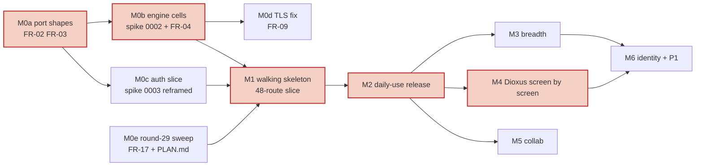

# Thrust architecture and plan review (Fable, 2026-10-19)

Reviewer: Claude Fable 5.1, one read-only session on `origin/main` at `4cac59e` (PR #33 merged). Nothing in the plan, the
code or GitHub was changed. Companion: `2026-10-19-fable-handoff-PROMPT.md` (written after triage).

Scope: the `.agents/plans/contrail/` package (SPEC, ARCHITECTURE, FEATURES, TRACEABILITY, DEVIATIONS, REVIEW-NOTES,
60 ADRs, 9 spikes, research 0002 to 0010, QUESTIONS), what is built in `crates/*`, `scripts/`, `.github/`, and
`docs/src/`. Plane facts were checked in the oracle fork at `/Users/asmith/repos/woven/forks/plane` (tag
`oracle/v1-pin-20261018` = `ba85d4d3d3`). Platform facts were checked against the Cloudflare docs on 2026-10-19.
REVIEW-NOTES (round 25) findings are not repeated; where one is still open it is cited.

Tags: `[verified]` checked in code, Plane source or vendor docs · `[inferred]` reasoned from the package ·
`[owner-call]` only the owner can judge. Severity: blocker / high / medium / low. Kind: problem / reorder /
reprioritise / regroup / simplify / cut.

Counts as read today: 60 ADRs (38 accepted, 20 proposed, 2 superseded); about 60 `open` rows in QUESTIONS.md;
13 crates; one vertical slice; 16 contract cells; one required CI check (`gate`).

---

## 1. Summary: the five findings that hurt most if found late

1. **FR-01 (plan, blocker).** P0 as tiered is roughly 400 to 500 person-days for one owner, and its largest line,
   the 290-row compat-plane layer (208 pd), is deleted in Phase 2. No `PLAN.md` exists to say what ships first.
   Decide the smallest usable release now: the 48-route minimum slice plus the handful of screens the team uses
   daily, and start the Dioxus clone screen by screen after that release is stable, not after all of P0 and P1.
2. **FR-02 (app, high).** Tenant scoping is enforced by convention, not by types. The `Database` port takes bare
   ids, `Scope` has public getters, `allocate` ignores the workspace, and the outbox methods carry no tenant. ADR-0051
   and ADR-0041 say repositories accept only a `Scope`; the code does not. Fix the port shape before the second
   aggregate is written, because every repository method signature copies it.
3. **FR-03 (app, high).** The session binds a workspace to the principal (`Principal { user_id, workspace_id }`),
   and sessions live in KV on the Worker. Plane sessions are per user; the workspace comes from the URL slug and a
   membership check. The accepted design (D-003) is database-authoritative sessions. Both shapes must change before
   the auth slice is built, because every use-case signature takes `&Principal`.
4. **FR-04 (infra and app, high, owner-call).** ADR-0040 is still `proposed`, spike 0002 has not run, and the
   Postgres path has accumulated four open costs since round 27: the Hyperdrive statement-flow constraint (now
   explained by the docs, so permanent), unauthenticated TLS with no cheap fix, availability coupling to an
   observability cluster, and a 0.6 s first database request per isolate. An instance-level Durable Object SQLite
   cell was never considered (the desk review assumed one object per workspace). Give it a three-day hearing inside
   spike 0002, using the existing target-agnostic contract suite, before the engine is locked.
5. **FR-05 (app and plan, high).** Of the 16 ports in ARCHITECTURE §1c, about seven have adapters that differ
   between the two sets. The rest are the same code over Postgres. Four pieces of the self-hosted twin are net-new
   infrastructure or non-Rust with no exit plan (a Postgres-backed workflow engine, RabbitMQ, Valkey, Hocuspocus).
   Cutting Workflows removes the only JavaScript in the Worker. Cut them; the twin is a single binary.

---

## 2. Findings

Ranked by how much it costs to find each one late. Disposition is filled in during triage (section 5).

### FR-01 P0 is sized for a team that does not exist; compat-plane is the largest throwaway

- **Area:** plan · **Severity:** blocker · **Kind:** reorder, cut
- **Evidence `[verified]`:** `research/0003` §8.2 and §15.6: minimum slice 48 routes, 39.3 pd (26.7 to 66.7); all
  290 P0 rows React uses, 207.6 pd (139.1 to 364.2); "every workspace page fires 9 reads and every project page 13".
  ADR-0034 round 27: tripwires at 66 pd (slice) and 364 pd (P0). FEATURES.md tiers 45 rows P0 (B01 to B16, B18,
  D01 to D04, D08 to D11, A03, A06 to A10, C01, E00a to E00c, E06, X01 to X08, X13, X14). SPEC §8: "indicative
  only". No `PLAN.md` on `origin/main`. ADR-0013 round 22: Dioxus starts after P0 and P1 ship and the SLO holds 4
  weeks. `.claude/skills/clone-frontend/SKILL.md` already encodes a per-screen React-to-Dioxus port with a pixel gate.
- **Evidence `[inferred]`:** the compat estimate excludes the core use-cases, schema, identity and outbox ("Scope of
  a person-day", `research/0003` §8). The spike built one aggregate (work items with activity and attachments) in
  about 2,200 shared lines plus harness. Scaling that to the 45 P0 feature rows, the oracle harness, the self-hosted
  set and the ops work puts P0 at 400 to 500 pd on top of compat. At one owner working with agents that is a
  multi-year horizon before any throwaway code is deleted.
- **Why it matters, and which phase:** Phase 1. Every compat row built beyond what the team uses is paid twice:
  once to build and once to keep behaviourally faithful while the React app is pinned. The Phase 2 gate (ADR-0013)
  also depends on "oracle diff clean", and the oracle covers `/api/v1` only (REVIEW-NOTES §7, still open); there is
  no UI oracle, so the gate cannot fire as written.
- **Comparison of the three alternatives** (`[inferred]`, costs are bands):

  | Route | Compat cost | Time to first daily-use product | Throwaway | Risk front-loaded |
  |---|---|---|---|---|
  | As planned: all 290 P0 rows, then P1, then Dioxus | 208 pd | after all P0 | 208 pd plus React integration | low per step, high in total |
  | Narrower P0: slice + daily-use screens, then Dioxus screen by screen | 60 to 90 pd | after the slice plus 5 to 8 screens | 60 to 90 pd, deleted screen by screen | medium |
  | Strangler from day one: Dioxus screens, no React phase | 0 | after the editor island, design system and 5 to 8 screens exist | 0 | high (spike 0007 unknowns on the critical path) |

  The narrower P0 is the cheapest route to a working product and keeps the React app as the UI oracle for the
  Dioxus clone (Playwright journeys recorded on the screens in scope, which also fills the parity matrix that
  TRACEABILITY.md leaves `_TBD_`).
- **Recommendation:** write `PLAN.md` with the roadmap in section 3. Make the minimum slice plus a named list of
  daily-use screens the acceptance list for F-X13 instead of the 290 rows; stub every other route the React shell
  calls with the cheapest shape-correct response (empty list, `404`, or the fixture) and record the stubs. Move the
  Phase 2 start gate from "P0 + P1 shipped" to "the daily-use release has held the SLO for 4 weeks and its Playwright
  journey suite is green". Delete compat rows as each screen moves to Dioxus.
- **Cost and benefit:** 1 to 2 days to write the plan and the screen list; saves on the order of 100 to 150 pd of
  compat work and brings the first usable release forward by months.
- **Touches:** SPEC §8, FEATURES F-X13, ADR-0013 (gate), ADR-0034 (acceptance list), TRACEABILITY (parity matrix),
  Q-0009.1, Q-R3, Q-0010.1.
- **Depends on:** the owner naming the daily-use screens (confirmed during triage: the section 3 default list).
- **Disposition:** apply now.

### FR-02 Tenant scoping is by convention; the `Scope` proof type does not gate the database

- **Area:** app · **Severity:** high · **Kind:** problem
- **Evidence `[verified]`:** `crates/thrust-ports/src/lib.rs:92-138`: every `Database` method takes `WorkspaceId` and
  `ProjectId` as plain arguments; `undispatched_outbox`, `mark_outbox_dispatched`, `outbox_depth`, `insert_activity`
  and `seed` take no tenant at all. `crates/thrust-core/src/lib.rs:139-155`: `Scope` has private fields but public
  getters that hand the ids back, so any caller can unwrap a `Scope` and call the port directly.
  `crates/thrust-adapters-postgres/src/lib.rs:399`: `Tx::allocate` ignores `_ws`. `:189-191`: the membership query joins
  `project_members` without `m.workspace_id`. ADR-0051 round 24 and ADR-0041 round 25 both say "repositories accept
  only a `Scope`". `docs/src/architecture/app.md:80` already says the outbox and `seed` do not take the tenant key.
- **Why it matters, and which phase:** Phase 0 now. The mutation control "ignore the tenant predicate" is killed by
  the HTTP suite today only because the one use-case passes the right ids. With 45 feature rows and about 150 tables,
  a repository method that forgets the predicate is the top security risk the threat model names (ADR-0141), and the
  type system is the cheapest guard. Changing the port shape later rewrites every repository and every use-case.
- **Recommendation:** make the proof the argument. Repository methods take `&Scope` (or a `TenantCtx` minted only by
  `authorize`), never bare ids; `Scope` getters become `pub(crate)` or are removed; the adapter derives
  `workspace_id` and `project_id` from the scope. Untenanted operations (outbox relay, sweeper, seed) get a separate
  `SystemScope` type minted only by the composition roots and the consumer. Keep the property test over a two-tenant
  fixture (ADR-0041 Confirmation) and make the mutation control fail to compile instead of fail at runtime where
  possible. Add `workspace_id` to `project_sequences` and to the membership join.
- **Cost and benefit:** 1 to 2 days now on one aggregate; prevents a per-method audit later.
- **Touches:** ADR-0041, ADR-0045, ADR-0051, ADR-0141, R-S1, `docs/src/contributing/patterns.md`.
- **Depends on:** nothing.
- **Disposition:** apply now.

### FR-03 The session shape is wrong for Plane's multi-workspace model, and the Worker stores sessions in KV

- **Area:** app · **Severity:** high · **Kind:** problem
- **Evidence `[verified]`:** `crates/thrust-contracts/src/lib.rs:81-86`: `Principal { user_id, workspace_id }` is what the
  `SessionStore` returns. Plane: `apps/api/plane/app/permissions/base.py:28,47,55` resolves the workspace from
  `kwargs["slug"]` on every request, and `apps/api/plane/db/models/session.py:17` is a plain Django session with no
  workspace. The React app switches workspaces by URL. `crates/thrust-adapters-cloudflare/src/lib.rs:65-94`:
  `KvSessionStore` with a 60 s minimum TTL on an eventually consistent store; DEVIATIONS.md D-003 and ADR-0052 round
  25: database-authoritative, no cache at P0. ADR-0082 round 26 already notes the spike shape "is not the accepted
  design".
- **Why it matters, and which phase:** Phase 0, before spike 0003 or the auth slice. A session that carries a
  workspace cannot serve the stock React app (a user is in several workspaces) and makes sign-out-everywhere and
  revocation depend on KV propagation. Every use-case signature takes `&Principal`, so the change is cheap now and
  expensive after the second feature.
- **Recommendation:** `Principal { user_id }` only; the workspace is resolved per request from the slug through the
  membership query inside `authorize`, which returns the `Scope`. `SessionStore` becomes a repository over the
  `Database` port (one row per session, `revoked_at`, `last_seen_at` updated lazily), and the KV adapter is deleted
  from the Cloudflare set. Keep the `SessionStore` trait only if the memory adapter is still wanted for tests.
- **Cost and benefit:** half a day now; avoids an auth rewrite and a KV consistency class of bugs.
- **Touches:** ADR-0052, ADR-0082, ADR-0051, D-003, spike 0003 (step 2), `docs/src/flows/app.md`.
- **Depends on:** FR-02 (same signatures).
- **Disposition:** apply now.

### FR-04 REOPEN Q-0040.1 (round 27): give an instance-level Durable Object SQLite cell a hearing in spike 0002

- **Area:** infra and app · **Severity:** high · **Kind:** problem · **`[owner-call]`**
- **What is new since round 27 `[verified]`:**
  1. *The Hyperdrive statement-flow constraint is documented, not a bug.* Cloudflare: "Hyperdrive supports named
     prepared statements as implemented in the `postgres.js` and `node-postgres` drivers. Named prepared statements
     in other drivers may have worse performance or may not be supported" (hyperdrive/concepts/connection-pooling);
     the rust-postgres row of hyperdrive/examples/connect-to-postgres says "Use the `query_typed` method for best
     performance". So every statement stays typed and uncached for good, `sqlx`, SeaORM and diesel-async are out, and
     advisory locks are unsupported through Hyperdrive (hyperdrive/reference/supported-databases-and-features), which
     rules out Plane's own sequencing mechanism (B2).
  2. *TLS is not authenticated and the fix touches a shared chart used by nine releases* (ADR-0094 rounds 27, Q-0094.9,
     `plane-byd.9`, deadline "before real data").
  3. *Availability now includes `woven-o11y`* (ADR-0094 Consequences; `research/0010` §6 risk 1: upgraded 1.32 to
     1.37 four days earlier, stateful pool at 80 to 95 % CPU requests, primary PodDisruptionBudget 0, one tunnel for
     both clusters). Q-0094.4 is open.
  4. *The first database-backed request on a fresh isolate is about 0.6 s* (`research/0004` §10.3, F7) against a
     p95 < 500 ms target, at a traffic level (≤50 users) where fresh isolates are common.
  5. ADR-0040 is `proposed`; spike 0002 has not run; the round-11 desk review rejected DO-SQLite only on "cross-workspace
     fan-out, migrations across all DOs, self-hosted emulation", all of which assume one object per workspace.
- **Platform facts `[verified]`:** SQLite in Durable Objects is GA with 10 GB per object, point-in-time recovery to any
  point in the last 30 days, FTS5 and the JSON extension (changelog 2025-04-07; durable-objects/api/sqlite-storage-api).
  workers-rs 0.8.7 exposes it and the spike already uses it (`crates/thrust-worker/src/durable.rs:34,57`). D1 offers
  only `batch()` atomicity, no interactive transactions (d1/worker-api/d1-database; the Django-on-Workers page states
  it outright), so D1 stays a desk review.
- **What an instance-level cell looks like `[inferred]`:** one `AppDo` for the instance (single-org, ADR-0003) holding
  SQLite; the `fetch` Worker forwards to it; the axum router and use-cases run inside the object over a synchronous
  SQLite adapter; the self-hosted twin runs the same SQL on `rusqlite` in the native binary, so both sets share one
  dialect (what ADR-0040 wanted). Sequence allocation and transactions are serialised by construction; no tunnel,
  VPC service, Hyperdrive, TLS question or cluster coupling; backups are PITR plus a nightly dump to R2 from an
  alarm. Costs: all requests serialise through one object in one region (the database is single-region today anyway),
  no Postgres extensions (FTS5 has a trigram tokenizer `[inferred]`), the live CNPG work becomes unused, and the
  storage billing that started in January 2026 applies.
- **Why it matters, and which phase:** Phase 0. The engine decides the SQL dialect, the transaction shape, the
  self-hosted twin and the ops surface. The contract suite is HTTP-only and target-agnostic (ADR-0121 round 26), so a
  fifth cell `worker-do` costs about three days and answers the question with numbers.
- **Recommendation:** add a `worker-do` cell to spike 0002 (the slice on an instance-level DO, same suite, same bench),
  run it beside the Postgres cell, and decide ADR-0040 on measured p95, cost and ops. Keep Postgres as the default if
  the cell fails any of: list p95, 20-writer create test, FTS parity, or a migration story.
- **Cost and benefit:** about 3 pd. The downside if Postgres wins is a documented rejection; the upside if the DO wins
  is removing the tunnel, VPC service, Hyperdrive, CNPG operations, the TLS deadline and RabbitMQ/Valkey from the
  product's critical path.
- **Touches:** ADR-0040, ADR-0041, ADR-0044, ADR-0045, ADR-0094 (not reopened: it decides where Postgres lives, not
  whether), spike 0002, Q-0040, Q-0040.1, Q-0094.4, Q-0094.9, Q-0006.6.
- **Depends on:** nothing; it can run against the existing slice.
- **Disposition:** apply now.

### FR-05 Cut the ports and adapters that only exist to satisfy the matrix

- **Area:** app and plan · **Severity:** high · **Kind:** cut, simplify
- **Evidence `[verified]`:** ARCHITECTURE §1c lists 16 port rows. `docs/src/architecture/app.md:74-85`: the tree has
  six (`Clock`/`IdGen`, `Background`, `Database`/`Tx`, `Queue`, `SessionStore`, `BlobStore`, `RateLimiter`). ADR-0071:
  the self-hosted workflow engine is "net-new code (Option B) ... we own correctness (timers, leader election, replay
  determinism)"; the Cloudflare adapter is the JavaScript shim `crates/thrust-worker/entry.mjs` whose exit plan is
  "when workers-rs gains" a Workflow API (no date). ADR-0070 rejects a DB-backed queue for "polling load", yet the
  outbox sweeper already polls every minute and the native server's `MemoryQueue` is an in-process channel
  (`crates/thrust-server/src/main.rs:57`). ADR-0060 round 21 lists "Hocuspocus+Redis (TS) or a Rust y-sweet/axum+yrs
  service" with Q-0061.2 open; Hocuspocus is a shipped TypeScript service, not a shim. ADR-0082 round 25: no session
  cache at P0, so Valkey has no P0 job. D-007 accepts approximate per-location rate limits, so the Durable Object
  limiter (`DoRateLimiter`, one hop on every create) is not required. Search (FTS plus trigram), flags, AI Gateway,
  OIDC, secrets and OTLP are the same code on both sets. Workers CPU limits: 5 minutes per invocation, 15 minutes
  wall time per queue consumer or cron run (workers/platform/limits), enough for a 100k-row CSV export.
- **Why it matters, and which phase:** Phase 0 and 1. Each port costs a trait, two adapters, a contract suite and a
  `pending-adapter` row (R-P3). Each self-hosted service costs a compose service, a testcontainer and a CI cell. For
  ≤50 users none of RabbitMQ, Valkey, a durable-execution engine or a Node collab server earns its keep.
- **Recommendation:**
  - **Cut `WorkflowEngine`.** Long jobs (exports, imports, seeding, backfills) are queue messages with a `jobs` table for
    state and idempotent steps. This deletes `entry.mjs`, the Workflow binding and the Option B engine.
  - **Self-hosted queue = the outbox.** The native binary keeps the in-process fast path and the sweeper; no RabbitMQ.
    Record "single process" as the self-hosted shape until a second process is needed.
  - **Cut Valkey** from P0 and P1. Sessions are rows; the rate limiter is in-process natively and the Rate Limiting
    binding on Cloudflare (D-007); a cache port is added only when a measured hot path needs it.
  - **Collab adapter = one `yrs` room, two hosts.** The room logic (sync, awareness, Hocuspocus framing or a swapped
    provider under Q-R2) lives in one crate and runs inside a Durable Object on Cloudflare and inside the axum server
    natively. Hocuspocus is dropped (see FR-15).
  - **Drop the DO rate limiter** in favour of the binding; keep the DO code only as the P1 collab template.
  - The remaining real ports: `Database` connector, `Queue`, `BlobStore`, `Scheduler` (cron versus timer), `Email`,
    `Collab` host, `Clock`/`IdGen`/`Background`. Everything else is core code.
- **Cost and benefit:** 1 day of ADR and SPEC edits; removes four adapters, one JS file and about a third of the
  contract matrix from the plan.
- **Touches:** ADR-0002, ADR-0060, ADR-0070, ADR-0071, ADR-0072, ADR-0082, ADR-0033, ADR-0091, ADR-0121, SPEC R-P3,
  FEATURES F-X02, ARCHITECTURE §1b and §1c, Q-0061.2, Q-0073.4, Q-0121.1.
- **Depends on:** FR-04 only for the connector row.
- **Disposition:** apply now.

### FR-06 The core REST+OpenAPI surface has no P0 consumer; build it when Dioxus needs it

- **Area:** plan · **Severity:** medium · **Kind:** reorder, cut
- **Evidence `[verified]`:** ADR-0034: three surfaces; the core API serves "Dioxus clients, scripts and MCP". FEATURES
  F-X08: the P0 AI surface is the public `/api/v1`; MCP is P1; Dioxus is P2. `/api/v1` is Plane-shaped (ADR-0031), so
  it is its own surface, not a shim over a core HTTP API. The slice's router (`crates/thrust-api/src/lib.rs:269-293`)
  mounts routes under `/api/v1/` that are neither Plane-shaped nor documented, so today's `/api/v1` prefix is
  misleading. ADR-0032 (accepted) makes the core API code-first with utoipa.
- **Why it matters, and which phase:** Phase 1. A third HTTP surface at P0 is designed with no caller to test it
  against, and its shapes will be redone when the Dioxus client exists. The use-case layer in `thrust-core` already is
  the core API in the sense that matters.
- **Recommendation:** at P0 build two surfaces: compat-plane (for the slice and the daily-use screens) and `/api/v1`.
  Generate the OpenAPI core surface from the use-cases at the start of the Dioxus work, when the first client exists.
  Rename the slice's routes out of `/api/v1/` so the prefix is reserved for wire-compatible routes.
- **Cost and benefit:** zero now; avoids a surface built twice.
- **Touches:** ADR-0034, ADR-0032, ARCHITECTURE §2a, SPEC R-F7, `docs/src/flows/app.md`.
- **Depends on:** FR-01 (roadmap).
- **Disposition:** apply now.

### FR-07 Close Q-0006.4: the Hyperdrive statement flow is a documented constraint; accept ADR-0044 as hand SQL

- **Area:** infra and app · **Severity:** medium · **Kind:** simplify
- **Evidence `[verified]`:** `crates/thrust-adapters-postgres/src/lib.rs:53-64` and `research/0004` §10.4 F1 describe the
  failure and the fix (every statement through `query_typed`/`execute_typed`). The docs quoted under FR-04 explain
  it: named prepared statements are supported only as `pg` and `postgres.js` implement them, and rust-postgres users
  are told to use `query_typed`. Hyperdrive pools in transaction mode and warns against long transactions
  (hyperdrive/concepts/connection-pooling). Hyperdrive does not support advisory locks, `LISTEN`/`NOTIFY`, SQL
  `PREPARE` or per-session state.
- **Why it matters:** Q-0006.4 asks whether to open a support case; the answer is no, and ADR-0044 (query layer) is
  effectively decided: hand-written SQL over `tokio-postgres` with typed parameters, no ORM, no server-side statement
  cache. The same constraint should be written into the contributing docs so no agent reaches for `sqlx`.
- **Recommendation:** record the two docs facts in ADR-0006 and ADR-0002, accept ADR-0044 as "hand SQL on
  `tokio-postgres`, typed parameters, one `Pg` wrapper, no ORM", close Q-0006.4 and Q-0044, and add a `check-deps.sh`
  line that forbids `sqlx`, `sea-orm` and `diesel` everywhere (today only `sqlx` is listed).
- **Cost and benefit:** an hour; removes a spike step and a support-case thread.
- **Touches:** ADR-0002, ADR-0006, ADR-0044, Q-0006.4, Q-0044, `scripts/check-deps.sh:13`, `docs/src/contributing/crates.md`.
- **Depends on:** nothing (moot if FR-04 picks the Durable Object).
- **Disposition:** apply now.

### FR-08 The p95 target is decided by placement, query count and the cold path, none of which the plan budgets

- **Area:** infra · **Severity:** medium · **Kind:** problem
- **Evidence `[verified]`:** `research/0004` §10.3: from one US-east laptop, list p95 86 ms, create p95 296 ms (c=1) and
  559 ms (c=8), first database request on a fresh isolate about 0.6 s, simple read 56 to 68 ms p50. Cloudflare:
  "If your Worker makes multiple sequential queries per request, use Placement ... Each query adds round-trip latency:
  20-30 ms from a distant region, or 1-3 ms when placed nearby" (hyperdrive/concepts/how-hyperdrive-works;
  workers/configuration/placement supports `placement.region = "aws:us-east-1"`). The database is in us-east-1
  (ADR-0094). `research/0003` §1: Plane's project page fires 13 reads and the workspace wrapper 9; Plane's grouped
  issue listing is "query-heavy" (ADR-0040 context). SPEC §6.4: p95 < 500 ms, measurement point still open (Q-G5.2).
- **Why it matters, and which phase:** Phase 1 onward. Without placement, a list endpoint that needs five queries from
  a European user pays 5 × 25 ms before any work. Without a query budget, the compat layer will reproduce Django's
  N+1 shapes. Without a stated cold-path policy, the first request of every idle period breaches the SLO by itself.
- **Recommendation:** (1) set `placement.region = "aws:us-east-1"` in `wrangler.toml` now and re-run the bench; (2)
  adopt a per-request budget of at most 5 database round trips for list endpoints and enforce it with a counting
  `Connector` in the contract suite; (3) answer Q-G5.2 with "p95 of a synthetic probe from the origin's region, warm
  path, 5-minute cadence, cold starts reported separately"; (4) allocate the sequence number in its own short
  transaction before the main one (gaps on failure are already accepted in ADR-0043) so the counter-row lock is held
  for one round trip, and re-measure c=8.
- **Cost and benefit:** 1 day; the difference between meeting the SLO by design and chasing it per endpoint.
- **Touches:** SPEC §6.4, Q-G5.2, ADR-0040 (S3, S5), ADR-0043 (B1), ADR-0094, `crates/thrust-worker/wrangler.toml`,
  spike 0002 step 7.
- **Depends on:** FR-04 (the DO cell removes most of it).
- **Disposition:** apply now.

### FR-09 Authenticated TLS to Postgres (Q-0094.9): the cheapest closing move is a Cloudflare Origin CA server certificate

- **Area:** infra · **Severity:** high (deadline-bound) · **Kind:** problem · **`[owner-call]`**
- **Evidence `[verified]`:** ADR-0094 round 27: `verify_ca` failed against CNPG's private CA; the VPC services run with
  `cert_verification_mode = disabled`; the owner accepted it as temporary with the deadline "before Thrust holds real
  data" (`plane-byd.9`, `infra-qnyi`). Cloudflare: "Workers VPC trusts ... publicly trusted certificates ... [and]
  Cloudflare Origin CA certificates"; `verify_ca` = "Verify the certificate chain only, skip hostname verification"
  (workers-vpc/configuration/vpc-services). Hyperdrive's own CA upload (`wrangler cert upload certificate-authority`,
  `--ca-certificate-id`, `--sslmode verify-full`, changelog 2025-04-09) applies to connection-string origins, which is
  what ADR-0094 Option 2 (tunnel + Access + service token) uses `[inferred]`.
- **Why it matters:** the deadline sits on the critical path to the first real data; the current plan names three
  options and picks none.
- **Recommendation:** issue a Cloudflare Origin CA certificate (any hostname in a zone the account owns; 15-year
  validity is allowed) and mount it as CNPG's server certificate (`spec.certificates.serverTLSSecret`,
  `serverCASecret`), then set the VPC services back to `verify_ca`. Chain verification passes because Workers VPC trusts
  Origin CA; hostname verification is skipped, which is why `verify_ca` rather than `verify_full` is the target. This
  needs the shared chart to expose `spec.certificates` as an opt-in value, the same shape as the `zoneSpread` change
  already made (nine releases see a version bump, manifests unchanged). Fallback: Option 2 with the CNPG CA uploaded
  to Hyperdrive and `verify-full`. Both are untested: the first `wrangler` update is the test.
- **Cost and benefit:** 1 to 2 days in the infra repo; closes a security finding with a deadline.
- **Touches:** ADR-0094, Q-0094.9, Q-0094.8, `plane-byd.9`, infra ADR 0022.
- **Depends on:** FR-04 (moot if the DO wins).
- **Disposition:** apply now.

### FR-10 Availability coupling (Q-0094.4): accept it for the internal-tool SLO, but measure it and name the exit

- **Area:** infra · **Severity:** medium · **Kind:** problem · **`[owner-call]`**
- **Evidence `[verified]`:** ADR-0094 Consequences; `research/0010` §6 risks 1, 2, 7; Q-0094.4 and Q-0094.7 open;
  `status.woven` does not probe the path (the prober is WARP-side). SLO 99.5 % over 30 days is about 3.6 hours a month.
- **Recommendation:** answer Q-0094.4 with: (1) a `GET /healthz?deep=1` on the product hostname that runs `select 1`
  through Hyperdrive, probed by `status.woven` every 60 s (the hostname is public, so the prober rule about Access is
  satisfied); (2) the SLO is measured on that probe, end to end, so cluster upgrades count; (3) the exit trigger
  written into ADR-0094: two breaches of the monthly budget in a quarter, or an EKS upgrade that needs more than the
  budget, moves the database to Option 3 (managed Postgres) or to the FR-04 outcome.
- **Cost and benefit:** half a day; turns an open worry into a measured one.
- **Touches:** ADR-0094, Q-0094.4, Q-0094.7, SPEC §6.4, `infrastructure/.claude/rules/status-page.md`.
- **Depends on:** FR-04.
- **Disposition:** apply now.

### FR-11 Topology: one Worker at P0; a second root only when collab lands

- **Area:** infra · **Severity:** medium · **Kind:** simplify
- **Evidence `[verified]`:** ADR-0090 (proposed) leads with role-split Workers: edge, api, consumer, collab, ordered
  deploys, version skew. ADR-0090 round 27: a service-binding hop costs +2.3 to +2.8 ms on the real edge. ADR-0007
  round 26: a Durable Object class must be exported from the same Wasm module as `fetch`. The slice already runs
  `fetch`, `queue`, `scheduled` and two DO classes in one Worker (`crates/thrust-worker/src/lib.rs`). ADR-0110's
  concern (DO lifecycle changes cannot be gradual) only bites when a DO class exists in production, which is P1.
- **Recommendation:** accept ADR-0090 as Option 1 for P0 and the daily-use release: one Worker, static assets bound to
  it, `placement.region` set. Add the `collab` Worker when the P1 room lands. Record the reopen trigger (bundle > 20
  MiB, or a DO lifecycle change needed in the same release as an API change).
- **Cost and benefit:** zero; one deployable instead of three or four for one owner.
- **Touches:** ADR-0090, ADR-0110, ARCHITECTURE §1a, Q-0090, Q-0030.2.
- **Depends on:** nothing.
- **Disposition:** apply now.

### FR-12 REOPEN ADR-0110: the 0 % / 10 % / 100 % rollout is ceremony at this traffic level

- **Area:** process (cd) · **Severity:** low · **Kind:** simplify
- **Evidence `[verified]`:** ADR-0110 round 24: upload at 0 %, smoke via the version-override header, 10 % for 10
  minutes, absolute-count gates (≤3 5xx), automatic rollback. `research/0004` §9 assumes about 5 M requests a month
  (about 2 a second); 10 % for 10 minutes is roughly 100 requests, most of them from the owner. The ADR itself notes
  that percentage slices are statistically meaningless at ≤50 users.
- **What is new:** the measured traffic model and the one-owner team; the gate cannot observe anything the smoke
  suite does not.
- **Recommendation:** expand migration → `wrangler deploy` at 100 % → smoke suite against the live hostname →
  automatic `wrangler rollback` on failure. Keep expand/contract discipline and the DO-lifecycle rule. Revisit gradual
  rollout when traffic makes a 10-minute slice meaningful.
- **Cost and benefit:** saves building and maintaining the version-override plumbing; nothing lost at this scale.
- **Touches:** ADR-0110, Q-0110.1, `docs/src/architecture/cicd.md`.
- **Depends on:** nothing.
- **Disposition:** apply now.

### FR-13 Case-insensitive Access bypass (Q-0050.7): run the Worker first and reject non-canonical paths

- **Area:** infra · **Severity:** low · **Kind:** problem (recommended answer)
- **Evidence `[verified]`:** ADR-0011 round 27: `/Api/x` bypasses Access, misses the case-sensitive `run_worker_first`
  patterns and is answered with the gated shell. Cloudflare: `run_worker_first` accepts `["/*", "!/assets/*"]` so
  hashed assets skip the Worker; requests to static assets are free, Worker invocations are billed
  (workers/static-assets/routing; workers/platform/pricing).
- **Recommendation:** at the Access phase set `run_worker_first = ["/*", "!/assets/*"]` and, in the Worker, answer
  404 for any path whose lower-cased form starts with `/api`, `/auth` or `/live` but whose exact form does not. Cost
  at 5 M requests a month is inside the included 10 M. Giving the API its own hostname is the alternative if the
  owner prefers no path-scoped bypass at all, at the price of cross-origin cookies.
- **Touches:** ADR-0011, ADR-0050, ADR-0141, Q-0050.7, `wrangler.toml`.
- **Depends on:** nothing (P1).
- **Disposition:** backlog (issue B16).

### FR-14 REOPEN Q-F5.1 (round 11): at P0 store one sanitised form for work items, three only for pages

- **Area:** app · **Severity:** medium · **Kind:** simplify
- **Evidence `[verified]`:** Q-F5.1 (round 11): "persist Yjs binary + html + json from day one". Since then spike 0006
  (`research/0008` §5.3, §8, §11): work-item descriptions carry no binary (v1 returns it null in 64 of 64); the v1
  serializer excludes `description_json` (`apps/api/plane/api/serializers/issue.py:73`); client and server HTML differ in
  37 % of documents; client JSON carries block ids the server drops; the Rust conversion is byte-identical to the JS
  oracle so a binary can be derived from HTML later. Only the page fallback path (`apps/web/core/hooks/use-page-fallback.ts`)
  produces all three forms in the browser. ADR-0012 (accepted): P0 = store client forms verbatim, sanitise in Rust.
- **Why it matters:** storing unsanitised client JSON next to sanitised HTML creates two sources of truth, one of them
  unsanitised, and a consistency problem (Q-0061.4) with no P0 reader. The P1 move to collab needs a binary, which the
  Rust converter produces from HTML on first open (`research/0008` §8).
- **Recommendation:** work items: store sanitised `description_html` (and the ported `description_stripped`) only;
  derive JSON and binary lazily at P1. Pages: store the triple the fallback path sends, but sanitise HTML and validate
  the binary decodes, as Plane's serializer does. Record the sanitiser stance (Q-0012.2: hardened, allow
  `issue-embed-component` and `rel`) as deviations.
- **Cost and benefit:** removes a column pair and a consistency rule from P0; no migration risk because the converter
  exists.
- **Touches:** ADR-0012, ADR-0061, Q-F5.1, Q-0012.2, Q-0012.4, Q-0061.4, DEVIATIONS (new rows).
- **Depends on:** nothing.
- **Disposition:** apply now.

### FR-15 Rust-only rule: the register is incomplete and one planned piece is a violation

- **Area:** process · **Severity:** medium · **Kind:** problem
- **Evidence `[verified]`** and classification under ADR-0006 round 22 (bounded shim, behind a port, with an exit plan):

  | Piece | Where | Class | Note |
  |---|---|---|---|
  | Workflows shim | `crates/thrust-worker/entry.mjs:1-26`; ADR-0071 round 26 | allowed shim, registered | exit plan has no date; FR-05 removes it |
  | TypeScript and Python oracle tooling | `tools/spike-0006/` (2,376 lines of ts, py, sh, json across `oracle`, `sanitize`, `jsworker`, `bench`) | tooling, not product; **not in the register** | the oracle is the JS editor by definition; register it as permanent tooling that no product crate imports (`check-deps.sh` already cannot see it) |
  | Hocuspocus + Redis as the self-hosted collab adapter | ADR-0060 Decision, round 21; Q-0061.2 open | **violation**: a shipped TypeScript service with no exit plan | replace with the `yrs` room on axum (FR-05) |
  | `@plane/editor` and the React apps | ADR-0001, ADR-0013 | allowed: the transitional frontend | exit is Phase 2 |
  | `@plane/editor` inside the Dioxus UI | Q-0013.2 open; spike 0007 step 3 "embed `@plane/editor` through JS interop" | **gap**: the most likely permanent non-Rust piece has no register entry | decide and register now, or budget a Rust ProseMirror view (large) |
  | Python inventory and spike-0004 scripts | `spikes/README.md` line 54: on branch `chore/contrail-plan-scripts` of `aRustyDev/plane` | tooling, off-repo | bring them here or record the home; `uv` rule applies |
  | `space` SSR Worker | withdrawn (Q-0011.3) | none | sound |

- **Recommendation:** rewrite the ADR-0006 register with the table above; mark Hocuspocus superseded; add an
  "editor island in Dioxus" entry as a planned permanent exception unless the owner wants a Rust editor costed in
  spike 0007.
- **Touches:** ADR-0006, ADR-0060, ADR-0013, Q-0061.2, Q-0013.2, spikes/README.
- **Depends on:** FR-05.
- **Disposition:** apply now.

### FR-16 The remaining spikes: reframe 0003, fold Stage 2b into 0002, keep 0005 and 0007 where they are

- **Area:** plan · **Severity:** medium · **Kind:** regroup
- **Evidence `[verified]`:** spike 0003 is written around BetterAuth, a TypeScript library, with a community alpha
  port whose wasm32 support is undocumented (`research/0002` §2); the owner's P0 is user+password only, DB sessions, no
  cache (round 25). Spike 0002 is Postgres-only, 3.5 days, and Q-0006.6 lists a Stage 2b (caching on/off, distant
  region, 24-hour cost, real email). Spike 0005 gates P1 collab; spike 0007 gates Phase 2.
- **Recommendation:**
  - **0003** becomes a two-day auth slice, not a framework evaluation: argon2id on the real platform (CPU ms
    measured), session row + cookie + CSRF double-submit, API key hashing, one OIDC login through the `openidconnect`
    crate against Zitadel, all on both targets. Drop options A and B; C is the plan. Gates ADR-0050 and ADR-0052.
  - **0002** absorbs Stage 2b (Q-0006.6) and the FR-04 cell; drop step 6 (data layer, decided by FR-07); keep steps
    2, 4, 7, 9.
  - **0005** unchanged, run before P1 collab; add "the same room runs on axum" as an exit criterion (FR-05).
  - **0007** unchanged as a go/no-go, but pull the editor-island decision forward into the Phase 2 planning gate.
- **Cost and benefit:** saves about two spike days and removes an alpha dependency from the path.
- **Touches:** spikes 0002, 0003, 0005, 0007, `spikes/README.md`, ADR-0050, Q-0050.4, Q-0050.6, Q-0006.6.
- **Depends on:** FR-03, FR-04.
- **Disposition:** apply now.

### FR-17 Planning overhead: promote the ADRs the code has already decided, and give the open questions defaults

- **Area:** process · **Severity:** medium · **Kind:** simplify
- **Evidence `[verified]`:** 20 ADRs are `proposed`; the slice has already taken a position on 0042 (SQL files and a
  `migrate` binary), 0043 (B1 counter row), 0044 (hand SQL), 0045 (explicit `Tx`), 0046 (outbox, envelope v1), 0121
  (one HTTP suite, mutation controls), and `docs/src/testing/` has graduated the content of 0120 and 0123. About 60
  QUESTIONS rows are open; many have a sensible default in their own text (0008, 0047, 0048, 0061, 0073, 0081).
- **Recommendation:** one "round 29" PR that (1) accepts 0042, 0043, 0044, 0045, 0046, 0121 with a one-line "Decision
  (accepted, round 29): as built in PR #17" and the FR-02/FR-03 corrections; (2) accepts 0008, 0047, 0048 (with F-E06 at
  P1, see FR-18), 0073, 0081, 0120, 0123 on their leading hypotheses; (3) leaves 0040, 0041, 0061, 0090, 0091, 0141
  open until FR-04 and FR-11 resolve; (4) closes every question whose answer is in this review (listed in the handoff)
  and gives the rest an owner, a date and a default. New decisions during implementation go in an issue, and an ADR
  only when the decision is hard to reverse (engine, surface, auth model).
- **Cost and benefit:** 1 day; afterwards the package stops being a prerequisite for coding.
- **Touches:** `adrs/README.md`, the ADRs named, QUESTIONS.md, PROMPT.md.
- **Depends on:** FR-02 to FR-05 dispositions.
- **Disposition:** apply now.

### FR-18 Fidelity and foundations that can be cheaper at P0

- **Area:** plan · **Severity:** low · **Kind:** reprioritise, simplify
- **Evidence `[verified]`:** `research/0007`: 157 quirks, 53 break clients, 93 affect parity tests only; the round-27
  decision is "reproduce all 500s" and the catalogue defaults every other entry to reproduce. FEATURES F-E06 audit
  logging is P0 with ADR-0048 `proposed` ("hash chaining, what is audited"); F-E00a feature flags is P0 with ADR-0008
  `proposed`. ADR-0046: outbox rows are kept 90 days.
- **Recommendation:** (1) Reproduce 500s through one shared `plane_500()` helper that returns the recorded status
  and body; the oracle sees status and body, nothing requires a crash. (2) Parity obligation for compat-plane = the
  routes in the FR-01 acceptance list; the 93 "affects-parity-tests" quirks matter only where the oracle gate or replay
  covers them. (3) Audit logging (F-E06) moves to P1: the retained outbox is the P0 audit trail; ADR-0048's
  synchronous rows for security actions arrive with OIDC and custom roles. (4) Feature flags are a `flags` table read
  per request, no port, no ADR beyond a short accepted 0008.
- **Touches:** FEATURES F-E06, F-E00a, ADR-0008, ADR-0048, ADR-0031, DEVIATIONS, Q-0048, Q-0008.
- **Depends on:** FR-01.
- **Disposition:** backlog (issue B17), with the two tier edits applied in Track A.

### FR-19 Self-hosted parity "in parallel from Phase 0" costs one CI cell, not a twin

- **Area:** plan · **Severity:** medium · **Kind:** simplify
- **Evidence `[verified]`:** SPEC R-P3 (round 25): P0 self-hosted set = DB, queue, blob, session, scheduler, SMTP.
  `docs/src/architecture/infra.md:86-99`: the `postgres` server today keeps sessions, blobs, the limiter and the queue
  in process memory; "the plan's RabbitMQ, Valkey and S3 adapters do not exist". SPEC §8 Phase 5: "running in parallel
  from Phase 0 for each port". ADR-0091 (proposed): Compose reference with Postgres, RabbitMQ, MinIO, Valkey.
- **Recommendation:** with FR-05, the P0 twin is: Postgres (or SQLite per FR-04) + the outbox as queue + a local-disk
  `BlobStore` (S3 adapter at P1 for MinIO) + SMTP through `lettre` + the in-process timer. What runs "in parallel" is
  exactly the `native-pg` contract cell that already exists in CI; nothing else needs to be built per port until a
  self-hoster asks. Rewrite R-P3, F-X02 and SPEC §8 Phase 5 to say so, and accept ADR-0091 as "one binary, one
  database, one object store; Compose file with three services".
- **Cost and benefit:** removes three adapters and three compose services from P0.
- **Touches:** SPEC R-P3 and §8, FEATURES F-X02, ADR-0091, ADR-0080, ADR-0073, Q-0091, Q-F6.2.
- **Depends on:** FR-05.
- **Disposition:** apply now.

### FR-20 API DTOs sit below the ports, so compat-plane shapes could leak into core by accident

- **Area:** app · **Severity:** low · **Kind:** problem
- **Evidence `[verified]`:** `crates/thrust-contracts/src/lib.rs:206-231` holds `CreateWorkItemRequest` and
  `ApiErrorBody` next to the domain records; `thrust-ports` and `thrust-core` depend on `thrust-contracts`. Nothing in
  `scripts/check-deps.sh:14` distinguishes an HTTP DTO from a domain record. ADR-0034 Confirmation: "the compat crate
  has no imports from adapters ... so it can be removed".
- **Recommendation:** when the compat crate is created, keep every Plane-shaped request and response type inside it
  (or a `thrust-compat-types` crate) and add a `check-deps.sh` rule that `thrust-core` and `thrust-ports` do not depend
  on it. Move the two slice DTOs into `thrust-api`.
- **Touches:** ADR-0034, `docs/src/contributing/crates.md`, `scripts/check-deps.sh`.
- **Depends on:** nothing.
- **Disposition:** backlog (issue B18).

### FR-21 Queue failure policy (Q-0006.5): decide it before the second consumer

- **Area:** app · **Severity:** low · **Kind:** problem (recommended answer)
- **Evidence `[verified]`:** `crates/thrust-worker/src/lib.rs:166-187`: a permanent `Invalid` error is retried three
  times then dead-lettered; an undecodable body is acknowledged and dropped. `research/0004` §10.4 F4.
- **Recommendation:** `EventConsumer::handle` returns `Permanent` or `Transient`; permanent goes to the DLQ at once
  (ack plus an explicit DLQ send), transient retries with backoff; an undecodable body is sent to the DLQ as raw text
  before ack. Natively the DLQ is a `dead_letters` table. Fold into ADR-0070 and close Q-0006.5.
- **Touches:** ADR-0070, Q-0006.5, `thrust-ports`.
- **Depends on:** nothing.
- **Disposition:** backlog (issue B19).

### FR-22 Sequence allocation serialises every create in a project for the whole transaction

- **Area:** app · **Severity:** low · **Kind:** problem
- **Evidence `[verified]`:** `crates/thrust-adapters-postgres/src/lib.rs:399-414`: the counter upsert is the first
  statement of the create transaction, so the row lock is held across insert, outbox write and commit. `research/0004`
  §10.3: create p95 559 ms at c=8 versus 296 ms at c=1, attributed to the hot row (not isolated). Plane's advisory lock
  behaves the same, so this is parity, not a regression.
- **Recommendation:** see FR-08 (4): allocate in its own short transaction, or `UPDATE ... RETURNING` last. Confirm
  with spike 0002's 50-writer test. Low because ≤50 users rarely create concurrently in one project.
- **Touches:** ADR-0043, R-F2, spike 0002 step 2.
- **Depends on:** FR-04.
- **Disposition:** apply now.

### FR-23 Sanitiser stance (Q-0012.2) and the browser-flavour renderer (Q-0012.4): recommended answers

- **Area:** app · **Severity:** low · **Kind:** problem (recommended answer) · **`[owner-call]`**
- **Evidence `[verified]`:** `research/0008` §7 and §11: the hardened Rust configuration closes all 125 executable
  payloads and changes none of 195 editor documents; nh3 lets 9 through; `issue-embed-component` and `rel` are
  stripped by Plane; the browser-flavour renderer costs about 3 pd and is needed only for byte equality with client
  HTML.
- **Recommendation:** hardened sanitiser, allow `issue-embed-component` and its attributes and `rel`, accept the
  ammonia 4.1+ difference, port `strip_tags`; record each as a deviation. No browser-flavour renderer: P0 never compares
  server HTML with client HTML (FR-14).
- **Touches:** ADR-0012, Q-0012.2, Q-0012.4, DEVIATIONS.
- **Depends on:** FR-14.
- **Disposition:** apply now.

---

## 3. Proposed roadmap

Sized for one owner working with agents. "pd" is person-days of the owner's attention; agents do the typing.

### Milestones

| Milestone | Contents | Exit criterion |
|---|---|---|
| **M0 Foundations fixed** (2 to 3 weeks) | FR-02 and FR-03 port shapes; single Worker with `placement.region`; clippy deny list in CI (ADR-0006 panic policy says "not yet enforced"); spike 0002 with the Postgres cell and the FR-04 DO cell; spike 0003 as the two-day auth slice; FR-09 TLS move if Postgres stays; round-29 ADR and question sweep (FR-17); `PLAN.md` | engine decided in ADR-0040; auth slice green on both targets; `gate` green with clippy; 4 contract targets still green |
| **M1 Walking skeleton** (about 39 pd of compat plus the auth and workspace/project use-cases) | the 48-route minimum slice with the auth-client JSON change applied; `/api/v1` for projects, states, labels and work items; oracle gate on those operations; Playwright journey "sign in, create a workspace, project and work item, see it" | the owner does that journey on the production hostname through the stock React app |
| **M2 Daily-use release, "Contrail"** | the screens the owner names (default proposal: work-item list with group-by, filters and pagination; work-item detail with comments, activity, attachments, labels, assignees, states; project settings; notifications; search); plain-save descriptions (FR-14); outbox consumers for activity and notifications; retention cleanup (F-D10); `status.woven` deep probe; Playwright journeys for every screen in scope | the team uses it daily for four weeks inside the SLO; compat rows outside the list are stubs, listed in `DEVIATIONS.md` |
| **M3 Breadth** | cycles, modules, views, estimates, intake, webhooks (with the SSRF guard), email digest, public spaces, API keys and the full P0 `/api/v1` resource list, exports as queue jobs, workspace invites (closes Q-F7) | oracle gate green for all P0 v1 operations; each new screen adds its Playwright journey |
| **M4 Dioxus, screen by screen** (starts when M2's exit criterion holds; runs beside M3) | spike 0007 go/no-go; editor island decision; core OpenAPI surface generated from the use-cases (FR-06); the first screen ported with `clone-frontend`; the compat rows behind each ported screen deleted | first Dioxus screen in production behind a flag; compat row count falling |
| **M5 Collab (P1)** | spike 0005; the `yrs` room on a Durable Object and on axum; pages open collaboratively from the P0 HTML (converter from spike 0006) | 50-editor load test passes; P0 pages open unchanged |
| **M6 Identity and P1 features** | OIDC through Zitadel with JIT; Cloudflare Access on the UI paths (FR-13); custom roles, guests, audit rows (FR-18); GitHub and Beads sync | ADR-0050 end state reached |

### Critical path

M0 → M1 → M2 → M4. M3 and M5 hang off M2 and can interleave with M4; M6 waits for M4's auth client or M3's
invites, whichever comes first.

### Diff against SPEC §8

| SPEC §8 | Proposed | Why |
|---|---|---|
| Phase 0 Foundations: ports package, harness, config, CI, DB spike | M0: the same, plus the two port-shape fixes and the engine decision with a DO cell | the harness exists; the shapes are wrong (FR-02, FR-03) |
| Phase 1 Core vertical slice | M1 plus M2, with a named screen list instead of "web app wired to the new API" | the compat obligation must be bounded (FR-01) |
| Phase 2 Breadth | M3, after a daily-use release rather than before it | ship something usable first |
| Phase 3 (P1) Collab, exports, importers, analytics | M5 for collab; exports move into M3 as queue jobs (FR-05); importers and analytics stay P1 | no workflow engine |
| Phase 4 Open-EE superset | folded into M6 and later; audit at P1 (FR-18) | |
| Phase 5 Self-hosted parity in parallel | deleted as a phase; it is the `native-pg` CI cell (FR-19) | |
| Phase 6 Dioxus after P0+P1 and 4 weeks of SLO | M4, after M2 and 4 weeks of SLO, screen by screen (FR-01) | shrink the throwaway; the React app becomes the UI oracle |

### Smallest usable release

M1 plus M2: a work tracker with workspaces, projects, states, labels, work items with descriptions, comments, activity,
attachments, assignees, notifications and search, served to the stock React app on one hostname, with `/api/v1` for
those resources. No cycles, modules, pages, intake, webhooks, exports or public spaces until M3.

---

## 4. Checked and sound

Checked so nobody re-checks it. Tag `[verified]` unless stated.

- **Port trait shape.** `Send` futures everywhere, `SendFuture` wrapping in the Cloudflare adapters, one shared axum
  router on both targets (`probes/send-shape`, ADR-0002 round 26). Sound; the cost is one wrapper per JS-touching
  method.
- **Dependency guard and CI gate.** `scripts/check-deps.sh` checks both directions of the graph; `gate` asserts that the
  planned cell set reported, so a skipped job is a failure (`docs/src/architecture/cicd.md`). Sound. Missing: clippy,
  fmt, cargo-deny (noted in the docs; M0).
- **Transactional outbox.** Entity and outbox row in one transaction; after-commit relay through `Background`; sweeper
  every minute; consumer idempotent on `event_id`; explicit rollback on error; `Drop` discards the connection
  (`crates/thrust-core/src/lib.rs:250-298`, `crates/thrust-adapters-postgres/src/lib.rs:387-395`). At-least-once semantics
  are correct. Create-to-activity p95 1.8 s on the real platform is the batching floor, not a defect.
- **Sequencing B1.** Counter row, monotonic, never decremented, `sort_order` in the same critical section, unique index
  across live and deleted rows (`migrations/0001_init.sql:18-24,44`). Matches Plane's `MAX(IssueSequence)+1` semantics.
  Advisory locks are unsupported through Hyperdrive, so B1 is the only Postgres option anyway.
- **Soft delete.** Partial unique index on the live external key; `Visible` scope excludes deleted, archived and
  draft rows. Two of Plane's four hidden classes (triage state group, project archived) are not modelled yet, which
  is expected at slice size.
- **Hyperdrive connector shape.** Per-request `App`, one shared read connection, one exclusive connection per
  transaction. Consistent with Hyperdrive's transaction-mode pooling and its advice against long transactions.
- **Bundle and startup.** 1.67 MiB deployed against 64 MiB; 2 to 3 ms startup against 1 s; CPU 8.35 ms mean per
  invocation (`research/0004` §10).
- **Cloudflare-side cost.** About $6.4 a month at 5 M requests; about $63 at ten times that, plus logs unless sampled
  (`research/0004` §9). Inside the envelope with headroom.
- **Queues limits.** 128 KB per message, batch 100 / 256 KB, delay 24 h, retention up to 14 days (REVIEW-NOTES §5,
  unchanged). The envelope stays small by design.
- **Durable Object SQLite.** 10 GB per object, PITR 30 days, FTS5 and JSON supported, GA (docs, for FR-04).
- **D1.** Batch-only atomicity, no interactive transactions (docs). Correctly kept as a desk review.
- **Email Sending.** Public beta on Workers Paid, 3,000 emails a month included, SMTP submission also in beta
  (email-service docs). Enough for a 50-user digest; the P0 self-hosted adapter is SMTP. Note the beta status in ADR-0073.
- **Workers VPC.** Beta, free during beta; the Option 2 fallback (tunnel + Access + service token) is GA (docs).
- **Oracle harness.** Schema conformance whose failure set must equal the register, a golden corpus and a nightly
  differential (ADR-0122 round 26). Sound; the register rows that encode 500s stay `reproduce` by owner decision.
- **Editor conversions.** Rust matches the JS oracle byte for byte on 1,337 pairs and 6,000 fuzz inputs; the real
  editor opens Rust-produced binaries (`research/0008`). ADR-0012 accepted on that basis. Sound.
- **`space` as an SPA with Rust head injection.** Sound; the HTML-escape rule for injected values is already recorded
  (ADR-0011 round 27). Q-0011.4 (CORS or proxy) remains and is answered by the same-hostname decision if `space` is a
  route group of the main Worker (FR-11).
- **D-014 and D-015.** Fixing two cross-tenant defects as deviations is right; the property tests for R-S1 cover them
  once FR-02 lands.
- **Panic policy.** `panic=abort` plus instance reset, one in-flight failure per panic on the real platform, no
  correctness-bearing isolate state. Sound for P0; `--panic-unwind` can wait.
- **Rate Limiting binding.** Approximate (3 allowed 4), periods of 10 or 60 s, per location; D-007 accepts this.
- **Service-binding hop cost.** +2.3 to +2.8 ms measured; immaterial at one or two hops (ADR-0090 round 27).
- **Per-PR schemas.** Role-level `search_path` is honoured through Hyperdrive; create and drop proven live
  (`research/0004` §10.4). The cleanup owner (Q-0094.7) is still unassigned.
- **Access findings from spike 0004.** Case-insensitive bypass, forwarded service-token secrets, unstripped
  `Cf-Access-Jwt-Assertion`, domain fronting blocked (ADR-0141 round 27). Recorded; FR-13 answers the first.

---

## 5. Dispositions

Triaged with the owner on 2026-10-19 in four rounds. Apply now = plan edit in Track A of the handoff (most also get an
implementation issue in Track B); backlog = GitHub issue only; no finding was rejected and none became a bare owner
question. Owner decisions taken during triage are recorded in the Note column.

| Finding | Disposition | Note |
|---|---|---|
| FR-01 | apply now | M2 daily-use screen list confirmed as the review's default (section 3); Dioxus starts after M2 holds the SLO for 4 weeks |
| FR-02 | apply now | code change is the first M0 issue; ADR edits are its spec |
| FR-03 | apply now | with FR-02 |
| FR-04 | apply now | the `worker-do` cell joins spike 0002; Postgres stays the default if the cell fails any exit criterion |
| FR-05 | apply now | all five cuts: WorkflowEngine, RabbitMQ, Valkey, Hocuspocus, the DO rate limiter |
| FR-06 | apply now | two surfaces at P0; the core OpenAPI surface is generated at M4 |
| FR-07 | apply now | no Cloudflare support case; ADR-0044 accepted as hand SQL |
| FR-08 | apply now | placement, the 5-round-trip budget, the Q-G5.2 probe definition |
| FR-09 | apply now | Origin CA plan recorded; work done after the FR-04 engine decision |
| FR-10 | apply now | the three conditions answer Q-0094.4 |
| FR-11 | apply now | ADR-0090 accepted as Option 1 for P0 with a reopen trigger |
| FR-12 | apply now | ADR-0110's rollout stages superseded |
| FR-13 | backlog | P1 (Access phase) |
| FR-14 | apply now | with FR-23 |
| FR-15 | apply now | the editor island in Dioxus is registered as a planned permanent exception |
| FR-16 | apply now | spike 0003 becomes the two-day auth slice; Stage 2b folds into spike 0002 |
| FR-17 | apply now | the round-29 sweep PR; every acceptance cites this review as the recorded owner decision |
| FR-18 | backlog, plus two tier edits | F-E06 audit logging to P1; F-E00a flags as a table with no port; the rest is an issue |
| FR-19 | apply now | local-disk blob store at P0, S3 adapter at P1 |
| FR-20 | backlog | |
| FR-21 | backlog | |
| FR-22 | apply now | with FR-08 |
| FR-23 | apply now | hardened sanitiser, allow `issue-embed-component` and `rel`, no browser-flavour renderer |
