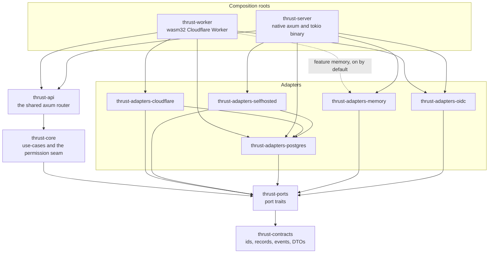

# Application architecture

The application is a small hexagon: business logic depends on port traits, adapters implement the ports for one
platform, and two composition roots pick an adapter set and start the same HTTP router. This page describes what
is built today, which is one vertical slice (work items, their activity feed and attachments). The target design
is in the plan, listed under [Not built yet](#not-built-yet).

The rule is ADR-0002 (accepted): core code imports no platform crate, and every Cloudflare primitive sits behind a
port. ADR-0007 (accepted) chooses the adapter set at compile time, in the composition root. The ADRs are in
`.agents/plans/contrail/adrs/architecture/`.

## Crates and what they depend on

Arrows point from a crate to a crate it depends on. Only workspace crates are drawn.

The diagram leaves out edges that the drawn ones already imply. Every drawn crate except `thrust-contracts` also
depends on it directly. `thrust-api` and both roots also depend directly on `thrust-ports`, and both roots on
`thrust-core`.

| Layer | Crate | Role |
|---|---|---|
| Data | `thrust-contracts` | Identifiers (`WorkspaceId`, `ProjectId`, ...), records (`WorkItem`, `Activity`), the event `Envelope`, the outbox row and the API request and error types. Depends on serde, serde_json, uuid and chrono without its clock feature |
| Ports | `thrust-ports` | The port traits and their error types. Every returned future is `Send` |
| Core | `thrust-core` | The use-cases, the `Ports` bundle, `App` and `CoreConfig`, the permission seam (`authorize`, which mints a `Scope`) and the identity use-cases (`sign_in`, sessions, CSRF, API keys with a versioned digest, the OIDC login) with the argon2id hasher. `CoreConfig` holds the CSRF enforcement switch (`csrf_enforce`) and the API key hash version (`api_key_hash_current`, `api_key_hash_supported`). It depends on `argon2` and `subtle`, both pure Rust, and on no OIDC crate |
| HTTP | `thrust-api` | One `router()` that both roots serve. Handlers see `App` and never a platform type |
| Adapters | `thrust-adapters-memory` | `Database` (workspaces, sessions, users, API keys and pending logins, and all), `Queue`, `BlobStore` and `RateLimiter` in process memory, for tests and as the reference the real adapters are compared with. It has no clock, id, random or background adapter |
| | `thrust-adapters-postgres` | The `Database` port written once against `tokio_postgres::Client`, plus the schema migrations (0001 to 0007: 0006 is the `pg_trgm` search indexes, 0007 adds `api_keys.hash_version`) and a `migrate` binary |
| | `thrust-adapters-selfhosted` | Native pieces: a system clock, UUID v7 ids, the operating system's random source, `reqwest` as the `Fetch` port, `Background` on tokio, and a deadpool connection pool that gives the Postgres adapter its connections |
| | `thrust-adapters-cloudflare` | Workers pieces: clock and ids from JavaScript, `crypto.getRandomValues` as the random source, `worker::Fetch` as the `Fetch` port, `Background` on `waitUntil`, R2 blobs, Queues, a Durable Object rate limiter and a Hyperdrive connection for the Postgres adapter |
| | `thrust-adapters-oidc` | The OIDC relying party: the `openidconnect` crate over the `Fetch` port, so one implementation serves both roots. It is its own crate because `openidconnect` pulls `wasm-bindgen` and `js-sys` into the wasm32 graph (through `chrono` and `getrandom`), which `thrust-core` must not have |
| Roots | `thrust-worker` | The Cloudflare Worker (`cdylib`): `fetch`, `queue` and `scheduled` handlers, and the Durable Object classes |
| | `thrust-server` | The native binary |
| Tests | `thrust-contract-tests` | A black-box HTTP suite. It depends on `thrust-contracts` only, so it never links the code it tests |

`thrust-editor-doc` and `thrust-editor-worker` are also workspace members. They are the editor-document spike and
sit outside this layering: `thrust-editor-doc` depends on no thrust crate, and `thrust-editor-worker` depends only
on it.

## Ports

| Port | What it abstracts | Adapters in the tree |
|---|---|---|
| `Clock`, `IdGen` | Wall time and time-ordered ids. Core takes time from the port. `thrust-contracts` depends on chrono without its `clock` feature, so `Utc::now()` is unavailable to it when built alone. `thrust-adapters-selfhosted` turns the feature on for the native server, so this is a convention that the dependency declaration backs, not a guarantee in every build | `SystemClock`, `NativeIdGen` (selfhosted); `JsClock`, `JsIdGen` (cloudflare) |
| `Background` | Running work after the response. Core never calls `tokio::spawn` | `TokioBackground`; `WaitUntilBackground`, `LocalBackground` |
| `Database` and `Tx` | Reads, a unit of work, the outbox and the activity projection. Every method takes a `Scope` (minted only by `authorize`), from which the adapter reads the tenant key, or a `SystemScope` (minted only by the composition roots) for the outbox relay and sweeper, the consumer's activity write, `seed` and the test-support user calls. `membership` (which resolves the workspace slug) and the identity calls run before a `Scope` exists and take none: they are the exceptions. They are the session calls (`session`, `touch_session`, `revoke_session`, `revoke_user_sessions`, `insert_session`), the user and account calls (`user_by_email`, `user_for_account`, `link_account`), the API-key calls (`insert_api_key`, `api_key`, `touch_api_key`, `rehash_api_key`, `list_api_keys`, `revoke_api_key`; `rehash_api_key` is a compare-and-set on the key's `hash_version`) and the pending OIDC login (`insert_oidc_login`, `take_oidc_login`). They are directory tables (ADR-0041), and none receives or returns a password or a token, only hashes | `MemoryDatabase`; `PgDatabase` over a `Connector` (`PoolConnector` native, `HyperdriveConnector` on the Worker) |
| `Queue` and `EventConsumer` | Publishing events, and the callback a queue adapter invokes per delivered message | `MemoryQueue`; `CfQueue` |
| `BlobStore` | Attachments | `MemoryBlobStore`; `R2BlobStore` |
| `RateLimiter` | A fixed-window counter | `MemoryRateLimiter`; `DoRateLimiter` |
| `Rng` | Cryptographically secure random bytes: session tokens, API keys, CSRF tokens, the OIDC `state`, `nonce` and PKCE verifier, password salts. A failing source is an error, never a short buffer | `NativeRng` (selfhosted); `JsRng` (cloudflare); a counter stream in tests |
| `PasswordHasher` | argon2id, as a port so that a test can count hash work (an unknown email must cost what a wrong password does) | `Argon2idHasher` (core); a counting wrapper in tests |
| `Fetch` | Outbound HTTP, the only way the application reaches a server it does not own | `ReqwestFetch`; `WorkerFetch` |
| `OidcProvider` | One OIDC provider as a relying party: the authorization URL, and the code exchange with ID-token verification. The `state`, `nonce` and verifier are core's, stored in a row, so the adapter holds nothing per login | `OpenIdProvider` (adapters-oidc) over `Fetch`; a scripted provider in tests |

Every future a port returns is `Send`, on both targets, because the one shared axum router needs `Send` handlers.
A Worker isolate is single-threaded, so the Cloudflare adapters wrap their JavaScript-backed futures in
`worker::send::SendFuture`.

## Composition

A root builds a `Ports` value (one `Arc<dyn Trait>` per port), wraps it with a `CoreConfig` into an `App`, and
hands the `App` to `thrust_api::router()` as a request extension. The roots read the application's configuration
from the environment; core and the router never do.

- **Adapter set.** It is fixed when the crate is built. `THRUST_ADAPTERS` only chooses among the sets that were
  compiled in: `memory` or `postgres` for the server, `cloudflare` or (with the `memory` feature) `memory` for
  the Worker. What each set contains is on [Infrastructure](infra.md).
- **Lifetime of `App`.** The server builds one and shares it. The Worker builds one per invocation (a request, a
  queue batch or a cron tick), because the Hyperdrive socket and `waitUntil` belong to a single request.
- **The consumer.** The queue consumer is `ActivityConsumer`, which core provides. The Worker's `queue` event and
  the server's in-process queue both call the same body.

## What enforces the layering

`scripts/check-deps.sh` is the guard. It asks `cargo tree` whether any of 17 forbidden crates (tokio,
tokio-postgres, hyper, worker, wasm-bindgen, sqlx, ...) is in the dependency graph of `thrust-contracts`,
`thrust-ports`, `thrust-core`, `thrust-api`, `thrust-compat-plane` or `thrust-adapters-memory`, and exits non-zero if one is. It holds
`thrust-adapters-oidc` to the same list minus `wasm-bindgen` and `js-sys` (the `openidconnect` crate brings those two on
wasm32 and nothing else) and also `reqwest`, and checks that `thrust-core` does not depend on it. It also
checks that the Worker's wasm32 graph holds none of the native-only crates and that the server's graph holds none
of the Worker-only ones. The `deps` job in CI runs it on every pull request that changes a Rust-relevant path
([CI/CD](cicd.md)), and `scripts/verify-all.sh` runs it along with the other checks. How to run it and how to prove it
can fail are on
[Architecture gates](../testing/techniques/architecture-gates.md).

## Not built yet

The plan's `ARCHITECTURE.md` (draft v0, `.agents/plans/contrail/ARCHITECTURE.md`) describes more than exists:

- **Crates:** `thrust-api-core`, `thrust-api-v1` and `thrust-collab-do` do not exist, and there is no `web/`
  directory. `thrust-compat-plane` exists but serves only S01 to S06 (`/api/instances/`, `/api/users/me/` signed out
  only, and the four `/auth/` routes the sign-up and sign-in pages call) so far; issue #44 builds the rest of the
  48-route slice stage by stage. Each composition root mounts it beside
  `thrust-api`'s router, which is still the only other router crate.
- **Ports:** Workflow, Scheduler, Collab, Search, Email, AI, Identity, Secrets, Telemetry and Flags have no trait.
  Scheduling today is a `scheduled` handler on the Worker and an optional timer in the server.
- **Adapters:** the self-hosted set in the plan's diagrams (RabbitMQ, Valkey, S3) does not exist. See
  [Infrastructure](infra.md).
