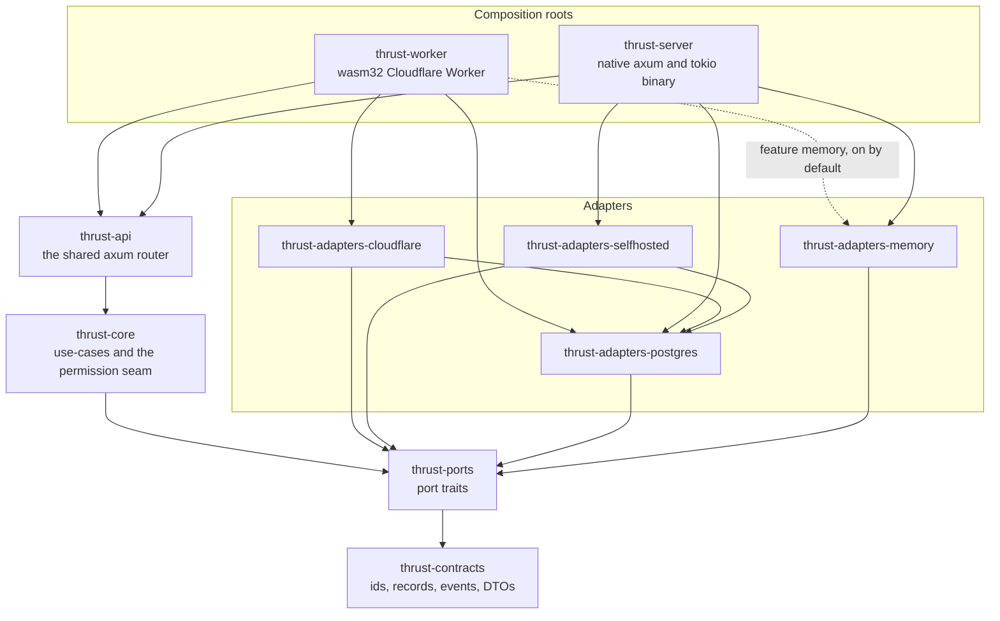

# Application architecture

The application is a small hexagon: business logic depends on port traits, adapters implement the ports for one
platform, and two composition roots pick an adapter set and start the same HTTP router. This page describes what
is built today, which is one vertical slice (work items, their activity feed and attachments). The target design
is in the plan, listed under [Not built yet](#not-built-yet).

The rule is ADR-0002 (accepted): core code imports no platform crate, and every Cloudflare primitive sits behind a
port. ADR-0007 (accepted) chooses the adapter set at compile time, in the composition root. The ADRs are in
`.agents/plans/contrail/adrs/architecture/`.

## Crates and what they depend on

Arrows point from a crate to a crate it depends on. Only workspace crates are drawn.

The diagram leaves out edges that the drawn ones already imply. Every drawn crate except `thrust-contracts` also
depends on it directly. `thrust-api` and both roots also depend directly on `thrust-ports`, and both roots on
`thrust-core`.

| Layer | Crate | Role |
|---|---|---|
| Data | `thrust-contracts` | Identifiers (`WorkspaceId`, `ProjectId`, ...), records (`WorkItem`, `Activity`), the event `Envelope`, the outbox row and the API request and error types. Depends on serde, serde_json, uuid and chrono without its clock feature |
| Ports | `thrust-ports` | The port traits and their error types. Every returned future is `Send` |
| Core | `thrust-core` | The use-cases, the `Ports` bundle, `App` and `CoreConfig`, and the permission seam (`authorize`, which mints a `Scope`) |
| HTTP | `thrust-api` | One `router()` that both roots serve. Handlers see `App` and never a platform type |
| Adapters | `thrust-adapters-memory` | `Database`, `Queue`, `SessionStore`, `BlobStore` and `RateLimiter` in process memory, for tests and as the reference the real adapters are compared with. It has no clock, id or background adapter |
| | `thrust-adapters-postgres` | The `Database` port written once against `tokio_postgres::Client`, plus the schema migration and a `migrate` binary |
| | `thrust-adapters-selfhosted` | Native pieces: a system clock, UUID v7 ids, `Background` on tokio, and a deadpool connection pool that gives the Postgres adapter its connections |
| | `thrust-adapters-cloudflare` | Workers pieces: clock and ids from JavaScript, `Background` on `waitUntil`, KV sessions, R2 blobs, Queues, a Durable Object rate limiter and a Hyperdrive connection for the Postgres adapter |
| Roots | `thrust-worker` | The Cloudflare Worker (`cdylib`): `fetch`, `queue` and `scheduled` handlers, and the Durable Object classes |
| | `thrust-server` | The native binary |
| Tests | `thrust-contract-tests` | A black-box HTTP suite. It depends on `thrust-contracts` only, so it never links the code it tests |

`thrust-editor-doc` and `thrust-editor-worker` are also workspace members. They are the editor-document spike and
sit outside this layering: `thrust-editor-doc` depends on no thrust crate, and `thrust-editor-worker` depends only
on it.

## Ports

| Port | What it abstracts | Adapters in the tree |
|---|---|---|
| `Clock`, `IdGen` | Wall time and time-ordered ids. Core takes time from the port. `thrust-contracts` depends on chrono without its `clock` feature, so `Utc::now()` is unavailable to it when built alone. `thrust-adapters-selfhosted` turns the feature on for the native server, so this is a convention that the dependency declaration backs, not a guarantee in every build | `SystemClock`, `NativeIdGen` (selfhosted); `JsClock`, `JsIdGen` (cloudflare) |
| `Background` | Running work after the response. Core never calls `tokio::spawn` | `TokioBackground`; `WaitUntilBackground`, `LocalBackground` |
| `Database` and `Tx` | Reads, a unit of work, the outbox and the activity projection. Every method takes a `Scope` (minted only by `authorize`), from which the adapter reads the tenant key, or a `SystemScope` (minted only by the composition roots) for the outbox relay and sweeper, the consumer's activity write and `seed`. `membership`, which `authorize` calls before a `Scope` exists, is the one exception | `MemoryDatabase`; `PgDatabase` over a `Connector` (`PoolConnector` native, `HyperdriveConnector` on the Worker) |
| `Queue` and `EventConsumer` | Publishing events, and the callback a queue adapter invokes per delivered message | `MemoryQueue`; `CfQueue` |
| `SessionStore` | Bearer token to `Principal` | `MemorySessionStore`; `KvSessionStore` |
| `BlobStore` | Attachments | `MemoryBlobStore`; `R2BlobStore` |
| `RateLimiter` | A fixed-window counter | `MemoryRateLimiter`; `DoRateLimiter` |

Every future a port returns is `Send`, on both targets, because the one shared axum router needs `Send` handlers.
A Worker isolate is single-threaded, so the Cloudflare adapters wrap their JavaScript-backed futures in
`worker::send::SendFuture`.

## Composition

A root builds a `Ports` value (one `Arc<dyn Trait>` per port), wraps it with a `CoreConfig` into an `App`, and
hands the `App` to `thrust_api::router()` as a request extension. The roots read the application's configuration
from the environment; core and the router never do.

- **Adapter set.** It is fixed when the crate is built. `THRUST_ADAPTERS` only chooses among the sets that were
  compiled in: `memory` or `postgres` for the server, `cloudflare` or (with the `memory` feature) `memory` for
  the Worker. What each set contains is on [Infrastructure](infra.md).
- **Lifetime of `App`.** The server builds one and shares it. The Worker builds one per invocation (a request, a
  queue batch or a cron tick), because the Hyperdrive socket and `waitUntil` belong to a single request.
- **The consumer.** The queue consumer is `ActivityConsumer`, which core provides. The Worker's `queue` event and
  the server's in-process queue both call the same body.

## What enforces the layering

`scripts/check-deps.sh` is the guard. It asks `cargo tree` whether any of 17 forbidden crates (tokio,
tokio-postgres, hyper, worker, wasm-bindgen, sqlx, ...) is in the dependency graph of `thrust-contracts`,
`thrust-ports`, `thrust-core`, `thrust-api` or `thrust-adapters-memory`, and exits non-zero if one is. It also
checks that the Worker's wasm32 graph holds none of the native-only crates and that the server's graph holds none
of the Worker-only ones. The `deps` job in CI runs it on every pull request that changes a Rust-relevant path
([CI/CD](cicd.md)), and `scripts/verify-all.sh` runs it along with the other checks. How to run it and how to prove it
can fail are on
[Architecture gates](../testing/techniques/architecture-gates.md).

## Not built yet

The plan's `ARCHITECTURE.md` (draft v0, `.agents/plans/contrail/ARCHITECTURE.md`) describes more than exists:

- **Crates:** `thrust-api-core`, `thrust-api-v1`, `thrust-compat-plane` and `thrust-collab-do` do not exist, and
  there is no `web/` directory. `thrust-api` is the only router crate.
- **Ports:** Workflow, Scheduler, Collab, Search, Email, AI, Identity, Secrets, Telemetry and Flags have no trait.
  Scheduling today is a `scheduled` handler on the Worker and an optional timer in the server.
- **Adapters:** the self-hosted set in the plan's diagrams (RabbitMQ, Valkey, S3) does not exist. See
  [Infrastructure](infra.md).
