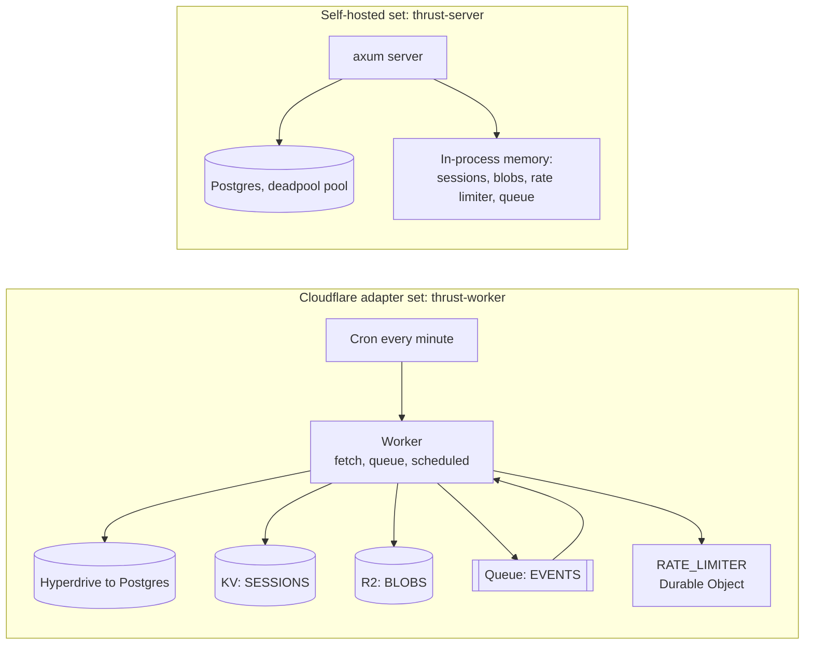

# Infrastructure

This page describes the infrastructure the repository declares: what each adapter set is made of, what it is
configured with, and how to run it. Nothing is deployed from here. The project has no deploy pipeline, Dockerfile,
compose file, Helm chart, OpenTofu or CI workflow of its own. Examples of a Dockerfile, a chart and workflows are
kept under `.agents/` as skill material, and they are not this project's files.

The Worker configuration has run locally under `wrangler dev` and once against real Cloudflare resources (the
2026-10-18 spike run, torn down afterwards). Nothing in the repository deploys the server. How the code is layered
is on [Application architecture](app.md).

## Cloudflare: `thrust-worker`

One Worker handles HTTP (`fetch`), queue delivery (`queue`) and the cron trigger (`scheduled`). `entry.mjs` is a
small JavaScript shim that re-exports the Rust Worker and adds the one thing workers-rs cannot define, a Workflow
class (`ThrustWorkflow`); it holds no business logic.

The bindings in `crates/thrust-worker/wrangler.toml`:

| Binding | Kind | Port it backs |
|---|---|---|
| `HYPERDRIVE` | Hyperdrive | `Database`, through `PgDatabase` and `HyperdriveConnector` |
| `SESSIONS` | KV namespace | `SessionStore` |
| `BLOBS` | R2 bucket | `BlobStore` |
| `EVENTS` | Queue, producer and consumer (batch of 10, 1 s timeout, 3 retries) | `Queue` |
| `RATE_LIMITER` | Durable Object `RateLimiterDo` (SQLite) | `RateLimiter` |
| `ROOM` | Durable Object `RoomDo` (SQLite) | none: a WebSocket room, reachable only through `/_test/room/...`, which needs test routes and the admin token |
| cron `* * * * *` | Cron trigger | runs the outbox sweeper |

`RL`, `SS`, `EMAIL`, `SELF` and `WORKFLOW` (rate limiting, Secrets Store, email, a service binding to the Worker
itself, and a Workflow) are binding probes. Only `probes.rs`, reached through `/_test/bindings/...`, and the
Workflow shim in `entry.mjs`, which calls back through `SELF`, use them. No use-case does.

Behaviour worth knowing:

- **Adapter set.** `wrangler.toml` builds with `--no-default-features`, so the bundle holds the Cloudflare set only.
  The default build also compiles an in-isolate `memory` set, which `wrangler.memory.toml` runs with no bindings.
- **Request bodies are buffered.** The Worker reads the whole body (at most 8 MiB, the router's limit) before it
  routes, so there are no streaming uploads. The source comment records why: skipping this made a share of local
  runs fail with a request-stream error.
- **Queue consumer.** A message the consumer rejects is retried after 5 seconds, up to the queue's `max_retries`
  of 3, and then goes to the dead-letter queue if one is configured. `wrangler.toml` configures none. The Stage 2
  config names one, and the spike run recorded a rejected event reaching it (research note 0004, S2-9). A message
  that cannot be decoded is acknowledged and dropped, so it never reaches a dead-letter queue.
- **Cron.** Each tick runs one outbox sweep of up to 100 rows.
- **Configuration and secrets.** The config file holds no secret. The Hyperdrive, KV and Secrets Store ids in it
  are all-zero placeholders for local use; R2 and the queue are given by name, and the rate-limit namespace id is
  `1001`. The Worker reads `THRUST_ADMIN_TOKEN` from its secrets or variables, and the local Postgres URL reaches
  `wrangler dev` through an environment variable, never through the file.
- **Stage 2.** `wrangler.stage2.toml` is the Worker as it ran on real Cloudflare resources. It is named
  `thrust-spike-worker`, has `workers_dev` on, turns test routes on, sets a create limit of 30 with a one-hour
  window, and gives the queue a dead-letter queue. Its header says its ids belonged to the 2026-10-18 run and were
  deleted at its end. The resources the run created start with `thrust-spike-`. The Secrets Store it names was the
  account's default store, which already existed, and only the probe secret in it was removed (research note 0004,
  section 10.7).

To run it locally, use `scripts/worker-dev.sh`. It starts `wrangler dev` (local workerd: no deploy, no login, no
remote bindings) with a minimal explicit environment, because wrangler would otherwise turn the whole process
environment into Worker bindings, and it always turns test routes on. `THRUST_ADAPTERS=memory` (the default)
selects `wrangler.memory.toml`, and any other value selects `wrangler.toml`. The script passes the value on to the
Worker, which accepts only `cloudflare` and `memory`, so use `cloudflare` (what `scripts/contract.sh worker-cf`
passes). The script's own header lists `postgres` instead, which the Worker would reject as not compiled in.
This paragraph is `[derived]` from the scripts and `[unverified: not run]`: running it needs wrangler and, for the
Cloudflare set, a Postgres URL in `DATABASE_URL`. `scripts/contract.sh` supplies one by starting a throwaway
Postgres in Docker.

## Self-hosted: `thrust-server`

One native binary serves the same router. It has two adapter sets, chosen by `THRUST_ADAPTERS`:

- `memory` (the default): every port in process memory.
- `postgres`: the `Database` port on Postgres through a deadpool pool. **Only the database changes.** Sessions,
  blobs, the rate limiter and the queue stay in process memory in both modes.

So a `postgres` server loses its sessions and attachments when it restarts, and so does any event that was already
handed to the in-process queue and not yet consumed. Outbox rows are in Postgres, so the sweeper delivers the rest
later. Sessions, blobs and the rate limiter belong to one process, so a second process would not share them. The
plan's RabbitMQ, Valkey and S3 adapters do not exist. There is also no login route:
a session token exists only if `POST /internal/seed` created it, and that route answers only when test routes are
on.

Configuration is read from the environment, in `crates/thrust-server/src/main.rs`:

| Variable | Default | Meaning |
|---|---|---|
| `THRUST_LISTEN` | `127.0.0.1:8080` | Address to bind |
| `THRUST_ADAPTERS` | `memory` | `memory` or `postgres` |
| `DATABASE_URL` | none | Required for `postgres`. It carries the password, so it is read from the environment only |
| `THRUST_PG_POOL` | `16` | Postgres pool size |
| `THRUST_CREATE_RATE_LIMIT` | `1000` | Work-item creates per user per window |
| `THRUST_RATE_WINDOW_SECS` | `60` | The window |
| `THRUST_OUTBOX_FASTPATH` | on | Publish events right after commit; off leaves every event to the sweeper |
| `THRUST_SWEEP_INTERVAL_SECS` | `0` | Interval of the in-process outbox sweeper; `0` turns it off |
| `THRUST_TEST_ROUTES` | off | Turns on `/_info`, `/_test/panic` and `/internal/*`; with it off they answer 404 |
| `THRUST_ADMIN_TOKEN` | none | The secret `/internal/*` requires, as the `x-admin-token` header |

The Worker reads `THRUST_ADAPTERS`, `THRUST_CREATE_RATE_LIMIT`, `THRUST_RATE_WINDOW_SECS`,
`THRUST_OUTBOX_FASTPATH`, `THRUST_TEST_ROUTES` and `THRUST_ADMIN_TOKEN` from its own environment. Its database comes
from the Hyperdrive binding, so it has no `DATABASE_URL`. The server turns a panic in a handler into a JSON 500 and
logs the cause.

## Postgres

`thrust-adapters-postgres` carries its own schema, `migrations/0001_init.sql`: `projects`, `project_members`,
`project_sequences`, `work_items`, `outbox` and `activity`. Its header says it is the spike's schema, enough for
the vertical slice and not the product schema. Every table carries `workspace_id`, the tenant key, except
`project_sequences`.

The `migrate` binary applies it. It needs the `native` feature and reads `DATABASE_URL` from the environment, and
`scripts/contract.sh` runs it as `scripts/rs cargo run -p thrust-adapters-postgres --features native --bin migrate`.
Neither the server nor the Worker applies the schema when it starts. `scripts/contract.sh native-pg` and `worker-cf` start
a throwaway `postgres:16-alpine` container in Docker, with a generated password that lives only in the script's
environment, and migrate it before the target starts.

## Elsewhere and not built yet

The plan records decisions and work about infrastructure that is not in this repository:

- **Provisioning and deploy.** ADR-0093 (accepted) puts OpenTofu in the infrastructure repository and leaves
  bundles, bindings and deploys to wrangler; ADR-0110 describes the deploy pipeline. ADR-0093 still lists as open
  which repository holds the Cloudflare OpenTofu root (Q-0093.1). Nothing for either is here.
- **Postgres hosting.** ADR-0094 (accepted) chooses Hyperdrive through Workers VPC and a tunnel to a CloudNativePG
  cluster, and its updates record that cluster as live on 2026-10-18, provisioned from the infrastructure
  repository. The same updates record that the Hyperdrive hop runs with certificate verification disabled: the
  connection is encrypted, but the database is not authenticated. The ADR names closing that as a condition for
  holding real data (Q-0094.9). This repository contains only the adapter side (`HyperdriveConnector`).
- **The self-hosted twin and the Cloudflare topology** (ADR-0091 and ADR-0090) are only proposed.

The ADRs are in `.agents/plans/contrail/adrs/infra/` and `.agents/plans/contrail/adrs/cd/`.
