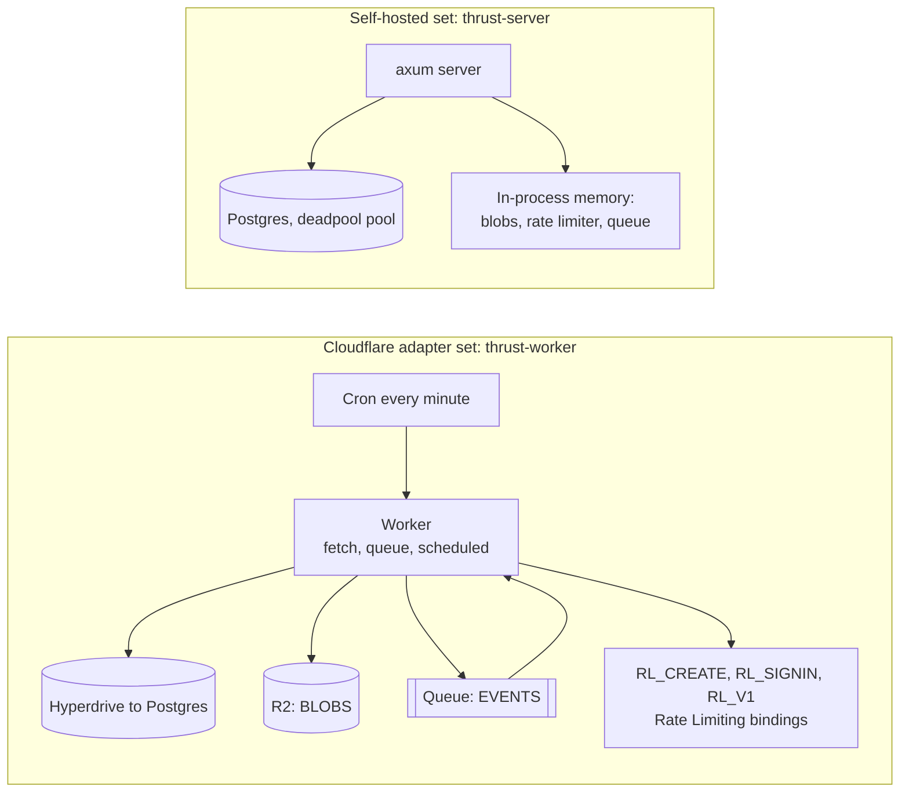

# Infrastructure

This page describes the infrastructure the repository declares: what each adapter set is made of, what it is
configured with, and how to run it. Nothing is deployed from here. The project has no deploy pipeline, Dockerfile,
compose file, Helm chart or OpenTofu of its own. Its only workflows run tests ([CI/CD](cicd.md)). Examples of a
Dockerfile, a chart and workflows are kept under `.agents/` as skill material, and they are not this project's files.

The Worker configuration has run locally under `wrangler dev` and once against real Cloudflare resources (the
2026-10-18 spike run, torn down afterwards). Nothing in the repository deploys the server. How the code is layered
is on [Application architecture](app.md).



## Cloudflare: `thrust-worker`

One Worker handles HTTP (`fetch`), queue delivery (`queue`) and the cron trigger (`scheduled`). It has no JavaScript,
no Workflow and no service binding: `main` is `build/worker/shim.mjs`, the file `worker-build` writes. That is
ADR-0090's Option 1, one Worker, until the P1 collab room is added as a Worker of its own, and the review's FR-05
removed the Workflows shim (`entry.mjs`) that used to sit in front of it. `scripts/check-topology.sh` fails CI on a `[[workflows]]` or `[[services]]` block or a
different `main` in any `crates/thrust-worker/wrangler*.toml`.

The bindings in `crates/thrust-worker/wrangler.toml`:

| Binding | Kind | Port it backs |
|---|---|---|
| `HYPERDRIVE` | Hyperdrive | `Database`, through `PgDatabase` and `HyperdriveConnector` |
| `BLOBS` | R2 bucket | `BlobStore` |
| `EVENTS` | Queue, producer and consumer (batch of 10, 1 s timeout, 3 retries) | `Queue` |
| `RL_CREATE`, `RL_SIGNIN`, `RL_V1` | Workers Rate Limiting bindings, one per kind of key (work item creates per user, 1000 a minute; sign-ins per email, 10; `/api/v1` requests per API key, 60) | `RateLimiter`, through `CfRateLimiter` |
| `ROOM` | Durable Object `RoomDo` (SQLite) | none: a WebSocket room, reachable only through `/_test/room/...`, which needs test routes and the admin token |
| cron `* * * * *` | Cron trigger | runs the outbox sweeper |

`RL`, `SS` and `EMAIL` (a rate-limiting binding of its own, Secrets Store and email) are binding probes. Only
`probes.rs`, reached through `/_test/bindings/...`, uses them. No use-case does. There is no probe for a service
binding or a Workflow, because the Worker has neither.

Behaviour worth knowing:

- **Adapter set.** `wrangler.toml` builds with `--no-default-features`, so the bundle holds the Cloudflare set only.
  The default build also compiles an in-isolate `memory` set, which `wrangler.memory.toml` runs with no bindings.
- **Rate limits.** On Cloudflare the allowance is the binding's own `limit` and `period` in the `[[ratelimits]]` block,
  not a variable: `THRUST_CREATE_RATE_LIMIT`, `THRUST_SIGNIN_RATE_LIMIT` and the count in `THRUST_V1_RATE_LIMIT` are
  read by the in-isolate and native sets only. A binding counts per Cloudflare location and approximately (one of 3 per
  10 s has let 4 through), over 10 s or 60 s and nothing else (ADR-0033, D-007), so the Worker refuses to start with a
  `THRUST_RATE_WINDOW_SECS` or a `THRUST_V1_RATE_LIMIT` period of any other length. The binding answers only yes or no.
  A refusal is a 429 with `Retry-After` of one whole period, and an answer that lets a request through reports
  `X-RateLimit-Remaining` on `/api/v1` as the limit less one, an upper bound and not a count. The native server and the
  in-isolate Worker count exactly (`MemoryRateLimiter`). A key that belongs to none of the three bindings is an error,
  not a free pass. Before issue #43 a Durable Object counted exactly, at a Durable Object round trip on every create.
- **Placement.** `wrangler.toml` and `wrangler.stage2.toml` set `placement.region = "aws:us-east-1"`, where the
  database is (ADR-0094), so `fetch` runs in the Cloudflare data centre closest to that region. Placement covers
  `fetch` only: the `queue` and `scheduled` handlers and the Durable Objects are not placed. `region` excludes `mode`,
  `host` and `hostname`. `wrangler.pg.stage.toml` carries no block of its own: `scripts/spike-0002-pg.sh` injects one at
  its `# __PLACEMENT__` marker unless given `--no-placement`. `scripts/check-placement.sh`, a step of the `deps` CI
  job, checks that text in all three files. It cannot show that Cloudflare accepted the hint: Cloudflare adds a
  `cf-placement` header (`remote-XXX` or `local-XXX`) to a response when placement is on, and the Workers API reports
  the Worker's placement. That the hint takes effect on a deployed Worker was seen on 2026-11-11 `[verified 2026-11-11
  1991731]` (issue #39): the Workers API returned `placement: {mode: "targeted", region: "aws:us-east-1"}`, a request
  that entered at EWR answered `cf-placement: remote-IAD`, and requests from a laptop whose edge is IAD answered
  `local-IAD`. The run is in research note 0004, section 10.3a; the stack it used was torn down afterwards.
- **Request bodies are buffered.** The Worker reads the whole body (at most 8 MiB, the router's limit) before it
  routes, so there are no streaming uploads. The source comment records why: skipping this made a share of local
  runs fail with a request-stream error.
- **Queue consumer.** A message the consumer rejects is retried after 5 seconds, up to the queue's `max_retries`
  of 3, and then goes to the dead-letter queue if one is configured. `wrangler.toml` configures none. The Stage 2
  config names one, and the spike run recorded a rejected event reaching it (research note 0004, S2-9). A message
  that cannot be decoded is acknowledged and dropped, so it never reaches a dead-letter queue.
- **Cron.** Each tick runs one outbox sweep of up to 100 rows.
- **Configuration and secrets.** The config file holds no secret. The Hyperdrive and Secrets Store ids in it
  are all-zero placeholders for local use; R2 and the queue are given by name, and the rate-limit namespace ids are
  `1001` (the probe's) to `1004`. The Worker reads `THRUST_ADMIN_TOKEN` from its secrets or variables, and the local Postgres URL reaches
  `wrangler dev` through an environment variable, never through the file.
- **Stage 2.** `wrangler.stage2.toml` is the Worker as it ran on real Cloudflare resources. It is named
  `thrust-spike-worker`, has `workers_dev` on, turns test routes on, has an `RL_CREATE` binding of 30 a minute, and gives
  the queue a dead-letter queue. Its header says its ids belonged to the 2026-10-18 run and were
  deleted at its end. The resources the run created start with `thrust-spike-`. The Secrets Store it names was the
  account's default store, which already existed, and only the probe secret in it was removed (research note 0004,
  section 10.7).

To run it locally, use `scripts/worker-dev.sh`. It starts `wrangler dev` (local workerd: no deploy, no login, no
remote bindings) with a minimal explicit environment, because wrangler would otherwise turn the whole process
environment into Worker bindings, and it always turns test routes on. `THRUST_ADAPTERS=memory` (the default)
selects `wrangler.memory.toml`, and any other value selects `wrangler.toml`. The script passes the value on to the
Worker, which accepts only `cloudflare` and `memory`, so use `cloudflare` (what `scripts/contract.sh worker-cf`
passes). The script's own header lists `postgres` instead, which the Worker would reject as not compiled in.
This paragraph is `[derived]` from the scripts and `[unverified: not run]`: running it needs wrangler and, for the
Cloudflare set, a Postgres URL in `DATABASE_URL`. `scripts/contract.sh` supplies one by starting a throwaway
Postgres in Docker.

## Self-hosted: `thrust-server`

One native binary serves the same router. It has two adapter sets, chosen by `THRUST_ADAPTERS`:

- `memory` (the default): every port in process memory.
- `postgres`: the `Database` port on Postgres through a deadpool pool. **Only the database changes.** Blobs, the
  rate limiter and the queue stay in process memory in both modes. Sessions are rows behind the `Database` port, so
  they are in process memory with `memory` and in Postgres with `postgres`.

So a `postgres` server keeps its sessions across a restart, and a second process shares them. It loses its
attachments when it restarts, and so does any event that was already handed to the in-process queue and not yet
consumed. Outbox rows are in Postgres, so the sweeper delivers the rest later. Blobs and the rate limiter belong to
one process, so a second process would not share them. The plan's RabbitMQ, Valkey and S3 adapters do not exist.
A user signs in with an email and a password (Plane's `POST /auth/sign-in/`) or through the one configured OIDC
provider, and gets a session row and cookies; the test seed (`POST /internal/seed`, test routes only) also creates
sessions, users, API keys and provider links directly. The full flow is on [Application flow](../flows/app.md).

Configuration is read from the environment, in `crates/thrust-server/src/main.rs`:

| Variable | Default | Meaning |
|---|---|---|
| `THRUST_LISTEN` | `127.0.0.1:8080` | Address to bind |
| `THRUST_ADAPTERS` | `memory` | `memory` or `postgres` |
| `DATABASE_URL` | none | Required for `postgres`. It carries the password, so it is read from the environment only |
| `THRUST_PG_POOL` | `16` | Postgres pool size |
| `THRUST_CREATE_RATE_LIMIT` | `1000` | Work-item creates per user per window |
| `THRUST_RATE_WINDOW_SECS` | `60` | The window |
| `THRUST_OUTBOX_FASTPATH` | on | Publish events right after commit; off leaves every event to the sweeper |
| `THRUST_SWEEP_INTERVAL_SECS` | `0` | Interval of the in-process outbox sweeper; `0` turns it off |
| `THRUST_TEST_ROUTES` | off | Turns on `/_info`, `/_test/panic` and `/internal/*`; with it off they answer 404 |
| `THRUST_ADMIN_TOKEN` | none | The secret `/internal/*` requires, as the `x-admin-token` header |

The Worker reads `THRUST_ADAPTERS`, `THRUST_CREATE_RATE_LIMIT`, `THRUST_RATE_WINDOW_SECS`,
`THRUST_OUTBOX_FASTPATH`, `THRUST_TEST_ROUTES` and `THRUST_ADMIN_TOKEN` from its own environment. Its database comes
from the Hyperdrive binding, so it has no `DATABASE_URL`. The server turns a panic in a handler into a JSON 500 and
logs the cause.

## Postgres

`thrust-adapters-postgres` carries its own schema, in four files that `migrate` applies in order on every run, so each
is idempotent:

| File | Adds |
|---|---|
| `0001_init.sql` | `projects`, `project_members`, `project_sequences`, `work_items`, `outbox` and `activity`. Its header says it is the spike's schema, enough for the vertical slice and not the product schema |
| `0002_sequence_tenant_key.sql` | `workspace_id` on `project_sequences`, and a foreign key that refuses a counter for a project outside its workspace (#35) |
| `0003_workspaces.sql` | `workspaces (id, slug)` and `workspace_members`, backfilled for a database that has projects and no workspaces, and the foreign keys that tie projects and project members to them (#36) |
| `0004_sessions.sql` | `sessions`, a directory table keyed by the SHA-256 of the token, with no plaintext and no workspace column (#36) |

Tenant tables carry `workspace_id`, the tenant key; `sessions` does not, because a session belongs to a user. The
migrations mark each table they add with `-- scope: tenant` or `-- scope: directory`, the first instance of
ADR-0041's marker. Tables from `0001` are not marked yet.

The `migrate` binary applies them. It needs the `native` feature and reads `DATABASE_URL` from the environment, and
`scripts/contract.sh` runs it as `scripts/rs cargo run -p thrust-adapters-postgres --features native --bin migrate`.
Neither the server nor the Worker applies the schema when it starts. `scripts/contract.sh native-pg` and `worker-cf` start
a throwaway `postgres:16-alpine` container in Docker, with a generated password that lives only in the script's
environment, and migrate it before the target starts.

## Recover a locked-out user

There is no reset by email yet (it comes after M2, D-037), so a person who has forgotten their password asks their admin, and
the sign-in screen says so. The admin's tool is two routes that make an account or set a new password. They are `thrust-api`'s
`OperatorAdmin` door and not the test routes: those can wipe every row (`/internal/reset`) and a deployment never turns them on.
The deviation record is D-038.

| Route (POST, JSON `{"email", "password"}`) | Does | Answers |
|---|---|---|
| `/internal/operator/users` | makes an account with that password; nobody is signed in | 204; 400 for an email or password the sign-up rules refuse; 409 for an email that is taken |
| `/internal/operator/users/password` | sets that password on the account with that email, and ends every session of that account | 204; 400 for a password the rules refuse; 404 for an email with no account |

Both answer 401 for a missing or wrong token and 404 while the switch is off, and neither has a body. The password has to pass
the sign-up rule (at least 10 characters, at least 5 different ones, not a common password: D-023). A reset does not change
whether the account is active, so a deactivated user stays deactivated; it gives an account that has no password (one single
sign-on made) one; and it leaves every other account and session alone. Each success leaves one line in the logs
(`operator set a password: user <id>`, or `created a user`): the action and the user's id, never the password or the email.

**Turning it on.** The routes do not exist until `THRUST_OPERATOR_ROUTES` is `1` (a variable on the Worker, an environment
variable on `thrust-server`) and they refuse every call until `THRUST_OPERATOR_TOKEN` (a Worker secret, never a file) is at least
32 characters. `openssl rand -hex 16` makes one. The token is in its own header, `x-operator-token`; the test routes' token
(`x-admin-token`) opens nothing here, the operator's opens no test route, and a person's session is no way in. Turn the switch on
when you need the routes and off when you are done, and replace the token after use if it was ever on a screen. Locally,
`scripts/worker-dev.sh` passes both through, and `scripts/contract.sh` sets both for the target it starts.

**Doing it.** Read the token from the secret store into the environment, check its length and not its value, type the temporary
password without it echoing, and send both without putting either on a command line (`ps` shows arguments). `--variable` and
`--expand-header` need curl 8.3 or later, which this Mac's `/usr/bin/curl` is.

```sh
export THRUST_OPERATOR_TOKEN="$(op read 'op://<vault>/<item>/<field>')"   # the item is yours to make; do not print it
echo "${#THRUST_OPERATOR_TOKEN}"                                          # at least 32, or every call is a 401
BASE=https://<the product hostname>
EMAIL=person@example.com
read -rs OPERATOR_PW; export OPERATOR_PW EMAIL                             # the temporary password, not echoed
jq -n '{email: env.EMAIL, password: env.OPERATOR_PW}' |
  curl -sS -o /dev/null -w '%{http_code}\n' -X POST "$BASE/internal/operator/users/password" \
    --variable '%THRUST_OPERATOR_TOKEN' --expand-header 'x-operator-token: {{THRUST_OPERATOR_TOKEN}}' \
    -H 'content-type: application/json' --data-binary @-
unset OPERATOR_PW THRUST_OPERATOR_TOKEN
```

For a new account use `/internal/operator/users` in place of `/internal/operator/users/password`. A `204` is done; `404` on a
reset means the email has no account (use the create route), `409` on a create means it does (use the reset route), and `400`
means the password was refused. Give the person the temporary password through a channel you trust, and not in the thread where
they asked. They sign in with it, and then change it in Profile, Security: the screen asks for the temporary password as the old one
(`POST /auth/change-password/`, D-039), and a change ends every session of the account and keeps them signed in on a new one, so tell
them to do it at once. Wrong guesses at the old password count against the account's sign-in allowance, the same ten a minute as
sign-in, so a person who mistypes it a few times is not locked out, and one who guesses it cannot. An account that single sign-on
made has no password to give as the old one, and this reset is how it gets one.

What this does not have, and why:

- **No rate limiter.** The Worker's limiter takes three key classes (`create:`, `signin:`, `v1:`), and the one that would fit,
  `signin:`, is a namespace an anonymous sign-in can write to, so it would let anyone use up the operator's allowance. A fourth
  class is a change to the adapter and a new binding. The route does no work before the token matches, and a token under 32
  characters is refused, so guessing it is not a plan.
- **No second gate.** The product hostname is public (Q-0090.3), so on the Worker the token is the only thing between the
  internet and these routes until the Access phase puts a path-scoped service token in front (ADR-0050). Keep the switch off when
  nobody is using it.
- **`[unverified]` on a deployed Worker.** The routes are tested on the four contract targets (`scripts/contract.sh`), and the
  commands above were run as written, with `op read` replaced by a generated token, against a local `thrust-server` on
  2026-11-13 `[verified]`: create, reset, the old password refused and the new one accepted, and neither the token nor either
  password on curl's command line (a wrapper wrote down its arguments) or in the server's log, nor the email. Nothing was run
  against a deployed Worker. Its asset config must also send `/internal/operator/*` to the Worker: `scripts/worker-dev.sh` lists
  `/internal` and `/internal/*` in `run_worker_first`, and the production config is not in this repository.

## Elsewhere and not built yet

The plan records decisions and work about infrastructure that is not in this repository:

- **Provisioning and deploy.** ADR-0093 (accepted) puts OpenTofu in the infrastructure repository and leaves
  bundles, bindings and deploys to wrangler; ADR-0110 describes the deploy pipeline. ADR-0093 still lists as open
  which repository holds the Cloudflare OpenTofu root (Q-0093.1). Nothing for either is here.
- **Postgres hosting.** ADR-0094 (accepted) chooses Hyperdrive through Workers VPC and a tunnel to a CloudNativePG
  cluster, and its updates record that cluster as live on 2026-10-18, provisioned from the infrastructure
  repository. The Hyperdrive hop is encrypted, and both clusters serve a Cloudflare Origin CA server certificate
  whose chain both VPC services verify (`verify_ca`; `thrust-pg-dev` since 2026-11-06, `thrust-pg` since
  2026-11-07, measured). That check does not tell Thrust's database from any other holder of an Origin CA
  certificate, so it narrows who can terminate the hop rather than proving the peer. The ADR named closing this as
  a condition for holding real data (Q-0094.9); the infrastructure side is done, in that sense. On 2026-11-09 the
  owner decided to keep `verify_ca` rather than move to `verify_full` (infrastructure ADR 0024), accepting that
  residual for an internal tool. The decision is reopened when Thrust holds real customer data, among other
  triggers listed in Q-0094.9, so that sense of "done" does not carry over to real data. This repository contains
  only the adapter side (`HyperdriveConnector`).
- **The self-hosted twin and the Cloudflare topology** (ADR-0091 and ADR-0090) are accepted. ADR-0090 chose one Worker
  for P0 and the daily-use release, with a `collab` Worker added when the P1 room lands, and it is reopened if the bundle
  passes 20 MiB or a Durable Object lifecycle change has to ship with an API change. This repository implements the one
  Worker (issue #43).

The ADRs are in `.agents/plans/contrail/adrs/infra/` and `.agents/plans/contrail/adrs/cd/`.
