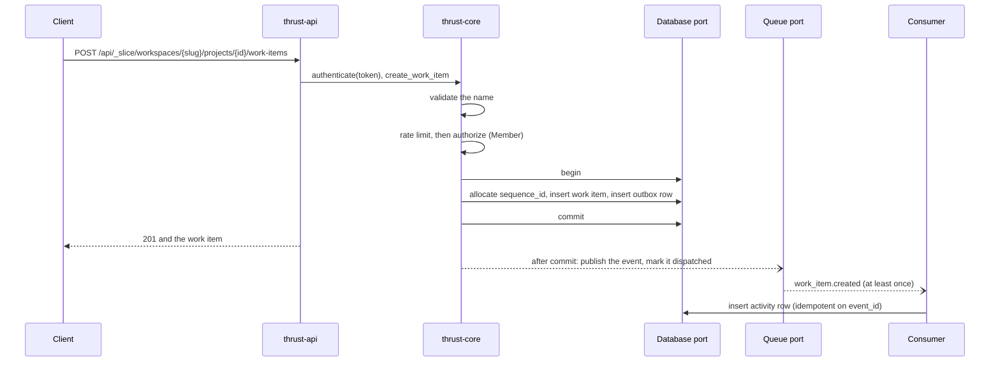

# Application flow

How a request moves through the application as built: authentication, the permission check, a write, the event
that follows it, and the errors a caller can get. Both composition roots serve the same router, so the flow is the
same on the Worker and on the native server. The crates involved are on
[Application architecture](../architecture/app.md), and the contract suite that checks most of this over HTTP is on
[Contract suite](../testing/techniques/contract-suite.md).

## The HTTP surface

`thrust_api::router()` defines the routes both roots serve. The request body limit is 8 MiB.

| Method and path | Needs | Answers |
|---|---|---|
| `GET /healthz` | nothing | 200 `ok` |
| `POST /api/_slice/workspaces/{slug}/projects/{project_id}/work-items` | Bearer token, role Member | 201 and the work item |
| `GET /api/_slice/workspaces/{slug}/projects/{project_id}/work-items` | Bearer token, role Guest | 200 and a list. `?scope=visible` (the default) or `?scope=with_deleted` (role Admin); any other scope is 400 |
| `DELETE /api/_slice/workspaces/{slug}/projects/{project_id}/work-items/{id}` | Bearer token, role Member | 204 |
| `GET /api/_slice/workspaces/{slug}/projects/{project_id}/work-items/{id}/activity` | Bearer token, role Guest | 200 and the item's activity |
| `GET /api/_slice/workspaces/{slug}/projects/{project_id}/activity` | Bearer token, role Guest | 200 and the project's activity |
| `PUT /api/_slice/workspaces/{slug}/projects/{project_id}/work-items/{id}/attachments/{name}` | Bearer token, role Member | 204 |
| `GET /api/_slice/workspaces/{slug}/projects/{project_id}/work-items/{id}/attachments/{name}` | Bearer token, role Guest | 200 and the bytes, with the `Content-Type` they were stored with, if any |
| `DELETE /api/_slice/workspaces/{slug}/projects/{project_id}/work-items/{id}/attachments/{name}` | Bearer token, role Member | 204 |

**The workspace slug.** Every route carries the workspace slug before the project, where Plane puts it
(`kwargs["slug"]` in `apps/api/plane/app/permissions/base.py:28,47,55` at the oracle tag `oracle/v1-pin-20261018`).
A session belongs to a user, not to a workspace, so the slug is what says which workspace a request is for, and
`authorize` resolves it on every request (see below).

**The prefix.** The routes live under `/api/_slice`, the slice's own prefix. `/api/v1` is reserved for routes that are
wire-compatible with Plane (ADR-0031; finding FR-06 of the architecture review,
`.agents/plans/contrail/reviews/2026-10-19-fable-architecture-review.md`; [issue #47](https://github.com/aRustyDev/thrust/issues/47)),
and no route is served under it today. Plane's v1 work items are at
`/api/v1/workspaces/{slug}/projects/{project_id}/work-items/` with a trailing slash, key attachments by id and
authenticate with `X-Api-Key` (`apps/api/plane/api/urls/work_item.py:99-103` and
`apps/api/plane/api/middleware/api_authentication.py:24` at the oracle tag `oracle/v1-pin-20261018`), so the slice's
routes differ on every count. No Plane route starts with an underscore, which keeps the prefix clear of all of them.
It stays under `/api`, so the edge patterns planned for `/api/*` cover it (ADR-0011, ADR-0090).

The router builds every path from one constant, `SLICE_PREFIX` in `thrust-api`; the contract suite mirrors it in
`thrust-contract-tests`, and the two must be equal or every request is a 404. The contract test
`the_slice_routes_are_gone_from_the_reserved_v1_prefix` shows that each of these eight routes answers a routing 404
through `/api/v1` and is mounted through `/api/_slice`.

These routes are temporary. [Issue #58](https://github.com/aRustyDev/thrust/issues/58) builds the Plane-shaped
`/api/v1/workspaces/{slug}/...` routes, and it deletes the `_slice` routes, moves the contract suite onto its own and
retires that test, which stops being true once `/api/v1` is live.

These routes exist for tests and answer 404 unless `THRUST_TEST_ROUTES` is on:

| Method and path | Needs | Answers |
|---|---|---|
| `GET /_info` | test routes | The `target` and `adapters` the process was started with |
| `GET /_test/panic` | test routes | Panics on purpose, to check that a panic becomes a 500 |
| `POST /internal/seed` | test routes and `x-admin-token` | 204 after storing the fixture's workspaces (with their slugs), workspace members, projects and project memberships, and its sessions (as hashes of the tokens, expiring after 30 days). The fixture's user list is accepted and not stored |
| `POST /internal/revoke-session` | same | 204 after revoking the session behind the `token` in the JSON body. A token that is unknown or already revoked is a 204 too. It stands in for sign-out until #38 |
| `POST /internal/sweep` | same | 200 and a sweep report (`found`, `published`, `failed`) |
| `GET /internal/outbox-depth` | same | 200 and `{"undispatched": n}` |
| `POST /internal/inject-event` | same | 202 after putting an event on the queue |

The Worker also serves `/_test/room/...` and `/_test/bindings/...`, which need test routes and the admin token and
belong to the spike. They are on [Infrastructure](../architecture/infra.md).

## Authentication and permission

There is no login route yet (#38). A caller sends `Authorization: Bearer <token>`. The `Authed` extractor calls
`authenticate`, which hashes the token (SHA-256) and reads the session row through the `Database` port on every
request. The row must exist, not be revoked and not be expired (30 days after it was created), or the request is
401. The result is a `Principal` with the user and nothing else: a session belongs to a user, not to a workspace,
so one token works in every workspace the user belongs to. The database holds only the hash, in a `sessions` table
with no workspace column (a directory table, ADR-0041). `last_seen_at` is rewritten only when it is an hour old, so
a busy session costs one write an hour.

Revocation is a row update, and the row is read on every request, so it is effective on the next request on every
target. There is no cache to wait out (ADR-0052 round 29). `POST /internal/revoke-session` does it for the tests.

The permission check is in the core, not in the router, so every entry point that calls a use-case gets it.
`authorize(app, who, slug, project, permission)` asks the `Database` port, in one query, for the workspace the slug
names, the caller's membership of that workspace and the caller's membership of the project, and returns a `Scope`
that only it can create.

| Result | When |
|---|---|
| 404 | The slug names no workspace, the caller is not a member of that workspace, or the project is not in it. All three look the same, so a probe learns neither that a workspace nor that a project exists |
| 403 | The caller is a member of the workspace but not of the project, or their role is below the one the action needs |
| `Scope` | The caller is a member of the project whose role is high enough |

Plane answers 403 for an unknown slug and for a non-member of the workspace (quirk PQ-003, to be reproduced). That
belongs to the wire-compatible routes of [issue #44](https://github.com/aRustyDev/thrust/issues/44); the slice's
routes keep 404, which tells a probe less.

Roles are ordered Guest, Member, Admin. Reading work items, activity and attachments needs Guest. Creating and
deleting work items and writing or deleting attachments needs Member. Reading soft-deleted work items needs Admin.

## Creating a work item

In order, `create_work_item` does the following:

1. **Validates the name.** After trimming, it must be 1 to 255 characters, or the request is 400.
2. **Applies the rate limit.** The key is `create:<user id>`. The defaults are 1000 creates per 60 seconds
   (`THRUST_CREATE_RATE_LIMIT`, `THRUST_RATE_WINDOW_SECS`). Over the limit is 429 with a `Retry-After` header.
3. **Authorizes** with the Member permission.
4. **Writes in one transaction.** It takes the next per-project sequence number and sort order from a counter row
   that is never decremented, so a number is never reused. It inserts the work item and inserts the event as an
   outbox row. On any error it rolls back explicitly, so a pooled connection never goes back mid-transaction.
5. **Commits, then relays.** With the fast path on (`THRUST_OUTBOX_FASTPATH`, on by default), it asks the
   `Background` port to publish the event and mark the outbox row dispatched, and the response does not wait for
   that. A publish failure is swallowed on purpose: the row stays undispatched and the sweeper picks it up.

The event has `event_type` `work_item.created`. Its payload carries the `project_id`, the `sequence_id` and the
changed fields. `dispatch` hands it to the `Queue` port on the `events` topic, with the event id as idempotency key
and the workspace and entity ids as ordering key. No current adapter uses those keys: `MemoryQueue` ignores its
options, and `CfQueue` ignores the topic (the `EVENTS` binding is its one queue) and sends the message with at most
a delay. Duplicates are handled by the consumer, not the queue.

Deleting a work item follows the same path: authorize with Member, soft-delete the row in a transaction, write a
`work_item.deleted` outbox row, commit, relay. A work item that is not there, or already deleted, is a 404 and the
transaction rolls back.

## From event to activity

Delivery is at least once, and the consumer is built for that.

- **The sweeper** publishes outbox rows that the fast path did not, oldest first, up to 100 per run. On the Worker
  it is the cron trigger, every minute. The server runs it from an in-process timer when
  `THRUST_SWEEP_INTERVAL_SECS` is above zero, and it is off by default. `POST /internal/sweep` runs it on demand.
- **The consumer** is `ActivityConsumer`, which calls `process_event`. It needs a `project_id` in the payload
  (otherwise the event is invalid), and it inserts an activity row whose verb is the last part of the event type,
  so `work_item.created` gives `created`. The row is keyed on the event id, so a redelivered event inserts nothing.
- **Failures.** On the Worker, a message the consumer rejects is retried after 5 seconds, and a message that cannot
  be decoded is acknowledged and dropped.

## Attachments

An attachment name is 1 to 128 bytes with no `/` and no `..`, or the request is 400. A body larger than 5 MiB
(`max_attachment_bytes`) is 413. `PUT` also needs the work item to exist and be visible, or it is 404. The
`BlobStore` key is `<workspace>/<project>/<work item>/<name>`, built from the `Scope`, so a caller can only reach
blobs inside a project they were authorized for.

## Errors

Errors raised by the use-cases and the router's own guards share one body,
`{"error": {"code": "...", "message": "..."}}`.

| Status | `code` | Raised when |
|---|---|---|
| 400 | `invalid` | A bad work item name or attachment name, or an unknown `scope` |
| 401 | `unauthenticated` | No Bearer token, a token that is unknown, revoked or expired, or a missing or wrong admin token |
| 403 | `forbidden` | Not a member, or a role that is too low |
| 404 | `not_found` | A slug that names no workspace, a workspace the caller is not in, a project that is not in it, no such item or attachment, or a test route that is switched off |
| 409 | `conflict` | A uniqueness constraint failed, such as a live work item with the same external source and id |
| 413 | `too_large` | An attachment over the size limit |
| 429 | `rate_limited` | Over the create limit. `Retry-After` carries the seconds |
| 500 | `internal` | Anything else. The body says only `internal error`; the cause is logged by the root |

A request that axum's extractors reject before any handler runs gets a plain-text body instead of that shape:

| Status | Raised when |
|---|---|
| 400 | The body is not valid JSON, or an id in the path is not a UUID |
| 415 | A JSON body arrives without `Content-Type: application/json` |
| 422 | The JSON is valid but lacks a required field, such as `name` |
| 413 | The body is over 8 MiB. The native server answers `Failed to buffer the request body: length limit exceeded` `[verified 2026-10-19 991275e]`, and the Worker answers `request body too large or unreadable` `[derived]` |

A body between 5 and 8 MiB on an attachment `PUT` gets the JSON `too_large` error from the table above instead.
