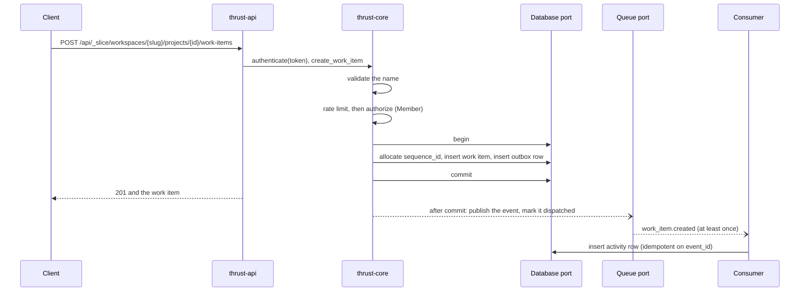

# Application flow

How a request moves through the application as built: authentication (a password sign-in, an OIDC login, a session
cookie, a bearer token or an API key), the permission check, a write, the event that follows it, and the errors a
caller can get. Both composition roots serve the same router, so the flow is the
same on the Worker and on the native server. The crates involved are on
[Application architecture](../architecture/app.md), and the contract suite that checks most of this over HTTP is on
[Contract suite](../testing/techniques/contract-suite.md).

## The HTTP surface

`thrust_api::router()` defines the routes both roots serve. The request body limit is 8 MiB.

| Method and path | Needs | Answers |
|---|---|---|
| `GET /healthz` | nothing | 200 `ok` |
| `POST /api/_slice/workspaces/{slug}/projects/{project_id}/work-items` | Bearer token, role Member | 201 and the work item |
| `GET /api/_slice/workspaces/{slug}/projects/{project_id}/work-items` | Bearer token, role Guest | 200 and a list. `?scope=visible` (the default) or `?scope=with_deleted` (role Admin); any other scope is 400 |
| `DELETE /api/_slice/workspaces/{slug}/projects/{project_id}/work-items/{id}` | Bearer token, role Member | 204 |
| `GET /api/_slice/workspaces/{slug}/projects/{project_id}/work-items/{id}/activity` | Bearer token, role Guest | 200 and the item's activity |
| `GET /api/_slice/workspaces/{slug}/projects/{project_id}/activity` | Bearer token, role Guest | 200 and the project's activity |
| `PUT /api/_slice/workspaces/{slug}/projects/{project_id}/work-items/{id}/attachments/{name}` | Bearer token, role Member | 204 |
| `GET /api/_slice/workspaces/{slug}/projects/{project_id}/work-items/{id}/attachments/{name}` | Bearer token, role Guest | 200 and the bytes, with the `Content-Type` they were stored with, if any |
| `DELETE /api/_slice/workspaces/{slug}/projects/{project_id}/work-items/{id}/attachments/{name}` | Bearer token, role Member | 204 |

The tenant routes above take any credential in [Authentication](#authentication-and-permission): a bearer token, the
session cookie (a mutation then also needs the CSRF token, while [enforcement](#authentication-and-permission) is on) or an
`X-Api-Key`. The identity routes, under the same prefix, are not tenant routes:

| Method and path | Needs | Answers |
|---|---|---|
| `POST /api/_slice/auth/sign-in/email` | nothing; JSON `{email, password}` | 200 and `{user_id, csrf_token, expires_at}`, with two `Set-Cookie` headers. 401 for every refusal, with one body |
| `POST /api/_slice/auth/sign-out` | a session (cookie, plus the CSRF token while enforcement is on, or bearer) | 204, ends that session and clears both cookies. An API key is a 401 here |
| `POST /api/_slice/auth/sign-out-all` | a session, as above | 200 and `{revoked: n}`, ends every session of the user |
| `GET /api/_slice/auth/csrf` | nothing | 200 and `{csrf_token}`, and the same value in the CSRF cookie (Plane's `get-csrf-token`) |
| `GET /api/_slice/auth/session` | any credential | 200 and `{user_id, credential}` (`session` or `api_key`) |
| `POST /api/_slice/api-keys` | a session; JSON `{label?, expires_at?}` | 201 and the key with its `token`, once |
| `GET /api/_slice/api-keys` | a session | 200 and the user's keys: id, prefix, label, dates, never the token |
| `DELETE /api/_slice/api-keys/{id}` | a session | 204 (again on a second call). 404 for an unknown id and for another user's key |
| `GET /api/_slice/auth/oidc/start` | a configured provider | 302 to the provider's authorization endpoint. 404 when none is configured |
| `GET /api/_slice/auth/oidc/callback` | `?code=&state=` from the provider | 303 to `/` with the same two cookies as a sign-in |
**The workspace slug.** Every route carries the workspace slug before the project, where Plane puts it
(`kwargs["slug"]` in `apps/api/plane/app/permissions/base.py:28,47,55` at the oracle tag `oracle/v1-pin-20261018`).
A session belongs to a user, not to a workspace, so the slug is what says which workspace a request is for, and
`authorize` resolves it on every request (see below).

**The prefix.** The routes live under `/api/_slice`, the slice's own prefix. `/api/v1` is reserved for routes that are
wire-compatible with Plane (ADR-0031; finding FR-06 of the architecture review,
`.agents/plans/contrail/reviews/2026-10-19-fable-architecture-review.md`; [issue #47](https://github.com/aRustyDev/thrust/issues/47)),
and no route is served under it today. Plane's v1 work items are at
`/api/v1/workspaces/{slug}/projects/{project_id}/work-items/` with a trailing slash, key attachments by id and
authenticate with `X-Api-Key` (`apps/api/plane/api/urls/work_item.py:99-103` and
`apps/api/plane/api/middleware/api_authentication.py:24` at the oracle tag `oracle/v1-pin-20261018`), so the slice's
routes differ on every count. No Plane route starts with an underscore, which keeps the prefix clear of all of them.
It stays under `/api`, so the edge patterns planned for `/api/*` cover it (ADR-0011, ADR-0090).

The router builds every path from one constant, `SLICE_PREFIX` in `thrust-api`; the contract suite mirrors it in
`thrust-contract-tests`, and the two must be equal or every request is a 404. The contract test
`the_slice_routes_are_gone_from_the_reserved_v1_prefix` shows that each of these eight tenant routes and each of the ten
identity routes answers a routing 404 through `/api/v1` and is mounted through `/api/_slice`.

These routes are temporary. [Issue #58](https://github.com/aRustyDev/thrust/issues/58) builds the Plane-shaped
`/api/v1/workspaces/{slug}/...` routes, and it deletes the `_slice` routes, moves the contract suite onto its own and
retires that test, which stops being true once `/api/v1` is live.

These routes exist for tests and answer 404 unless `THRUST_TEST_ROUTES` is on:

| Method and path | Needs | Answers |
|---|---|---|
| `GET /_info` | test routes | The `target` and `adapters` the process was started with, and `csrf_enforce`: whether it asks a cookie mutation for the CSRF token. `scripts/contract.sh` reads it before any test runs |
| `GET /_test/panic` | test routes | Panics on purpose, to check that a panic becomes a 500 |
| `POST /internal/seed` | test routes and `x-admin-token` | 204 after storing the fixture's workspaces (with their slugs), workspace members, projects and project memberships, its users (by id, or with an email and a password, which is hashed before the database sees it), provider links, API keys and sessions (as hashes of the tokens; sessions expire after 30 days) |
| `POST /internal/revoke-session` | same | 204 after revoking the session behind the `token` in the JSON body. A token that is unknown or already revoked is a 204 too |
| `POST /internal/set-user-active` | same | 204 after deactivating or reactivating the user named in `{user_id, active}`; 404 for a user that does not exist. It stands in for ADR-0053's deprovisioning |
| `POST /internal/sweep` | same | 200 and a sweep report (`found`, `published`, `failed`) |
| `GET /internal/outbox-depth` | same | 200 and `{"undispatched": n}` |
| `POST /internal/inject-event` | same | 202 after putting an event on the queue |

The Worker also serves `/_test/room/...` and `/_test/bindings/...`, which need test routes and the admin token and
belong to the spike. They are on [Infrastructure](../architecture/infra.md).

## Authentication and permission

**Which credential counts.** The `Authed` extractor hands the headers to `authenticate_request` in the core, which picks
one credential and never tries a second: a bearer token if the request has one, else `X-Api-Key`, else the session
cookie, else 401. The result is a `Principal` with the user and nothing else: a session belongs to a user, not to a
workspace, so one credential works in every workspace the user belongs to.

| Credential | Accepted when | Refused with |
|---|---|---|
| `Authorization: Bearer <token>` | the token is a live session | 401 |
| `X-Api-Key: <key>` | the key is live: it exists, is not revoked, has not expired and its owner is active | 403 `invalid_api_key` for an unknown, revoked, expired or inactive-owner key (Plane's status, ADR-0033 round 27); 401 only when the header is missing or empty |
| the session cookie (`__Host-thrust_session`) | the cookie is a live session, and for a mutation, **while CSRF enforcement is on**, the `X-CSRFToken` header equals the CSRF cookie (`__Host-thrust_csrf`) | 401 for a dead session (checked first), 403 `csrf_failed` for a live one without the matching token (only while enforcement is on) |

A bearer token and a key are not ambient credentials, so neither needs the CSRF token; a safe method (`GET`, `HEAD`,
`OPTIONS`) never does. Signing out and the API-key routes need a session, not a key, so a leaked key cannot end the
owner's sessions or mint more keys. The table is checked request by request, 126 combinations of credential kind,
state, method and CSRF-token position, by the contract test
`every_credential_state_method_and_csrf_position_gets_the_status_of_the_table` (enforcement on, the main pass), and again, with
the one row that differs, by `csrf_off_every_credential_state_method_and_csrf_position_gets_the_status_of_the_table` (the
`csrfoff` pass).

**CSRF enforcement is a switch (Q-0050.8).** `CoreConfig::csrf_enforce` decides whether a mutation authenticated by the
session cookie must carry the token. The core's default is on, the rule ADR-0052 wrote. The composition roots read
`THRUST_CSRF_ENFORCE` (an environment variable natively, a var of the Worker declared in its `wrangler*.toml`) and default it
**off**: the stock Plane frontend sends the token only on its auth form posts, so enforcing it on JSON mutations would break
it. The flip is when the custom frontend replaces the stock one (PLAN.md, M4), with no code change. Off changes one thing:
the token is not consulted for a cookie mutation, so one is accepted without it, whatever is sent in its place. The cookie,
`GET auth/csrf`, a bearer token, an API key and the order of the checks (a dead session is 401 first) are as before. **While it
is off, the only cookie-side protection is `SameSite=Lax`, `HttpOnly`, `Secure` and the `__Host-` prefix**, the posture of
Plane, whose REST API disables Django's CSRF check; `Lax` does not help against a request from the same site (a sibling
subdomain) or in a browser without it. The contract targets run with it on.

**Sessions.** A session is a row, found by the SHA-256 of its token, and the row is read on every request. It must
exist, not be revoked, not be expired (30 days after it was created) and belong to a user who exists and is active, or
the request is 401. `last_seen_at` is rewritten only when it is an hour old. Revocation, sign-out and deactivation are
row updates, effective on the next request on every target; there is no cache to wait out (ADR-0052 round 29).
The database holds only the digest, in a `sessions` table with no workspace column (a directory table, ADR-0041).

**Sign-in.** `sign_in` checks the input bounds, applies a limiter per normalised email (10 attempts a minute by
default, `THRUST_SIGNIN_RATE_LIMIT`; over it is 429, before any hashing), looks the user up, and then does exactly one
unit of argon2id work whether or not the email exists: a wrong password verifies against the stored hash, and an
unknown email, or a user with no password, hashes the attempt and throws the result away. Every refusal (wrong
password, unknown email, deactivated user, no password) is the same 401 with the same body. A success makes a new
session every time: 256 bits of token and 128 of CSRF token from the `Rng` port, hex, one row holding only the token's
digest. The token goes to the client only in `Set-Cookie`, never in a body. Both cookies are `Secure; HttpOnly;
SameSite=Lax; Path=/`, have no `Domain` (so the `__Host-` prefix applies) and live 30 days. Passwords are argon2id at
OWASP's minimum (m = 19 MiB, t = 2, p = 1) unless `THRUST_ARGON2_M_KIB`, `THRUST_ARGON2_T` and `THRUST_ARGON2_P` say
otherwise (the local contract targets use a cheap cost; the real cost is pinned by a core test and measured on a
deployed Worker in `research/0012-auth-slice.md`).

**API keys.** A key is `thrk_` and 256 random bits, made by `POST /api/_slice/api-keys` and shown in that response only.
The database holds its digest and the first nine characters (the prefix), never the token. The digest is the plain SHA-256
of the token, with no pepper (Q-0052.3: 256 random bits cannot be guessed back from a hash), and the row says which scheme
made it (`hash_version`, 1 today): a key is looked up under every version the process reads, and one found under another
version than the current one is moved to the current one after the response, so that a pepper can be introduced later
without invalidating a key (the steps are in ADR-0052's 2026-10-24 note). `last_used_at` is stamped through the `Background`
port, at most once an hour per key, so a request never waits for it.

**OIDC.** `GET .../oidc/start` makes a `state`, a `nonce` and a PKCE verifier (256 random bits each), stores them in
`oidc_logins` for ten minutes (the `state` as its digest) and redirects the browser to the provider. The callback takes
the stored login by the `state` it was given, once, and refuses a state that is empty, unknown, replayed or expired
before it asks the provider anything. Then the `openidconnect` crate exchanges the code with the stored verifier and
verifies the ID token (signature, issuer, audience, expiry and the stored nonce). The provider must vouch for a
verified email. The account is the one linked to `(issuer, sub)`; failing that, the active user with that email, who is
then linked; failing that, nobody, because there is no just-in-time provisioning at P0 (Q-0050.1). A deactivated user is
refused. A provider that refuses is 401, one that cannot be reached is 502, and with no provider configured the routes
are 404. It ends in the same session and cookies as a password sign-in.

The permission check is in the core, not in the router, so every entry point that calls a use-case gets it.
`authorize(app, who, slug, project, permission)` asks the `Database` port, in one query, for the workspace the slug
names, the caller's membership of that workspace and the caller's membership of the project, and returns a `Scope`
that only it can create.

| Result | When |
|---|---|
| 404 | The slug names no workspace, the caller is not a member of that workspace, or the project is not in it. All three look the same, so a probe learns neither that a workspace nor that a project exists |
| 403 | The caller is a member of the workspace but not of the project, or their role is below the one the action needs |
| `Scope` | The caller is a member of the project whose role is high enough |

Plane answers 403 for an unknown slug and for a non-member of the workspace (quirk PQ-003, to be reproduced). That
belongs to the wire-compatible routes of [issue #44](https://github.com/aRustyDev/thrust/issues/44); the slice's
routes keep 404, which tells a probe less.

Roles are ordered Guest, Member, Admin. Reading work items, activity and attachments needs Guest. Creating and
deleting work items and writing or deleting attachments needs Member. Reading soft-deleted work items needs Admin.

## Creating a work item

In order, `create_work_item` does the following:

1. **Validates the name.** After trimming, it must be 1 to 255 characters, or the request is 400.
2. **Applies the rate limit.** The key is `create:<user id>`. The defaults are 1000 creates per 60 seconds
   (`THRUST_CREATE_RATE_LIMIT`, `THRUST_RATE_WINDOW_SECS`). Over the limit is 429 with a `Retry-After` header.
3. **Authorizes** with the Member permission.
4. **Writes in one transaction.** It takes the next per-project sequence number and sort order from a counter row
   that is never decremented, so a number is never reused. It inserts the work item and inserts the event as an
   outbox row. On any error it rolls back explicitly, so a pooled connection never goes back mid-transaction.
5. **Commits, then relays.** With the fast path on (`THRUST_OUTBOX_FASTPATH`, on by default), it asks the
   `Background` port to publish the event and mark the outbox row dispatched, and the response does not wait for
   that. A publish failure is swallowed on purpose: the row stays undispatched and the sweeper picks it up.

The event has `event_type` `work_item.created`. Its payload carries the `project_id`, the `sequence_id` and the
changed fields. `dispatch` hands it to the `Queue` port on the `events` topic, with the event id as idempotency key
and the workspace and entity ids as ordering key. No current adapter uses those keys: `MemoryQueue` ignores its
options, and `CfQueue` ignores the topic (the `EVENTS` binding is its one queue) and sends the message with at most
a delay. Duplicates are handled by the consumer, not the queue.

Deleting a work item follows the same path: authorize with Member, soft-delete the row in a transaction, write a
`work_item.deleted` outbox row, commit, relay. A work item that is not there, or already deleted, is a 404 and the
transaction rolls back.

## From event to activity

Delivery is at least once, and the consumer is built for that.

- **The sweeper** publishes outbox rows that the fast path did not, oldest first, up to 100 per run. On the Worker
  it is the cron trigger, every minute. The server runs it from an in-process timer when
  `THRUST_SWEEP_INTERVAL_SECS` is above zero, and it is off by default. `POST /internal/sweep` runs it on demand.
- **The consumer** is `ActivityConsumer`, which calls `process_event`. It needs a `project_id` in the payload
  (otherwise the event is invalid), and it inserts an activity row whose verb is the last part of the event type,
  so `work_item.created` gives `created`. The row is keyed on the event id, so a redelivered event inserts nothing.
- **Failures.** On the Worker, a message the consumer rejects is retried after 5 seconds, and a message that cannot
  be decoded is acknowledged and dropped.

## Attachments

An attachment name is 1 to 128 bytes with no `/` and no `..`, or the request is 400. A body larger than 5 MiB
(`max_attachment_bytes`) is 413. `PUT` also needs the work item to exist and be visible, or it is 404. The
`BlobStore` key is `<workspace>/<project>/<work item>/<name>`, built from the `Scope`, so a caller can only reach
blobs inside a project they were authorized for.

## Errors

Errors raised by the use-cases and the router's own guards share one body,
`{"error": {"code": "...", "message": "..."}}`.

| Status | `code` | Raised when |
|---|---|---|
| 400 | `invalid` | A bad work item name or attachment name, or an unknown `scope`; a sign-in with an empty or over-long email or password; an API key label over 100 characters or an expiry in the past; an OIDC callback with no code or an unknown, used or expired `state` |
| 401 | `unauthenticated` | No credential, a session that is unknown, revoked, expired or whose user is inactive, a refused sign-in or OIDC login, or a missing or wrong admin token |
| 403 | `forbidden` | Not a member, a role that is too low, or an OIDC login without a verified email, without a matching user, or of a deactivated user |
| 403 | `csrf_failed` | While CSRF enforcement is on: a mutation authenticated by the session cookie without an `X-CSRFToken` that equals the CSRF cookie |
| 403 | `invalid_api_key` | An `X-Api-Key` that is unknown, revoked, expired or whose owner is inactive |
| 404 | `not_found` | A slug that names no workspace, a workspace the caller is not in, a project that is not in it, no such item or attachment, or a test route that is switched off |
| 409 | `conflict` | A uniqueness constraint failed, such as a live work item with the same external source and id |
| 413 | `too_large` | An attachment over the size limit |
| 429 | `rate_limited` | Over the create limit, or over the sign-in limit for an email. `Retry-After` carries the seconds |
| 502 | `bad_gateway` | The OIDC provider cannot be reached or answered something unusable. The cause is logged, not returned |
| 500 | `internal` | Anything else. The body says only `internal error`; the cause is logged by the root |

A request that axum's extractors reject before any handler runs gets a plain-text body instead of that shape:

| Status | Raised when |
|---|---|
| 400 | The body is not valid JSON, or an id in the path is not a UUID |
| 415 | A JSON body arrives without `Content-Type: application/json` |
| 422 | The JSON is valid but lacks a required field, such as `name` |
| 413 | The body is over 8 MiB. The native server answers `Failed to buffer the request body: length limit exceeded` `[verified 2026-10-19 991275e]`, and the Worker answers `request body too large or unreadable` `[derived]` |

A body between 5 and 8 MiB on an attachment `PUT` gets the JSON `too_large` error from the table above instead.
